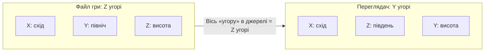

# Осі, одиниці й час

Ігри та мапи не погоджуються в тому, де «вгорі», яка довжина в юніта або як записується час. Ця сторінка показує три налаштування, які роблять так, щоб ваші дані стояли, мали правильний масштаб і відтворювалися правильно.

Якщо ваша мапа стоїть як стіна, а не лежить як підлога, перемкніть **Вісь «угору» в джерелі**.

За неправильної **Осі «угору» в джерелі** мапа стоїть як стіна; за правильної вона лежить як підлога.

## Світ, у якому малює переглядач {#the-world-the-viewer-draws-in}

Світ переглядача - **Y угорі**: X і Z - це площина землі, Y - висота. Більшість ігрових рушіїв - **Z угорі**: для них X і Y - це земля, а Z - висота. Деякі рушії також дзеркальні (лівосторонні). Відображення каже, як перетворити осі файлу на осі переглядача. (Технічно переглядач правосторонній, як це прийнято в three.js.)

### Вісь «угору» {#up-axis}

**Вісь «угору» в джерелі** у [Відповідності стовпців](column-mapping.md):

| Налаштування | Файл (x, y, z) стає світом (X, Y, Z) |
|---|---|
| *Z угорі (більшість ігрових рушіїв)* - типове | (x, **z**, **y**): Z файлу стає висотою, а Y файлу стає Z світу |
| *Y угорі (прийнято в графіці)* | (x, y, z) без змін |

Для даних з Z угорі три масиви перейменовуються, а не копіюються ([`remapAxesInPlace`](https://github.com/Holdi601/3DHeat/blob/main/src/data/ingest.ts)), що заощаджує сотні мегабайтів на великих завантаженнях. Здогад робиться за зразком: вгору йде той із стовпців Y і Z, у якого менший розкид.

### Віддзеркалення {#flips}

**Віддзеркалити X**, **Віддзеркалити Y**, **Віддзеркалити Z** змінюють знак *осі файлу* з такою назвою, до перейменування - тож за Z угорі *Віддзеркалити Y* змінює знак того, що стає Z світу. Віддзеркалення змінює завантажені дані: координати, які показує [лінійка](measure.md), переріз і положення камери, - це вже віддзеркалені.

Щоб намалювати дзеркальний світ правильно, **не** змінюючи даних, використайте натомість **Камера і сцена → Інвертувати вісь світу** ([Камера](camera.md#invert-world-axis)). Це краще для ігор, чий світ лівосторонній, бо кожна координата, яку показують інструменти, лишається власною координатою гри.

### Масштаб одиниць {#unit-scale}

**Масштаб одиниць** множить кожну позицію. *1 (м)* ставить 1, *0,01 (см→м)* ставить 0,01 (одиниці Unreal Engine - це сантиметри, тож беріть 0,01; одиниці рушія Source - дюйми, тож беріть 0,0254; жодне з них не є метрами), а поле приймає будь-яке значення. Введений 0 або значення, яке не є числом, замінюється на 1.

Переглядач підписує відстані в метрах (радіус спрайта, межі відсікання, лінійка, швидкість польоту), і це правда лише тоді, коли масштабована одиниця світу - метр. Нічого не ламається, якщо це не так; просто підписи читаються «м» для будь-якої одиниці.

## Час {#time}

### Одиниці часу {#time-units}

Практичне правило: значення на кшталт 17000000000 (десять і більше цифр) - це мітка часу Unix; значення на кшталт 0, 0,25, 0,5 - це секунди від початку.

| Одиниця часу (підпис у меню) | Читається як | Показується годинник |
|---|---|---|
| *Секунди (відносні)* | значення × 1 с | ні |
| *Мілісекунди (відносні)* | значення × 0,001 с | ні |
| *Мікросекунди (відносні)* | значення × 10^-6 с | ні |
| *Наносекунди (відносні)* | значення × 10^-9 с | ні |
| *Мітка часу Unix (с)* | секунди від 1970-01-01 UTC | так |
| *Мітка часу Unix (мс)* | мілісекунди від 1970-01-01 UTC | так |
| *Рядок дати ISO-8601* | текст на кшталт `2026-03-14T18:02:11.250Z`, розбирається `Date.parse` браузера | так |

З абсолютною одиницею (останні три) набір даних зберігає момент настінного годинника найранішого рядка, а часова шкала показує поточний час доби за UTC (`HH:MM:SSZ`) поруч із позицією відтворення.

**Колонки `TIMESTAMP` і `DATE` у Parquet** розкодовуються в справжні моменти, тож їхнє налаштування одиниці ігнорується, і панель про це повідомляє. Колонка `DATE` - це ціла доба: кожен рядок доби має той самий момент, і відтворення стрибає по одній добі, про що панель попереджає.

**Рядки ISO-8601 працюють однаково в CSV і Parquet.** Текстова колонка часу з одиницею ISO розбирається один раз для кожного окремого рядка; якщо жоден не розбирається, завантаження падає з повідомленням *No parseable ISO-8601 timestamps in the mapped time column.* - а відображення вже відмовляється стартувати, коли жодне зі зразкових значень не розбирається. Колонка `TIMESTAMP` у Parquet читається як мітка часу за будь-якої встановленої одиниці, а числова колонка Parquet з одиницею ISO читається як мілісекунди Unix. Текстова колонка часу з числовою одиницею відхиляється до завантаження: кожне значення читалося б як NaN.

### Як зберігається час {#how-time-is-stored}

Поки файли об’єднуються, час зберігається як 64-бітні секунди, тож абсолютна епоха зберігає свої частки секунди. Коли всі файли зібрано, найраніший час усього вибору стає 0, а кожен рядок зберігає 32-бітні секунди від нього. У 32-бітного числа з плаваючою комою 24 біти мантиси: проміжки до приблизно півтори доби відтворюються краще ніж 1/100 с, проміжки в півроку - приблизно з точністю до секунди. Рядок, у якого час відсутній або не є числом, ставиться на 0, на початок.

Рядки потім сортуються за часом, і саме це робить часову шкалу дешевою: часове вікно знаходиться двома бінарними пошуками (див. [Вибірка й бюджети](sampling-and-budgets.md)).

### Минулий час проти настінного годинника {#elapsed-time-versus-wall-clock}

Колонка часу на кшталт `match_time` або `round_time` відлічує від початку кожного матчу. Її вибір ставить кожен матч на одну спільну вісь - добре для порівняння того, що відбувається на 3-й хвилині кожного матчу, - і панель на це вказує. Колонка настінного годинника показує матчі в тому порядку, у якому вони справді відбувалися, із перекриттям там, де вони перекривалися.

## Напрям погляду {#look-direction}

Напрям погляду використовується лише [відтворенням коробок](box-replay.md) (промені від кожної коробки). Він зберігається як два кути, рискання та тангаж, у радіанах.

- **Колонки рискання / тангажу** читаються як є, перетворюються з градусів, коли вибрано *Градуси*. Їх не коригують за віссю «угору» чи віддзеркаленнями.
- **Колонки вектора напрямку** проходять ті самі перейменування й віддзеркалення, що й позиції, а потім стають рисканням = atan2(x, -z) і тангажем = atan2(y, √(x² + z²)) у осях світу, тож промінь вказує туди, куди дивиться коробка, і в дзеркальному світі джерела.

Якщо колонки рискання/тангажу після віддзеркалення, вектора напрямку чи скоригованих кутів показують не в той бік, виправлення - саме в цьому.
