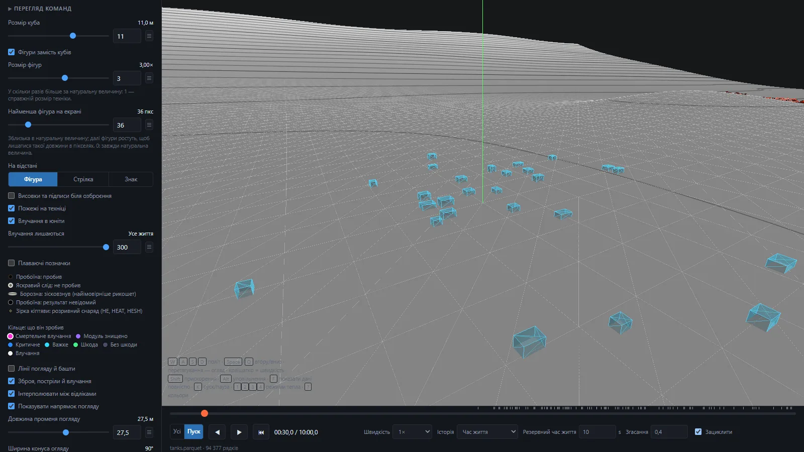

# Накладання фігур (повтор коробками)

Маленький фільм: одна фігура для кожної людини, яка рухається, поки йде час, із слідом позаду.

Режим називається **Накладання фігур** на панелі режимів. Ця сторінка раніше називалася «повтор коробками», бо до появи фігур кожна людина була коробкою; «повтор фігурами» і «повтор коробками» означають одне й те саме. **Накладання фігур** не має числової клавіші: виберіть його на панелі режимів. Воно малює одну фігуру (або коробку) на кожну [людину](glossary.md), яка рухається вздовж [часової шкали](timeline.md), з необов’язковими променями погляду та слідами. Це відтворення, а не щільність: *хто де був і коли*. Потрібна колонка людини; без колонки часу кожен зразок малюється відразу.

## Як користуватися {#how-to-use-it}

1. Завантажте дані з колонкою людини та колонкою часу.
2. Виберіть **Накладання фігур** на панелі режимів.
3. Перемкніть шкалу часу на **Пуск** і натисніть відтворення (`K`).
4. Відкрийте **Перегляд команди**, щоб змінити **Довжину сліду**, розмір фігур або промені погляду.

У цьому режимі теплова карта не малюється, а адаптивний бюджет спрайтів не працює.

За замовчуванням кожна людина малюється як фігура того, ким вона є, а не як коробка - див. [Фігури](figures.md), яку фігуру отримує юніт, і [Розбір матчу](match-replay.md) для підписів, камери стеження, вимірювання між двома юнітами та списку подій.

## Панель Перегляд команди {#the-team-viewer-panel}

Показується замість панелей тепла в цьому режимі.

| Елемент керування | За замовчуванням | Діапазон (повзунок) | Значення |
|---|---|---|---|
| **Фігури замість кубів** | увімк. | | Кожна людина як фігура того, ким вона є: піхотинець пішки, танк або літак, які називають дані. Те, що дані не описують, лишається коробкою. |
| **Розмір фігур** | 1× | | 1× - справжній розмір. |
| **Найменша фігура на екрані** | 36 px | 0 = завжди справжній розмір | Справжній розмір зблизька; далі фігури збільшуються, щоб лишатися такими довгими в стільки пікселів. |
| **Зброя, постріли й влучання** | увімк. | | Зброя в польоті з димом, трасери, удари, влучання й вбивства. Трасери, виведені з влучання, пунктирні. |
| **Розмір куба** | розмір сутності, або розмір / 500, при завантаженні | 0,05-200 м, логарифмічна (5000) | Довжина ребра кожної коробки. Див. [розмір сутності](sessions-persons-groups.md#entity-size). |
| **Інтерполювати між відліками** | увімк. | | Між двома відліками однієї людини в одній сесії ставити коробку пропорційно між ними. Ніколи через межу сесії. |
| **Показувати напрямок погляду** | увімк. | | Промінь від кожної коробки за напрямком погляду людини (потрібні [колонки погляду](axes-units-and-time.md#look-direction)). |
| **Довжина променя погляду** | розмір сутності × 4, або розмір / 200, при завантаженні | 0,5-500 м, логарифмічна (20 000) | Показується, коли напрямок погляду увімкнено. |
| **Довжина сліду** | 8 с | 0-300 с (86 400); 0 = вимкнено | Секунди історії, намальовані позаду кожної людини. |
| **Малювати кожен вихідний відлік** | вимк. | | Коробка на кожен збережений відлік у вікні, а не одна інтерпольована коробка на людину. Береться підвибірка, щоб лишатися інтерактивним. |

Підказки в панелі пояснюють, що інтерполяція і сліди з’єднують відліки лише в межах однієї сесії, а коли завантаження має [спільні імена](sessions-persons-groups.md#names-worn-by-several-things-at-once), скільки імен малюється як окремі відліки.

## Сесія, яку відтворюють {#the-session-being-played}

Коли є колонка сесії, вибирач **Сесія** вгорі бокової панелі ([Сесії](sessions-persons-groups.md#the-session-picker)) визначає, який матч відтворюється. Під час завантаження обирається найзайнятіша. Коробками й слідами стають лише рядки цієї сесії, а шкала часу проходить по проміжку цієї сесії, а не всього набору даних. *Усі сесії* відтворює всі сесії одночасно, але й тоді відліки між сесіями ніколи не з’єднуються.

## Що і коли малюється {#what-is-drawn-when}

З [`TrackCursor`](https://github.com/Holdi601/3DHeat/blob/main/src/data/tracks.ts):

**Живі коробки** (режим Пуск, вихідні відліки вимкнено). Для кожної видимої людини - її останній відлік на позиції відтворення або раніше:

- Якщо в людини є наступний відлік, він у тій самій сесії, а ім’я не спільне, коробка ставиться між двома відліками пропорційно часу, з рисканням, інтерпольованим коротшим шляхом по колу, і тангажем лінійно (коли *Інтерполювати* увімкнено).
- Інакше коробка лишається на останньому відліку протягом **Резервного часу життя** шкали часу (за замовчуванням 10 с), а потім прибирається, щоб вибулі гравці не затримувалися.

**Режим Усі** ігнорує позицію відтворення і малює кожен відлік у діапазоні як коробку.

**Вихідні відліки** малюють коробку на кожен збережений відлік у вікні: *Проміжок* з історією *Вікно*, інакше все до позиції відтворення. Не більше 65 536 коробок; якщо відліків більше, береться кожен *k*-й.

**Сліди** (коли довжина сліду більша за 0, а вихідні відліки не малюються): лінія між кожною парою послідовних відліків однієї людини за останні *довжину сліду* секунд до позиції відтворення, яка з віком згасає від 80% непрозорості до прозорості. Слід зупиняється на зміні сесії і не малюється для спільних імен. Не більше 131 072 вершин; якщо більше, рядки пропускаються рівномірно.

**Хто видимий:** людину приховано, якщо її група вимкнена в [Списку команд](teams-list.md) (її група - це група її першого рядка), якщо фільтр групи її виключає або якщо панель [Сутностей](entities.md) має вибір, що її не включає. [Фільтри](filters.md) колонок на коробки не діють.

## Кольори {#colours}

Одна родина відтінків на групу і один відтінок на учасника, тож погляд одразу показує, на якому боці людина ([`teamMemberColor`](https://github.com/Holdi601/3DHeat/blob/main/src/render/colors.ts)). Відтінки груп циклічно беруться з фіксованого списку з десяти - синій, червоний, зелений, бурштиновий, фіолетовий, блакитний, пурпуровий, лаймовий, помаранчевий, індиго - а учасники групи розподілені за світлотою 42-76% і насиченістю 90-65%.

## Примітки {#notes}

- Накладання фігур перебудовує свої фігури, лише коли щось змінюється; кадр у спокої перемальовує попередні.
- Рядок *Коробки* в [накладанні статистики](performance-and-stats.md) рахує коробки на екрані.
- Накладання фігур малює в тій самій сцені, що й рівень, тож [глибина різкості](camera.md#depth-of-field) розмиває коробки, але ніколи тепло.
