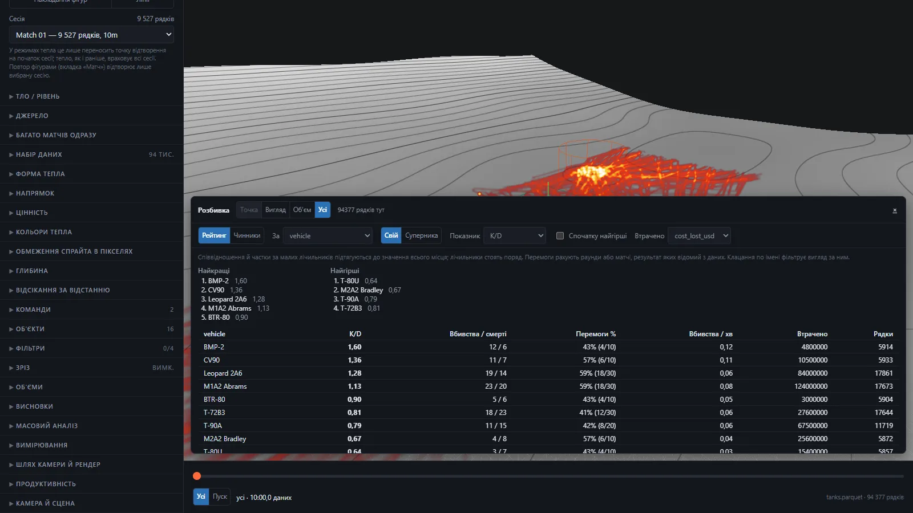
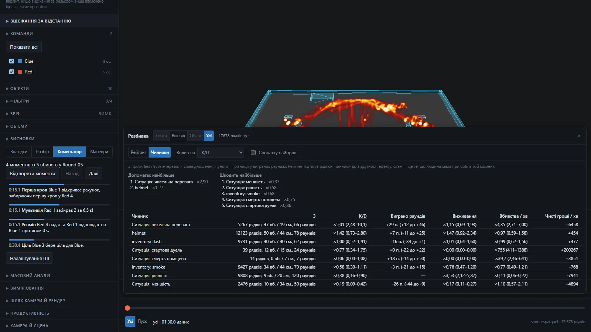

# Розбивка: хто й що найкраще робить де

**Розбивка** відповідає на одне питання: у цьому місці яка техніка, гравець чи зброя найкраще справляється? Використовуйте її, щоб знайти танк, який перемагає біля мосту, або перевірити, чи справді шолом допомагає.

Вона ранжує те, що відбувається в одному місці (обраній точці, виді, об’ємі або всьому показаному) за будь-якою категорією, і вимірює кожен фактор стану з і без нього.

## Спробуйте {#try-it}

1. Завантажте матч із вбивствами та смертями і відкрийте **Об’єми**.
2. Намалюйте об’єм навколо місця, яке вас цікавить, і виберіть його.
3. Натисніть **Розбивка…** у розділі Статистика.
4. У **За** виберіть *Техніка*, а міру - *K/D* (вбивства на смерть).
5. Прочитайте список, найкращі зверху. Натисніть **Спочатку найгірші**, щоб перевернути. Клацніть на назву, щоб відфільтрувати вигляд до неї; клацніть ще раз, щоб відпустити.

## Відкрити {#open-it}

| Звідки | Область, з якої вона починається |
| --- | --- |
| **Розбивка…** у [Об’єми](volumes.md) (Статистика) | вибраний об’єм |
| **Розбивка тут** на картці вибору, після клацання на точці | сфера навколо цієї точки (**Радіус**, за замовчуванням 3% розміру даних) |
| панель розділення **Різниця** | вигляд |

Заголовок перемикає область: **Точка**, **Вигляд** (що бачила камера під час останнього підрахунку; **Перерахувати** після переміщення), **Об’єм** (вибрати один) або **Усі**. Підрахунок іде у фоні; рядок стану показує, скільки рядків в області.

## Ранжування {#ranking}

Виберіть, за чим ранжувати, і міру:

| Міра | Що це |
| --- | --- |
| A, B | рядки з кожного боку карти різниці, розділені так, як їх ділить тепло |
| A / B, A - B, A / (A + B) | два шари один проти одного |
| K/D | вбивства проти смертей |
| Перемоги, % | перемоги в раундах (або матчах), де дані вказують, хто переміг |
| Вбивства / хв | вбивства за хвилину присутності (проміжки між зразками руху) |
| Зароблено, Втрачено, Чистий дохід | суми стовпців `earn_*` і `cost_*`; вибирач обирає валюту |

Вбивства, смерті, присутність, перемоги й гроші рахують кожен рядок, який вигляд показує в цьому місці, з будь-якого боку розділення або без боку.

Співвідношення й частки притягуються до значення всього місця там, де кількості малі, тож 2 вбивства за 1 життя не піднімають до верху списку. Кількості показано поруч.

Можна ранжувати групи, гравців і матчі, будь-який стовпець категорії (техніку, зброю, сторону, тип закупівлі, агента чи набір), будь-який числовий стовпець у діапазонах (броня, вартість спорядження), **клас** стовпця зброї (гвинтівка, снайперська, пістолет-кулемет, пістолет...) і скільки предметів **засобів** містить стовпець-список на кшталт `inventory`.

**Свій** ранжує за власним значенням рядка. **Суперника** ранжує за значенням іншої сторони: зброєю жертви при вбивстві, зброєю вбивці при смерті (потрібен стовпець `other` / `victim`, який їх називає).

## Стан на той момент {#state-at-the-time}

Значення рядка - це його власне, якщо рядок не веде журналу (рядок події без спорядження) або якщо це смерть (стовпець зброї якої може називати зброю вбивці); тоді це те, що та сама людина несла востаннє раніше в матчі.

## Фактори: з і без {#factors-with-against-without}

Перейдіть з **Рейтингу** на **Фактори**, виберіть **Вплив на** і прочитайте *Найбільше допомагає* та *Найбільше шкодить*:

Вплив кожного фактора на K/D, перемоги в раундах, виживання (хвилин на смерть), вбивства за хвилину й чистий дохід за хвилину - з 95% інтервалом: співвідношення як x, перемоги в раундах як різниця в очках. Рейтинг притягує кожну оцінку до відсутності впливу відповідно до її власної невизначеності, тож рідкісний фактор, щоб піднятися високо, потребує чіткого ефекту; показаний інтервал - це непритягнутий.

Дані з раундами додають до ситуацій у ближньому бою ([Ближній бій і раунди](close-quarters.md)), які обчислюються один раз для набору даних: *осліплений* (`state_flashed` рядка або ворожа спалахана в межах 15 м за останні 3 с), *смерть відплачена*, *відкриваючий дует*, а також *переважаємо*, *рівна кількість* або *переважають* (гравці живі з боку рядка проти ворога). Смерть зараховується до ситуації, в якій була її жертва безпосередньо перед нею.

В одному проході вимірюється не більше 256 факторів.

## Для розробників {#for-developers}

### Притягування малих вибірок {#pulling-small-samples}

Значення ранжування: `(n + m*r0) / (d + m)`, де `n` і `d` - кількості, `r0` - співвідношення для всього місця, а `m` - вага цього апріорного значення.

### Для авторів конвертерів: назви стовпців факторів {#for-converter-authors-naming-factor-columns}

Конвертер додає фактор, називаючи його стовпець:

| Стовпець | Фактор |
| --- | --- |
| число `state_<назва>` | увімкнено, поки не нуль (`state_scoped`, `state_suppressor`) |
| категорія `state_<назва>` | один фактор на значення (`state_ammo` = AP, HE...) |
| `active_<назва>` | те саме для того, що увімкнено або щойно використано: здібність, ультимейт, гаджет, бафф (`active_ult`, `active_stim`) |
| стовпець-список (`inventory`, `loadout`, `perks`, `abilities`, `attachments`, `modules`, `buffs`, `debuffs`, `upgrades`, або назва `state_`/`active_`, що закінчується на `s`) | один фактор на кожен предмет значення `a\|b\|c` |
| уже поширені прапорці спорядження (`helmet`, `defuser`, `armor`, `scoped`, `airborne`, `duck`, `flashed`...) | увімкнено, поки не нуль |
| `ammoType`, `shellType`, `ammoName` | останній випущений снаряд |

Результати: стовпець `won` з 0/1 (сторона рядка перемогла в раунді або матчі) і стовпець `round` - [стовпці результату](data-formats.md#outcome-columns); якщо файл має і `won`, і `matchWon`, *Перемоги %* рахує раунди. Гроші: `earn_<валюта>` і `cost_<вид>_<валюта>`; дохід лише за видом (`earn_round_cs2`, точні винагороди за раунд від конвертера) замінює лише дохідну частину моделі вартості цього виду (`round` також охоплює закладання й розмінування), а модель далі оцінює решту.

Відображення само завантажує ці стовпці поруч зі списком файлу: кожен `state_*`, `active_*`, `won`, `round` і стовпець-список, крім тих, які статистика файлу Parquet показує як такі, що тримають одне значення весь час (кожен завантажений стовпець - 4 байти на рядок).
