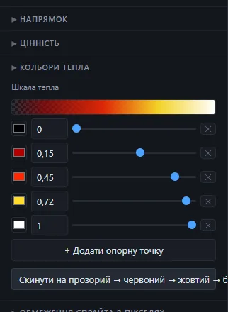

# Колір і експозиція

Ці елементи керування визначають, яка кількість тепла отримує який колір. **Точка насичення** - це кількість тепла, яка вважається розжареною до білого.

## Швидкі виправлення {#quick-fixes}

- Усе біле: підніміть **Точку насичення** або натисніть **Автоекспозиція за полем**.
- Нічого не видно: опустіть **Точку насичення** або натисніть **Автоекспозиція за полем**.
- Видно лише кілька окремих точок: збільште **Мінімальне тепло**.

Кожен елемент керування на цій сторінці діє тоді, коли тепло перетворюється на колір, тому перетягування будь-якого з них одразу перемальовує картинку і **ніколи не перезапускає накопичення**.

## Точка насичення {#saturation-point}

**Точка насичення** (розділ «Форма тепла»): накопичене тепло, яке відповідає верхньому краю шкали кольорів (для відгуку *Лінійна*; про інші див. нижче). Логарифмічний повзунок від 0,1 до 4000, маркер можна перетягнути до 10 000 000, бо накопичене тепло зростає разом із кількістю рядків. За замовчуванням 24; під час кожного завантаження спершу **аналітична оцінка**, потім **виміряна** за зображенням.

Помилка тут - це різниця між тепловою картою та порожнім (або білим) екраном, і її не можна надійно вивести з даних: телеметрія так сильно збивається в купи - поява, двері, вузьке місце, - що відношення піку до середньої щільності відрізняється на порядок між наборами даних і між кутами камери.

## Автоекспозиція {#auto-exposure}

**Автоекспозиція за полем** вимірює поле, яке шейдер справді створив. Вона ігнорує порожні пікселі, бере 98-й перцентиль освітлених пікселів і ставить його на 85% шляху до точки насичення, тож верх шкали лишається для справжніх піків.

Потім панель показує *виміряно X% кадру; 98-й перцентиль R розміщено близько до верху шкали*. За відгуку *З насиченням* значення на 85% точки насичення потрапляє приблизно на 69% шкали, а не на 85%.

Вона також працює **автоматично**:

- через 8 відрендерених кадрів після завантаження набору даних;
- через 8 кадрів після зміни [фільтрів](filters.md) (фільтрація кожної позиції до сотні подій змінює щільність на порядки);
- через 8 кадрів після перемикання між точковим теплом і [лінійним теплом](line-heat.md) або після зміни маршрутів, які малює лінійне тепло, бо лінія залишає значно менше тепла на один зразок, ніж спрайт.

Коли нічого не освітлено, автоматичний прохід залишає насичення як є; кнопка повертається до аналітичної оцінки й повідомляє *нічого освітленого для вимірювання - використано аналітичну оцінку*.

### Стежити за видом {#follow-the-view}

**Стежити за видом** (розділ «Форма тепла», за замовчуванням увімкнено) міряє знову щоразу, коли камера зупиняється, тож ділянка, у яку ви летите, використовує весь діапазон шкали, а не масштаб, виміряний для всієї карти. Малі зміни ігноруються, і шкала плавно змінюється, а не стрибає. Працює в чотирьох режимах тепла, не в накладанні фігур.

Вимкніть, щоб зафіксувати шкалу й порівнювати місця на одній шкалі. Перетягування **Точки насичення** вручну теж її фіксує.

## Відгук на щільність {#density-response}

**Відгук на щільність** - як *k* (тепло / насичення) відображається на шкалу:

| Відгук | Формула | Застосування |
|---|---|---|
| **З насиченням** (за замовчуванням) | t = 1 - e^(-k) | Асимптотично наближається до верху шкали, як складені напівпрозорі спрайти. Нічого не обрізається до суцільного білого, тому це безпечне типове значення для незнайомих даних. |
| **Лінійна** | t = k | Єдине відображення, де однаковий колір означає однакову кількість. Використовуйте його, щоб порівняти два набори даних або два часові проміжки. |
| **Логарифмічний** | t = log₂(1 + 7k) / 3 | Стискає довгий хвіст, тож один надзвичайний гарячий осередок перестає притискати все інше до низу шкали. Підіймає розріджені ділянки. |

## Мінімальне тепло {#minimum-heat}

**Мінімальне тепло** (за замовчуванням вимкнено, від 0% до 100%): кожен піксель, що має хоч якесь тепло, піднімається щонайменше до цієї позначки шкали. Збільшіть його, а радіус спрайта зменште, щоб побачити, *де щось взагалі відбувалося* - одиничні точки даних стають чітко видимими, а не ледве вищими за прозорий фон. Залишайте його вимкненим, коли оцінюєте щільність, бо воно навмисно вирівнює низ шкали. Поріг (k > 0,0001) лишає справді порожні пікселі порожніми.

## Редактор шкали {#the-ramp-editor}

У розділі **Кольори тепла**. Його напис каже, для чого шкала: *Шкала тепла* у режимах «Тепло» та «Лінії», *Додатна (команди, що додають)* у «Різниці», *Шкала непрозорості (колір задає група)* у [Тепло команд](team-heat.md), де використовується лише її альфа-канал.



Смуга вгорі показує попередній перегляд шкали. Нижче - по одному рядку на опорну точку:

| Частина | Значення |
|---|---|
| Кольоровий зразок | Колір опорної точки (палітра кольорів браузера). |
| Число | Положення опорної точки на шкалі, від 0 до 1 (0 = немає тепла). |
| Повзунок | Непрозорість опорної точки, від 0% до 100%. |
| ✕ | Видаляє опорну точку; вимкнено, коли лишилися лише дві. |

**+ Додати опорну точку** додає опорну точку посередині між двома останніми, з кольором і непрозорістю останньої. **Скинути на прозорий → червоний → жовтий → білий** відновлює типове значення.

Опорні точки можна задавати в будь-якому порядку; їх сортують під час побудови шкали. **Альфа** - це те, що змішує тепло зі сценою, тому нульовий кінець типової шкали повністю прозорий.

### Типові шкали {#the-default-ramps}

| Положення | Додатна (Тепло, Лінії, Різниця +) | Від’ємна (Різниця −) |
|---|---|---|
| 0,00 | чорний, альфа 0 | чорний, альфа 0 |
| 0,15 | rgb(180, 0, 0), альфа 0,55 | rgb(0, 170, 60), альфа 0,55 |
| 0,45 | rgb(255, 40, 0), альфа 0,85 | rgb(0, 190, 200), альфа 0,85 |
| 0,72 | rgb(255, 220, 40), альфа 0,95 | rgb(40, 80, 255), альфа 0,95 |
| 1,00 | білий, альфа 1 | rgb(170, 60, 255), альфа 1 |

## Поки камера рухається {#while-the-camera-moves}

Коли камера рухається, накопичення перезапускається щокадру. Якщо **Малювати всі рядки щокадру** увімкнено (за замовчуванням), кожен рухомий кадр усе одно точний; якщо вимкнено, рухомий кадр показує одну вибіркову оцінку - яскравіші, зважені за вагою грудки, - які сходяться до гладкішої справжньої картинки, коли ви зупиняєтеся. Це очікувано; див. [Накопичення](accumulation.md).

## Для розробників {#for-developers}

### Прохід композиції {#the-composite-pass}

Після накопичення тепла значення кожного пікселя перетворюється на колір в одному проході композиції ([`COMPOSITE_FS`](https://github.com/Holdi601/3DHeat/blob/main/src/render/webgl2/shaders.ts)). Кроки такі:

```
k = |heat| / saturation point
t = response(k)                         clamped to 0..1
if minimum heat > 0 and k > 0.0001:  t = minimum + (1 - minimum) × t
colour, alpha = ramp(t)                  (the negative ramp when heat < 0, Difference only)
pixel = mix(scene, colour, alpha)
```

### Аналітична оцінка {#the-analytic-estimate}

**Аналітична оцінка** ([`estimateSaturation`](https://github.com/Holdi601/3DHeat/blob/main/src/data/calibrate.ts)) припускає, що рядки розподілені по площі X-Z даних: середнє тепло = рядки × (π r² / площа основи) × 1/3 × інтенсивність у центрі (1/3 - це середнє по диску лінійного спаду), помножене на припущене відношення піку до середнього, яке дорівнює 25, і обмежене діапазоном 0,1-1 000 000. Їй достатньо бути правильною з точністю до порядку.

### Вимірювання {#metering}

[`exposure.ts`](https://github.com/Holdi601/3DHeat/blob/main/src/render/exposure.ts):

1. ціль тепла зчитується з GPU назад, із підвибіркою не більше 40 000 значень;
2. порожні пікселі (тепло ≤ 0,0001) відкидаються - більшість теплового поля порожня, і їх усереднення занизило б експозицію всього, як експонометр камери, спрямований на чорний фон;
3. 98-й перцентиль освітлених пікселів є еталоном;
4. точка насичення стає еталон / 0,85, тож еталон лежить на 85% шляху до точки насичення, а верх шкали лишається для справжніх піків.

### Таблиця кольорів {#the-colour-table}

Шкала запікається в таблицю RGBA 256 × 2 (додатна шкала в першому рядку, від’ємна - у другому) ([`buildColorLut`](https://github.com/Holdi601/3DHeat/blob/main/src/render/colors.ts)). Кольори інтерполюються в лінійному світлі й зберігаються як sRGB; непрозорість інтерполюється лінійно.
