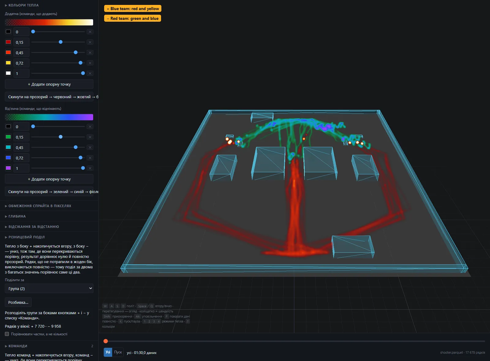

# Різниця

Червоним там, де команда A була більше, зеленим і синім - де більше була команда B, нічого там, де вони були рівні.

**Різниця** (клавіша 2) - тепло зі знаком. Рядки однієї сукупності додають тепло; рядки іншої - віднімають. Там, де обидві рівномірно перекриваються, результат нуль і повністю прозорий; де переважає одна, вона показується кольорами цієї сторони - за замовчуванням теплими (прозорий → червоний → жовтий → білий) для сторони **+** і холодними (прозорий → зелений → синій → фіолетовий) для сторони **−**.

## Як користуватися {#how-to-use-it}

1. Натисніть `2` (або виберіть **Різниця** на панелі режимів).
2. Відкрийте **Різницевий поділ** на бічній панелі.
3. Оберіть, **Поділити за**: зазвичай *Група*.
4. Поставте одну групу (або значення) на **+**, а іншу - на **−**.
5. Читайте кольори: теплий означає сторону +, холодний - сторону −. Панель попереджає, якщо в однієї сторони немає рядків (див. [Повідомлення, які ви можете побачити](#messages-you-may-see)).

*Які саме дві сукупності* - це і є все питання, тож поділ може бути за будь-яким збереженим стовпцем, а не лише за групами. Рядки, що потрапляють **ні на одну** сторону, **не враховуються**, а не рахуються як нуль: саме це робить поділ за двома з багатьох значень порівнянням лише цих двох, і він поєднується з [фільтрами](filters.md) - відфільтруйте до однієї карти, а потім поділіть її за збіркою.

Режим потребує дві сторони: стовпець групи з принаймні двома групами або поділ за стовпцем, збереженим для фільтрів. На даних з меншим ніж двома групами завантаження починається з поділу за стовпцем - спочатку стовпець *Source file* при завантаженні кількох файлів, інакше перший категоріальний стовпець із двома значеннями, інакше перший числовий стовпець з розмахом - тож *порівняти два завантаження* працює і без жодної групи. Лише дані без обох варіантів роблять режим недоступним; так само з поділом стовпця, де з одного боку нічого немає.

## Панель Різницевий поділ {#the-difference-split-panel}

Показана в режимі Різниця, під панелями тепла.

**Поділити за** пропонує:

| Варіант | Як показано | Правило поділу |
|---|---|---|
| Групи | *Група (N)* (коли є стовпець групи) | Кожна група на +, − або ні на одну, задається в [Список команд](teams-list.md) |
| Категоріальний стовпець | *стовпець (N значень)* | Значення на +, − або ні на одну |
| Числовий стовпець | *стовпець (числовий)* | Діапазон значень для кожної сторони |
| Файл походження | *Source file* — порівняти два завантаження (коли завантажено кілька файлів) | Файли на +, − або ні на одну |

Пропонуються лише стовпці, які під час завантаження позначені *Зберегти для фільтрування*.

### Порівнювати частки, а не кількості {#compare-shares-not-counts}

**Порівнювати частки, а не кількості** (типово вимкнено) зважує кожну сторону на одиницю, поділену на її власну кількість рядків, тож сторона з удвічі більшою кількістю рядків не виграє лише числом. Колір тоді показує, де кожна сторона пропорційно частіша за іншу. Використовуйте це, коли в двох сторін дуже різний обсяг даних, наприклад дві сесії різної тривалості.

### Повідомлення, які ви можете побачити {#messages-you-may-see}

Панель попереджає, коли картинка не є справжньою різницею:

| Повідомлення | Значення |
|---|---|
| *N + / M −* (або *N + / M − / K unused*) | Скільки значень на кожній стороні (і на жодній). |
| Жоден рядок у вікні не на стороні **+** | Малюється лише сторона **−**. Перемістіть вікно часової шкали або змініть поділ. |
| Жоден рядок у вікні не на стороні **−** | Малюється лише сторона **+**. |
| Жодне значення не на жодній стороні | Різниця нічого не малює. Поставте принаймні одне значення на **+** або **−**. |
| *стовпець* не можна поділити так | Вибраний стовпець не підходить для поділу. Виберіть стовпець знову. |
| Стовпець поділу не вмістився в пам’ять GPU для N з M частин | Ці рядки не малюються. Збільште бюджет GPU у Продуктивність → Бюджети ресурсів або завантажте менше рядків. |

### За групами {#by-group}

Панель лише вказує на [Список команд](teams-list.md), де в кожної групи є кнопки **+** і **−**. При кожному завантаженні перша половина груп (округлено вгору) ставиться на +, решта - на −; **Поділити порівну** у Списку команд робить те саме знову. Група на жодній стороні або прихована своїм прапорцем нічого не додає.

### За значеннями категорії {#by-category-values}

| Частина | Значення |
|---|---|
| `a + / b − / c unused` | Скільки значень на кожній стороні і на жодній. |
| **Очистити** | Ставить кожне значення на жодну сторону. |
| Список значень | Кожне значення з кнопками **+** і **−** (щоб зняти значення зі сторони, натисніть активну кнопку ще раз). Порожнє значення позначено як *(відсутнє)*. |
| Примітка про ліміт | *Показано перші 200 із N значень. Такий широкий стовпець краще спершу звузити фільтром або поділити за діапазоном, якщо його значення впорядковані.* |

Вибір стовпця ставить його перше значення на + і друге на −. Коли на жодній стороні немає значень, поділ повертається до груп, замість того щоб показувати порожній кадр. *Source file* працює так само, з одним значенням на файл - так порівнюють два експорти, два тестові прогони або дві збірки.

### За діапазоном {#by-range}

| Частина | Значення |
|---|---|
| Підказка | Мінімум і максимум стовпця. |
| **Додатний діапазон (+)**, **від** / **до** | Рядки зі значенням у цьому діапазоні додають, обидві межі включно. |
| **Від’ємний діапазон (−)**, **від** / **до** | Рядки в цьому діапазоні віднімають. |
| **Поділити посередині** | Ставить + на [мінімум, середина] і − на [середина, максимум] - так само, як вибір стовпця. |

Значення в обох діапазонах рахується як +. Діапазони не мусять покривати стовпець; значення поза обома лишаються без розгляду. *Перші дві хвилини проти останніх двох* - це поділ за діапазоном стовпця, схожого на час.

## Кольори {#colours}

Розділ **Кольори тепла** в цьому режимі показує два редактори шкал: **Додатна (команди, що додають)** і **Від’ємна (команди, що віднімають)**, кожен зі своєю кнопкою скидання (*Скинути на прозорий → червоний → жовтий → білий*, *Скинути на прозорий → зелений → синій → фіолетовий*). Композит бере абсолютне значення чистого тепла через [точку насичення і відгук](colour-and-exposure.md) і обирає від’ємну шкалу там, де чисте значення менше за нуль. Див. [Колір і експозиція](colour-and-exposure.md#the-ramp-editor).

Використовуйте відгук *Лінійний*, коли важливий розмір різниці: це єдиний відгук, де однаковий колір означає однакову кількість.

## Як це працює {#how-it-works}

Кожен рядок отримує знак +1, -1 або 0 у вершинному шейдері ([`POINT_HEAT_VS`](https://github.com/Holdi601/3DHeat/blob/main/src/render/webgl2/shaders.ts)); 0 відкидає рядок до малювання будь-якого фрагмента.

- За групами знак береться з таблиці груп на 4 096 записів, індексованої ідентифікатором групи рядка (ідентифікатор групи їде в четвертому каналі текселя позиції рядка).
- За категорією знак береться з другої таблиці на 4 096 записів, заповненої для кожного значення категорії, а значення рядка читається з текстури фільтра стовпця; значення за межами таблиці відкидається на обох бекендах.
- За діапазоном значення рядка порівнюється з двома діапазонами.

Зміна поділу перезапускає накопичення.

**Приховані групи лишаються прихованими за будь-якого поділу.** За поділу за стовпцем таблиця груп уже не несе знаків; вона містить 1 для видимої групи і 0 для прихованої ([`frameSignTables`](https://github.com/Holdi601/3DHeat/blob/main/src/render/filterTables.ts)), і обидві таблиці разом надходять до шейдера - два рядки однієї текстури знаків у WebGL2, дві половини одного буфера сховища у WebGPU. Рядок малюється лише тоді, коли його група видима *і* значення його стовпця на якійсь стороні. Тож група, знята з прапорця в [Списку команд](teams-list.md) або залишена поза фокусом сторони на вкладці Матч, не додає нічого, як би не поділялася різниця.
