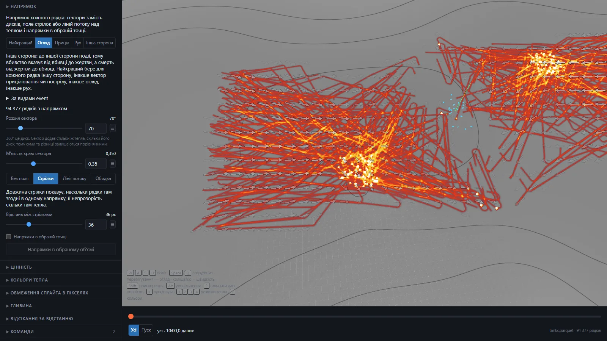

# Спрямоване тепло

Звичайне тепло показує, **де** щось відбувається. Спрямоване тепло також показує **куди**: куди дивилися люди, куди цілилися, рухалися, або де була інша сторона бою.

Звичайний спрайт - це повний диск (360 градусів). З **Розхилом сектора** 70 градусів той самий спрайт стає вузьким клином, який вказує, куди був повернутий рядок, і додає ту саму загальну кількість тепла.

## Як користуватися {#how-to-use-it}

1. Завантажте дані, у яких є напрямок (див. [Що дає рядку напрямок](#what-gives-a-row-a-direction)).
2. Виберіть **Тепло**, **Різницю** або **Тепло команд** на панелі режимів.
3. Відкрийте розділ **Напрямок** на боковій панелі.
4. Виберіть **джерело** (який напрямок брати), потім увімкніть малювання:
   - зменште **Розхил сектора** нижче 360°, щоб малювати кожен рядок клином, що вказує його напрямок, а не диском;
   - виберіть **Поле**, щоб намалювати стрілки або лінії потоку поверх тепла;
   - позначте **Напрямки в обраній точці** і клацніть на тепло, щоб отримати полярну діаграму цієї точки.

Рядок стану показує, скільки рядків мають напрямок із обраного джерела.

## Налаштування {#settings}

| Налаштування | За замовчуванням | Що робить |
|---|---|---|
| Джерело: **Найкращі**, **Вигляд**, **Приціл**, **Рух**, **Інша сторона** | Найкращі | Який напрямок отримує кожен рядок. *Найкращі* бере для кожного рядка іншу сторону, інакше приціл, інакше вигляд, інакше рух. |
| **За видом події** | як вище | Окреме джерело для кожного виду події, наприклад *Інша сторона* для вбивств і *Вигляд* для позицій. Показується, коли в даних є колонка подій з не більш ніж 40 значеннями. |
| **Розхил сектора** | 360° | 360° - звичайний диск (вимкнено). Менше - вужчий клин. Клин додає стільки ж тепла, скільки його диск, тож суми й різниці лишаються порівнянними. |
| **М’якість краю сектора** | 0,35 | 0 - клин з різким краєм, 1 - м’який віяло. |
| **Поле**: Без поля, Стрілки, Лінії потоку, Обидва | Без поля | Стрілки: довжина стрілки - це наскільки рядки там згодні в одному напрямку, її непрозорість - скільки там тепла. Стрілки показуються лише там, де є тепло. |
| **Відстань між стрілками** | 28 px | Відстань між стрілками на екрані. |
| **Анімувати лінії потоку** | увімк. | Лінії потоку рухаються, поки ввімкнено. |
| **Напрямки в обраній точці** | вимк. | Клацніть на тепло, щоб побачити напрямки там (нижче). |
| **Напрямки в обраному об’ємі** | | Та сама діаграма для всього всередині вибраного [об’єму](volumes.md). |

## Полярна діаграма в точці {#the-polar-chart-at-a-spot}

Коли **Напрямки в обраній точці** увімкнено, клацніть на тепло. Рядки поблизу цієї точки (у межах 1,5 радіуса спрайта) збираються в розу з 24 секторів по 15°:

- **помаранчеві** пелюстки: вихідні напрямки (куди вказують рядки);
- **сині** пелюстки: вхідні напрямки (звідки вони прийшли);
- **площа** пелюстки зростає з її кількістю; стрілка показує основний напрямок;
- рядки під діаграмою дають головний пеленг, наскільки рядки згодні (R, від 0 до 1), розкид у градусах і кількість рядків.

0° угорі діаграми - це світовий −Z (північ для записів Tacview). Точка також позначається у тривимірному виді стрілкою і кільцем.

## Що дає рядку напрямок {#what-gives-a-row-a-direction}

| Джерело | Потрібно в даних |
|---|---|
| Вигляд | стовпець рискання (відображений як напрямок погляду): `yaw`, `heading`, `azimuth`, `view_yaw`, `rot_z` |
| Приціл | пари чисел, як-от `aim_x`/`aim_y`, `shot_x`/`shot_y`, `fire_x`/`fire_y`, `hit_dir_x`/`hit_dir_y` (необов’язковий `…_z`) |
| Рух | нічого додаткового: крок від попереднього зразка тієї самої людини (не більш ніж за 10 с раніше, та сама сесія) |
| Інша сторона | стовпець, що називає іншу сторону події (`other`, `victim`, `target`, `killer`, `attacker`, `shooter`, `other_player` ...), значення якого - імена людей; вбивство вказує від вбивці до жертви, смерть - від жертви до вбивці |

## Поради {#tips}

- Клинам потрібен певний розмір на екрані; менші за кілька пікселів, вони знову малюються як диски.
- Використовуйте *Інша сторона* для рядків вбивств, щоб побачити, **звідки** вигравалися бої, а *Вигляд* для рядків позицій - щоб побачити, **де люди дивляться**.
- З **Різницею** клини двох сторін вказують у власних напрямках, тож спірні лінії вогню виділяються.
