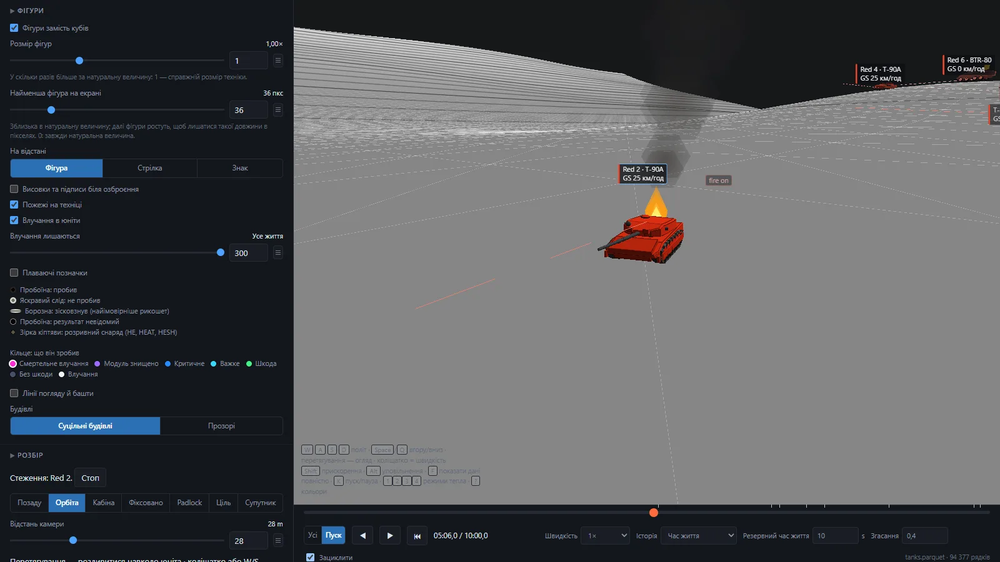

# Фігури

**Фігура** — це невелика тривимірна модель того, чим є юніт насправді: танк, реактивний літак, корабель, солдат. [Повтор](match-replay.md) малює кожен юніт як його фігуру в справжньому розмірі, а не як звичайний куб.

Є близько 2 000 іменованих машин, літаків, кораблів, озброєння та солдатів, і все це створив сам переглядач.

## Що є в каталозі {#what-is-in-the-catalogue}

| Категорія | Приклади |
|---|---|
| Люди | солдат стоїть, присів, лежить; снайпер, протитанковий, санітар, екіпаж |
| Наземні | танки, бойові машини піхоти, засоби ППО, артилерія, вантажівки і легкові авто, потяги і трамваї |
| Повітряні | винищувачі, штурмовики, бомбардувальники, транспортні, гелікоптери: від біпланів до сучасних реактивних літаків |
| Морські | бойові кораблі за класами, авіаносці, підводні човни, катери, торгові судна |
| Озброєння | керовані ракети, реактивні снаряди, бомби, торпеди, теплові пастки та чаф (дипольні відбивачі) |
| Маркери | дим, спалах і вогняні гранати, закладені бомби, прапори, точки появи, маршрутні точки |

## Як створюються фігури {#how-the-figures-are-made}

- **Побудовано з опублікованих розмірів.** Більшість фігур створює власний будівник фігур переглядача з публічних цифр: довжина, ширина, висота, опорні колеса, башта і гармата, крила та хвіст. Їхню форму потім підлаштовують під публічні фото, креслення та опубліковані розміри. Моделі жодної гри не використовуються.
- **Безкоштовні моделі.** Кілька фігур використовують безкоштовні тривимірні моделі (CC0 або CC BY), де вони правдивіші. Іноді їх поєднують із побудованим корпусом. Авторів робіт CC BY вказано в [Авторстві фігур](figure-credits.md). Роботи CC0 не потребують зазначення і там не перелічені.
- Кожна фігура має повну, грубу і далеку версії (рівні деталізації, LOD), тож можна малювати тисячі разом.

## Яку фігуру отримує юніт {#which-figure-a-unit-gets}

Переглядач дивиться на власні стовпці даних:

1. **Назви**: стовпці *Name*, *Vehicle*, *Unit*, *Unit type*, *Model*, *Aircraft*, *Plane*, *Tank*, *Ship*, *Craft*, *Loadout*, *Kit* або *Figure* порівнюються з каталогом. Порівняння йде точно, через близько 4 000 псевдонімів (ідентифікатори юнітів кількох ігор), за найдовшим відомим початком (`F-16C_50` — це F-16C) або за найкоротшою назвою фігури, яка з нього починається.
2. Назва, фігура якої не пасує до **типу** юніта, не використовується. Вантажівка на ім'я *Typhoon* — це не винищувач.
3. **Типи**: стовпці *Type*, *Class*, *Kind*, *Category*, *Icon*, *Role* або *Domain* дають фігуру класу. Це теги Tacview (`Air+FixedWing`, `Ground+Heavy+Armor+Vehicle+Tank`, `Sea+Watercraft+Warship`, `Weapon+Missile`), значки карти або прості слова (танк, гелікоптер, піхота).
4. Дані без жодного з цих стовпців — це дані про людей: кожен юніт є солдатом.

Найпростіший спосіб отримати правильні фігури: стовпець `vehicle` з реальними назвами або стовпець `type` з тегами Tacview.

**Мій юніт показується як куб або солдат.** Додайте стовпець `vehicle` з реальною назвою або стовпець `type` з тегом Tacview. Наведіть курсор на юніт, щоб побачити, яку назву було зіставлено. Дані, у яких є такі стовпці, але нічого не сказано про юніт, лишають його кубом. Дані без них малюються як солдати.

## Налаштування {#settings}

Розділ **Фігури** на бічній панелі повтору задає розмір, найменший розмір на екрані, те, чим стають далекі юніти (фігура, стрілка, символ), і ефекти, намальовані на них. Див. [Розбір матчу](match-replay.md#figures). Дим, вогонь та інші ефекти з часом: [Фігури в накладанні фігур](figure-replay.md).

## Необов'язковий локальний пакет фігур {#an-optional-local-figure-pack}

Можна зберігати на власному комп'ютері необов'язковий пакет власних фігур. Його фігури замінюють фігури каталогу з такими самими назвами. Він ніколи не є частиною репозиторію чи опублікованої збірки. Без нього нічого не змінюється.
