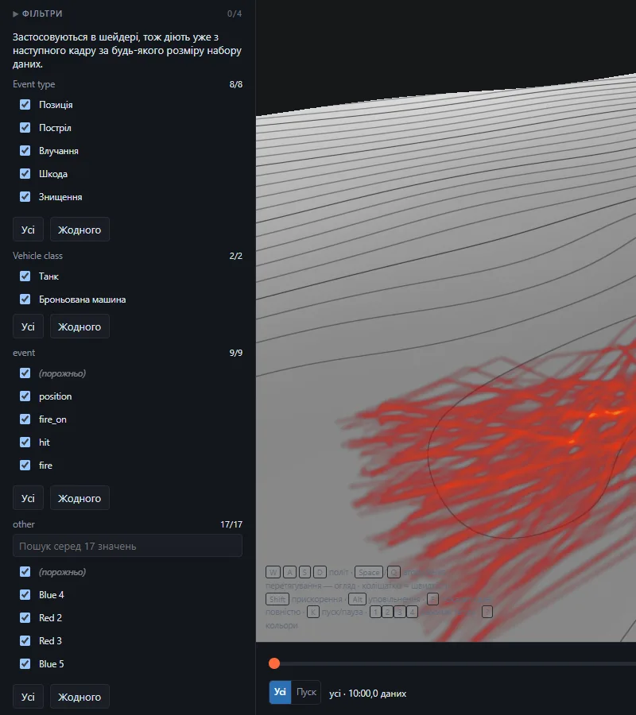
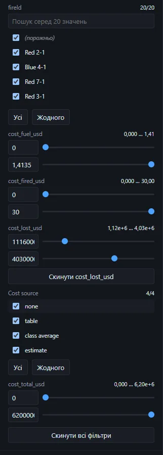

# Фільтри

**Фільтри** ховають рядки, які вам не потрібні, наприклад один клас техніки або один тип події, і картинка відразу оновлюється. Панель перелічує стовпці, збережені при завантаженні під *Зберегти для фільтрування* ([Зіставлення стовпців](column-mapping.md)), а також *Source file*, коли завантажено кілька файлів.

## Спробуйте {#try-it}

1. Завантажте набір даних і відкрийте **Фільтри** на бічній панелі.
2. У **Клас техніки** зніміть *Tank*. Картинка змінюється одразу.
3. Натисніть **Скинути всі фільтри**, щоб відмінити.

Перші рядки - це власні стовпці переглядача (нижче). Рядки після них походять з вашого файлу.

## Стовпці, які додає переглядач {#columns-the-viewer-adds}

При завантаженні переглядач визначає чотири власні стовпці й показує їх **першими**, з назвами та значеннями вашою мовою, щоб той самий фільтр працював для кожної гри й кожного джерела даних:

| Стовпець | Значення | Визначається з |
|---|---|---|
| **Тип події** | 23 типи: Позиція, Постріл, Пуск (ракета, снаряд, бомба), Влучання, Промах (зброя закінчилася поблизу цілі), Вибух, Шкода, Знищення, Смерть, Знищено, Аварія, Катапультування / вихід з літака, Поява, Зникнення, Зліт, Посадка, Торкання землі, Зупинка на землі, Переозброєння / заправка, Захоплення / ціль, Пастка, Повідомлення, Інше | стовпець `event`, `events`, `event_type` або `event_name`; власні слова кожної гри (`shot`, `burst`, `fired`, `struck`, `flare`, `plant` ...) відображаються на ці типи. Повна таблиця: [Типи та класи подій](ref-event-types.md). |
| **Гравець або ШІ** | Гравець, ШІ | стовпець `ai`, `is_ai`, `bot` або `actor`; інакше `is_player` / `human`; інакше ідентифікатор облікового запису (`user_id`, `steam_id`; порожньо або 0 - це ШІ); для записів Tacview - чи має об’єкт пілота |
| **Клас техніки** | 17 класів: Винищувач, Штурмовик, Бомбардувальник, Інший літак, Гелікоптер, Танк, Броньована машина, ППО, Артилерія, Вантажівка / авто, Корабель, Підводний човен, Піхота, Зброя, Пастка, Споруда, Інше | назва техніки або юніта (зіставляється з [каталогом фігур](figures.md)) і стовпці типу |
| **Клас цілі** | ті самі класи | техніка іншої сторони (`other_vehicle`, `target_vehicle`, `victim_type` ...) |

Одразу після них ідуть [стовпці результату](data-formats.md#outcome-columns), якщо вони є в даних: **Підсумок раунду** і **Підсумок матчу** (*Будь-який*, *Перемога*, *Поразка*) і **Як завершився раунд**, зі значеннями вашою мовою. Фільтруйте за ними або поділіть тепло за ними як [карту частки перемог](win-rate.md).

Перелічені лише типи, які трапляються. Стовпці значень (`cost_*`, `earn_*`, `net_*` і *Cost source*, див. [Зважування за вартістю](value-weighting.md)) фільтруються, як будь-який числовий стовпець: наприклад, зніміть *estimate* у *Cost source*, щоб залишити лише рядки з ціною.

У списку категорій із більш ніж 12 значеннями з’являється поле пошуку (*Пошук N значень*) і кнопка **Лише ці**, яка дозволяє рівно ті значення, що збігаються.

Які стовпці можна фільтрувати, вирішується при завантаженні, бо їх треба прочитати саме тоді. Якщо збережених стовпців немає, панель про це каже і посилається на *Зберегти для фільтрування*.

## Числові стовпці (діапазон) {#numeric-columns-range}

| Частина | Значення |
|---|---|
| Назва і `min ... max` | Стовпець і поточний діапазон (повний діапазон стовпця, поки фільтр не задано). |
| Перший рядок: поле числа і повзунок | Нижня межа. Перетягування повзунка вище за верхню межу тягне за собою й верхню. |
| Другий рядок: поле числа і повзунок | Верхня межа. Перетягування нижче за нижню межу тягне й її. |
| **Скинути {column}** | Прибирає цей фільтр. |

Повзунки покривають мінімум і максимум стовпця у 1 000 кроків; поля числа приймають будь-яке значення. Рядок проходить, коли його значення лежить у діапазоні, обидві межі включно. Великі значення показуються у степеневій формі (`1.23e6`).

## Категоріальні стовпці {#category-columns}

| Частина | Значення |
|---|---|
| Назва і `allowed/total` | Стовпець і скільки його значень дозволено. |
| Список значень | Прапорець для кожного значення; порожнє значення показано як *(порожньо)*. |
| **Усі** / **Жодного** | Дозволити всі значення / жодного. |

Дозвіл на всі значення прибирає фільтр.

## Правила {#rules}

- **Чотири фільтри одночасно.** Заголовок показує `active/4`. П’ятий фільтр не застосовується, і панель про це каже. Вибір у [Об’єктах](entities.md) (або фокус гравця на вкладці Матч) займає один із чотирьох. Фільтр, що охоплює весь стовпець, не займає жодного.
- **Категоріальний стовпець має щонайбільше 4 096 значень**; ширший не зберігається при завантаженні.
- **Фільтри поєднуються через І** і з видимістю команд, поділом різниці, часовим вікном, відсіканням за відстанню та [зрізом](slice.md).
- **Зміна фільтра перезапускає накопичення і через кілька кадрів перевимірює експозицію**, бо фільтрування може дуже змінити щільність ([Колір і експозиція](colour-and-exposure.md#auto-exposure)).
- **Скинути всі фільтри** прибирає кожен фільтр стовпця. Видимість команд і вибір гравців, зроблені деінде, зберігаються.
- Фільтри стовпців змінюють режими тепла. Вони не змінюють фігури [розбору фігурами](box-replay.md), які слідують за видимістю команд і вибором в Об’єктах. Вибір в Об’єктах змінює обидва.
- У [лінійному теплі](line-heat.md) фільтр перевіряється за рядком, на якому *закінчується* кожен відрізок.
- При кожному новому наборі даних усі фільтри скидаються.

## Для розробників {#for-developers}

**Слоти.** Кожен активний фільтр займає один із чотирьох слотів GPU ([`MAX_FILTER_SLOTS`](https://github.com/Holdi601/3DHeat/blob/main/src/render/types.ts)), текстуру з 4 байтами на рядок. Слоти дістаються фільтрам у порядку їх останньої зміни ([`filterSlots`](https://github.com/Holdi601/3DHeat/blob/main/src/render/filterTables.ts), спільний для шейдера і обох панелей). Понад чотири з’являється помилка: *Лише перші 4 фільтри застосовано. Скасуйте один - решта ігноруються, а не поєднуються мовчки*, а назви зайвих фільтрів читаються як *стовпець (не застосовано)*. Фільтри працюють щорядка у вершинному шейдері, тож зміна порогу не потребує повторного розбору й повторного вивантаження.

**Фільтри, яких панель не показує.** У стані застосунку існують ще два види ([`FilterSpec`](https://github.com/Holdi601/3DHeat/blob/main/src/state/types.ts)):

- фільтр **груп**, який задає вкладка Матч, коли фокусується на одній стороні. Він ховає інші групи в кожному режимі, включно з поділом [різниці](difference.md) за стовпцем.
- фільтр **осіб**, який задають панель [Об’єкти](entities.md) і вкладка Матч, коли фокусується на одному гравцеві. Він обмежує розбір фігурами і режими тепла. У теплі це категоріальний фільтр за ідентифікаторами осіб, що займає один із чотирьох слотів. Його маска тримає 65 536 ідентифікаторів ([`FILTER_MASK_CAPACITY`](https://github.com/Holdi601/3DHeat/blob/main/src/render/types.ts)); особа понад цю межу не малюється в теплі, поки фільтр активний, навіть коли вона вибрана. Розбір фігурами їх досі показує.
