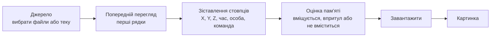

# Завантаження даних

Перш ніж 3DHeat щось намалює, йому потрібна таблиця: кожен рядок каже, де щось було і, якщо є, коли і хто. Цей розділ показує, як файл стає картинкою. Ще немає даних? Спробуйте [демо-дані](demo-data.md).

**Зробіть це зараз:**

1. На бічній панелі **Теплова карта** відкрийте **Джерело** і натисніть **Файли…** (або перетягніть файл чи теку в зону скидання).
2. Перегляньте **Зіставлення стовпців**: поля зазвичай уже заповнені.
3. Переконайтеся, що **Оцінка пам’яті** каже *вміщується*.
4. Натисніть **Завантажити**.

Усе, що показує вкладка Теплова карта, береться з одного **набору даних**: таблиці рядків, кожен із позицією і, за бажанням, часом, особою, групою, сесією, напрямком погляду та будь-якою кількістю додаткових стовпців для фільтрів. Цей розділ пояснює, як складається набір даних.

## Шлях від файлів до картинки {#the-path-from-files-to-picture}

1. **Виберіть файли** на панелі **Джерело** - один файл, кілька, дерево тек або перетягніть їх. Приймаються Parquet, CSV, Tacview, GPS-треки та інші; повний перелік є в [Формати даних](data-formats.md#files). Див. [Завантаження файлів](loading-files.md).
2. **Попередній перегляд.** Відкривається перший файл вибірки: його назви стовпців, перші 50 рядків, які стовпці схожі на числові, а для Parquet - логічний тип кожного стовпця та власні інструкції читання файлу, запис `heat3d` у метаданих у кінці файлу.
3. **Автозіставлення.** Стовпці призначаються ролям - X, Y, Z, час, особа, сесія, група, напрямок погляду - і кілька з них залишаються для фільтрів. Кожне припущення видно на панелі **Зіставлення стовпців**, і його можна змінити. Див. [Зіставлення стовпців](column-mapping.md) і [Осі, одиниці та час](axes-units-and-time.md).
4. **Підрахунок.** Кількість рядків кожного файлу читається (точно з метаданих Parquet, оцінюється для CSV), тож панель може сказати ще до завантаження, скільки пам’яті потрібно і чи поміщається вона. Якщо ні, вона пропонує завантажувати кожен *N*-й рядок. Див. [Пам’ять і бюджети](memory-and-budgets.md).
5. **Завантаження.** Фоновий робітник розбирає лише зіставлені стовпці кожного файлу - кілька файлів одночасно, до бюджету [потоків розбору](memory-and-budgets.md#parser-threads) - і зливає їх у порядку вибірки в один набір даних: один спільний словник осіб, груп і сесій для всіх файлів, один спільний початок часу, усі рядки впорядковані за часом. Див. [Сесії, особи та групи](sessions-persons-groups.md).
6. **Вивантаження.** Головний потік повідомляє «Uploading N rows to the GPU» на один кадр, а потім пакує рядки в пам’ять GPU в межах бюджету GPU. Див. [Перебування в пам’яті GPU](gpu-memory.md).
7. **Перша картинка.** Камера вписує дані в кадр, радіус спрайтів і насиченість задаються з розмірів даних і кількості рядків, а після 8 відтворених кадрів насиченість вимірюється з самої картинки ([Колір і експозиція](colour-and-exposure.md)).

## Вимоги, які перевіряються перед завантаженням {#requirements-checked-before-a-load}

| Потреба | Що буде без неї |
|---|---|
| **Принаймні два з X / Y / Z** | Завантаження відхиляється. Якщо є рівно два, третя вісь дорівнює 0, і дані малюються плоскою площиною в 3D-сцені - саме це потрібно для теплової карти з виглядом зверху. |
| Стовпець часу | Необов’язковий. Без нього часова шкала вимкнена, вигляд залишається в режимі **Усі**, а бічна панель про це каже. |
| Стовпець особи | Необов’язковий. Потрібен для [накладання фігур](box-replay.md) (фігура для кожної особи), [лінійного тепла](line-heat.md) (шлях кожної особи), інтерполяції, слідів і історії **Час життя**. |
| Стовпець групи | Необов’язковий. Потрібен для [тепла команд](team-heat.md) і режиму [різниці](difference.md) (принаймні дві групи). |

Режим, який завантажені дані не підтримують, сірий на панелі режимів; наведення на нього показує причину.

## Без власних даних {#without-your-own-data}

Панель **Набір даних** (під **Джерело**) має [синтетичний генератор](synthetic-generator.md), який створює набір даних у формі королівської битви будь-якого розміру. Це корисно, щоб спробувати переглядач і перевірити, що витримає машина.

## Сторінки цього розділу {#pages-in-this-section}

- [Завантаження файлів](loading-files.md) - вибір файлів, теки, перетягування, злиття кількох файлів, правило файлів руху, прогрес і скасування
- [Зіставлення стовпців](column-mapping.md) - кожне поле панелі зіставлення, як автозіставлення вгадує, підказки `heat3d`
- [Осі, одиниці та час](axes-units-and-time.md) - вісь «вгору», перевороти, масштаб одиниць, одиниці часу, напрямок погляду
- [Сесії, особи та групи](sessions-persons-groups.md) - що робить кожне, обмеження, спільні назви, розмір сутностей, панель Набір даних
- [Синтетичний генератор](synthetic-generator.md)
- [Пам’ять і бюджети](memory-and-budgets.md) - модель обсягу, перевірка вміщення, децимація, межа сортування, бюджети ресурсів
