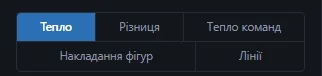

# Режими тепла

Кожна точка додає трохи світіння, світіння складаються разом, а купа фарбується кольорами. Режимів п’ять - п’ять способів її пофарбувати, і кожен відповідає на одне питання.

Панель режимів угорі бічної панелі вкладки Теплова карта вибирає, як малюється [набір даних](glossary.md). Клавіші 1-4 вибирають Тепло, Різниця, Тепло команд і Лінії. Накладання фігур клавіші не має.

| Режим | Яке питання відповідає |
|---|---|
| **Тепло** | Де це сталося і скільки? |
| **Різниця** | Яка сторона робила це частіше? |
| **Тепло команд** | Чиє це було? |
| **Лінії** | Яким шляхом ходили люди? |
| **Накладання фігур** | Хто де був і коли? |

| Режим (напис на панелі) | Клавіша | Що малює | Потрібно |
|---|---|---|---|
| **Тепло** | 1 | Адитивна щільність: кожен видимий рядок додає спрайт-коло, повернутий до камери. [Тепло](heat.md) | набір даних |
| **Різниця** | 2 | Знакова щільність: одна сукупність додає, інша віднімає. [Різниця](difference.md) | дві сторони: принаймні дві групи або поділ за збереженим стовпцем |
| **Тепло команд** | 3 | Щільність, пофарбована за групою: відтінок для кожної групи, змішаний там, де групи перетинаються. [Тепло команд](team-heat.md) | стовпець групи |
| **Накладання фігур** | - | Фігура (або куб) для кожної особи, що рухається вздовж часової шкали: розбір. [Накладання фігур](box-replay.md), [Розбір матчу](match-replay.md) | стовпець особи |
| **Лінії** | 4 | Лінійне тепло: лінія від кожної точки особи до її наступної, тепло спадає вбік. [Лінійне тепло](line-heat.md) | стовпці особи та часу |

Режим, який дані не підтримують, сірий, а його підказка називає причину, наприклад *Unavailable - Difference mode needs two groups or a kept column to split on; this data has one group.* Коли новий набір даних не може підтримати поточний режим, вигляд переходить на **Тепло**.

Клавіші 1-4 перевіряються за даними так само: клавіша для сірого режиму нічого не робить.

## Які панелі показує кожен режим {#which-panels-each-mode-shows}

| Панель | Тепло | Різниця | Тепло команд | Накладання фігур | Лінії |
|---|---|---|---|---|---|
| Маршрути ([лінійне тепло](line-heat.md)) | | | | | так |
| Форма тепла (з **Стежити за видом** і **Однакова щільність за будь-якого масштабу**), Кольори тепла, обмеження розміру спрайта в пікселях, Глибина, Відсікання за відстанню | так | так | так | | так |
| Напрямок ([напрямне тепло](directional-heat.md)), Значення ([зважування за вартістю](value-weighting.md)) | так | так | так | | так |
| Перегляд команд ([накладання фігур](box-replay.md)) | | | | так | |
| Поділ різниці ([різниця](difference.md)) | | так | | | |
| [Команди](teams-list.md), [Об’єкти](entities.md), [Фільтри](filters.md), Тло / рівень, [Зріз](slice.md), [Вимірювання](measure.md), Шлях камери й рендер, Продуктивність, Камера й сцена | так | так | так | так | так |

## Що спільне у всіх режимах тепла {#what-every-heat-mode-shares}

Усі чотири режими тепла (усі, крім накладання фігур) - це та сама машина з різними вхідними даними ([`engine.ts`](https://github.com/Holdi601/3DHeat/blob/main/src/render/engine.ts)):

1. **Які рядки.** [Часова шкала](timeline.md) вибирає суцільний діапазон рядків, відсортованих за часом; [фільтри](filters.md), видимість груп, поділ різниці, [відсікання за відстанню](depth-and-culling.md#distance-culling) і [зріз](slice.md) вирішують для кожного рядка у вершинному шейдері, чи він бере участь і з якою силою.
2. **Розмазування (splatting).** Кожен рядок, що бере участь, малюється як спрайт (або в режимі Лінії - як відрізок) у **теплову ціль** з плаваючою комою, додаючи своє значення з шкали. Коли рядків більше, ніж може витримати кадр, малюється стратифікована вибірка рядків із поправкою на вагу. Див. [Семплування і бюджети](sampling-and-budgets.md).
3. **Накопичення.** Поки нічого не змінюється, кадри об’єднуються, доки кожен рядок не внесе внесок рівно один раз. Див. [Накопичення](accumulation.md).
4. **Композит.** Накопичене значення в кожному пікселі ділиться на **точку насичення**, формується за **відгуком на щільність**, піднімається **мінімальним теплом** і знаходиться в **шкалі кольорів**, чия прозорість змішує її зі сценою. Див. [Колір і експозиція](colour-and-exposure.md).

Усе з кроку 4 застосовується під час композиту, тож перетягування цих елементів керування ніколи не перезапускає накопичення; кроки 1-2 - перезапускають.

## Сторінки цього розділу {#pages-in-this-section}

- [Тепло](heat.md) - звичайний режим тепла й огляд його панелей
  - [Форма спрайта](sprite-shape.md) - радіус, інтенсивності, спад, редактор кривої, обмеження в пікселях, вирівнювання
  - [Колір і експозиція](colour-and-exposure.md) - редактор шкали, точка насичення, автоекспозиція, мінімальне тепло, відгук на щільність
  - [Глибина і відсікання](depth-and-culling.md) - заслоняння рівнем, приховування за рельєфом, відсікання за відстанню
- [Різниця](difference.md) - поділ різниці
- [Тепло команд](team-heat.md)
- [Лінійне тепло](line-heat.md) - маршрути
- [Накладання фігур](box-replay.md) - режим розбору (файл досі називається box replay)
- [Напрямне тепло](directional-heat.md)
- [Зважування за вартістю](value-weighting.md)
