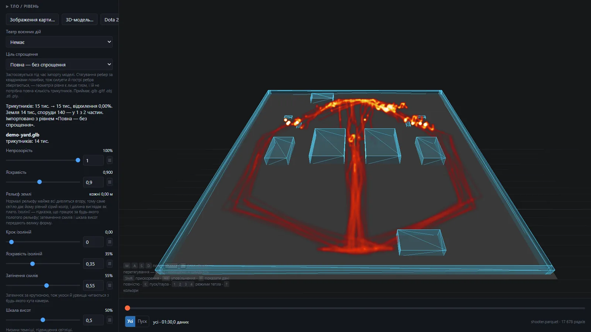
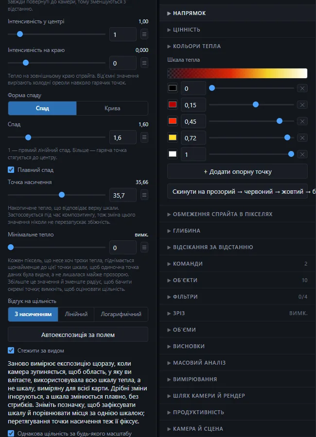

# Тепло

Тепло розфарбовує місця, де сталося багато подій: червоним там, де сталося трохи, розжареним до білого там, де сталося багато. Воно відповідає на питання «де це відбувається і скільки».

**Тепло** (клавіша 1) - це режим за замовчуванням. Кожен видимий [рядок](glossary.md) додає повернутий до камери круглий [спрайт](glossary.md); спрайти, що перекриваються, додаються в буфері з плаваючою комою; сума переводиться через шкалу кольорів - за замовчуванням прозорий → червоний → жовтий → білий - і малюється поверх сцени.

На картинці показано тепло раунду шутера на рівні з будівлями: гарячі точки лежать у кімнатах і на сходах, а не лише на землі.

## Як користуватися {#how-to-use-it}

1. Завантажте дані й натисніть `1` (або виберіть **Тепло** на панелі режимів).
2. Якщо все біле або порожнє, натисніть **Автоекспозиція за полем** у розділі **Форма тепла**.
3. Змінюйте **Радіус спрайта**, доки сусідні крапки не зіллються в смуги: менший показує окремі місця, більший - ділянки.
4. Відкрийте **Кольори тепла**, щоб змінити кольори, або **Глибина**, щоб пагорби й стіни ховали тепло за собою.

Ті самі панелі формують [Різницю](difference.md), [Тепло команд](team-heat.md) і [Лінійне тепло](line-heat.md); вони відрізняються тим, що додається (зі знаком, кольорове або вздовж ліній), а не тим, як це робиться.

## Панелі та їхні значення за замовчуванням {#the-panels-and-their-defaults}

Кожен елемент керування пояснено на власній сторінці; колонка «Деталі» веде до неї. Повзунки мають поле для введення поруч і маркер для перетягування (маленька ручка праворуч: тягніть вгору або вниз, далі - швидше, Shift - для точного керування); там, де доріжка повзунка закінчується раніше за справжню межу, маркер може піти далі, до *стелі повзунка*, яку тут зазначено. Значення, позначені *під час завантаження*, перераховуються для кожного нового набору даних.

### Форма тепла (відкрито) {#heat-shape-open}

| Елемент керування | За замовчуванням | Діапазон (стеля повзунка) | Деталі |
|---|---|---|---|
| **Радіус спрайта** | 6 м; під час завантаження розмір / 120 | 0,05-2000 м, логарифмічна (50 000) | [Форма спрайта](sprite-shape.md#sprite-radius) |
| **Інтенсивність у центрі** | 1 | 0-10 (1000) | [Форма спрайта](sprite-shape.md#centre-and-edge-intensity) |
| **Інтенсивність на краю** | 0 | -2-10 (1000) | [Форма спрайта](sprite-shape.md#centre-and-edge-intensity) |
| **Форма спаду** | *Спад* | *Спад* / *Крива* | [Форма спрайта](sprite-shape.md#ramp-shape-falloff-or-curve) |
| **Спад** (лише для Спаду) | 1,6 | 0,1-8 (64) | [Форма спрайта](sprite-shape.md#falloff) |
| **Плавний спад** (лише для Спаду) | увімк. | | [Форма спрайта](sprite-shape.md#falloff) |
| Редактор кривої (лише для Кривої) | пресет *Плавна* | | [Форма спрайта](sprite-shape.md#the-curve-editor) |
| **Точка насичення** | 24; під час завантаження оцінка, потім виміряна | 0,1-4000, логарифмічна (10 000 000) | [Колір і експозиція](colour-and-exposure.md#saturation-point) |
| **Мінімальне тепло** | вимк. (0) | 0-100% | [Колір і експозиція](colour-and-exposure.md#minimum-heat) |
| **Відгук на щільність** | *З насиченням* | *З насиченням* / *Лінійна* / *Логарифмічний* | [Колір і експозиція](colour-and-exposure.md#density-response) |
| **Автоекспозиція за полем** | | кнопка | [Колір і експозиція](colour-and-exposure.md#auto-exposure) |
| **Стежити за видом** | увімк. | | Вимірює експозицію знову щоразу, коли камера зупиняється, тож ділянка, у яку ви летите, використовує всю шкалу кольорів. Малі зміни ігноруються, а шкала плавно змінюється. Зніміть позначку або перетягніть **Точку насичення**, щоб зафіксувати шкалу й порівнювати місця на одній шкалі. [Колір і експозиція](colour-and-exposure.md#follow-the-view) |
| **Однакова щільність за будь-якого масштабу** | увімк. | | Колір означає однакову кількість рядків на площу землі, як близько б ви не були. Спрайт, який обмеження в пікселях збільшують (далеко) або зменшують (зблизька), зберігає тепло, яке дав би його справжній розмір, тож картинка, експонована здалеку, не згасає, коли ви в неї летите. Вимкнено - обмежений спрайт додає повну вагу при обмеженому розмірі. [Форма спрайта](sprite-shape.md#pixel-clamps) |
| **Спроєктувати на площину землі** | вимк. | | [Форма спрайта](sprite-shape.md#flatten-onto-ground-plane) |

### Кольори тепла (закрито) {#heat-colours-closed}

| Елемент керування | За замовчуванням | Деталі |
|---|---|---|
| Кольорові зразки груп і **Розділення кольорів** (лише Тепло команд) | 1,4 | [Тепло команд](team-heat.md) |
| Редактор **Шкала тепла** (*Додатна (команди, що додають)* у Різниці, *Шкала непрозорості* у Тепло команд) | прозорий → червоний → жовтий → білий | [Колір і експозиція](colour-and-exposure.md#the-ramp-editor) |
| **Скинути на прозорий → червоний → жовтий → білий** | | |
| Шкала **Від’ємна (команди, що віднімають)** (лише Різниця) | прозорий → зелений → синій → фіолетовий | [Різниця](difference.md#colours) |

### Обмеження спрайта в пікселях (закрито) {#sprite-pixel-clamps-closed}

| Елемент керування | За замовчуванням | Діапазон (стеля повзунка) | Деталі |
|---|---|---|---|
| **Мін. радіус у пікселях** | 1 px | 0-16 (512) | [Форма спрайта](sprite-shape.md#pixel-clamps) |
| **Макс. радіус у пікселях** | 96 px | 2-1024, логарифмічна (8192) | [Форма спрайта](sprite-shape.md#pixel-clamps) |

### Глибина (відкрито) {#depth-open}

| Елемент керування | За замовчуванням | Деталі |
|---|---|---|
| **Ховати за рельєфом** | увімк. | [Глибина й відсікання](depth-and-culling.md#hide-behind-terrain) |
| **Приховане за геометрією** | 0,8 (*на 80% темніше*) | [Глибина й відсікання](depth-and-culling.md#hidden-behind-geometry) |

### Відсікання за відстанню (закрито) {#distance-culling-closed}

| Елемент керування | За замовчуванням | Діапазон (стеля повзунка) | Деталі |
|---|---|---|---|
| **Ближня** | вимк. (0) | 0,5-5000 м, логарифмічна; низ доріжки = вимк. (200 000) | [Глибина й відсікання](depth-and-culling.md#distance-culling) |
| **Дальня** | вимк. (0) | 1-200 000 м, логарифмічна; низ = вимк. (10 000 000) | [Глибина й відсікання](depth-and-culling.md#distance-culling) |
| **Різати площиною** | увімк. | | [Глибина й відсікання](depth-and-culling.md#distance-culling) |
| **Різати й рівень** | увімк. | | [Глибина й відсікання](depth-and-culling.md#distance-culling) |

Клавіші: `[` і `]` пересувають дальню межу всередину й назовні, `\` перемикає її ([Глибина й відсікання](depth-and-culling.md#keyboard)).

### Напрямок і Значення {#direction-and-value}

Ще два розділи є під Формою тепла. **Напрямок** малює кожен рядок як клин і додає стрілки: див. [Спрямоване тепло](directional-heat.md). **Значення** зважує тепло за тим, що кожен рядок коштував або приніс: див. [Вагування значень](value-weighting.md).

## Що зберігається {#what-is-saved}

Наведені вище налаштування тепла не зберігаються між сесіями: перезавантаження сторінки повертає значення за замовчуванням. У браузері зберігаються дві речі: остання швидкість відтворення (`heat3d.speed`, див. [Часова шкала](timeline.md)) і налаштування далеких фігур [накладання фігур](box-replay.md) (стиль знаків, розмір, мітки влучань тощо). Так само зберігаються мова, [інвертовані осі світу](camera.md#invert-world-axis), запам’ятані назви машин на вкладці гонок і [бібліотека рівнів](level-library.md). Повний список - на [Збережені налаштування](ref-settings-storage.md).
