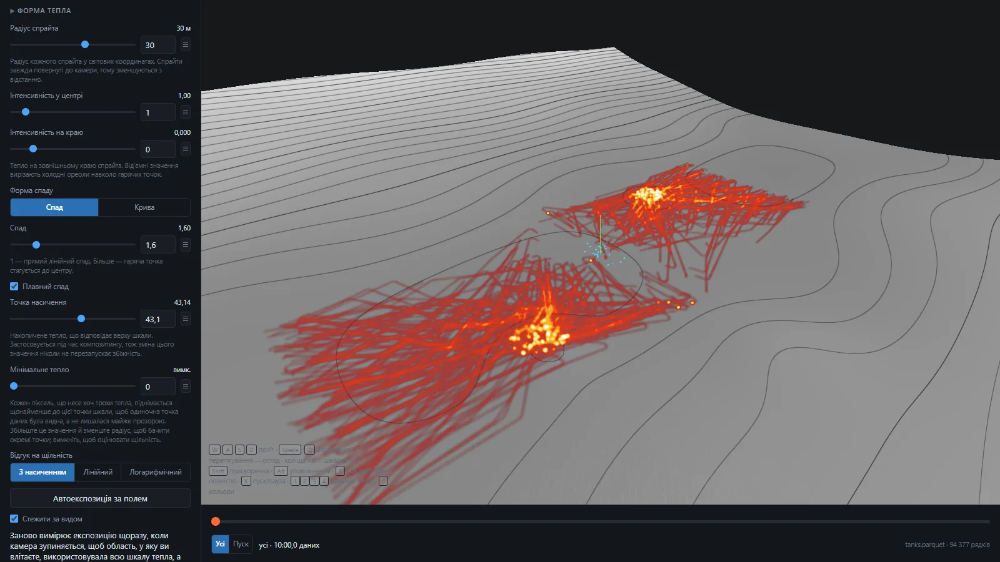
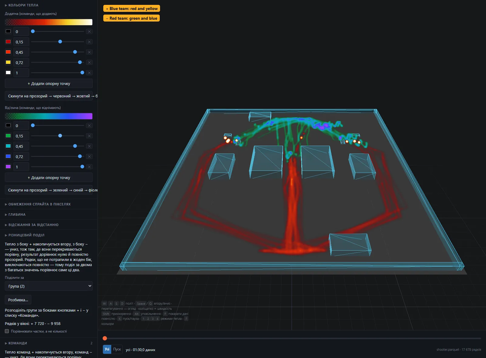
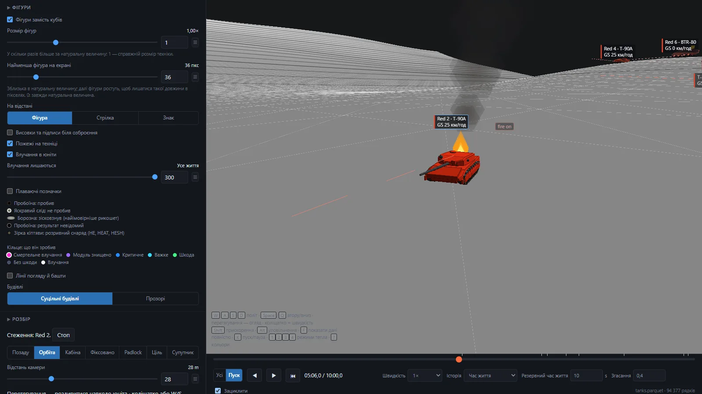
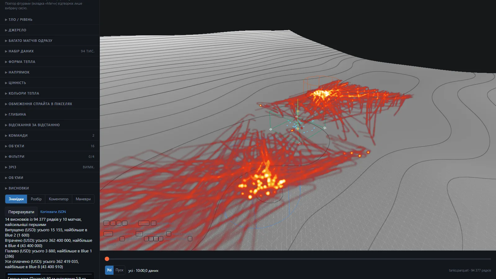
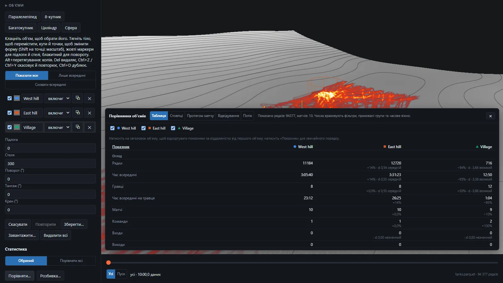
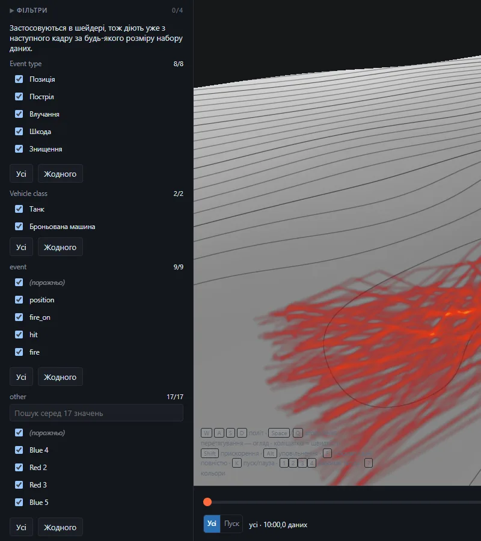
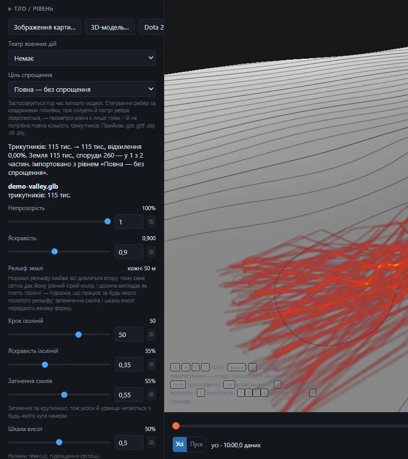

# 3DHeat

3DHeat показує, де щось відбувалося в грі - куди ходили гравці, з ким билися і де впали, - як світні кольори, крізь які можна летіти, або як маленькі 3D-фігури, що відтворюють матч.

Завантажте позиції - CSV, Parquet, записи Tacview, конвертовані повтори, один файл, теку або тисячі матчів - і побачте їх як **теплову карту, крізь яку можна летіти**, як **фігури, що відтворюють матч**, як лінії вздовж маршрутів, якими йшли люди, або як одну сукупність проти іншої. Він сам знаходить, що виділяється, і працює повністю у вашому браузері: нічого нікуди не вивантажується. 3DHeat і всі його інструменти безкоштовні та з відкритим кодом за ліцензією [MIT](https://github.com/Holdi601/3DHeat/blob/main/LICENSE).



**Уперше тут?** Створіть [демо-дані](demo-data.md) і пройдіть їх сім кроків. Кожна картинка на цьому сайті зроблена з їх допомогою.

## Що він робить {#what-it-does}

| | |
|---|---|
|  | **[Режими тепла](heat-modes.md)** - тепло, [різниця](difference.md) (червоним там, де одна сторона була більше, зелено-синім там, де інша), [тепло команд](team-heat.md), [лінійне тепло](line-heat.md); [напрямне тепло](directional-heat.md) з клинами, полями стрілок і полярними графіками; тепло [зважене за вартістю](value-weighting.md): скільки коштують зброя, техніка й пальне. |
|  | **[Розбір матчу](match-replay.md)** - кожен юніт як [фігура](figures.md) того, чим він є, знаки NATO або російські далеко, ракети й трасери, позначки влучань, уламки, пожежі, башти, цілі, камери в стилі Tacview і тактичний показ; [багато матчів одразу](many-matches.md). |
|  | **[Висновки](insights.md)** - сильні позиції, смертельна місцевість, пастки відродження, вузькі місця і видатні гравці, знайдені й ранжовані з доказами; письмовий розбір, за бажанням від ШІ на ваш вибір; коментатор для одного матчу; [лінза знань](knowledge.md). |
|  | **[Об'єми](volumes.md)** - малюйте коробки, призми, циліндри й сфери, фільтруйте до них, рахуйте, що відбувається всередині, експортуйте і порівнюйте місця поруч; [розбивка](breakdown.md) того, хто й що найкраще діє в місці. |
|  | **[Фільтри](filters.md)** - за типом події, гравцем або ШІ, класом техніки, значенням, будь-яким стовпцем, на відеокарті за будь-якого розміру даних. |
|  | **[Рівні](levels.md)** - зображення карт, 3D-рівні, зроблені [інструментами даних](#related-repositories), спрощення, [фон світу](world-backdrop.md) зі справжнім рельєфом для даних польоту. |

Також: вкладка [Аналіз заїздів](race-analysis.md) для кіл гонкових ігор, вкладка [Матч](match-analysis.md) для зведень Counter-Strike 2, [Дошка тактики](tactics-board.md) для планів на рівні, [аналіз влучань](hit-analysis.md) за технікою, [масовий аналіз](mass-analysis.md) тисяч матчів, [траєкторії камери й відео](camera-path-and-video.md), [40 мов](languages.md), [метричні або імперські одиниці](settings.md).

## Вкладки {#the-tabs}

Вкладки розташовані вгорі бічної панелі, під назвою, одиницями і меню мови.

| Вкладка | Для чого |
|---|---|
| **Теплова карта** | Будь-яка позиційна таблиця: режими тепла, накладання фігур, фільтри, об’єми, висновки, рівні, вимірювання і відео. |
| **Аналіз заїздів** | Два або більше кіл однієї траси: де втрачається час, чому і що змінити. |
| **Матч** | Розбір матчу фігурами і зведення матчів Counter-Strike 2. |
| **Тактика** | Плани на рівні: фігури, маршрути, засоби кидання, області й нотатки кроками, які програються. |
| **Техніка** | Де кожна одиниця була влучена, ким і чим. |

## Встановлення і запуск {#install-and-run}

3DHeat безкоштовний для використання, зміни й поширення (ліцензія MIT), так само як і кожен інструмент зі списку [Пов’язані репозиторії](#related-repositories).

### Windows, найпростіший спосіб {#windows-the-easy-way}

Корінь репозиторію містить три пакетні файли.

| Файл | Що робить |
|---|---|
| `start.bat` | Запускає переглядач. Знаходить Node.js, навіть коли його немає в `PATH` (шукає в `%ProgramFiles%\nodejs`, `%ProgramFiles(x86)%\nodejs` і `%LOCALAPPDATA%\Programs\nodejs`), а коли Node.js немає, пропонує встановити LTS-випуск командою `winget install -e --id OpenJS.NodeJS.LTS`. При першому запуску питає перед завантаженням залежностей (близько 300 МБ у `node_modules\` всередині теки, нічого системного). Відмовляється запускатися, коли щось уже слухає порт 5273, і вказує на `restart.bat`. Коли тека - це копія git без локальних змін і існує новіша версія, питає, чи оновити (Y/N; без відповіді за 60 с лишає цю версію; див. [Оновлення](updates.md)). Далі запускає сервер розробки на `http://127.0.0.1:5273/` і відкриває браузер. **Вікно і є сервером**: залиште його відкритим, закрийте або натисніть Ctrl+C, щоб зупинити. |
| `restart.bat` | Виконує `stop.bat quiet`, потім `start.bat`. Потрібен лише після зміни `vite.config.ts`, додавання залежності або коли сервер завис - зміни в коді підхоплюються гарячим перезавантаженням. |
| `stop.bat` | Зупиняє все, що слухає порт 5273, за ідентифікатором процесу, знайденим через `netstat`, ніколи за назвою образу, тож інші процеси Node.js на комп’ютері не чіпаються. Чекає близько двох секунд, поки сокет звільниться. З аргументом `quiet` не зупиняється в кінці. |

### Вручну (будь-яка ОС) {#by-hand-any-os}


```bash
git clone --recursive https://github.com/Holdi601/3DHeat.git
cd 3DHeat
npm install
npm run dev      # http://127.0.0.1:5273
```

Тека `exporters/` містить окремі інструменти даних як підмодулі git, кожен - власний репозиторій; після звичайного клонування виконайте `git submodule update --init`. Сам переглядач для запуску їх не потребує. `exporters/ext/` містить необов’язкові конвертери (повтори War Thunder, World of Tanks, World of Warships, Squad; карти DCS і IL-2), кожен - окремий проєкт.

Жодних ігрових даних із цим нічого не постачається: рівні, карти і записи створюються на вашому комп’ютері інструментами, з ігор, які у вас є.

### Скрипти npm {#npm-scripts}

| Скрипт | Що запускає |
|---|---|
| `npm run dev` | Сервер розробки Vite на порту 5273, прив’язаний до `127.0.0.1`. |
| `npm run build` | Перевірка типів (`tsc --noEmit`) і виробнича збірка в `dist/`. |
| `npm run preview` | Обслуговує виробничу збірку. |
| `npm run typecheck` | Лише перевірка типів. |
| `npm test` / `npm run test:watch` | Модульні й інтеграційні тести (vitest). |
| `npm run smoke` | Керує справжнім застосунком у безголовому Chromium і перевіряє, що полотно має пікселі з кольорами даних; знімки йдуть у `tools/.smoke/`. Очікує, що сервер розробки запущено. |
| `npm run smoke:f16` | Той самий набір з `?heat=f16`, що примусово використовує шлях накопичення half-float (див. [Накопичення half-float](half-float-accumulation.md)). |
| `npm run bench` | Тест прийому даних, записує `tools/.smoke/ingest-bench.json`. |
| `npm run test:heavy` | Тести, яким потрібні великі справжні файли даних; вони самі пропускаються, коли файлів немає. |
| `npm run inspect -- <file.parquet>` | Виводить схему файлу Parquet і кілька рядків (`tools/inspect-parquet.mjs`). |

### Що додає сервер розробки {#what-the-dev-server-adds}

Переглядач - це статична веб-сторінка, але сервер розробки (див. `vite.config.ts`) додає два локальні маршрути, яких немає у статичному розгортанні `dist/`:

- `/__host/memory` повідомляє встановлену і вільну оперативну пам’ять комп’ютера та, де може прочитати, пам’ять відеокарти (з `nvidia-smi`, або на Windows з запису драйвера дисплея в реєстрі). Завдяки цьому [бюджети пам’яті](memory-and-budgets.md) використовують справжні цифри, а не обмежені оцінки браузера.
- `/__heat3d/update` перевіряє, чи копія відстає, і може перемотати її вперед ([Оновлення](updates.md)).

Сервер прив’язаний лише до `127.0.0.1`, тож жоден з маршрутів не доступний із мережі. Відкривайте його як `http://127.0.0.1:5273`: `localhost` може розпізнаватися як IPv6-петля `::1`, де ніхто не слухає. Він не надсилає заголовків міжсайтової ізоляції (COOP/COEP): ніщо в переглядачі не використовує `SharedArrayBuffer`, а робітники передають дані переданням, якому вони не потрібні.

## Вимоги до браузера та GPU {#browser-and-gpu-requirements}

- **Браузер з WebGPU або WebGL2.** Спершу пробується WebGPU (він є в Chrome і Edge); без нього використовується бекенд WebGL2. WebGL2 мусить пропонувати `EXT_color_buffer_float` (рендеринг у текстури з плаваючою комою), інакше переглядач показує «Не вдається ініціалізувати рендерер.» Див. [Два рушії](backends.md). Переглядач розробляється і тестується в Chromium; інші браузери не перевірені.
- **Увімкнено апаратне прискорення.** Коли браузер малює на процесорі (SwiftShader, llvmpipe, Microsoft Basic Render Driver та подібні), червоний банер угорі бічної панелі каже про це і як виправити. Див. [Виявлення програмного рендерингу](software-rendering.md).
- **Дискретна відеокарта допомагає, але не обов’язкова.** Обидва бекенди просять високопродуктивний адаптер. Обсяг даних, який можна тримати в GPU, - це бюджет, який ви бачите й можете змінити ([Пам’ять і бюджети](memory-and-budgets.md)).
- **Додаткові можливості** використовують інші API браузера: відео-рендер потребує WebCodecs `VideoEncoder` з VP9 або VP8 ([Траєкторія камери і відео](camera-path-and-video.md)); спрощення сітки рівнів потребує WebAssembly; перетягування тек використовує File and Directory Entries API; бібліотека рівнів використовує IndexedDB; геймпади - Gamepad API.

## Карта документації {#documentation-map}

**Початок**: [Демо-дані](demo-data.md) · [Завантаження даних](getting-data-in.md) ([завантаження файлів](loading-files.md), [зіставлення стовпців](column-mapping.md), [осі, одиниці та час](axes-units-and-time.md), [сесії, особи та групи](sessions-persons-groups.md), [Tacview](tacview-acmi.md), [конвертери](converters.md), [.3dheat](container.md), [пам’ять і бюджети](memory-and-budgets.md))

**Дивитися**: [Режими тепла](heat-modes.md) ([тепло](heat.md), [форма спрайта](sprite-shape.md), [колір і експозиція](colour-and-exposure.md), [глибина і відсікання](depth-and-culling.md), [різниця](difference.md), [тепло команд](team-heat.md), [лінійне тепло](line-heat.md), [розбір коробками](box-replay.md), [напрямне тепло](directional-heat.md), [зважування за вартістю](value-weighting.md)) · [Часова шкала](timeline.md) · [Рівні](levels.md) ([зображення карт](map-images.md), [3D-рівні](model-levels.md), [вигляд](level-appearance.md), [бібліотека](level-library.md), [фон світу](world-backdrop.md), [його джерела](world-backdrop-sources.md)) · [Камера](camera.md) ([геймпад](gamepad.md), [клавіші](keyboard-reference.md)) · [Траєкторія камери і відео](camera-path-and-video.md)

**Аналіз**: [Фільтри та інструменти](filters-and-tools.md) ([фільтри](filters.md), [команди](teams-list.md), [об’єкти](entities.md), [зріз](slice.md), [вимірювання](measure.md), [об’єми](volumes.md), [розбивка](breakdown.md)) · [Висновки](insights.md) ([лінза знань](knowledge.md)) · [Масовий аналіз](mass-analysis.md)

**Розбір**: [Розбір матчу](match-replay.md) · [Багато матчів одразу](many-matches.md) · [Фігури](figures.md) ([у накладанні фігур](figure-replay.md), [авторство](figure-credits.md)) · [Паритет з Tacview](tacview-parity.md) · [Аналіз влучань](hit-analysis.md)

**Інші вкладки**: [Аналіз заїздів](race-analysis.md) ([метод](race-analytics.md), [інші ігри](other-games.md)) · [Аналіз матчу](match-analysis.md) · [Дошка тактики](tactics-board.md) ([швидкості](tactics-speeds.md))

**Переглядач**: [Глосарій](glossary.md) · [Налаштування, одиниці та клавіші](settings.md) · [Мови](languages.md) · [Оновлення](updates.md) · [Внутрішні механізми рендерингу](rendering-internals.md) ([бекенди](backends.md), [накопичення](accumulation.md), [семплування і бюджети](sampling-and-budgets.md), [half-float](half-float-accumulation.md), [пам’ять GPU](gpu-memory.md), [програмний рендеринг](software-rendering.md), [продуктивність і статистика](performance-and-stats.md)) · [Формати даних](data-formats.md) · [Довідник](reference.md) · [Супровід документації](maintaining.md)

## Пов’язані репозиторії {#related-repositories}

Переглядач читає дані; ці інструменти їх створюють. Кожен - окремий публічний репозиторій (MIT) з власною документацією. Жоден не постачає ігрових даних: рівні, карти й записи створюються на вашому комп’ютері, з ігор, які у вас є. Кожен модуль читання гри - окремий невеликий проєкт із власним файлом ліцензії, випусками й трекером задач, тож його можна встановлювати, оновлювати, підтримувати - або відкликати на запит правовласника - окремо, не зачіпаючи переглядач та інші інструменти.

| Репозиторій | Що робить | Корисно для | Документація |
|---|---|---|---|
| [3DHeat-GameFiles](https://github.com/Holdi601/3DHeat-GameFiles) | Читає траси і рівні з архівів, які постачають ігри (Forza Horizon, BeamNG, Assetto Corsa Rally; читачі Unreal, Unity, Frostbite і Source 2) у форматі glTF | 3D-рівень під вашим теплом або розбором | [сайт](https://holdi601.github.io/3DHeat-GameFiles/) |
| [3DHeat-GameCapture](https://github.com/Holdi601/3DHeat-GameCapture) | Записує телеметрію кіл з інтерфейсів, які публікують гонкові ігри, і відтворює рівні з ігрового відео | кола для Аналізу заїздів; рівень там, де файли не читаються | [сайт](https://holdi601.github.io/3DHeat-GameCapture/) |
| [3DHeat-UnrealExporter](https://github.com/Holdi601/3DHeat-UnrealExporter) | Плагін Unreal Editor, який експортує рівень одним файлом glTF | рівні ваших проєктів Unreal | [сайт](https://holdi601.github.io/3DHeat-UnrealExporter/) |
| [3DHeat-CS2](https://github.com/Holdi601/3DHeat-CS2) | Демо Counter-Strike 2 у таблиці теплової карти і зведення матчів, карти CS2 у геометрію | тепло CS2, розбори і вкладка Матч | [сайт](https://holdi601.github.io/3DHeat-CS2/) |
| [3DHeat-Watcher](https://github.com/Holdi601/3DHeat-Watcher) | Записує вашу гру у фоні з того, що публікують ігри: телеметрія, інтеграції стану гри, журнали, повтори | вашу власну статистику без ручної роботи | [сайт](https://holdi601.github.io/3DHeat-Watcher/) |
| [3DHeat-Ext-WarThunder](https://github.com/Holdi601/3DHeat-Ext-WarThunder) | Повтори War Thunder (`.wrpl`) у таблиці: треки в повітрі й на землі, постріли, влучання, знищення, башти, цілі | повтори War Thunder, позначки влучань і висновки | [сайт](https://holdi601.github.io/3DHeat-Ext-WarThunder/) |
| [3DHeat-Ext-WoT](https://github.com/Holdi601/3DHeat-Ext-WoT) | Повтори World of Tanks у таблиці: позиція кожної машини, смерті й знищення | тепло і повтори World of Tanks | [сайт](https://holdi601.github.io/3DHeat-Ext-WoT/) |
| [3DHeat-Ext-WoWs](https://github.com/Holdi601/3DHeat-Ext-WoWs) | Повтори World of Warships у таблиці: позиція кожного корабля і потоплення | тепло і повтори World of Warships | [сайт](https://holdi601.github.io/3DHeat-Ext-WoWs/) |
| [3DHeat-Ext-Squad](https://github.com/Holdi601/3DHeat-Ext-Squad) | Демо серверів Squad у таблиці: позиція, команда й загін кожного гравця | тепло і повтори Squad | [сайт](https://holdi601.github.io/3DHeat-Ext-Squad/) |
| [3DHeat-Ext-DCS](https://github.com/Holdi601/3DHeat-Ext-DCS) | Місцевості DCS World з вашої інсталяції в рівні: земля, дороги, міста, аеродроми, поля, вода | DCS і записи Tacview на їхній справжній місцевості | [сайт](https://holdi601.github.io/3DHeat-Ext-DCS/) |
| [3DHeat-Ext-IL2](https://github.com/Holdi601/3DHeat-Ext-IL2) | Карти IL-2 Great Battles у рівні | записи IL-2 на їхній карті | [сайт](https://holdi601.github.io/3DHeat-Ext-IL2/) |

## Структура коду, коротко {#source-layout-briefly}

| Тека | Вміст |
|---|---|
| [`src/data/`](https://github.com/Holdi601/3DHeat/tree/main/src/data) | Вибір файлів, прийом CSV і Parquet, автозіставлення, перевірка, модель пам’яті, побудова набору даних, розбір моделей, класифікація, спрощення, бібліотека рівнів |
| [`src/render/`](https://github.com/Holdi601/3DHeat/tree/main/src/render) | Цикл кадрів (`engine.ts`), семплування, обидва бекенди, камера, геймпад, вимірювання, траєкторія камери, запис відео |
| [`src/state/`](https://github.com/Holdi601/3DHeat/tree/main/src/state) | Стан застосунку (`store.ts`) з кожним типовим значенням, доменні типи (`types.ts`), крива спрайта |
| [`src/ui/`](https://github.com/Holdi601/3DHeat/tree/main/src/ui) | Панелі бічної панелі, часова шкала, накладки |
| [`src/race/`](https://github.com/Holdi601/3DHeat/tree/main/src/race), [`src/match/`](https://github.com/Holdi601/3DHeat/tree/main/src/match) | Вкладки Аналіз заїздів і Матч |
| [`src/i18n/`](https://github.com/Holdi601/3DHeat/tree/main/src/i18n) | Переклади |
| [`src/insights/`](https://github.com/Holdi601/3DHeat/tree/main/src/insights) | Висновки: детектори, розбір, коментатор, постачальники ШІ, лінза знань |
| [`src/mass/`](https://github.com/Holdi601/3DHeat/tree/main/src/mass) | Масовий аналіз багатьох матчів |
| [`src/volumes/`](https://github.com/Holdi601/3DHeat/tree/main/src/volumes) | Об'єми, їхня статистика, експорт і порівняння |
| [`src/breakdown/`](https://github.com/Holdi601/3DHeat/tree/main/src/breakdown) | Розбивка і фактори |
| [`src/overlay/`](https://github.com/Holdi601/3DHeat/tree/main/src/overlay) | Накладання багатьох матчів |
| [`src/figures/`](https://github.com/Holdi601/3DHeat/tree/main/src/figures) | Каталог фігур і його будівельник |
| [`src/vehicle/`](https://github.com/Holdi601/3DHeat/tree/main/src/vehicle) | Аналіз влучань (вкладка Техніка) |
| [`src/tactics/`](https://github.com/Holdi601/3DHeat/tree/main/src/tactics) | Дошка тактики |
| [`src/world/`](https://github.com/Holdi601/3DHeat/tree/main/src/world) | Фон світу |
| [`src/units/`](https://github.com/Holdi601/3DHeat/tree/main/src/units) | Одиниці вимірювання |
