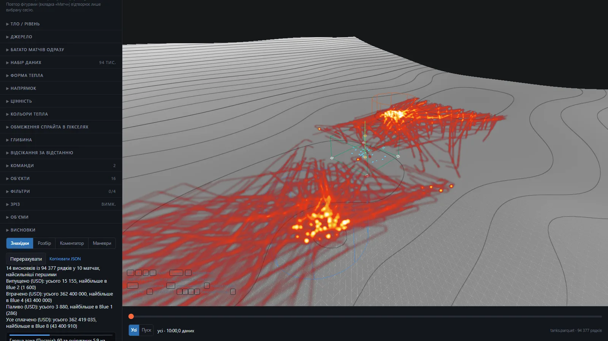
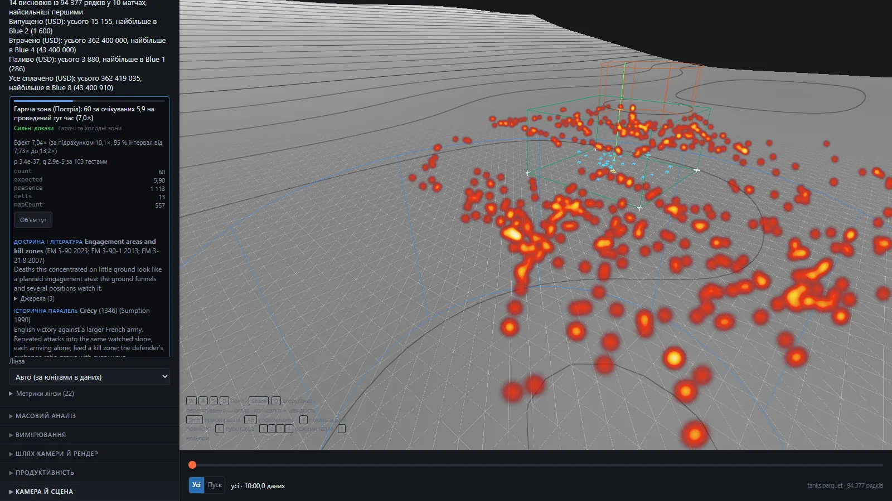
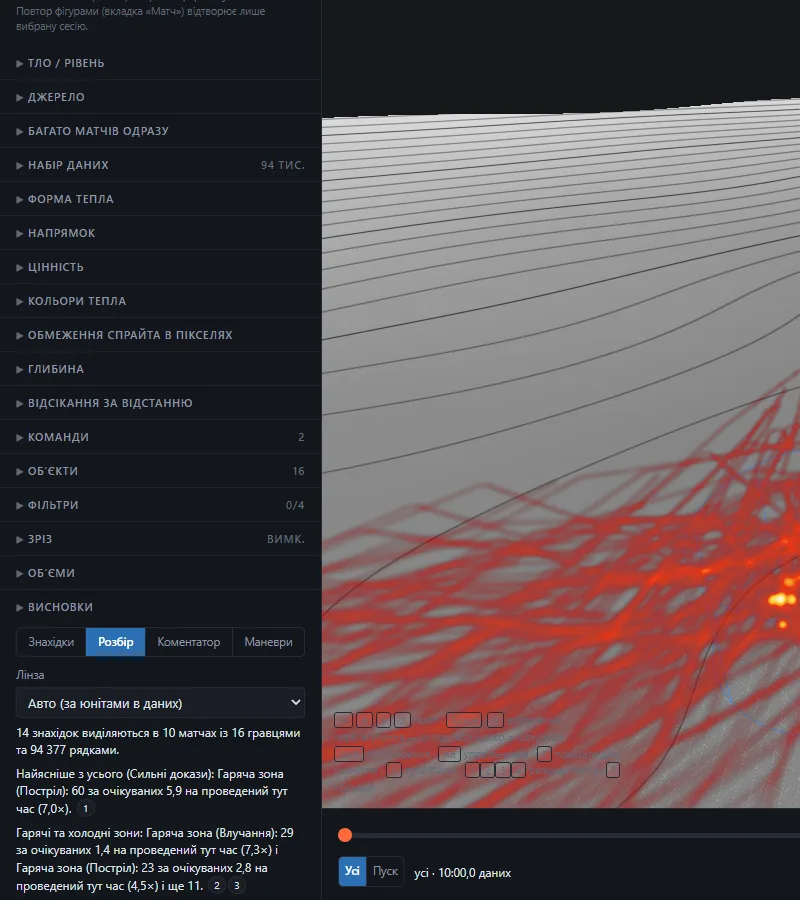
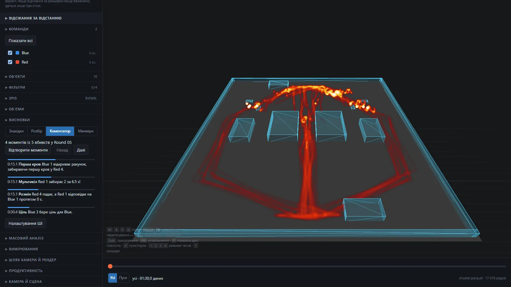

# Висновки

**Висновки** переглядають завантажені дані у пошуках того, що виділяється: сильні позиції, смертельна місцевість, пастки на відродженні, вузькі місця, гравці, які далеко попереду своїх, - і розповідають про це, починаючи з найсильнішого, з доказами. Використовуйте їх, щоб за хвилину зрозуміти, де матч було виграно або програно. Далі вони можуть написати розбір, а в одному розборі можуть працювати як коментатор, що переходить до великих моментів.

Усе рахується у вашому браузері. Нічого не залишає ваш комп’ютер, якщо ви не ввімкнули зовнішній ШІ (див. [Зовнішній ШІ](#external-ai)).

Розділ **Висновки** є на бічній панелі вкладок Теплова карта і Матч. Він має три вкладки: **Знахідки**, **Розбір** і **Коментатор**.

## Знахідки {#findings}

1. Завантажте дані й відкрийте **Висновки**. Натисніть **Знайти висновки** («Counting… n%» показує прогрес).
2. Прочитайте список. Кожна знахідка має смугу сили, речення, міцність доказів (*Strong evidence*, *Good evidence* або *Some evidence*), який детектор її знайшов, і клас техніки там, де це важливо.
3. **Клацніть знахідку**: переглядач застосовує її фільтри, летить камерою до місця і переходить до часу, і відкриває деталі: ефект з 95% інтервалом, значення p і q, порахані докази і **Об'єм тут**, який малює [об’єм](volumes.md) навколо місця.
4. **Повернути фільтри** відновлює ваші фільтри. **Копіювати JSON** копіює весь звіт.

Підрахунок використовує поточні фільтри, приховані групи і вибраний матч на всьому часовому діапазоні. Коли ви потім змінюєте фільтри, з’являється примітка про це; натисніть **Перерахувати**.

Рядки вгорі списку (наприклад, суми грошей) підсумовують усі дані перед знахідками.

### Детектори {#the-detectors}

| Детектор | Що знаходить | Потрібно в даних |
|---|---|---|
| **Сильні позиції** | Місця з набагато кращими шансами вбивство-до-смерті, ніж решта карти, і *безпечну землю*, де мало хто гине за проведений там час | події вбивств і смертей |
| **Гарячі та холодні зони** | Місця, де вид події (постріли, влучання, захоплення ...) стається значно частіше або рідше, ніж передбачає час, проведений там | стовпець подій |
| **Відкрита місцевість і укриття** | Смерті на відкритому місці проти близької геометрії рівня, і повільно проти швидкого руху | смерті; 3D-рівень для частини геометрії |
| **Відродження** | Сильні відродження, пастки відродження, безпечні відродження, час до першого контакту | час і особи |
| **Клас за місцем** | Клас техніки або гравці проти ШІ, які значно краще або гірше діють у зоні | вбивства плюс стовпець класу техніки або гравця/ШІ |
| **Гравці** | Гравці, що вбивають або гинуть набагато частіше або рідше за інших того самого класу | особи та вбивства |
| **Вузькі місця і фланги** | Вузькі місця (набагато більше переходів, ніж навколишньої землі) і фланкові маршрути (рідко використовувані, але ведуть до вбивств) | особи |
| **Значення** | *Дорога земля* і *Прибуткова земля* | [стовпці значень](value-weighting.md) |
| **Що вирішило раунди** | Що відрізняло виграні раунди від програних, і гравці, які додали або коштували найбільше ймовірності перемоги (див. [Хто переміг](#who-won-what-decided-the-rounds)) | раунди, вбивства і смерті, а також [стовпці результату](data-formats.md#outcome-columns) (`won`) |

Детектори, які не можуть працювати з даними, перелічені внизу з причиною.

### Як ранжуються знахідки {#how-findings-are-ranked}

Кожне місце або група перевіряється проти решти карти (точні біноміальні тести або тести частот). Частка хибних відкриттів тримається на рівні 5% (Benjamini-Hochberg). Випадковість може скидатися на закономірність; це тримає хибні тривоги низькими: серед показаних знахідок очікується щонайбільше близько однієї з двадцяти, що є випадковістю. Ефекти з малої кількості подій тягнуться до «ефекту немає» перед ранжуванням. Перелічено щонайбільше 60 знахідок, і кожен детектор отримує кілька місць угорі.

### Хто переміг: що вирішило раунди {#who-won-what-decided-the-rounds}

Якщо дані кажуть, хто виграв кожен раунд ([стовпець результату](data-formats.md#outcome-columns) `won`: CS2, Rainbow Six Siege, War Thunder ...), то саме про результат ідеться у Висновках. Для кожної сторони раунди діляться за тим, що в них сталося, і порівнюються частки перемог:

| Чинник | Раунди сторони з ним | ... і без нього |
|---|---|---|
| Перша дуель | вона зробила перше вбивство | вона загинула першою |
| Закупівля | її закупівля була кращою, ніж у іншої сторони | гіршою |
| Розміняна перша смерть | її першу смерть розміняли протягом 5 с | не розміняли |
| Встановлення | вона встановила бомбу | без встановлення |
| Спорядження | більше гранат, ніж у її звичайному раунді | менше |
| Ранній контакт | перша дуель була раніше за медіанний час матчу | пізніше |
| Утримане місце | гравець стояв на місці 5 с або більше | ніхто не стояв |
| Місце, досягнуте рано | гравець дістався туди за перші 25 с (маршрут) | ніхто не дістався |

Кожне порівняння - це різниця двох часток перемог із її 95% інтервалом (Newcombe), точне p Фішера і q за всіма перевіреними чинниками (Benjamini-Hochberg). Гілка з менш ніж 8 раундами позначена *мало раундів*. Ті, що проходять під 5% частки хибних відкриттів, стають знахідками; найсильніші стоять вище за знахідки інших детекторів (знахідка про результат важить у 1,35 раза більше, ніж знахідка з тим самим ефектом і доказами).

Вигаданий приклад на 40 раундах:

> **T** виграла 79% з 19 раундів, коли утримувала **Mid**, проти 24% з 21 без цього (55 пунктів, 95% від 26 до 74) - q 0,004.

Також Висновки стежать за **ймовірністю перемоги** в раунді - шансом кожної сторони в кожну мить, з живих бійців, встановлення і годинника: підігнаною під раунди, коли їх 30 або більше, інакше з фіксованої апріорної моделі (і текст каже, з якої). З неї виходять **поворотні моменти** (вбивства і встановлення, які найбільше змінили шанс) і **додана ймовірність перемоги** кожного гравця: його вбивства і встановлення йдуть йому в плюс, його смерті - в мінус, у раундах за матч, у середньому за раунд з інтервалом, з перевіркою проти нуля. Місця отримують такий самий баланс: яка сторона виграла найбільше в дуелях, що там відбулися.

Даним потрібні раунди, вбивства і смерті з обома сторонами, а також стовпець `won`; названі місця (`place`) для утриманих місць, стовпець `buy` для закупівлі.

## Розбір {#debrief}

Вкладка **Розбір** записує знахідки коротким текстом: вступ, найяснішу знахідку, одну про тактику, одну про балансування, потім - якщо дані кажуть, хто переміг, - що вирішило раунди, решту, згруповану за детекторами, і скільки з них спираються на слабші докази.

Що вирішило раунди, описано в чотирьох абзацах: рахунок і звідки беруться ймовірності перемоги; найсильніші чинники з їхніми числами, інтервалом і q (коли жоден не проходить частку хибних відкриттів, текст каже *поки нічого не певно* і все одно називає найсильніший); три найбільші поворотні моменти; і гравці, які додали та коштували найбільше ймовірності перемоги, з місцями, що отримали найбільше. Вигаданий приклад:

> T виграла 23, а CT виграла 17 з 40 раундів із відомим результатом (T: 58%, 95% від 42% до 72%). Ймовірності перемоги беруться з моделі, підігнаної під ці раунди.
>
> Що відрізняло виграні раунди від програних: T виграла 79% з 19 раундів, коли утримувала Mid, проти 24% з 21 без цього (55 пунктів, 95% від 26 до 74) (q 0,004), ...
>
> Поворотні моменти: раунд 17 на 48 с, вбивство від CT на B site змінило її шанс з 31% до 58%, і вона взяла раунд, ... Кожен абзац має пронумеровані кнопки, що показують його знахідки. **Копіювати текст** копіює його.

Вбудований оповідач працює офлайн, вашою мовою. Вибирач **Лінза** над ним (див. [Лінза знань](knowledge.md)) визначає, на яку літературу посилаються абзаци.

### Зовнішній ШІ {#external-ai}

**Налаштування ШІ** дозволяє написати розбір моделлю ШІ на ваш вибір:

| Налаштування | Значення |
|---|---|
| **Постачальник** | Anthropic (Claude), OpenAI (ChatGPT), OpenRouter, Ollama (локально), LM Studio (локально), сервер llama.cpp (локально) або будь-яка кінцева точка, сумісна з OpenAI |
| **Базова URL-адреса**, **Модель** | Заповнює постачальник; **Показати моделі** запитує сервер |
| **API-ключ** | Надсилається лише на базову URL-адресу. Ніколи не записується в журнал, ніколи не зберігається в видах, експортах чи файлах `.3dheat`. Більшості локальних серверів він не потрібен. |
| **Запам'ятати ключ у цьому браузері** | Типово вимкнено: ключ забувається, коли сторінку закрито |
| **Використовувати зовнішній ШІ** | Типово вимкнено |
| **Надсилати імена гравців** | Типово вимкнено: гравці надсилаються як P1, P2 ... |

Потім введіть необов’язкове запитання і натисніть **Написати за допомогою ШІ**. Надсилаються лише знахідки та їхні числа - ніколи рядки ваших даних. Відповідь надходить потоком; знахідки, на які посилаються, стають кнопками. Якщо дані кажуть, хто переміг, моделі велять почати з того, що вирішило раунди, з інтервалом і q кожного числа, і сказати, коли чинник спирається на мало раундів або ймовірності перемоги беруться з апріорної моделі.

## Коментатор {#caster}

Для **одного матчу** (виберіть, якщо завантажено кілька), **Коментатор** знаходить моменти, вартісні уваги: першу кров, мультивбивства, обміни, клатчі, зміни в цілях, камбеки, видатних гравців, далекі постріли і **поворотні моменти** - вбивства, які найбільше змінили шанс сторони виграти раунд (за кількістю живих гравців кожної сторони, у раундах без відродження).

Якщо дані кажуть, хто виграв кожен раунд, кожен момент це повідомляє: *«Anna вбиває Ben: шанс T виграти раунд зростає з 38% до 62% - і вони беруть раунд.»* Момент сторони, яка потім виграла, важить більше, коли коментатор вибирає, які моменти залишити, а камбек рахується у виграних раундах.

- Клацніть момент: вигляд переходить на розбір, стрибає трохи раніше за нього, летить туди і стежить за гравцем.
- **Відтворити моменти** відтворює кожен до кінця і йде далі; **Назад** / **Далі** перемикають між ними.
- Коли ввімкнено зовнішній ШІ, **Коментарі від ШІ** пишуть коментар зі списку моментів (типи, часи, імена або псевдоніми, команди, класи, відстані).

Потрібні особи і події вбивство/смерть (або захоплення); стовпець `other`/`victim` робить можливими обміни й далекі постріли.

## Лінза знань {#knowledge-lens}

Знахідку можна прочитати крізь **лінзу** усталених знань: військова доктрина, повітряний і морський бій, міські операції, ігровий дизайн і кіберспорт (або *Авто*, обране за юнітами в даних). Відкрита знахідка тоді показує найближчий запис **доктрини і літератури** та **історичну паралель** з посиланнями, а **Метрики лінзи** обчислює вимірювання з тієї літератури на даних (підгонки Ланчестера, обмінні співвідношення, співвідношення сил, сектори вогню, ключова місцевість, обміни, ініціатива). Розбір і запит до ШІ їх включають. Усе про це: [Лінза знань](knowledge.md).

Метрики лінзи також вимірюють, як гравці поводяться як натовп і як група - вирівнювання і кружляння, ведення маршрутами, лінії й сліди, скупчення, лідери та ті, що йдуть слідом, відсталі, точка зламу під втратами, ризик після втраченого життя, серії, узгодженість купівель і реакція на вогонь, що надходить, - кожне проти власної нульової моделі: [Колективна поведінка](collective-behaviour.md).

## Дані, які роблять висновки корисними {#data-that-makes-insights-work}

- позиції з **часом**, стовпцем **особи** і **команди**;
- стовпець **події** з вбивствами і смертями (`kill`, `death`), та іншими (`hit`, `fire`, `capture` ...);
- стовпець **іншої сторони** (`other`, `victim`) для обмінів і напрямків;
- стовпець **техніки** або **типу** для класів; стовпець `ai` для гравців проти ШІ;
- стовпець **сесії** / **матчу** / **раунду**, коли матчів кілька.

У [демо-даних](demo-data.md) є все це.
