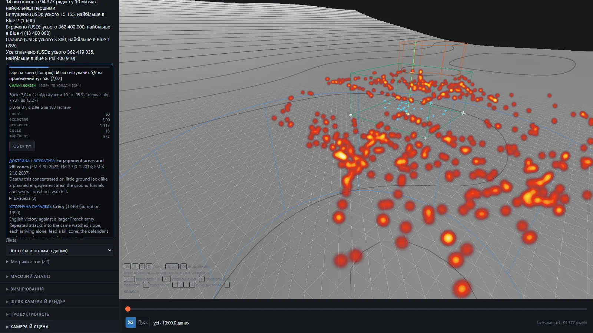

# Лінза знань

Коли [Висновки](insights.md) щось знаходять, ця частина пояснює це ідеями з військової історії, дизайну ігор і спортивної аналітики. Вона називає книгу або статтю, звідки ця ідея. Користуйтеся нею, щоб дізнатися, *чому* патерн важливий, а не лише те, що він існує.

## Спробуйте {#try-it}

1. Завантажте дані, відкрийте **Висновки** і натисніть **Знайти висновки**.
2. Клацніть на висновок, щоб відкрити його.
3. Прочитайте **Доктрина і література** та **Історична паралель**. Повні посилання згорнуто під ними.
4. Змініть **Лінза** (наприклад, на *Військова доктрина*), щоб прочитати той самий висновок через іншу літературу.

## Як це працює {#how-it-works}

Панель Висновки оцінює свої знахідки так, як це робив би професійний аналітик. Вона використовує військову доктрину й дослідження операцій, історичні бої, а також літературу про дизайн ігор, дизайн рівнів і аналітику. Це відбувається офлайн, з відібраної бази знань у переглядачі. Той самий матеріал передається зовнішній моделі, коли вона пише розбір.

## Що показує панель {#what-the-panel-shows}

- **Лінза** вибирає, через яку літературу читати висновки: *Авто* (вибирається за типами одиниць у даних: літаки, кораблі, наземна техніка, піхота), *Військова доктрина*, *Повітряний бій*, *Морський*, *Міський*, *Дизайн гри і баланс*, *Кіберспорт*. Записи поза обраною лінзою пропускаються.
- Кожен відкритий висновок показує свій найближчий запис **доктрини і літератури** та найближчу **історичну паралель**. Повні посилання згорнуто під ними.
- **Метрики лінзи** перелічують міри дослідження операцій, обчислені за тими самими рядками (нижче). Кожна з них має пояснення і свою літературу.
- **Розбір** додає рядки для головних висновків і метрик лінзи: «Доктрина і література: ...» та «Історична паралель: ...». Кожен має цитування з автором і роком і згорнуті під ним посилання.
- **Написати за допомогою ШІ** надсилає найвідповідніші записи (короткий зміст, урок, висновки, з якими вони пов'язані, повні посилання) разом зі звітом. Модель має посилатися на них за ідентифікатором, наприклад `{concept.lanchester-square}`, і не використовувати жодних інших джерел.

Мітки перекладено. Сам матеріал знань англійською.

## Метрики лінзи {#lens-metrics}

Обчислюються у воркері висновків, за тим самим проходом по рядках, що й детектори (`src/insights/lensMetrics.ts`). Кожна пропускається, коли дані її не витримують.

| Метрика | Що вимірює | Потрібно |
|---|---|---|
| Підгонка Ланчестера | Втрати кожної сторони за 20 с, регресовані на живу силу обох сторін (Пуассон, квазівірогідні помилки). Показники на силу ворога і власну силу перевіряються проти квадратичного закону (прицільний вогонь) і лінійного закону (площинний вогонь) | час, команди, знищення і смерті |
| Коефіцієнт обміну | Знищення на смерть за стороною і місцем. Частка смертей на найсмертоноснішій ділянці, яка займає 5% часу, проти частки, яку дає сам шанс при такій кількості смертей. Джині смертей за часом. I Морана для частот смертей | знищення і смерті |
| Локальне співвідношення сил | Свої і вороги, що живі в межах дальності бою від кожного знищення (дальність задається даними: удвічі медіана відстані до найближчого ворога). Частка знищень тією стороною, що локально сильніша, і її перевага над тим, що передбачають самі числа | час, команди, особи |
| Поля вогню | Зони видимості найзавантаженіших місць знищень на 2,5D-поверхні перешкод (геометрія рівня до висоти стіни або пройдена земля) порівняно із середнім місцем. Ранговий кореляційний коефіцієнт видимості й частки знищень | позиції; завантажений рівень робить це точніше; для повітря не підходить |
| Енергетичний стан | Питома енергія (висота плюс висота, яку може купити швидкість) повітряних убивць і жертв, порівняна статистикою Манна-Уїтні | класи літаків, час, висота |
| Ключова місцевість | Як часто кожне місце входить до трьох найзавантаженіших місць знищень матчу | кілька матчів |
| Взаємна підтримка (обміни) | Смерті, на які відповіло знищення товариша в межах дальності бою і 5 с | час, команди |
| Перший удар | Сутички (знищення, згруповані за матчем, за 20 с тиші і за трьома дальностями бою), виграні стороною, яка першою набрала очко | час, команди |
| Модель залпу | Рівняння залпів Гьюза, підігнане під 20-секундні періоди контакту кораблів: кораблі, виведені з ладу, на один корабель, що атакує, і врятовані на один корабель, що захищається. Підгонка Ланчестера лише за кораблями | класи кораблів, час, команди |
| Ефективність у бою | Знищення на одиницю часу в бою кожної сторони і співвідношення двох найбільших (значення бойової ефективності в сенсі Дюпюї) з 95% інтервалом. Частка знищень кожної сторони за рівної локальної кількості | час, команди |
| Дальності бою | Відстань до найближчого ворога під час знищень, пусків і першого пострілу кожного життя (від виявлення до бою), за видом одиниці | час, команди; пуски там, де вони є в даних |
| Ланцюг знищення | Секунди від останнього пуску убивці до знищення і від його першого пострілу в бою до знищення | час; пуски або події вогню |
| Концентрація або розосередження | У кожному 20-секундному періоді - розкид двох найбільших сторін і частка знищень, узятих тією, що щільніша | час, команди |
| Вильоти | За сторонами: вильоти (зльоти або появи літаків), посадки, втрачені літаки і знищення літаків; частка втрат і знищень на виліт | класи літаків; зльоти або появи |

Дані з раундами додають міри ближнього бою та кіберспорту: ймовірність виграти раунд, цінність дій, відкриваючі дуелі, обміни, гравець, що висовується, проти того, хто тримає, приціл, перехресний вогонь, засоби, перевагу в людях, клатчі, розстановки, після закладки, фатальні воронки і вплив гравця. Див. [Ближній бій і раунди](close-quarters.md).

Треки і команди додають міри колективної поведінки з наукового вивчення натовпів, колективного руху, поведінкової економіки і військової психології: вирівнювання і кружляння, ведення маршрутом, смуги й сліди, скупчення, лідери й ведені, відсталі, точка зламу, ризик після втрат, серії, узгодження і придушення покупок. Кожна порівнюється з власною нульовою моделлю. Див. [Колективна поведінка](collective-behaviour.md).

Зброя, принади і будівлі не рахуються як одиниці. Коли рядки зброї називають свою одиницю запуску (стовпець `Shooter` або `Launcher`, як у даних, похідних від Tacview), пуск зараховується цій одиниці, за її назвою або ідентифікатором об'єкта.

## Як висновки зустрічаються з літературою {#how-findings-meet-the-literature}

Записи і висновки зустрічаються через **таксономію патернів** (`src/insights/knowledge/patterns.ts`): концентрація, локальна перевага, прицільний і площинний вогонь, вузькі місця, зони знищення, поля вогню, зворотний схил, фланги, взаємна підтримка, енергетична перевага, тиск спавну, баланс тощо. Кожен вид детектора і кожна метрика лінзи вказує, які патерни показують її числа (`src/insights/lens.ts`). Кожен запис знань вказує, які патерни він торкається, з вагою. Відповідність запису висновку - це зважене перекриття. Воно масштабується тим, наскільки домен запису (суша, повітря, море, місто) підходить до даних, і силою самого висновку. Пояснення, що показується, - це числа висновку в одному реченні, а за ним урок запису.

## Каталог {#catalogue}

Кожен патерн, концепція, метод, історичний випадок, принцип дизайну і дослідження з бібліографією: див. [Каталог знань](knowledge-catalogue.md).

## Для розробників {#for-developers}

### Додавання записів {#adding-entries}

1. Оберіть файл за типом: `concepts.ts` і `concepts-more.ts`, `methods.ts`, `cases.ts`, `cases-land.ts`, `cases-air-sea.ts`, `cases-esports.ts`, `design.ts` (принципи дизайну) або `studies.ts` у `src/insights/knowledge/`.
2. Дайте йому новий ідентифікатор `<type>.<slug>` (ніколи не повторюйте старий), його лінзи, домени і патерни, які він торкається, з вагами 0..1. Додавайте патерн до `patterns.ts` лише тоді, коли його може показати висновок. І відобразіть його з висновку або метрики в `lens.ts`.
3. Напишіть короткий зміст і урок **своїми словами**. Цитати лише з творів суспільного надбання (`pd: true` у посиланні), і короткі.
4. Цитуйте: додайте кожну нову працю до `refs.ts` з авторами, роком, назвою і видавцем (журнал з томом і сторінками). Додайте URL або DOI, коли є публічний запис.
5. Запустіть `npx vitest run src/insights/lens.test.ts` (унікальні ідентифікатори, відомі патерни, посилання, що розв'язуються, цитати суспільного надбання, випадки з датою і результатом) і `node tools/knowledge-doc.mjs`, щоб оновити [каталог](knowledge-catalogue.md).
