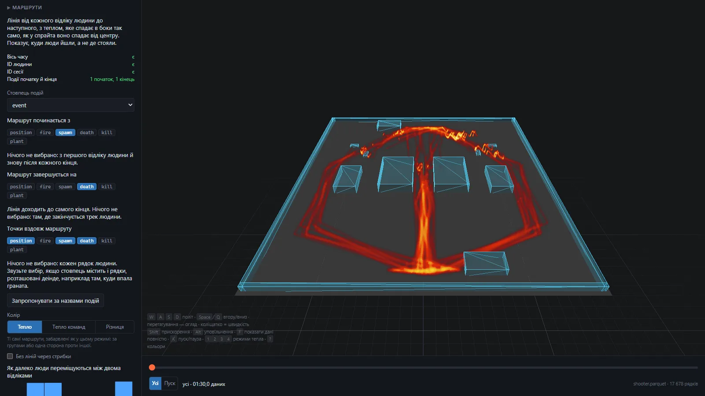

# Лінійне тепло

Тепло показує, де люди стояли. Лінії показують шляхи, якими вони ходили.

**Лінії** (клавіша 4) - це лінійне тепло: лінія від кожного зразка [людини](glossary.md) до її наступного зразка, розмазана тим самим спадом, що й [спрайт](glossary.md). Тільки розмазування йде поперек лінії, а не навколо точки. Так показано, куди люди *ходили*, а не де стояли. Коридор, пройдений один раз, видно так само добре, як кімната, в якій хтось сидів довго. А рідкі зразки швидкого гравця з'єднуються в суцільний маршрут, а не в пунктирний слід. Для цього потрібні стовпець особи і стовпець часу.

## Як користуватися {#how-to-use-it}

1. Натисніть `4` (або виберіть **Лінії** на смузі режимів).
2. Відкрийте **Маршрути** і перевірте зелений список. Вісь часу і ID людини мають бути наявні.
3. Натисніть **Запропонувати за назвами подій**, щоб заповнити, де маршрути починаються і завершуються.
4. Прочитайте рядок статистики: «N маршрутів, M з них дійшли до кінця».
5. Якщо лінії перескакують через мапу, змініть **Найдовший крок** (див. [Межа стрибків](#the-jump-limit)).

Лінія має сенс лише між початком і кінцем. Тому панель **Маршрути** показує, що обмежує маршрут. Усе, що починається з [Правил маршруту](#the-rules-of-a-route), - це подробиці, які можна пропустити.

## Панель Маршрути {#the-routes-panel}

Показується над панелями тепла в режимі Лінії.

### Що є в даних {#what-the-data-has}

Список перевірки, зелений, коли є, бурштиновий, коли немає:

| Рядок | Стан |
|---|---|
| **Вісь часу** | *є* / *немає - потрібна* |
| **ID людини** | *є* / *немає - потрібен* |
| **ID сесії** | *є* / *немає - усі рядки однієї сесії* |
| **Події початку й кінця** | *N початків, M кінців* / *не вибрано - цілі треки* (зелене лише тоді, коли є стовпець подій і принаймні один початок та один кінець) |

### Керування {#controls}

| Елемент | Значення |
|---|---|
| **Стовпець подій** | Категорійний стовпець, чиї значення - події (поява, загибель, позиція, ...). *Немає - цілі треки*: трек кожної людини в кожній сесії - один маршрут, що розривається там, де в треку прогалина. Пропонуються лише стовпці, які залишили для фільтрування під час завантаження. |
| **Маршрут починається з** | Значення подій, що починають маршрут (поява, повторна поява, розгортання). Нічого не вибрано: маршрут починається з першого зразка людини і знову після кожного кінця. |
| **Маршрут завершується на** | Значення подій, що завершують маршрут (загибель, евакуація, телепортація). Лінія доходить до самого рядка кінця. Нічого не вибрано: маршрут завершується там, де закінчується трек людини. |
| **Точки вздовж маршруту** | Значення подій, чиї рядки лежать уздовж маршруту. Нічого не вибрано: кожен рядок людини. Звужуйте, коли в стовпці також є рядки в інших місцях, наприклад там, де приземлилася граната. |
| **Запропонувати за назвами подій** | Заповнює три списки за назвами значень (нижче). |
| **Колір** | *Тепло*, *Тепло команд* або *Різниця*. Ті самі маршрути в забарвленні цього режиму: кожна група своїм відтінком або одна сторона проти іншої. Список груп, розподіл і шкали працюють так само, як у цих режимах. Типово *Тепло*. Тепло команд і різниця потребують стовпця групи. |
| **Без ліній через стрибки** / **Найдовший крок** | Наступний зразок людини, що далі, ніж цей крок, - це повторна поява, телепортація або падіння, а не місце, куди вона ходила. Тому жодна лінія не з'єднує ці два. Заповнюється під час завантаження, коли дані показують чітку прогалину (нижче), і вимикається, коли її немає. Працює з стовпцем подій і без нього. |
| Рядок статистики | `N маршрутів, M з них дійшли до кінця, K відрізків`. Оновлюється кілька разів на секунду. |

Кожен список - це ряд перемикальних чіпів, по одному на значення, спочатку найчастіші. Наведення на чіп показує кількість його рядків. Пропонується не більше 120 значень (*ще N значень не показано*).

Вибір іншого стовпця подій застосовує пропозицію, якщо пропозиція обирає саме цей стовпець. Інакше списки починаються порожніми.

### Пропозиція {#the-suggestion}

Під час кожного завантаження і на **Запропонувати за назвами подій** ([`suggestLineSettings`](https://github.com/Holdi601/3DHeat/blob/main/src/data/lines.ts)):

- **Стовпець подій:** перший збережений категорійний стовпець з назвою `event`, `eventname` або `eventtype`. Якщо такого немає, то `kind`, `type` або `action`. Якщо й цього немає, то будь-який, що містить *event*, *kind*, *action* або *type*.
- **Початки:** значення, що містять *spawn, deploy, join, enter, start, begin, respawn, revive, land/landed/landing, drop*, - якщо вони не містять також слова кінця.
- **Кінці:** значення, що містять *death, died, dead, kill/killed, eliminat…, extract, evac, teleport, leave, left, disconnect, quit, exit, end, finish, downed*, - крім значень `kill` і `kills` (убивство - це те, що робить убивця, а не кінець його маршруту).
- **Точки:** значення, які точно дорівнюють *position, location, player location, move, movement, tick, sample* або *pos*. Коли знайдено хоча б одне, початки і кінці теж додаються до точок. Коли не знайдено жодного, точки лишаються порожніми (кожен рядок).

### Межа стрибків {#the-jump-limit}

Там, де люди стрибають, довжини кроків поділяються на дві групи з майже порожнечею між ними: те, що людина проходить між двома зразками, і ширина мапи. Під час завантаження ([`suggestMaxJump`](https://github.com/Holdi601/3DHeat/blob/main/src/data/lines.ts)) кроки рахуються за подвоєннями їхньої квадратної довжини, до 16 мільйонів кроків. Межа ставиться посередині першого діапазону вище медіани, який має ширину щонайменше одне подвоєння довжини, містить менше 0,02% кроків у кожному інтервалі і має кроки за собою. Якщо такого діапазону немає, нічого не обрізається, бо тоді неможливо відрізнити стрибок від швидкої машини. Якщо вмикати межу вручну, вона починається з однієї десятої діагоналі даних.

Графік над межею показує, наскільки довгі кроки насправді, з лінією на межі. Стовпці праворуч від неї не малюються. Обидві осі логарифмічні, бо стрибки можуть бути сотою частиною кроків і в тисячу разів довшими. Наведіть на стовпець, щоб побачити його діапазон і частку. Клік по графіку ставить межу в цьому місці. Під ним - частка кроків понад межею.

## Правила маршруту {#the-rules-of-a-route}

Рядки проходять у порядку часу, окремо для кожної людини ([`buildLines`](https://github.com/Holdi601/3DHeat/blob/main/src/data/lines.ts)):

1. Рядки [спільної назви](sessions-persons-groups.md#names-worn-by-several-things-at-once) пропускаються повністю.
2. Коли точки вибрано, рядок, який не є ні початком, ні кінцем, ні точкою, пропускається.
3. Рядки йдуть окремо для кожної людини і кожної сесії. Тому людина, чиї сесії чергуються в часі, має один маршрут у кожній. Маршрут закривається, коли в попереднього рядка не було наступника (його [тривалість життя](sessions-persons-groups.md#person) - «немає»). Маршрут ніколи не перетинає межу сесії або прогалину, яку завантаження визнало такою, що не має наступного зразка. До якого маршруту належить рядок, вираховується один раз і зберігається, 4 байти на рядок. Тому зміна найдовшого кроку не повторює цю частину.
4. **Початковий** рядок закриває будь-який відкритий маршрут і відкриває там новий.
5. Коли вибрано початки, рядок поза маршрутом ігнорується. Без початків будь-який не кінцевий рядок поза маршрутом відкриває новий.
6. Будь-який інший рядок усередині маршруту додає **відрізок** від попереднього рядка маршруту до цього.
7. **Кінцевий** рядок, що продовжує маршрут, закриває його після свого відрізка. Такий маршрут рахується як *що дійшов до кінця*.
8. Крок довший за **Найдовший крок** закриває маршрут там, де він був, і новий маршрут починається на дальньому кінці. Це не стосується випадку, коли цей рядок є кінцем. Через такий крок лінія не малюється, а рядок статистики його рахує.

Кожен відрізок зберігається у своєму *кінцевому* рядку. Тому відрізки лишаються в порядку часу, і [часова шкала](timeline.md), вибірка, [фільтри](filters.md), видимість груп і знак різниці працюють із ними так само, як із точками. Фільтр тому діє на рядок, у якому закінчується відрізок.

## Відтворення {#playback}

У режимі **Усі** кожен маршрут малюється цілим. У режимі **Пуск** кожна людина - це точка, що рухається між її зразками, і малює свій маршрут позаду себе:

- відрізок, що починається після playhead, не малюється;
- відрізок, на якому людина зараз, малюється до її інтерпольованої позиції, із закінченням на голові;
- тепло згасає на **хвості**. З історією *Накопичувально* хвіст необмежений, і весь маршрут до цього моменту лишається. З *Вікно* він згасає до нуля за *Проміжок* (типово 30 с). З *Тривалість життя* хвіст теж дорівнює *Проміжку*. У режимі Лінії часова шкала показує поле *Проміжок* і для цієї історії (замість *Запасне життя* і *Згасання*, яких лінійне тепло не використовує).

Під час відтворення кожен кадр малюється цілим, а не накопичується. Голови рухаються щокадру, і ковзне середнє розмазало б кожну в смужку.

## Для розробників {#for-developers}

### Пам'ять {#memory}

Маршрути будуються в головному потоці, коли входять у режим Лінії (або змінюються налаштування маршрутів), і звільняються, коли з нього виходять. Це 5 байтів на рядок у пам'яті і 8 байтів на рядок на GPU: початкова позиція кожного відрізка, квантована до 16 біт на вісь у межах обмежувальної рамки даних, і його прапорці.

### Як малюється лінія {#how-a-line-is-drawn}

Обидва бекенди малюють кожен відрізок з його кінцевого рядка як **18 вершин** ([`lineHeatVs`](https://github.com/Holdi601/3DHeat/blob/main/src/render/webgl2/shaders.ts) і його двійник на WGSL):

- Половина ширини на кожному кінці дорівнює [радіусу спрайта](sprite-shape.md#sprite-radius) на відстані цього кінця, з застосованими піксельними межами. Лінія вужча за 2,5 px малюється завширшки 2,5 px, а її тепло масштабується вниз, щоб відповідати. Так тонкі лінії не зникають і не яскравішають.
- Тепло спадає **поперек** лінії тією самою шкалою, що й у спрайта: спад або крива, інтенсивність у центрі та на краю.
- Круглі закінчення малюються **лише** там, де маршрут починається або завершується. Тому стики сусідніх відрізків не збираються в низку перлин.
- Геометрія будується в екранному просторі й інтерполюється там лінійно. Тому спад лишається по центру лінії, якою б вона не була в глибину. Відрізок, що перетинає ближню площину, обрізається там, а не відкидається.

Точкове тепло і лінійне тепло додають дуже різну кількість тепла на рядок. Тому насиченість перераховується знову, коли ви перемикаєте їх ([Колір і експозиція](colour-and-exposure.md#auto-exposure)).
