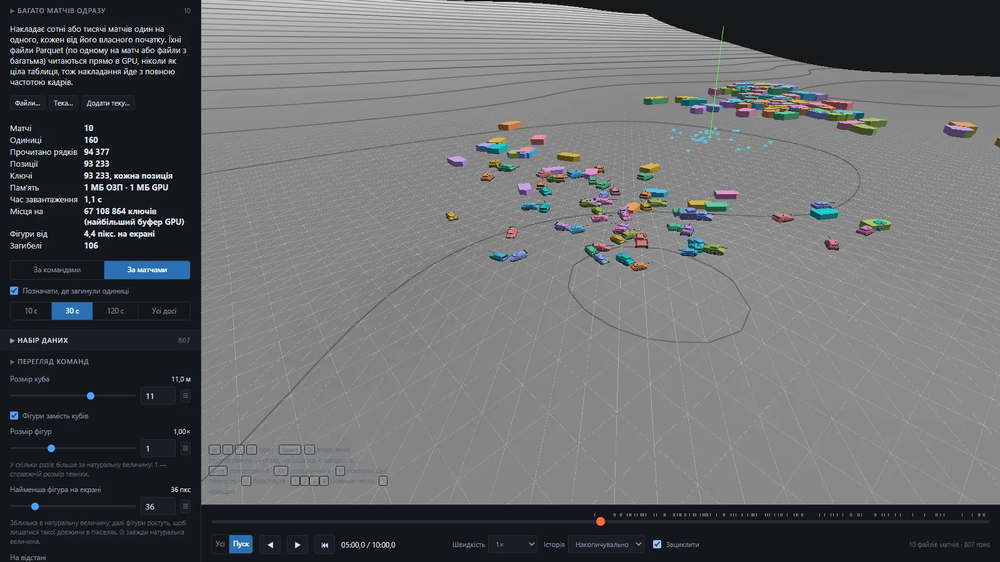

# Багато матчів одразу

**Багато матчів одразу** відтворює багато матчів один поверх одного, тож ви бачите, куди зазвичай ходять гравці кожного матчу. Використовуйте це, щоб порівняти сотні або тисячі матчів на одній картинці.

Кожен матч починається з власного початку, і його юніти рухаються як фігури. Файли йдуть прямо в відеокарту, і повна таблиця не будується, тож відтворення йде плавно там, де звичайне завантаження вичерпало б пам’ять.

## Як користуватися {#how-to-use-it}

1. Відкрийте **Багато матчів одразу** на бічній панелі Теплова карта.
2. Натисніть **Файли…** (виберіть багато файлів), **Тека…** (тека з підтеками) або **Додати теку…** (додати до завантаженого).
3. Переглядач переходить на накладання фігур і починає з початку. Натисніть **Пуск**.

Кожен файл - це один матч (або кілька). Працюють файли Parquet і контейнери [`.3dheat`](container.md). Файлу потрібні стовпці позиції, часу і юніта; стовпці назви, типу і сторони зберігаються. Інші файли і побічні файли конвертерів (політ, повідомлення, події, чат, цілі) пропускаються. Для звичайної таблиці див. [Завантаження даних](getting-data-in.md).

## Налаштування {#settings}

| Налаштування | Що робить |
|---|---|
| **За командами** / **За матчами** | Колір за стороною або колір для кожного матчу. |
| **Позначати, де загинули одиниці** | Позначка місця, де загинула кожна одиниця, на 10 с, 30 с, 120 с або на весь час досі. |

Панель показує, скільки матчів, юнітів, рядків і позицій прочитано, використану пам’ять і час завантаження. *Room for* - скільки ще позицій відеокарта могла б прийняти. *Figures from* - розмір на екрані, нижче якого юніт малюється як маленька стрілка, а не як його фігура.

Вигляд фігур використовує ті самі елементи керування, що й [розбір матчу](match-replay.md#figures): **Розмір фігур**, **Найменша фігура на екрані** і **На відстані**.

## Поради {#tips}

- Коли все не вмістилося б у пам’ять, позиції проріджуються (лишається лише позиція кожні кілька метрів), і панель про це каже.
- Режими тепла також працюють на даних накладання.
- Для статистики за тисячами матчів без їх малювання див. [Масовий аналіз](mass-analysis.md).
