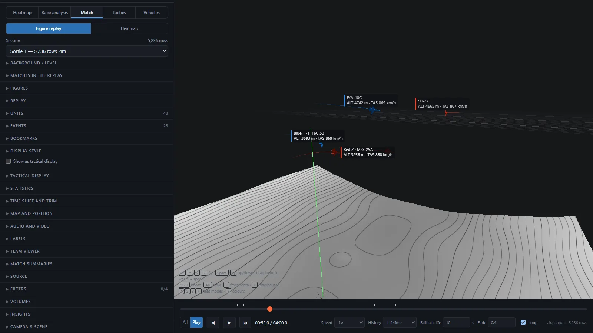

# Розбір матчу

Розбір - це фільм матчу, де кожен гравець намальований як те, чим він керував. Використовуйте його, щоб переглянути бій ще раз, стежити за однією одиницею і побачити, хто в кого влучив.

Постріли, влучання, пожежі й уламки малюються на юнітах і цілях рівня. Камери, підписи і тактичний показ допомагають читати бій. Знаєте Tacview? [Паритет з Tacview](tacview-parity.md) показує, де кожен його інструмент.

## Почати розбір {#start-a-replay}

1. Завантажте запис через **Джерело → Файли…** або перетягніть його на панель Джерело (будь-яка таблиця зі стовпцями **особи** і **часу**, файл Tacview, конвертований розбір, матч [`.3dheat`](container.md)). Див. [Завантаження даних](getting-data-in.md).
2. Відкрийте вкладку **Матч** і виберіть **Повтор фігурами**, або виберіть **Накладання фігур** на панелі режимів вкладки Теплова карта.
3. У **Матчі в повторі** виберіть один матч, усі одразу або кілька.
4. Натисніть **Пуск** на часовій шкалі (або `K`). Перетягніть шкалу, щоб перескочити.

Фігури замінюють куби для кожного юніта, чию назву або тип відомо (див. [Фігури](figures.md)). Дані без стовпця назви чи типу малюються як солдати.

## Фігури {#figures}

| Налаштування (розділ **Фігури**) | Типово | Що робить |
|---|---|---|
| **Фігури замість кубів** | увімкнено | Вимкнено малює прості куби. |
| **Розмір фігур** (разів від справжнього розміру) | 1 | 1 - справжній розмір; від 0.25 до 20 разів (логарифмічна шкала). Більший допомагає здалеку. |
| **Найменша фігура на екрані** | 36 px | Далекі фігури збільшуються, щоб тримати цей розмір, від 0 до 200 px; 0 лишає справжній розмір. |
| **На відстані**: Figure, Arrow, Symbol | Figure | Чим стає далека одиниця. |
| **Знаки** | NATO (APP-6) | NATO (APP-6), російські тактичні знаки, значки **Ігрова мапа** або **Лише форми (для дальтоніків)**. |
| **Розмір знака**, **Мій бік**, **Ворожі / Нейтральні**, **Позначки курсу** | 28 px (від 12 до 64), автоматично, ворожий, увімкнено | Як виглядають знаки і яка сторона дружня. |
| **Вертикальні лінії** | увімкнено | Лінія від кожної одиниці прямо вниз до землі, щоб висоту було видно в 3D. |
| **Висовки та підписи біля озброєння** | вимкнено | Лінії до землі й підписи на ракетах і бомбах. |
| **Пожежі на техніці** | увімкнено | Полум’я від миті, коли одиниця загорається, до гасіння. |
| **Влучання в юніти** | увімкнено | Позначки місць, куди влучили постріли (нижче). **Влучання лишаються**: від 1 до 300 секунд або **Усе життя**. **Плаваючі позначки**: мітки, намальовані над поверхнею. |
| **Лінії погляду й башти** | вимкнено | Пунктир: куди дивиться гравець; суцільна: куди спрямована гармата. |
| **Будівлі** | суцільні | Суцільні або прозорі будівлі, коли рівень їх малює. |

### Знаки на відстані {#symbols-at-a-distance}

Коли одиниця була б меншою за **Найменша фігура на екрані**, вона може стати знаком, який лишається читабельним. Форма каже тип (наприклад, заокруглена коробка з позначкою гусениці для броні); колір каже сторону. Відкрийте меню **Знаки**, щоб змінити стиль.

### Позначки влучань, уламки й пожежі {#hit-marks-wrecks-and-fires}

- **Позначки влучань** стоять на поверхні, куди потрапив постріл, у масштабі фігури. Їхній вигляд каже, що сталося: дірка (пробили), яскрава пляма (не пробили), борозна (рикошет), зірка сажі (фугасний снаряд). Кольоровий ободок каже, що це зробило: смертельний постріл, модуль знищено, критичне, сильне, пошкодження, без пошкоджень, влучання. Наведіть курсор на позначку, щоб побачити назву снаряда.
- Знищена одиниця малюється **обвугленою** як уламок від смерті до відродження або видалення; її знак перекреслено.
- **Пожежі** горять на одиниці від моменту, коли вона загорається, до гасіння.
- **Башти** повертаються туди, куди за даними спрямована гармата (або, без цього, куди дивиться гравець).

### Зброя, пастки й трасери {#weapons-decoys-and-tracers}

Коли ввімкнено **Зброя, постріли й влучання** (розділ Перегляд команд): ракети, снаряди, бомби й торпеди летять як власні фігури зі димовим слідом; кулі й снаряди - це трасери; удари й вибухи спалахують. Трасер, намальований **пунктиром**, був відтворений з влучання, бо в даних не було пострілу. Флери та дипольні відбивачі малюються як пастки; вони сховані зі списку юнітів, якщо не позначено *Пастки та снаряди*.

## Камери {#cameras}

Клацніть юніт або його підпис, щоб **стежити** за ним; розділ **Розбір** пропонує **Позаду**, **Орбіта**, **Кабіна** (з індикатором на лобовому склі, `H`), **Фіксовано**, **Padlock**, **Ціль** і **Супутник**. `V` перемикає їх, **Відстань камери** задає, як далеко. Esc зупиняє.

- **Вид двох юнітів**: виберіть **Ціль** (або Ctrl/Alt-клік по юніту), щоб дивитися на нього з того, за яким стежите; **Поміняти** їх місцями.
- **Показник**: Shift-клік по двох юнітах дає пеленг, відстань і різницю висот між ними.
- **2D-мапа** (`M`): кутовий або повний вид, зі слідами й іменами.
- **Закладки** (`B`): зберігають момент і камеру; власні вбивства, смерті та позначки запису також перелічені.
- **Події**: кожна подія в часовому порядку; клік переходить до неї. `Page Up` / `Page Down` перескакують між подіями; **Пауза на події** зупиняється на кожній.

## Тактичний показ {#tactical-display}

Розділ **Тактичний показ** малює, для жодного юніта, вибраних, усіх або одного виду (літаки, наземні, кораблі, зброя): вектори швидкості і шлях попереду, лінії носа і підйомної сили, конуси радара, захоплення, канали передачі даних, зони і лінії втягування, лінії прямої видимості, куди дивляться гравці (конуси огляду), наведення башт і записану камеру.

### Стиль показу {#display-style}

`T` (або перемикач **Показати як тактичний дисплей**) перемикає вигляд на стиль радарного екрана: світіння, контури, лінії рельєфу, сітка вимірювань, лінії сканування, кільця відстані, шкали висоти, панелі з вбивствами й подіями, і **Режисер**, який сам переміщує камеру до подій.

## Цілі {#objectives}

Коли матч надходить зі своїми цілями, розділ **Цілі** малює їх на рівні: зони захоплення (з власником і прогресом захоплення), відродження, аеродроми, області та цілі бомбардувань, кожен шар можна вмикати й вимикати, з підписами. Вони видні крізь землю. Коли завантажено кілька ігрових режимів, **Режим** фільтрує матчі за режимом. Цілі беруться з файлу матчу конвертера поруч із записом або всередині контейнера [`.3dheat`](container.md).

## Підписи і статистика {#labels-and-statistics}

- **Підписи**: правила для кожного виду (**Вибрані**, **Літаки**, **Земля**, **Кораблі**, **Зброя**, **ШІ**): показувати чи ні, які значення і **Пріоритет** - хто отримує місце, коли підписи перекриваються. **Розводити підписи** переміщує підпис поруч із юнітом, коли він закрив би інший, і прибирає там, де немає місця. **Розмір підписів** від 60 до 250 %. **Повернути ім’я, техніку, висоту й швидкість** скидає правила.
  - Наземні юніти починаються з імені, техніки і швидкості.
  - Літаки починаються з імені, техніки, висоти і швидкості.
  - Кораблі починаються з імені, техніки, швидкості і курсу.
  - Наведіть курсор на юніт, щоб побачити кожне його значення.
- **Статистика**: для кожної команди і юніта: вбивства, смерті, постріли, влучання, відсоток влучань, зльоти, посадки, час у повітрі, максимальна швидкість, висота і G, відстань. Експорт CSV.
- **Графіки**: значення юніта в часі, два юніти порівняно або одне значення проти іншого.

## Багато матчів одразу {#many-matches-at-once}

Щоб накласти сотні або тисячі матчів один на одного, див. [Багато матчів одразу](many-matches.md). Деталі фігур (дим, вогонь, інші часові ефекти): [Фігури в накладанні фігур](figure-replay.md). Список можливостей Tacview: [Паритет з Tacview](tacview-parity.md), дочірня сторінка цієї.
