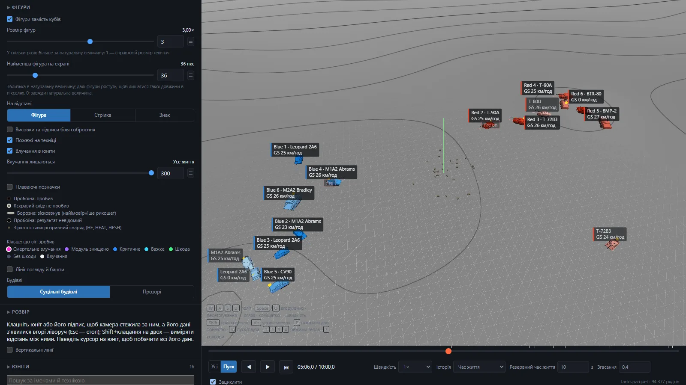
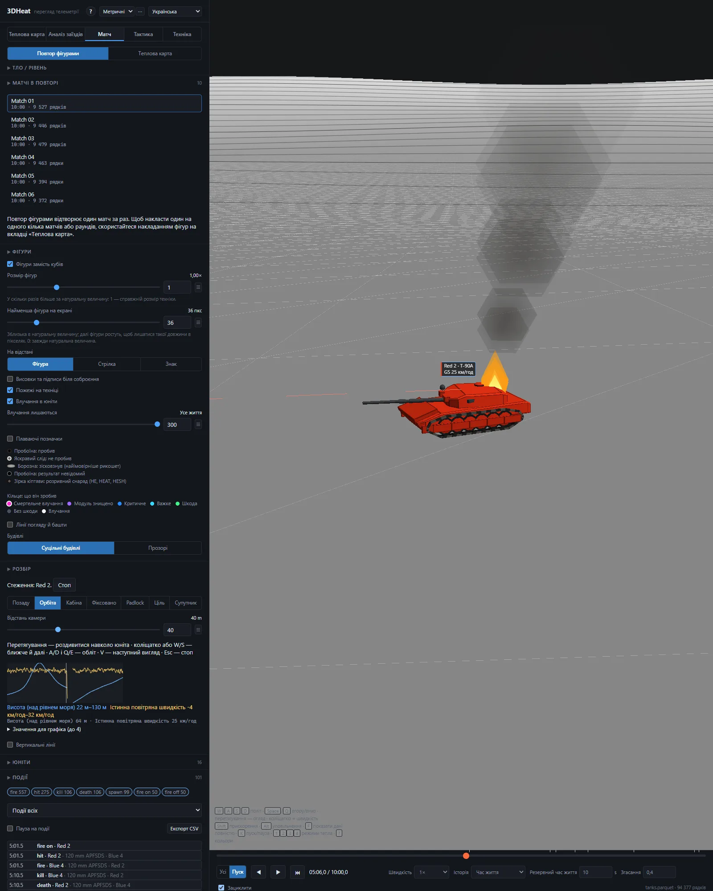
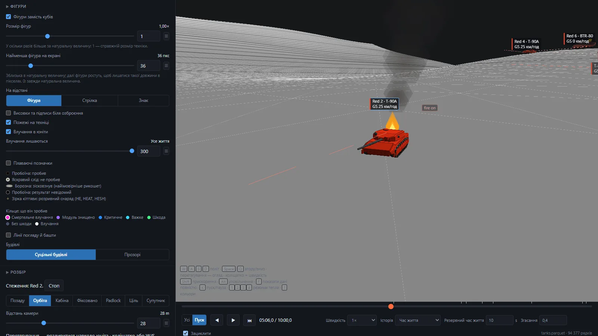
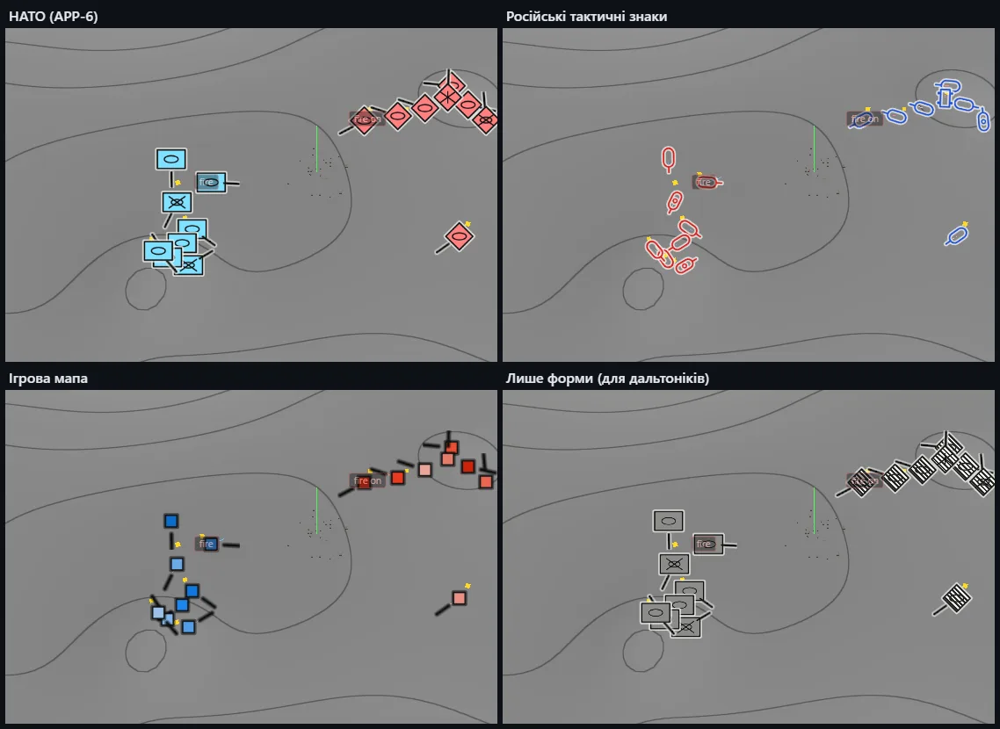
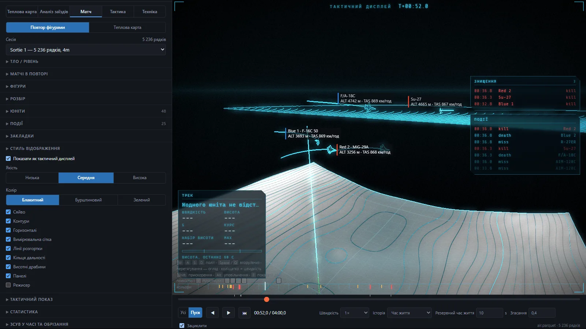
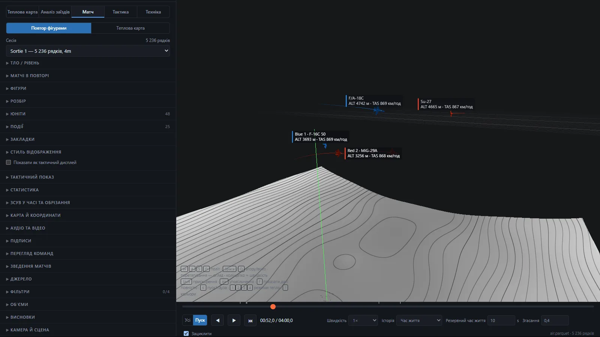

# Розбір матчу

Розбір - це фільм матчу, де кожен гравець намальований тим, чим він керував. Використовуйте його, щоб переглянути бій знову, стежити за одним юнітом і побачити, хто в кого влучив.

Постріли, влучання, пожежі й знищення малюються на юнітах і цілях на рівні. Камери, підписи та тактичний показ допомагають читати бій. Знаєте Tacview? [Відповідність Tacview](tacview-parity.md) показує, де в 3DHeat кожен його інструмент.

## Почати розбір {#start-a-replay}

1. Завантажте запис через **Джерело → Файли…** або перетягнувши його на панель Джерела (будь-яка таблиця зі стовпцем **людина** і стовпцем **час**, файл Tacview, перетворений розбір, матч [`.3dheat`](container.md)). Див. [Завантаження даних](getting-data-in.md).
2. Відкрийте вкладку **Матч** і виберіть **Повтор фігурами** або виберіть **Накладання фігур** на панелі режимів вкладки Теплова карта.
3. У розділі **Матчі в повторі** виберіть один матч, усі одразу або кілька.
4. Натисніть **Пуск** на часовій шкалі (або `K`). Перетягніть шкалу, щоб перестрибнути.

Фігури замінюють кубики для кожного юніта, чиє ім’я або тип відомі (див. [Фігури](figures.md)). Дані без стовпця імені чи типу малюються як піхота.

## Фігури {#figures}

| Налаштування (розділ **Фігури**) | За замовчуванням | Що робить |
|---|---|---|
| **Фігури замість кубів** | увімк. | Вимкнено малює прості куби. |
| **Розмір фігур** (у рази до справжнього розміру) | 1 | 1 - справжній розмір; від 0,25 до 20 разів (логарифмічна шкала). Більший допомагає здалеку. |
| **Найменша фігура на екрані** | 36 px | Далекі фігури збільшуються, щоб лишатися такими великими; від 0 до 200 px; 0 лишає справжній розмір. |
| **На відстані**: Фігура, Стрілка, Знак | Фігура | Чим стає далекий юніт. |
| **Знаки** | NATO (APP-6) | NATO (APP-6), російські тактичні знаки, піктограми **Ігрова мапа** або **Лише форми (для дальтоніків)**. |
| **Розмір знака**, **Мій бік**, **Ворожий / Нейтральний**, **Позначки курсу** | 28 px (від 12 до 64), автоматично, ворожий, увімк. | Як виглядають знаки і який бік дружній. |
| **Вертикальні лінії** | увімк. | Лінія від кожного юніта прямо вниз до землі, щоб висоти читалися в 3D. |
| **Висовки та підписи біля озброєння** | вимк. | Лінії до землі та підписи на ракетах і бомбах. |
| **Пожежі на техніці** | увімк. | Полум’я від моменту, коли юніт загорівся, до гасіння. |
| **Влучання в юніти** | увімк. | Позначає, куди влучили постріли (нижче). **Влучання лишаються**: від 1 до 300 секунд або **Усе життя**. **Плаваючі позначки**: позначки, намальовані над поверхнею. |
| **Лінії погляду й башти** | вимк. | Пунктир: куди дивиться гравець; суцільна: куди спрямована гармата. |
| **Будівлі** | суцільні | Суцільні або прозорі будівлі, якщо рівень їх малює. |

### Знаки на відстані {#symbols-at-a-distance}

Коли юніт був би меншим за **Найменша фігура на екрані**, він може стати знаком, який лишається читабельним. Форма показує вид (наприклад, закруглений прямокутник із міткою гусениці для броні); колір показує бік. Відкрийте меню **Знаки**, щоб змінити стиль.

### Мітки влучань, уламки й пожежі {#hit-marks-wrecks-and-fires}

- **Мітки влучань** лежать на поверхні, в яку влучив постріл, у масштабі фігури. Їхній вигляд говорить, що сталося: дірка (пробив), яскравий бризок (не пробив), борозна (рикошет), зоряна пляма кіптяви (вибухове снаряддя). Кольоровий ковзний кружечок показує результат: смертельний постріл, модуль знищено, критичне, сильне, пошкодження, без пошкоджень, влучання. Наведіть курсор на мітку, щоб побачити назву снаряда.
- Знищений юніт малюється **обвугленим** як уламок від моменту смерті до відродження або видалення; його знак перекреслено.
- **Пожежі** горять на юніті від моменту, коли він загорівся, до гасіння.
- **Башти** повертаються туди, куди за даними спрямована гармата (а без цих даних - куди дивиться гравець).

### Зброя, пастки й трасери {#weapons-decoys-and-tracers}

Коли ввімкнено **Зброя, постріли й влучання** (розділ Перегляд команди): ракети, снаряди, бомби й торпеди летять як власні фігури зі димним слідом; кулі й снаряди - це трасери; влучання й вибухи спалахують. Трасер, намальований **пунктиром**, було обчислено з влучання, бо даних про постріл не було. Флери та хаф малюються як пастки; їх приховано зі списку юнітів, якщо не позначено *Пастки та снаряди*.

## Камери {#cameras}

Клацніть юніт або його підпис, щоб **стежити** за ним; розділ **Розбір** пропонує **Позаду**, **Орбіта**, **Кабіна** (з індикатором на лобовому склі, `H`), **Фіксовано**, **Padlock**, **Ціль** і **Супутник**. `V` перемикає їх, **Відстань камери** задає, як далеко. Esc зупиняє.

- **Вид на два юніти**: виберіть **Ціль** (або клацніть юніт із Ctrl/Alt), щоб дивитися на нього з того, за яким стежите; **Поміняти** міняє їх місцями.
- **Показник**: клацніть два юніти з Shift, щоб побачити пеленг, відстань і різницю висот між ними.
- **2D-мапа** (`M`): кутовий або повний вигляд зі слідами й іменами.
- **Закладки** (`B`): зберігають момент і камеру; також перелічуються власні вбивства, смерті та позначки запису.
- **Події**: кожна подія в часовому порядку; клацання переходить до неї. `Page Up` / `Page Down` перестрибують між подіями; **Пауза на події** зупиняється на кожній.

## Тактичний показ {#tactical-display}

Розділ **Тактичний показ** малює для жодного юніта, для вибраних, для всіх або для одного виду (літаки, наземні, кораблі, зброя): вектори швидкості й шлях попереду, лінії носа й підйомної сили, конуси радара, захоплення цілі, канали передачі даних, зони та лінії бою, лінії погляду, куди дивляться гравці (конуси огляду), приціл башти та записану камеру.

### Стиль показу {#display-style}

`T` (або перемикач **Показати як тактичний дисплей**) перемикає вигляд на стиль радарного екрана: світіння, контури, ізолінії, сітку вимірювань, лінії сканування, кільця дальності, драбини висот, панелі з вбивствами й подіями та **Режисера**, який сам переміщує камеру до подій.

## Цілі {#objectives}

Якщо матч має цілі, розділ **Цілі** малює їх на рівні: зони захоплення (з власником і прогресом захоплення), точки появи, аеродроми, області й цілі бомбардування; кожен шар можна вимкнути, є підписи. Їх видно крізь землю. Коли завантажено кілька ігрових режимів, **Режим** фільтрує матчі за режимом. Цілі беруться з файлу матчу конвертера поруч із записом або всередині контейнера [`.3dheat`](container.md).

## Підписи та статистика {#labels-and-statistics}

- **Підписи**: правила для кожного виду (**Вибрані**, **Літаки**, **Земля**, **Кораблі**, **Зброя**, **ШІ**): показувати чи ні, які значення, і **Пріоритет** - хто отримує місце, коли підписи перекриваються. **Розводити підписи** переносить підпис поруч із юнітом, якщо він закриває інший, і прибирає його там, де немає місця. **Розмір підписів** - від 60 до 250 %. **Повернути ім’я, техніку, висоту й швидкість** скидає правила.
  - Наземні юніти починаються з імені, техніки й швидкості.
  - Літаки починаються з імені, техніки, висоти й швидкості.
  - Кораблі починаються з імені, техніки, швидкості й курсу.
  - Наведіть курсор на юніт, щоб побачити кожне його значення.
- **Статистика**: для кожної команди та юніта: вбивства, смерті, постріли, влучання, відсоток влучань, зльоти, посадки, час у повітрі, найбільша швидкість, висота й перевантаження G, відстань. Експорт у CSV.
- **Графіки**: значення юніта з часом, порівняння двох юнітів або одне значення проти іншого.

## Багато матчів одночасно {#many-matches-at-once}

Щоб накласти сотні чи тисячі матчів один на одного, див. [Багато матчів одночасно](many-matches.md). Деталі фігур (дим, вогонь, інші часові ефекти): [Фігури в накладанні фігур](figure-replay.md). Список функцій Tacview: [Відповідність Tacview](tacview-parity.md), дочірня сторінка цієї.
