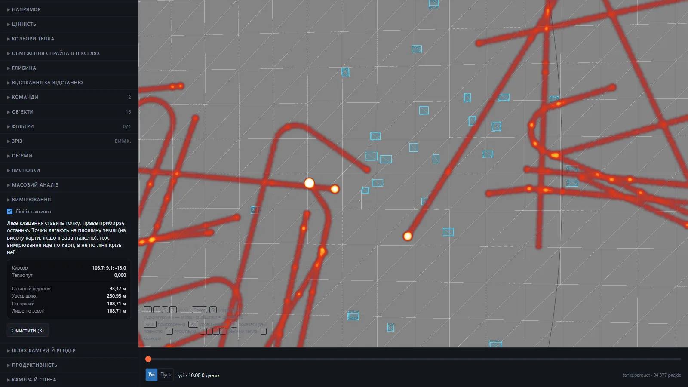

**Показник** перетворює мишу на лінійку і каже, наскільки жвава точка під курсором. Скористайтеся ним, щоб дізнатися, наскільки далеко одне від одного два місця, або скільки руху відбувається в одній точці.

## Спробуйте {#try-it}

1. Відкрийте **Показник** на бічній панелі і позначте **Лінійка активна**.
2. Клацніть лівою кнопкою миші на трьох місцях на карті. Кожен клік ставить точку.
3. Прочитайте **Увесь шлях** (довжина всього шляху) і **Останній відрізок** (останній перегін).
4. Клацніть правою кнопкою, щоб прибрати останню точку, або натисніть **Очистити (3)**, щоб прибрати всі.

| Дія | Ефект |
|---|---|
| Лівий клік | Ставить точку там, де курсор перетинає площину землі. Клік, при якому миша між натисканням і відпусканням зсунулася більш як на 4 пікселі, є перетягуванням камери, а не точкою. |
| Правий клік | Прибирає останню точку. |
| Рух | Положення курсора і тепло під ним оновлюються наживо. |

Камера працює, поки ввімкнена лінійка: перетягування все ще оглядає, клавіші все ще ведуть політ. Поки лінійка ввімкнена, вона забирає кожен клік, тож [вибір кліком](camera.md#click-to-pick) чекає, поки її вимкнуть.

**Площина землі** — це висота [зображення карти](map-images.md), якщо зображення завантажено. Інакше це найнижчий Y набору даних (без нього — 0). Точки лягають на неї, тож лінійка міряє по карті, а не по прямій крізь неї. У тривимірному рівні площина все одно є найнижчим Y набору даних, а не поверхнею рівня. Щоб отримати точку на справжній поверхні, вимкніть лінійку і клацніть по ній ([вибір кліком](camera.md#click-to-pick)): тоді координати беруться з власних трикутників рівня.

## Показники {#readouts}

| Рядок | Значення |
|---|---|
| **Курсор** | Світові X, Y, Z точки під курсором, на площині. |
| **Тепло тут** | Скільки тепла в пікселі курсора. Більше число означає більше руху в цій точці. Це значення, яке подається в шкалу кольорів до того, як точка насичення його ділить, тож його можна порівняти з [Точкою насичення](colour-and-exposure.md#saturation-point). |
| **Останній відрізок** | Відстань від останньої точки до курсора (або між двома останніми точками). |
| **Увесь шлях** | Довжина ламаної через кожну точку і курсор. |
| **По прямій** | Тривимірна відстань від першої точки до курсора (або останньої точки). |
| **Лише по землі** | Те саме, лише по X і Z. |
| **Очистити (N)** | Прибирає всі точки. |

Відстані показано в сантиметрах, якщо менше 1 одиниці, у метрах до 1 000, а понад це в кілометрах. Це припускає, що одна світова одиниця — метр ([Осі, одиниці та час](axes-units-and-time.md#unit-scale)). Координати світові, навіть коли вісь [інвертовано для показу](camera.md#invert-world-axis).

Точки і лінія між ними малюються накладкою у вигляді, розміри якої залежать від кроку сітки. Точки лінійки не зберігаються у видах; вони лишаються, коли ви завантажуєте інші дані.

## Для розробників {#for-developers}

**Тепло тут** читається з GPU не частіше ніж кожні 120 мс, бо читання одного пікселя зупиняє конвеєр. Воно використовує той самий шлях, що і `engine.readHeatProbe()`: ділиться на підсилення, з яким записано кадр. Тож на шляху накопичення half-float (`?heat=f16`) воно в тих самих одиницях, що й на 32-бітній цілі ([Накопичення half-float](half-float-accumulation.md)).
