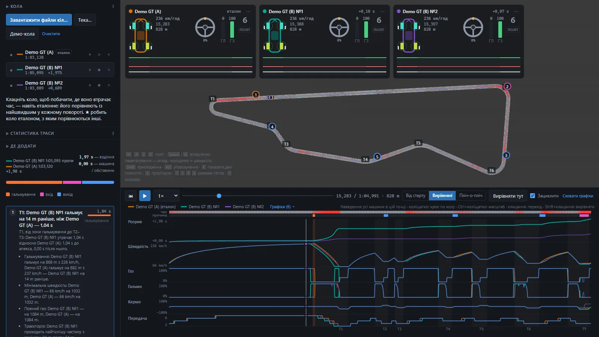

# Аналіз заїздів

Ви проїхали одну й ту саму трасу двічі. Вкладка **Аналіз заїздів** відтворює обидва заїзди разом у 3D, показує, де одне коло було повільнішим, і пояснює чому. Кіл ще немає? Натисніть **Демо-кола**.

Вкладка порівнює два або більше кіл однієї траси. Вона спільна з тепловою картою для полотна, камери і завантаженої моделі траси (**Тло / рівень**); усе інше її власне: власна бічна панель і власна смуга під виглядом. Слова на кшталт *коло*, *еталон* і *вершина повороту* є в [глосарії](glossary.md).

Ця сторінка - карта вкладки. Кожна частина має власну сторінку:

| Сторінка | Що охоплює |
|---|---|
| [Завантаження кіл](race-loading-laps.md) | кожен формат файлів, теки й траси, назви машин, демо-кола, список кіл, еталон і фокус |
| [Розбір і 3D-сцена](race-replay-and-scene.md) | смуга керування, три режими розбору, вирівнювання машин, камера переслідування, лінії, мапи, машини, підписи, дзеркальні світи |
| [Графіки та HUD](race-charts-and-hud.md) | графіки за дистанцією, вибирач графіків, наведення й масштаб, картки машин, таблиця каналів |
| [Події контролю машини](race-control-events.md) | блокування, пробуксовка, недостатня й надмірна поворотність, розкручування, недостатня поворотність на вході, удари, аварії, ABS/TC, ручник, повітря - як виявляється кожна, з усіма порогами |
| [Аналіз поворот за поворотом](race-corner-analysis.md) | вирівнювання за дистанцією, повороти й відрізки, розрахунок часу в повороті, кожна причина і порядок, у якому їх перевіряють, форма лінії і порада |
| [Профілі машин і порівняння](race-car-profiles.md) | що вміє кожна машина, виміряно з її кіл; *Cars compared*; що машина вирішує на кожному повороті |
| [Статистика траси](race-course-statistics.md) | багато кіл однієї траси: помилки за поворотом і за видом, карта помилок, експорт теплової карти, межі продуктивності |
| [Аналітика заїздів: метод](race-analytics.md) | дослідження, на якому базуються правила, з джерелами |
| [Інші гонкові ігри](other-games.md) | що переглядач робить з колами кожної гри: ковзання й дрифт, обчислені там, де гра їх не надсилає, дзеркальні світи, додаткові канали |

## Екран {#the-screen}

**Бічна панель**, зверху вниз (розділи можна згортати):

1. **Кола** - завантаження, список, показ/приховання, еталон, фокус, переслідування.
   Див. [Завантаження кіл](race-loading-laps.md).
2. **Статистика траси** - лише від трьох завантажених кіл.
   Див. [Статистика траси](race-course-statistics.md).
3. **Де додати** - висновки для сфокусованого кола, поворот за поворотом.
   Див. [Аналіз поворот за поворотом](race-corner-analysis.md).
4. **Поворот за поворотом** (або *Поворот за поворотом - клас X*, коли є кілька класів) - найшвидше коло через кожен поворот і його лінія. Показується з двох або більше кіл.
5. **Контроль машини** - блокування, ковзання, недостатня поворотність і удари сфокусованого кола.
   Див. [Події контролю машини](race-control-events.md).
6. **Порівняння машин** (або **Машина**, коли одна машина) - див.
   [Профілі машин і порівняння](race-car-profiles.md).
7. **Вигляд** - яка мапа намальована на трасі і що малюється.
   Див. [Розбір і 3D-сцена](race-replay-and-scene.md).
8. Спільні панелі **Тло / рівень** і **Камера й сцена** (модель траси, інверсія осей, камера) - описані разом із тепловою картою і на сторінці [Камера](camera.md).

**Вигляд** показує трасу, намальовані лінії проїзду, мапу, машини, підписи, прикріплені до траси, і до шести карток машин у верхньому лівому куті (див. [Графіки та HUD](race-charts-and-hud.md)). Коли кіл не завантажено, там написано «No laps loaded - Drop two or more lap files here, or load the demo laps from the sidebar.»

**Смуга під виглядом** містить керування розбором і, якщо її не приховано, графіки за дистанцією.

## Швидкий старт {#quick-start}

1. Відкрийте вкладку **Аналіз заїздів** (поруч із **Теплова карта** угорі бічної панелі).
2. Завантажте кола. Натисніть **Демо-кола**, щоб побачити, що вкладка робить із трьома вигаданими колами. Для власних кіл спершу запишіть їх ([формати файлів і записувачі](race-loading-laps.md#file-formats)), потім натисніть **Завантажити файли кіл…** або **Тека…**, або перетягніть файли чи теки на вигляд.
3. Найшвидше повне коло стає еталоном; найповільніше інше коло отримує фокус. Клацніть будь-яке коло в списку, щоб сфокусувати його; ★ робить коло еталоном.
4. Прочитайте **Де додати**. Клацніть знахідку: машини вирівнюються за 40 м до неї, камера вписує її в кадр, розбір проходить крізь неї і відкриваються вимірювання.
5. Наведіть курсор на графіки, щоб перемістити кожну машину на цей метр; Shift+клік вирівнює їх там.

## Клавіатура {#keyboard}

Поки відкрита вкладка Аналіз заїздів:

| Клавіша | Дія |
|---|---|
| **K** | пуск / пауза розбору |
| **Home** | назад на початок розбору |
| цифрові клавіші | нічого (на тепловій карті вони перемикають режими) |

Клавіші, набрані в текстовому полі або випадаючому списку, ігноруються. Клавіші камери працюють так само, як на тепловій карті (**W A S D**, **Пробіл** вгору, **Q** вниз, **Shift** швидше, **Alt** повільніше, миша - щоб дивитися; усе в [Камера](camera.md)); **F** вписує завантажені кола в кадр (як і завантаження кіл).

## Багато кіл {#many-laps}

- Усі завантажені кола аналізуються і рахуються; десятки займають секунду-дві.
- Понад **8** кіл (`SHOW_ALL_UP_TO`) додані кола малюються лише тоді, коли вони еталон, сфокусоване коло або найкраще коло класу сфокусованого кола. Перемикають *Показати всі* / *Лише переглядувані*.
- Понад **10** видимих машин (`PLAIN_PAST`) кола, на які не дивляться (не фокус, не машина, за якою стежать, не еталон), малюються з лініями, прорідженими до точки кожні 6 м замість 1.5 м, і звичайними машинами.
- Графіки малюють щонайбільше **8** кіл; HUD показує щонайбільше **6** карток.
- Статистика траси з’являється від **3** кіл.

Деталі: [Статистика траси](race-course-statistics.md#performance-with-many-laps).

## Типові налаштування вигляду {#default-view-settings}

| Налаштування | Типово |
|---|---|
| Мапа | Часова мапа |
| Лінії проїзду, Машини, Шини й підвіска, Підписи, Траса з кіл | увімкнено |
| Усі значення на картках | вимкнено |
| Розмір машини | 1× |
| Графіки | показані |
| Режим розбору | Від лінії |
| Швидкість розбору | 1× |
| Зациклити | увімкнено |

Нічого з цього не зберігається; перезавантаження починає з типових значень. Що запам’ятовується в браузері: мова і назви машин, вивчені з файлів кіл (див. [Завантаження кіл](race-loading-laps.md#car-names)).

## Для розробників {#for-developers}

### Що відбувається, коли завантажено кола {#what-happens-when-laps-are-loaded}

Щоразу, коли змінюються набір кіл, еталон або мова, увесь аналіз виконується заново (`analyse` у [`src/race/analysis.ts`](https://github.com/Holdi601/3DHeat/blob/main/src/race/analysis.ts)):

1. До кожного кола додаються похідні канали там, де гра їх не надсилає: кут дрифту, проковзування коліс за швидкостями коліс, перебування в повітрі, пухкий ґрунт, швидкість рискання ([`derive.ts`](https://github.com/Holdi601/3DHeat/blob/main/src/race/derive.ts)).
2. Обирається еталон, і кожне коло проєктується на його шлях і пересемплюється кожні 2 м ([`align.ts`](https://github.com/Holdi601/3DHeat/blob/main/src/race/align.ts)).
3. З кіл визначається, чи дзеркальний світ гри ([`handedness.ts`](https://github.com/Holdi601/3DHeat/blob/main/src/race/handedness.ts)).
4. Повороти знаходяться на еталоні й групуються в ділянки від однієї зони гальмування до наступної ([`segments.ts`](https://github.com/Holdi601/3DHeat/blob/main/src/race/segments.ts)).
5. Для кожної машини: її обвідна (зчеплення, гальмування, тяга за швидкістю), її профіль, її криві шин ([`envelope.ts`](https://github.com/Holdi601/3DHeat/blob/main/src/race/envelope.ts), [`profile.ts`](https://github.com/Holdi601/3DHeat/blob/main/src/race/profile.ts), [`control.ts`](https://github.com/Holdi601/3DHeat/blob/main/src/race/control.ts)).
6. Для кожного кола й ділянки: що воно зробило (точка гальмування, найповільніша точка, повний газ, ...) і лінія, якою воно їхало ([`line.ts`](https://github.com/Holdi601/3DHeat/blob/main/src/race/line.ts)).
7. Для кожного кола: його події керування машиною, кожна поставлена проти кола, з яким його там порівнюють.
8. Для кожного кола й ділянки: баланс часу відносно кола порівняння і знахідка словами.
9. Карта часу і карта причин для кожного кола.

Тексти створюються поточною мовою; зміна мови запускає аналіз знову (і перейменовує демо-кола). Збій аналізу показується під кнопками **Кола** як помилка, а кола лишаються завантаженими.

### Вихідні файли {#source-files}

| Файл | Призначення |
|---|---|
| `src/race/adapters.ts`, `ibt.ts` | читання файлів кіл |
| `src/race/lap.ts`, `carNames.ts`, `synthetic.ts` | тип кола, назви, демо-кола |
| `src/race/derive.ts`, `handedness.ts` | похідні канали, дзеркальні світи |
| `src/race/align.ts`, `segments.ts`, `line.ts` | вісь відстані, повороти, лінії |
| `src/race/analysis.ts` | порівняння поворотів, причини, знахідки |
| `src/race/envelope.ts`, `profile.ts` | що вміє машина |
| `src/race/control.ts`, `impacts.ts` | керування машиною, влучання й аварії |
| `src/race/stats.ts` | багато кіл |
| `src/race/replay.ts`, `scene.ts`, `glyph.ts`, `geometry.ts` | повтор і малювання |
| `src/race/schema.ts`, `graphs.ts` | таблиця каналів, рядки графіків |
| `src/ui/race/*` | бічна панель, графіки, HUD, підписи |
| `src/state/raceStore.ts` | стан вкладки і годинник повтору |
