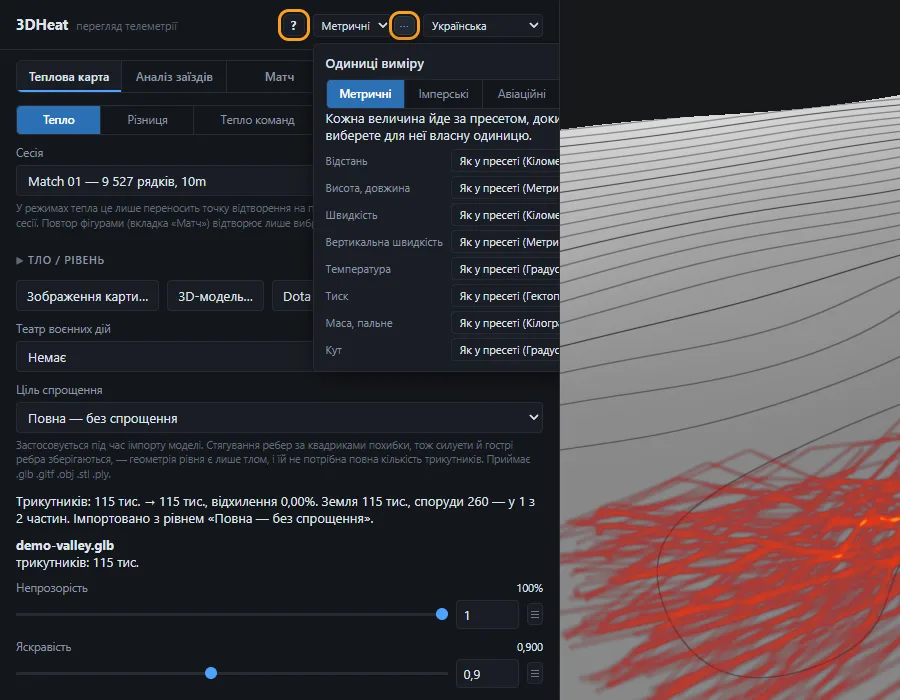
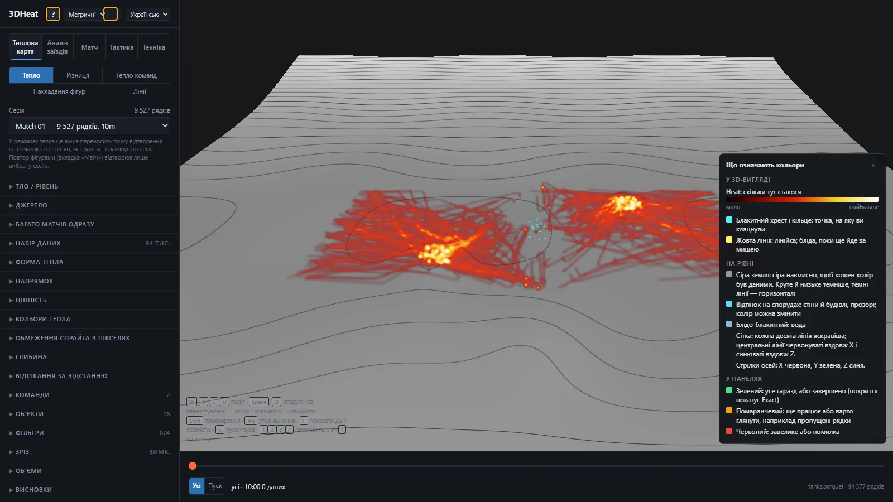
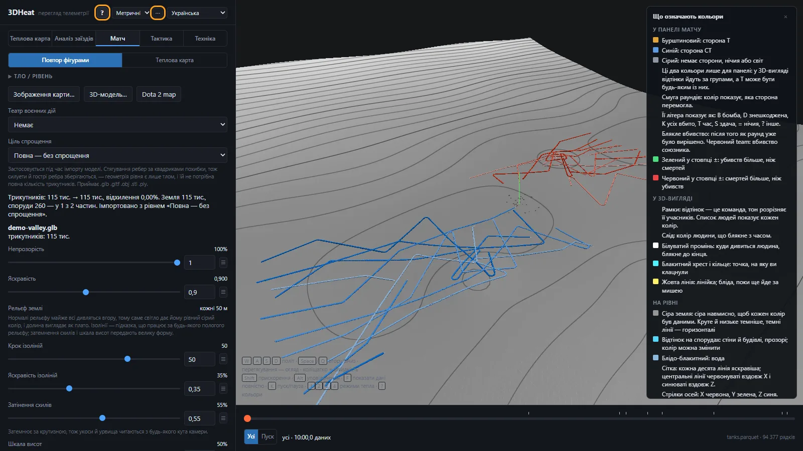

# Налаштування, одиниці та клавіші

Невеликі елементи керування вгорі бічної панелі змінюють те, як переглядач з вами спілкується: мова, одиниці (метри або фути, км/год або вузли) і режим довідки, який пояснює кольори. Ваш вибір запам'ятовується у браузері.

## Заголовок {#the-header}

Угорі бічної панелі:

| Елемент | Що робить |
|---|---|
| **?** | Режим довідки: що означає кожен колір (також `?` або `F1`) |
| Меню **Одиниці** | Метрична, імперська, авіаційна або морська |
| Кнопка **...** поруч із **Одиниці** | Відкриває «Одиниці виміру»: один випадаючий список на кожну величину |
| Меню **Мова** | Мова переглядача: [40 мов](languages.md) або мова браузера |

Числа, які ви вводите в поле, можна писати з крапкою або комою (`0.35` або `0,35`). Переглядач розуміє обидва варіанти і показує числа так, як їх пише мова переглядача.

## Одиниці {#units}

1. Оберіть набір у меню **Одиниці**. Усі величини перемикаються разом.
2. Щоб змінити лише одну величину, натисніть кнопку **...** поруч із нею і оберіть для неї одиницю. Тоді в меню з'явиться `*` після назви набору.
3. Величина, яку ви не змінювали, слідує за набором. Щоб повернутися, оберіть «Як у наборі».

| Величина | Метрична (за замовчуванням) | Імперська | Авіаційна | Морська |
|---|---|---|---|---|
| Відстань | km | mi | NM | NM |
| Висота, довжина | m | ft | ft | m |
| Швидкість | km/h | mph | kt | kt |
| Вертикальна швидкість | m/s | ft/min | ft/min | m/s |
| Температура | °C | °F | °C | °C |
| Тиск | hPa | inHg | hPa | hPa |
| Маса, пальне | kg, l | lb, gal | lb, gal | t, m³ |
| Кут | градуси | градуси | градуси | градуси |

Інші одиниці, які можна обрати для однієї величини: відстань km, mi, NM; швидкість km/h, m/s, kt, mph; вертикальна швидкість m/s, ft/min, m/min; температура °C, °F, K; тиск hPa, inHg, mmHg, psi; маса kg, lb, t; кут градуси або NATO mils (6400 на коло). Одиниці скрізь однакові в переглядачі: підписи, картки, графіки, статистика.

## Режим довідки {#help-mode}

Натисніть `?` або `F1` чи клацніть кнопку **?**. З'явиться розділ *Що означають кольори*: легенди для тривимірного виду, теплових шкал, кольорів команд, кольорів рівня, кольорів статусів панелей, панелі матчу і вигляду заїзду. Режим лишається увімкненим, доки ви його не вимкнете. На вкладці **Матч** він також пояснює кольори панелі матчу.

## Що пам'ятає браузер {#what-the-browser-remembers}

Ці налаштування зберігаються у вашому браузері між відвідинами (ніщо нікуди не надсилається):

- мова, одиниці та режим довідки;
- налаштування фігури, символу, підпису, камери і тактичного відображення у повторі;
- швидкість відтворення і дзеркальність;
- закладки для кожного запису, гучність для кожного набору даних, шари цілей;
- налаштування зовнішнього ШІ (ключ лише якщо ви позначите *Remember*).

Налаштування тепла, фільтри і режим починаються з нуля при кожному завантаженні. Повний згенерований список: [Збережені налаштування](ref-settings-storage.md).

## Клавіші, які переглядач утримує від браузера {#keys-the-viewer-keeps-from-the-browser}

Сесія з великими даними довго завантажується, тому переглядач не дає браузеру випадково її скинути:

- `Ctrl`/`Cmd` + літери, які друкують, зберігають, відкривають, перезавантажують, закривають або відкривають нові вікна, нічого не роблять поза текстовими полями; `F1`, `F3`, `F5`, `F6` і `F7` також нічого не роблять.
- Закриття або перезавантаження вкладки з завантаженими даними чи рівнем спершу запитує підтвердження.
- На повному екрані переглядач блокує клавіші, які використовує (W, T, N, S, R, P, Q, Esc), щоб браузер їх не перехопив.

Точний список: [Клавіші браузера](ref-browser-keys.md). Усі власні клавіші переглядача: [Довідник клавіатури і миші](keyboard-reference.md).
