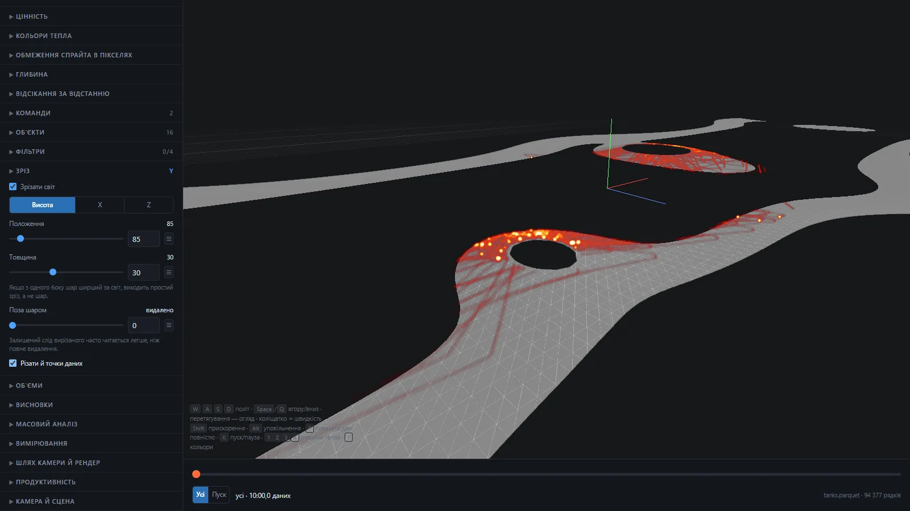

# Зріз

**Зріз** розрізає світ, як шматок торта, щоб можна було зазирнути всередину будівель. Скористайтеся ним, коли стіни ховають цікаве тепло, наприклад щоб побачити один поверх будівлі.

## Спробуйте {#try-it}

1. Завантажте рівень і якісь дані, потім відкрийте **Зріз**.
2. Позначте **Зрізати світ**. Вісь — **Висота**.
3. Перетягуйте **Позиція** вгору і вниз: шар рухається крізь рівень.
4. Зробіть **Товщина** тонкою для плану поверху або широкою для «все нижче за цю точку».
5. Залиште **Поза шаром** на 0, щоб прибрати решту, або підніміть, щоб лишити ледь помітний слід.



Шар ріже **геометрію рівня і точки даних разом**. Якщо різати тільки рівень, тепло висіло б там, де колись була його будівля. Це протилежність [глибини перекриття](depth-and-culling.md): коли рівень правильно приховує те, що за ним, то й усередина будівлі прихована. Панель показується, коли є що різати (набір даних або тривимірний рівень). Її заголовок показує вісь, коли зріз увімкнено, і *вимкнено*, коли ні.

```
side view         Position = where the slab is
 ----------       Thickness = how tall the slab is
 | floor 3 |
 |=========|  <--- slab (kept)
 | floor 2 |  <--- outside: removed (or faint)
 | floor 1 |
 ----------
```

## Елементи керування {#controls}

| Елемент | За замовчуванням | Значення |
|---|---|---|
| **Зрізати світ** | вимкнено | Вмикає шар. Поки позиція ще на початковому 0, а товщина на початковій 500, увімкнення переносить їх до середини осі і до 15% її довжини. |
| Вісь | **Висота** | *Висота* (Y), *X* або *Z*. Зміна осі переносить шар у середину нової осі. |
| **Позиція** | середина | Центр шару в світових одиницях, уздовж осі (500 кроків). |
| **Товщина** | 15% довжини | Від 1/500 довжини до подвоєної довжини, логарифмічними кроками. Коли вона стає такою широкою, як вісь, показує *past the world*: одна сторона тоді виходить за межі світу, і це звичайний розріз, а не шар. |
| **Поза шаром** | 0, *прибрано* | Скільки того, що лежить поза шаром, лишається видимим, 0-100%. Ледь помітний слід того, що відрізали, часто легше читати, ніж повне прибирання. |
| **Різати й точки даних** | увімкнено | Вимкнено залишає тепло цілим, тож воно видно крізь розріз. Це корисно, щоб бачити, що над шаром і під ним. |

Довжина осі — це довжина тривимірного рівня, якщо його завантажено, інакше — довжина набору даних.

Зріз не залежить від [відсікання за відстанню](depth-and-culling.md#distance-culling), яке ріже вздовж напрямку погляду, а не вздовж осі світу. Обидва поєднуються. Будь-яка зміна налаштувань зрізу перезапускає накопичення тепла.

## Для розробників {#for-developers}

Шар перевіряється для позиції світу кожного рядка у вершинному шейдері. Рядок поза ним має свій внесок помножений на значення *Поза шаром*, тож при 0 його відхиляють ще до малювання будь-якого фрагмента. Шейдери рівня застосовують ту саму перевірку до кожного фрагмента землі, споруд і води.
