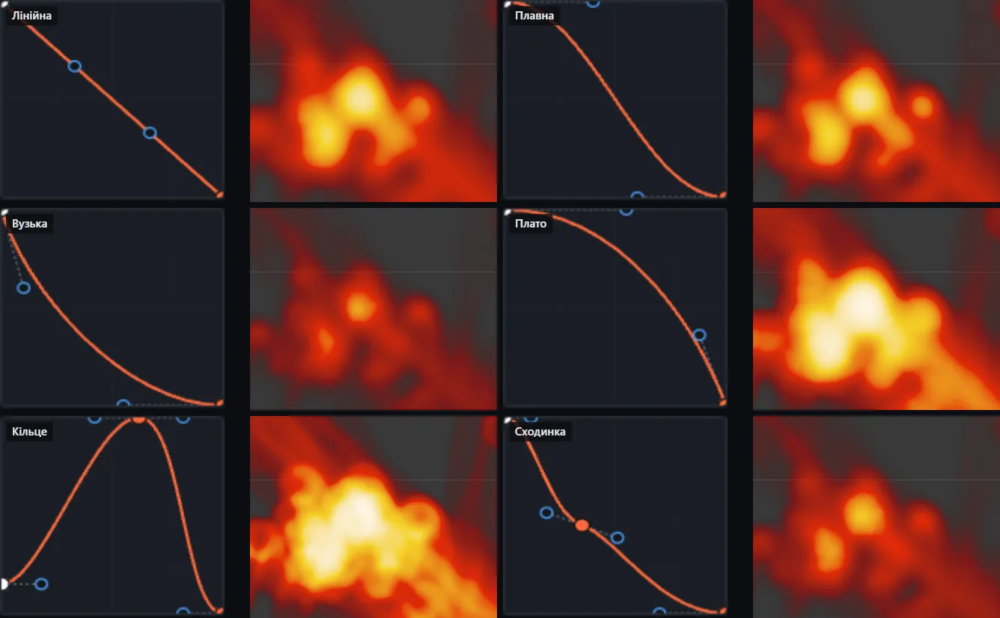

# Форма спрайта

Кожен рядок малюється круглим спрайтом, який завжди повернутий до камери. Його розмір і профіль від центру до краю - **спад** - визначають, чи гаряча точка читається як щільна крапка, м’яка хмара, диск чи кільце. Ці елементи керування містяться в розділах **Форма тепла** та **Обмеження спрайта в пікселях** бокової панелі й діють на [Тепло](heat.md), [Різницю](difference.md), [Тепло команд](team-heat.md), а як half-width лінії - на [Лінійне тепло](line-heat.md).

Зміна будь-якого з них перезапускає накопичення (поле треба перемалювати з новою формою).

Думайте про кожну крапку як про м’яку пляму світла. Мала пляма показує окремі місця; велика пляма зливає сусідів у хмару. Форма визначає, наскільки м’яким є край.



## Радіус спрайта {#sprite-radius}

Радіус спрайта в **одиницях світу** (позначено метрами). За замовчуванням 6, а при кожному завантаженні - горизонтальний розмір даних / 120, достатньо великий, щоб сусідні зразки вздовж шляху зливалися в смугу, а не читалися як волосина. Логарифмічний повзунок від 0,05 до 2000, маркер можна перетягнути до 50 000.


Далекі речі виглядають меншими, тож спрайт на екрані зменшується з відстанню. У паралельній проєкції він однаковий скрізь, і саме тому паралельний вигляд правильний для порівняння гарячих точок ([Камера](camera.md#projection)).

## Обмеження в пікселях {#pixel-clamps}

**Обмеження спрайта в пікселях** (за замовчуванням закрито) обмежують радіус на екрані після перетворення вище.

| Елемент керування | За замовчуванням | Діапазон (повзунок) | Навіщо |
|---|---|---|---|
| **Мін. радіус у пікселях** | 1 px | 0-16 (512) | Не дає далеким даним зникнути менше ніж в один піксель. |
| **Макс. радіус у пікселях** | 96 px | 2-1024, логарифмічна (8192) | Захист від перемальовування. Спрайт, що покриває N пікселів, коштує N операцій змішування, тож необмежений радіус близько до камери перетворює швидкий кадр на повільний. Вище висоти вікна перегляду обмеження нічого не обрізає. |

**Однакова щільність за будь-якого масштабу** (у розділі Форма тепла, за замовчуванням увімкнено) працює разом з обмеженнями. Спрайт, який обмеження робить більшим (далеко) або меншим (зблизька), зберігає тепло, яке дав би його справжній розмір, тож колір означає однакову кількість рядків на площу землі за будь-якого масштабу. Якщо це вимкнено, обмежений спрайт додає повну вагу при обмеженому розмірі, і картинка змінюється, коли ви наближаєтеся.

## Інтенсивність у центрі й на краю {#centre-and-edge-intensity}

Тепло, яке спрайт додає в точному центрі (**Інтенсивність у центрі**, за замовчуванням 1, від 0 до 10, повзунок 1000), і на краю (**Інтенсивність на краю**, за замовчуванням 0, від -2 до 10, повзунок 1000). Значення спаду *t* (1 у центрі, 0 на краю, сформоване спадом або кривою нижче) змішує їх між собою (формула - у розділі [Для розробників](#for-developers)).

**Від’ємна інтенсивність на краю** змушує край віднімати, що вирізає холодне гало навколо кожної гарячої точки і загострює кластери один щодо одного. Видимість враховує [перекриття](depth-and-culling.md) і [переріз](slice.md); згасання - це [згасання часу життя](timeline.md#history); знак дорівнює ±1 у [Різниці](difference.md).

## Форма спаду: Спад або Крива {#ramp-shape-falloff-or-curve}

**Форма спаду** перемикає між двома способами формувати *t* по спрайту. Нехай *d* - відстань від центру (0) до краю (1):

### Спад {#falloff}

Показується, коли вибрано *Спад* (за замовчуванням).

- **Спад** (за замовчуванням 1,6, від 0,1 до 8, повзунок 64): `t = (1 - d) ^ falloff`. 1 - це прямий лінійний спад; більше стягує тепло до центру і загострює гарячу точку; менше 1 вирівнює його в диск.
- **Плавний спад** (за замовчуванням увімкнено): застосовує до *t* S-подібну криву smoothstep, тож спрайт плавно проявляється на краю, а не обривається видимою межею.

### Редактор кривої {#the-curve-editor}

Показується, коли вибрано *Крива*. Це буквальний поперечний переріз спрайта: відстань від центру впоперек (*центр* ліворуч, *край* праворуч), тепло вгору. Крива - це кусково-кубічна Безьє через контрольні точки, кожна з двома маркерами.

| Дія | Результат |
|---|---|
| Подвійний клік на графіку | Додає точку на цій відстані (тримається між 0,02 і 0,98), на кривій і з її нахилом у цьому місці, тож додавання нічого не змінює, доки ви її не перетягнете. |
| Перетягування точки | Переміщує її. Висоти тримаються між 0 і 1. |
| Перетягування малого кружечка | Згинає сусідній відрізок (переміщує цей маркер). |
| Alt-клік або правий клік на точці | Видаляє її. Дві кінцеві точки видалити не можна. |
| Кнопка пресета | Замінює криву пресетом. |

Кінцеві точки зафіксовані в центрі й на краю; їхню висоту можна змінювати.

**Пресети** ([`curve.ts`](https://github.com/Holdi601/3DHeat/blob/main/src/state/curve.ts)):

| Пресет | Форма | Застосування |
|---|---|---|
| **Лінійна** | Пряма від 1 до 0 | Те саме, що *Спад* 1 при вимкненому *Плавному спаді*. |
| **Плавна** | S-крива | Типова крива; те, що дає *Плавний спад* при спаді 1. |
| **Вузька** | Крутий центр, довга бліда спідниця | Рідкі дані. |
| **Плато** | Рівно, потім швидкий спад | Читається як диск, а не як пляма. |
| **Кільце** | 0,15 у центрі, 1 при 62% радіуса, 0 на краю | Порожнистий спрайт: показує, де шляхи проходять, а не де зупиняються. |
| **Сходинка** | Двоступеневий спад, 0,45 при 35% | Відокремлює щільне ядро від його околиці. |

## Спроєктувати на площину землі {#flatten-onto-ground-plane}

**Спроєктувати на площину землі** (за замовчуванням вимкнено) ігнорує висоту кожного рядка і малює все тепло на одній висоті - найнижчій Y набору даних - класична теплова карта 2D-мапи. Коли це ввімкнено, перекриття за глибиною і *Ховати за рельєфом* вимикаються (кожна точка лежала б точно на поверхні, з якою її перевіряють), і розділ Глибина про це повідомляє.

## Для розробників {#for-developers}

### Формули {#formulas}

Радіус на екрані в пікселях: `radius × P[1][1] / w × висота вікна перегляду / 2`, де `P` - матриця проєкції, а `w` - глибина точки у вигляді.

Тепло, яке додає спрайт:

```
heat added = mix(edge, centre, t) × sample weight × sign × fade × visibility
```

### Крива {#the-curve}

Маркери обмежені по горизонталі своїм відрізком, тож крива завжди є функцією відстані: якщо перетягнути маркер далеко за наступну точку, він вирівнюється об неї, а не загинає криву назад, що зробило б результат залежним від того, який корінь знайшов розв’язувач.

### Як малюється крива {#how-the-curve-is-drawn}

Крива запікається в таблицю з 256 записів щоразу, коли вона змінюється, завантажується як текстура з 16-бітних чисел з плаваючою комою і вибирається для кожного фрагмента з лінійною фільтрацією та зсувом на половину текселя, щоб обидва кінці лишалися точними. Розв’язування Безьє за x потребує ітерацій, яким не місце в найгарячішому шейдері програми, а вибірка з таблиці також дешевша за `pow()`, який використовує спад. 16-бітні, а не 8-бітні, бо 8 бітів дає смуги, коли сумуються тисячі спрайтів; 16-бітний half float фільтрується в базовому WebGL2, тоді як 32-бітний потребує розширення.
