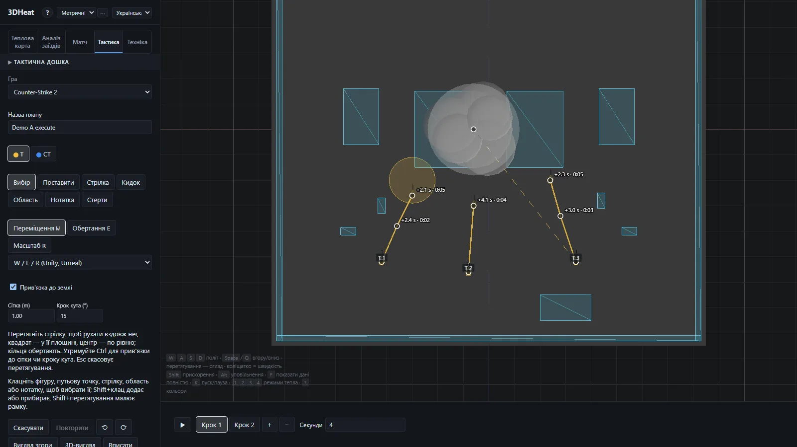

# Дошка тактики

Вкладка **Тактика** - це дошка для малювання плану команди: ви ставите маленькі фігури на карту, малюєте стрілки, куди вони йдуть, і натискаєте пуск, щоб побачити, як це відбувається. Користуйтеся нею, щоб сплянувати раунд або атаку перед грою. Вона ділить полотно, камеру і [рівень](levels.md) з іншими вкладками і більше нічим; план не є даними і тепла не малює.

## Ваш перший план {#your-first-plan}

1. Відкрийте вкладку **Тактика**. Виберіть **Гра** (наприклад, Counter-Strike 2) і, для Valorant, натисніть **Завантажити карти Valorant** і виберіть **Карта**. Або спершу завантажте [рівень](levels.md).
2. Виберіть **Сторона** (вона задає колір) і натисніть **Вигляд згори**.
3. Виберіть **Місце**, оберіть фігуру в **Фігури** (використайте **Пошук фігур**, щоб знайти її) і клацніть по карті. Поставте дві-три.
4. Виберіть **Стрілка**, клацніть по фігурі, клацніть уздовж шляху, яким вона має піти, і натисніть **Enter**, щоб завершити стрілку.
5. Натисніть **+** під виглядом, щоб додати крок 2. Кожна фігура починається там, де закінчилася її стрілка. Малюйте там більше стрілок.
6. Натисніть **▶** (або `K`), щоб відтворити план від показаного кроку до кінця.
7. Назвіть план у **Назва плану** і натисніть **Зберегти**.

## Початок плану {#starting-a-plan}

| Елемент | Що робить |
|---|---|
| **Гра** | Вибирає сторони і фігури, які пропонує палітра: Counter-Strike 2 (T, CT; гравці і засоби підтримки), Valorant (Attack, Defense; гравці й загальні здібності), Battlefield, Squad, Arma (піхота, наземна техніка, літаки, човни), DCS / War Thunder / IL-2 (реактивні, поршневі літаки, гелікоптери, зенітні засоби, земля, кораблі, зброя) і Other. План, у якому вже є фігури, зберігає свої сторони, коли гра змінюється. |
| **Назва плану** | Назва, за якою план зберігається. |
| **Карта**, **Завантажити карти Valorant** | Коли вибрано Valorant: **Завантажити карти Valorant** отримує список карт з [valorant-api.com](https://valorant-api.com); **Карта** потім ставить міні-карту вибраної карти як рівень, вписану зверху. Зображення завантажується під час вибору і ніколи не постачається разом із застосунком. Повідомлення Riot показується, поки воно на екрані (див. нижче). |
| **Сторона** | Сторона, якій належить наступна фігура, стрілка або область; вона отримує колір сторони. |

Без рівня дошка є плоскою площиною землі. Завантажте рівень у **Рівень**, щоб плануватиши на справжній карті: карту CS2, експортовану інструментом CS2, рівень з бібліотеки або зображення карти.

## Інструменти {#tools}

| Інструмент | Клік | Примітки |
|---|---|---|
| **Вибір** | Фігура, точка маршруту, стрілка, область або нотатка вибирає її. | Shift+клік додає або знімає; Shift+перетягування малює рамку навколо того, що додати. Вибір отримує ручку перетворення (див. нижче); `Delete` або `Backspace` видаляє його. `M` переміщує вибрану фігуру до наступного кліку. |
| **Місце** | Ставить обрану фігуру. | Фігура вибирається в палітрі **Фігури** (з **Пошук фігур**). Коли нічого не вибрано, `R` повертає наступну фігуру на 15° перед розміщенням (`Shift+R` - у інший бік). |
| **Стрілка** | Кожен клік додає точку; Enter, подвійний клік або правий клік завершує, Esc скидає. | **Зсунути**, **Атака** (ширша голівка) або **Спостереження** (тонка лінія на рівні очей). Стрілка, почата на фігурі, - це маршрут цієї фігури в цьому кроці: під час відтворення фігура йде ним, а наступний крок починається там, де він закінчився. |
| **Кидок** | Той, хто кидає, потім місце приземлення. | Пунктирна дуга між ними, а вибраний засіб (дим, світлошумова, коктейль Молотова ...) з’являється там, де приземлився, і лишається з цього кроку далі. |
| **Область** | Центр, потім край. | Диск кольору сторони. |
| **Нотатка** | Де буде нотатка; запитує її текст. | Показується як шпилька, а її текст над нею. |
| **Стерти** | Фігуру, стрілку, область або нотатку. | Прибирає її з цього кроку далі; на її першому кроці прибирає повністю. |

**Скасувати** і **Повторити** (`Ctrl+Z`; `Ctrl+Y` або `Ctrl+Shift+Z`) ходять по кожній зміні. Рядок під планом показує, скільки фігур, стрілок і кроків він має. **Вигляд згори** дивиться прямо вниз (ортографічно), **3D-вигляд** повертає перспективу, **Кадр** вписує план або, коли план порожній, рівень.

**Розмір фігур** масштабує кожну фігуру на дошці; 1× - справжній розмір, що зверху здалеку для людини є кількома пікселями.

## Переміщення, обертання і масштаб {#moving-turning-and-scaling}

Усе на дошці можна переміщувати, як у 3D-редакторі: фігури, засоби, маркери, окремі точки маршруту і цілі стрілки, області та нотатки. Вибране отримує ручку в своїй середині:

| Режим | Клавіші | Ручки |
|---|---|---|
| **Зсунути** | W (або G) | Стрілка на кожну вісь (X червона, Y зелена і вгору, Z синя) рухає вздовж неї; квадрат рухає в своїй площині; центр переміщується по рівню під курсором. |
| **Обертання** | E (або R) | Кільце на кожну вісь обертає навколо неї. Кільця однієї фігури - її власні рискання, тангаж і крен; група обертається навколо осей світу зі своєї середини. |
| **Масштаб** | R (або S) | Розсуває або стягує вибране від свого центру вздовж осі або в усі боки; радіус області зростає разом із ним. |

**Клавіші** перемикаються між W / E / R (Unity, Unreal) і G / R / S (Blender); клавіші вибирають режим лише тоді, коли щось вибрано, а інакше літають камерою. Тож `R` означає **Масштаб** з клавішами W / E / R і **Обертання** з клавішами G / R / S, коли щось вибрано, і повертає наступну фігуру для розміщення, коли нічого не вибрано. Усі клавіші дошки перелічено в [довіднику клавіатури](keyboard-reference.md#tactics-board). Тримайте **Ctrl** під час перетягування, щоб прив’язати переміщення до **Сітки** (метри) або обертання до **Кроку кута**. **Прив’язка до землі** (типово увімкнено) ставить переміщених людей, техніку, маркери, точки маршруту й області на поверхню рівня; літаки й гелікоптери зберігають висоту, а перетягування вздовж стрілки Y ніколи не прив’язує. Перетягування ручки ніколи не рухає камеру. **Esc** скасовує перетягування, і кожна зміна - це один крок Скасувати.

Точки маршруту показуються крапками на стрілках показаного кроку: клацніть одну, щоб вибрати, перетягніть, щоб перемістити, Delete, щоб прибрати. Розділ **Вибрані** показує місце вибраного в метрах, рискання, тангаж і крен фігури в градусах та радіус області, кожне можна ввести вручну.

## Час {#timing}

Маршрут фігури має час: кожен відрізок займає свою довжину по рівню - вибірка на поверхні кожні пару метрів, тож пагорб або сходи між двома точками рахуються - зі швидкістю свого режиму руху **Режим** для цієї фігури в цій грі, плюс будь-яке **очікування** в точці маршруту. Піхота повзе, присідає, йде (тихо), біжить або спринтує; техніка і човни повзуть, їдуть обережно, звичайно або поспішають; літаки й гелікоптери летять повільно, крейсерською, бойовою або максимальною швидкістю. Режим, якого в грі немає (у CS2 немає спринту), бере найближчий наявний. Як схил сповільнює, залежить від гри: у CS2 і Valorant рахується лише горизонтальна відстань, як у іграх; військові симулятори сповільнюють піхоту на підйомі (функція ходьби Тоблера), а техніку - за ухилом.

Швидкості беруться з таблиць для кожної гри з їхніми джерелами (див. [Швидкості руху](tactics-speeds.md)): CS2 - за зброєю в руках, з визначень зброї гри; Valorant - за зброєю; Battlefield, Squad, Arma і повітряні ігри - за типом і класом техніки. **Рухається як** вибирає профіль фігури (зброя, тип техніки); **Своя (m/s)** перевизначає будь-який режим для цієї фігури. Режими названо так, як їх показує дошка: *Crawl* (повзти), *Crouch* (присісти), *Walk (silent)* (іти тихо), *Run* (бігти), *Sprint* (спринт); *Cautious* (обережно), *Normal* (звичайно), *Rush* (поспішати); *Slow* (повільно), *Cruise* (крейсерська), *Combat* (бойова), *Maximum* (максимальна).

Кожна точка маршруту показує час від попередньої і час від початку плану («+3.9 s · 0:12»). Маршрут вибраної фігури перелічує кожен відрізок з його режимом, довжиною і часом, очікуванням і прибуттям. **Прибуття** під **Час** ставить кожну фігуру з маршрутом на одну часову лінію, перше прибуття зверху. З **Відтворювати в реальному часі** (типово увімкнено) крок триває, доки не прибуде найповільніший маршрут, і кожна фігура рухається зі своєю швидкістю; **Секунди** тоді - найменша довжина кроку. **Одиниць рівня на метр** каже, у чому рівень: 39.37 для карт CS2 (ігрові одиниці), 1 для карт у метрах.

## Порівняння з даними матчів {#compare-with-match-data}

**Завантажити файли матчів…** читає таблиці матчів CS2 для карти (файли Parquet інструменту CS2, скільки завгодно; лише потрібні стовпці, у фоні); **Використати завантажені дані** бере дані, завантажені в переглядач. Тоді:

- **Найраніше прибуття на карті** фарбує карту часом від початку раунду, коли гравець уперше дійшов до кожного місця - кнопка **Найшвидший** показує найшвидший за всі раунди, **Типово (медіана)** - середній раунд - від зеленого раніше до червоного пізніше, для однієї сторони або обох. Це показує, що можливо і коли.
- Вибраний маршрут порівнюється з тим, чого гравці досягали від його початку (або від початку раунду) до його кінця; кожен кінець - диск заданого радіуса: «Fastest observed 14.2 s, p10 15.0 s, median 18.3 s over 41 runs; your plan 15.1 s».
- Швидкості, з якими гравці справді рухалися - біг, ходьба, присідання, з стовпців ходьби і присідання таблиць - у m/s.

## Кроки {#steps}

Смуга під виглядом містить кроки. План починається з одного; **+** додає один, і кожна фігура починається там, де закінчився її маршрут в останньому кроці; **−** прибирає показаний. **Секунди** - скільки триває показаний крок під час відтворення. **▶** (K) відтворює від показаного кроку до кінця: фігури з маршрутом ідуть ним, фігури, переміщені на нове місце в наступному кроці, з’їжджають туди, решта стоять. Поки крок показано, місце кожної фігури в наступному кроці малюється блідим привидом, а стрілки останнього кроку ледь помітно лежать під стрілками цього.

## Збереження {#saving}

Розділ **Файл** містить **Зберегти**, **Відкр.** і **Очистити**. **Зберегти** записує план як `<name>.h3dplan.json` (звичайний JSON: сторони, кроки, фігури з місцем на кожному кроці, стрілки, області, нотатки); **Відкр.** читає його назад. Файл іншої версії або той, що не є планом, відхиляється з причиною. **Очистити** спорожнює план; Скасувати його повертає.

## Фігури {#figures}

Кожну фігуру будує сам переглядач: прості форми до опублікованого розміру типу з ознаками, що відрізняють її від сусідів - опорні колеса й башта танка, гармати, ракети та радари зенітної техніки, план крила, хвіст і двигуни літака, ротори й короткі крила гелікоптера. Нічого не взято з гри. Конструкцію, яку вигадала гра, показано як загальну фігуру її класу. Як дані знаходять свою фігуру, див. [Фігури](figures.md#which-figure-a-unit-gets).

## Повідомлення Riot {#riots-notice}

Карти Valorant показуються за політикою Riot Games «Legal Jibber Jabber», яка дозволяє безкоштовним спільнотним проєктам їх використовувати і вимагає цього повідомлення там, де вони з’являються: *3DHeat was created under Riot Games' "Legal Jibber Jabber" policy using assets owned by Riot Games. Riot Games does not endorse or sponsor this project.* Здібності на дошці - це загальні форми, а не мистецтво Riot.
