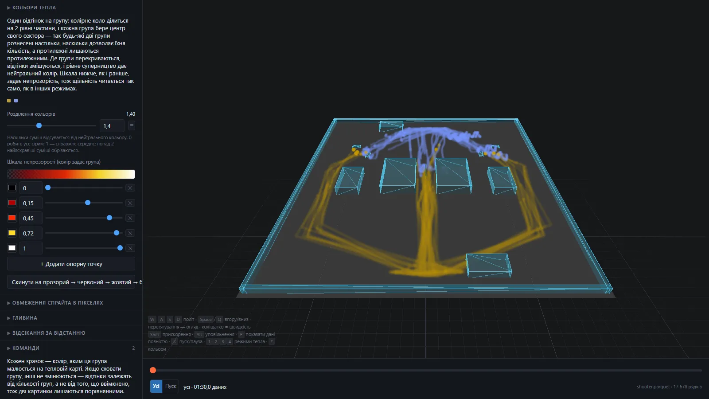

# Тепло команд

Тепло команд показує, де була кожна команда, кожна у своєму кольорі. Там, де команди перетинаються, кольори змішуються.

**Тепло команд** (клавіша 3) — це поле щільності [Тепла](heat.md), де кожна [група](glossary.md) має власний відтінок. Там, де групи перетинаються, їхні відтінки змішуються; рівна боротьба виходить нейтральною. Непрозорість і далі передає щільність так само, як в інших режимах, тож картинка показує *скільки* і *чия* одночасно. Потрібен стовпець груп.

Це не [накладання фігур](box-replay.md): воно малює одну фігуру на людину. Це поле тепла, пофарбоване тим самим стовпцем.

## Як користуватися {#how-to-use-it}

1. Натисніть `3` (або оберіть **Тепло команд** на панелі режимів).
2. Відкрийте **Кольори тепла**. Зразки показують колір кожної групи; наведіть курсор на зразок, щоб побачити назву команди.
3. Якщо все виглядає сірим, підніміть **Розділення кольорів**.
4. Зніміть позначку з групи у [Списку команд](teams-list.md), щоб прибрати її. Інші кольори лишаються на місцях.

## Елементи керування {#controls}

У розділі **Кольори тепла**:

| Елемент | За замовчуванням | Значення |
|---|---|---|
| Зразки | | Колір кожної групи, для перших 12 груп, далі *+N more*. Наведіть курсор для назви групи і кольору. |
| **Розділення кольорів** | 1,4 | Наскільки суміш відсувається від нейтрального, 0-4. 0 робить усе сірим; 1 — справжнє середнє; понад близько 2 найяскравіші суміші виходять за межі відображуваного діапазону і обрізаються для кожного каналу, що зсуває їхній відтінок. |
| **Шкала непрозорості (колір задає група)** | стандартна шкала тепла | Тут використовується лише **альфа** шкали: прозора там, де нічого немає, непрозора вгорі. Її кольори ігноруються. |

Група, чия мітка означає «без групи» (`0`, порожня, `none`, `unknown`, `null` або `-1`), малюється сірим.

Усі інші елементи керування теплом (форма, насиченість, відгук, мінімальне тепло, глибина, відсікання) працюють так само, як у [Теплі](heat.md).

[Список команд](teams-list.md) показує колір кожної групи як зразок у цьому режимі. Приховання групи не змінює кольори інших груп: відтінки беруться з загальної кількості груп, а не з увімкнених. Тому дві картинки лишаються порівнянними.

## Для розробників {#for-developers}

### Палітра {#the-palette}

З [`colors.ts`](https://github.com/Holdi601/3DHeat/blob/main/src/render/colors.ts):

- Кольори живуть на площині **Oklab** при сталій світлості (0,7) і насиченості (0,115), тож кожна група однаково яскрава, і червона група не виглядає гарячішою за синю.
- Для *n* груп коло відтінків ділиться на *n* рівних частин, і група *i* бере **центр** своєї частини, `(i + 0,5) / n` оберту. Будь-які дві групи віддалені настільки, наскільки дозволяє кількість, а протилежні лишаються протилежними за будь-якої кількості.
- Використовується щонайбільше **16** різних відтінків. За більшої кількості груп ідентифікатори розставляються повторним діленням навпіл (ідентифікатори з оберненими бітами: 0, ½, ¼, ¾, ⅛, …), щоб сусідні ідентифікатори не мали спільного відтінку. Групи понад 16 неминуче ділять відтінки.
- Група, чия мітка означає «без групи»: `0`, порожня, `none`, `unknown`, `null` або `-1` (без урахування регістру), малюється **нейтральним сірим** замість того, щоб брати частку кола. Так обробляється лише перша така мітка в списку груп.

Типове розділення 1,4, а не 1, бо за 1 суміш п'яти рівномірно розподілених відтінків *є* сірою: правильно, але не читається. Трохи вище за 1 зберігає чесні нічиї і при цьому робить видимим поділ 60/40.

### Як це працює {#how-it-works}

Ціль тепла має в цьому режимі чотири канали. Кожен спрайт додає свою щільність *v* до першого каналу, а *v* × координати Oklab *a* і *b* групи до другого і третього. Під час композиції суміш пікселя — це середнє, зважене щільністю: *a* = G / R, *b* = B / R, помножене на розділення кольорів і перетворене в sRGB при світлості палітри. Ділення на накопичену щільність робить відтінок незалежним від того, скільки даних, і тому кожен елемент керування щільністю далі діє лише на непрозорість.

Ціль з чотирма каналами коштує вчетверо більше пам'яті GPU, ніж ціль тепла з одним каналом при тій самій роздільності.
