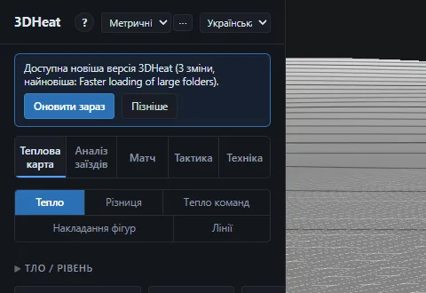

# Оновлення

Переглядач повідомляє, коли існує новіша версія, і оновлюється сам лише тоді, коли ви скажете «так». Нічого на вашому комп'ютері не змінюється без вашої відповіді.

## Оновлення переглядача {#update-the-viewer}

1. **На сторінці.** Коли існує новіша версія, під назвою вгорі бічної панелі з'являється вікно: «A newer version of 3DHeat is available». Натисніть **Оновити зараз**. Сторінка перезавантажується сама, коли все готово. **Пізніше** ховає вікно, доки ви не перезавантажите сторінку.
2. **Якщо там сказано запустити restart.bat**, закрийте вікно сервера (чорне вікно, яке відкрив `start.bat`) і двічі клацніть `restart.bat`.
3. **Під час запуску переглядача.** `start.bat` також перевіряє. Якщо існує новіша версія, він питає **Update now? [Y/N]**. Натисніть `Y`, щоб оновити. Натисніть `N` або зачекайте 60 секунд без відповіді, щоб запустити версію, яка у вас є.



Копію зі змінами, внесеними вами, ніколи не оновлюють за вас. Вікно лише повідомляє, що чекає оновлення, і радить зафіксувати або відкласти ваші зміни та виконати `git pull`. Копія, встановлена не через git (наприклад, zip-файл), нічого не показує.

Як працює перевірка, крок за кроком:

```
сторінка ---(через 4 с, потім кожні 6 год)---> сервер розробки ---> git fetch
   позаду?  ні  -> нічого не показується
            так -> ваші зміни або коміти?  так -> лише повідомити
                                           ні  -> [Оновити зараз] -> git pull
                                                  -> перезавантаження або «запустіть restart.bat»
```

## Правила безпеки {#the-safety-rules}

- **Лише перемотка вперед** (`git pull --ff-only`): оновлення ніколи нічого не зливає, не перебазовує і не переписує.
- **Без локальних змін**: копія з незакоміченими змінами відстежуваних файлів (`git status --porcelain --untracked-files=no` не порожній) ніколи не оновлюється автоматично. Чужа робота не є тим, що оновлення має перезаписати. Їй лише повідомляють, що оновлення чекає. Невідстежувані файли (дані, експорти) змінами не вважаються.
- **Без локальних комітів**: копія з комітами, яких немає у віддаленої гілки («diverged»), не оновлюється. Перемотка вперед їх не підтягне, а злиття - для `git pull` вручну. Сторінка і `start.bat` кажуть про це тими самими словами, а `start.bat` запускає наявну версію.
- **Лише зі сторінки**: запит оновлення до сервера розробки мусить нести власний заголовок і, коли браузер надсилає `Origin`, походити з власного хоста сервера (нижче).
- Оновлюється лише копія git із гілкою віддаленого сховища. Усе інше (копія без `.git`, git не встановлено, статична збірка) лишається без змін і нічого не каже.

## Що робить start.bat {#what-startbat-does}

`start.bat` (двічі клацніть; вікно і є сервером) робить по порядку:

1. Знаходить Node.js - у `PATH`, інакше в `%ProgramFiles%\nodejs`, `%ProgramFiles(x86)%\nodejs` або `%LOCALAPPDATA%\Programs\nodejs`. Якщо його немає, пропонує встановити його командою `winget install -e --id OpenJS.NodeJS.LTS` (питає, Y/N; після цього вікно треба відкрити знову, щоб Windows підхопила новий `PATH`).
2. **Оновлення**, коли git встановлено і тека має `.git`:
   - `git fetch --quiet` (без мережі або без віддаленої гілки: мовчки пропускається);
   - рахує `git rev-list --count HEAD..@{u}`. Нічого позаду - нічого не каже;
   - локальні зміни: «A newer version of 3DHeat is available (N changes), but this copy has local changes, so it is not updated. Commit or stash them, then run git pull.» - і запускає наявну версію;
   - власні коміти (`git rev-list --count @{u}..HEAD` не 0): «A newer version of 3DHeat is available (N changes), but this copy has commits of its own that the newest version does not, so it is not updated. Update it with git pull.» - і запускає наявну версію;
   - інакше «A newer version of 3DHeat is available (N changes).» і питання **Update now? [Y/N]**. `N` або відсутність відповіді 60 секунд друкує «Not updated; starting the version you have.» і запускає наявну версію. На `Y`: «Updating...», повідомляє, чи змінилися `package.json` або `package-lock.json`, виконує `git pull --ff-only` (якщо й це не вдалося - наприклад, мережа: «The update did not go through; starting the version you have.»), потім `git submodule update --init` (закріплені інструменти, див. [Супровід документації](maintaining.md#the-tools-under-exporters)), потім `npm install`, коли файли пакета змінилися і існує `node_modules`, і «Updated.»
3. Відмовляється запускати другий сервер: коли порт **5273** уже зайнятий, каже про це і вказує на `restart.bat` / `stop.bat`.
4. При першому запуску (немає `node_modules`) питає перед завантаженням залежностей (близько 300 МБ у `node_modules\`, нічого системного).
5. Запускає сервер розробки на `127.0.0.1:5273` (`--strictPort`) і відкриває браузер, коли він готовий.

`restart.bat` зупиняє сервер (за портом) і знову запускає `start.bat`, тож ставить те саме питання. `stop.bat` лише зупиняє.

## Для розробників {#for-developers}

### Поки працює: маршрут оновлення {#while-it-runs-the-update-route}

Сервер розробки (плагін Vite `heat3d-self-update` у `vite.config.ts`) віддає `/__heat3d/update`. Він є лише на сервері розробки, а не в статичній збірці і не у `vite preview`.

**`GET /__heat3d/update`** відповідає, чи відстає копія:

```json
{ "checkout": true, "upstream": "origin/main", "behind": 3, "ahead": 0, "dirty": false, "latest": "the newest commit's subject" }
```

- `checkout: false`, коли тека не є копією git;
- він запускає `git fetch --quiet` **не частіше ніж раз на 30 хвилин** (запити між цим відповідають з того, що було отримано востаннє);
- `behind` / `ahead` беруться з `git rev-list --count HEAD..@{u}` / `@{u}..HEAD`, `dirty` - з `git status --porcelain --untracked-files=no`, `latest` - тема найновішого коміту upstream;
- без гілки upstream: `upstream: null` і `behind: 0`.

**`POST /__heat3d/update/apply`** оновлює копію:

1. Відмова `403 { ok: false, reason: "forbidden" }`, якщо в запиті немає заголовка `X-Heat3d-Update: 1` і, коли є `Origin`, його хост не збігається з `Host` запиту. Форма з іншого сайту не може надіслати власний заголовок без попереднього CORS-запиту, якого цей сервер ніколи не дозволяє.
2. Робити нічого (не копія, немає upstream, не відстає): `{ ok: true, updated: false }`.
3. Локальні зміни: `{ ok: false, reason: "dirty" }`; локальні коміти: `{ ok: false, reason: "diverged" }`.
4. Інакше: з'ясовує, які файли змінюються (`git diff --name-only HEAD @{u}`), виконує `git pull --ff-only` (тайм-аут 2 хв), `git submodule update --init` (збій ігнорується), `npm install`, якщо змінилися `package.json` або `package-lock.json` (тайм-аут 15 хв), і відповідає `{ ok: true, updated: true, restart }`. `restart` пояснює, чому запущений сервер не може підхопити оновлення: `"dependencies"`, коли залежності перевстановлено, `"config"`, коли змінився лише файл `vite.config`, `false`, коли перезапуск не потрібен.
5. Якщо команда git або npm завершилася помилкою, відповідь `{ ok: false, reason: "<помилка, до 300 символів>" }`.

Відповіді - JSON з `Cache-Control: no-store`. Сервер слухає лише `127.0.0.1`, тож маршрут недоступний із мережі.

### Повідомлення на сторінці {#the-notice-in-the-page}

`UpdateBanner`, під назвою вгорі бічної панелі:

- Він запитує маршрут через **4 секунди** після завантаження сторінки (не в перші секунди: у сторінки є набір даних для завантаження і GPU для запуску), а потім **кожні 6 годин**, поки сторінка відкрита.
- Він нічого не показує, коли маршруту немає (статична збірка), тека не є копією або нічого новішого немає. Повідомлення при кожному запуску - це те, до чого люди швидко звикають і перестають його помічати.
- Відстає, без локальних змін: «A newer version of 3DHeat is available (N changes, the newest: <subject>).» з кнопками **Оновити зараз** і **Пізніше** (*Пізніше* ховає вікно до перезавантаження сторінки).
- Відстає, з локальними змінами: та сама фраза і «This copy has local changes, so it is not updated automatically; commit or stash them, then run git pull.», без кнопки.
- **Оновити зараз** надсилає запит на `/apply` («Оновлення…»). Далі:
  - «Оновлено. Сторінка перезавантажується.» - і через 1,5 с сторінка перезавантажується (сервер уже віддає нові файли);
  - якщо залежності перевстановлено: «Оновлено. Змінилися залежності: закрийте вікно сервера і запустіть **restart.bat**, щоб завершити.»;
  - якщо змінилися лише налаштування сервера: «Оновлено. Змінилися налаштування сервера: закрийте вікно сервера і запустіть **restart.bat**, щоб завершити.»;
  - зрештою оновлювати нічого (`updated: false`, наприклад, коли копію вже оновив `start.bat`): «Оновлювати нічого: ця копія вже найновіша.» - і без перезавантаження;
  - відмова: фраза про локальні зміни, або «This copy has commits of its own that the newest version does not; update it with git pull.», або «Оновлення не відбулося: <причина>».
