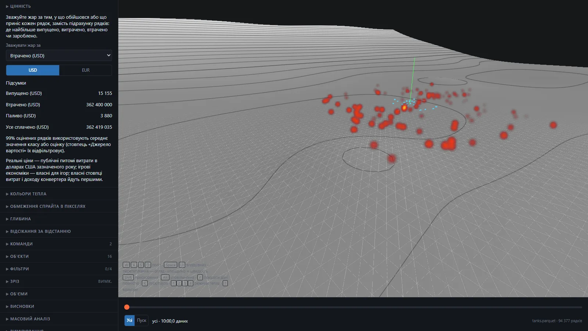

# Зважування за вартістю

Кожен постріл, боєприпас, втрачена техніка і літр пального мають ціну. Переглядач обчислює, скільки коштував або скільки приніс кожен рядок, і може зважити тепло цим. Тоді карта показує **куди пішли гроші**, а не там, де рядки.

## Як користуватися {#how-to-use-it}

1. Завантажте дані з подіями (постріли, вбивства, смерті) та назвами техніки або зброї.
2. Відкрийте **Значення** на бічній панелі Тепла.
3. Оберіть **Зважувати жар за**, наприклад *Втрачено (USD)*. Тепер тепло додає ціну кожного рядка замість 1.
4. Прочитайте **Підсумки**: суму кожного стовпця вартості для того, що показано (застосовуються фільтри і часове вікно).
5. Якщо ціни — реальні гроші, з'являється перемикач **USD / EUR**.

Оберіть порожній перший пункт меню, щоб знову рахувати рядки.

## Що можна зважувати {#what-can-be-weighed}

Стовпці вартості додаються під час завантаження, по одному на вид і валюту:

| Вид | Рядки, на які він лягає | Як оцінюється |
|---|---|---|
| **Випущено** | постріли і пуски | зброя, інакше середнє для виду боєприпасів |
| **Витрачено** | купівля, поява | грошові стовпці гри (наприклад, меню купівлі в шутері) |
| **Втрачено** | смерті, знищення | власна техніка, інакше середнє її класу |
| **Знищено** | вбивства | техніка цілі |
| **Завдана шкода** | влучання | частка вартості цілі |
| **Пальне** | позиції | спожите пальне зі стовпця пального або оцінене за класом і часом |
| **Усе сплачено** | | випущено + витрачено + втрачено + пальне |
| **Зароблено** | винагороди | власні стовпці винагород гри (`earn_…`) |
| **Підсумок** | | зароблено мінус сплачено; малюється як знакове тепло (додатна шкала там, де заробили більше, від'ємна там, де заплатили більше) |

Назви стовпців: `cost_<kind>_<currency>`, `earn_<currency>` і `net_<currency>`. Конвертер, який знає власну валюту гри (наприклад, конвертер повторів, що пише ігрові кредити), має перевагу над вбудованими таблицями цін.

## Таблиці цін {#the-price-tables}

| Таблиця | Валюта |
|---|---|
| Реальна військова техніка: ракети, бомби, снаряди, засоби протидії, літаки, гелікоптери, наземна техніка, кораблі, пальне | USD (EUR = USD × 0,92, фіксований `EUR_PER_USD` у [`cost.ts`](https://github.com/Holdi601/3DHeat/blob/main/src/data/cost.ts); це не живий курс) |
| Меню купівлі в шутерах і нагороди за вбивства | кредити гри |
| Танкові та корабельні ігри | кредити гри |
| Стратегії (кілька ресурсів) | один стовпець на ресурс плюс один сумарний |
| Воєнні ігри | очки |

Гру визначають за назвами в даних. Реальні ціни беруться з публічних джерел (бюджетних документів, енциклопедій) або позначаються як оцінки. Їх не коригують на інфляцію. Згенерований список таблиць — у [Таблицях значень](ref-value-tables.md).

## Оцінки {#estimates}

Додатковий стовпець категорій **Джерело вартості** показує, як оцінено кожен рядок: `table`, `class average`, `estimate` або `none`. Розділ **Значення** показує, яка частка рядків з цінами — це середні або оцінки. Щоб лишити лише точно оцінені рядки, зніміть позначки *estimate* і *class average* у **Джерело вартості** у [Фільтрах](filters.md).

## Де ще видно вартість {#where-else-value-shows}

- [Висновки](insights.md): знахідки *Costly ground* і *Earning ground*.
- [Розбивка](breakdown.md): Зароблено, Втрачено і Підсумок грошей для кожної команди, гравця або зброї.
- [Об'єми і порівняння](volumes.md): стовпці вартості в статистиці та порівнянні.
