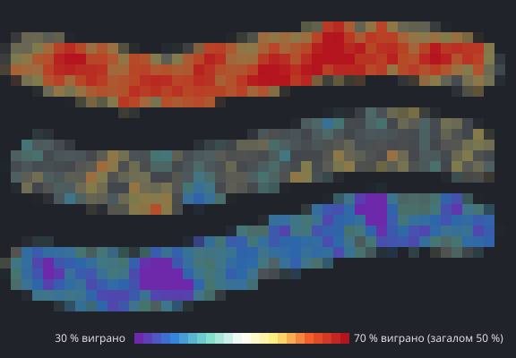

# Частка перемог: як часто перемагає місце, маршрут чи дія

Де гравець стоїть, куди йде, звідки кидає гранати - і як часто його сторона потім виграє раунд. **Карта частки перемог** фарбує кожне місце за часткою рядків там, що належать до раундів, які виграла сторона рядка, порівняно з часткою по всьому показаному: тепло там, де вона вища, холодно там, де нижча, нічого там, де вона така сама.

*На малюнку вигадані дані: три маршрути на порожньому рівні, 68 %, 50 % і 33 % їхніх рядків у виграних раундах.*

Потрібні дані, які кажуть, хто переміг: [стовпці результату](data-formats.md#outcome-columns) (`won`, `matchWon`, `roundEndReason`). Їх записують конвертери CS2 і War Thunder; будь-який файл теж може.

## Спробуйте {#try-it}

1. Завантажте матчі зі стовпцем результату і натисніть `2` (**Різниця**).
2. У **Різницевий поділ** натисніть **Частка перемог у раундах** (або **Частка перемог у матчах**). Це ставить виграні раунди на **+**, програні на **−** і перемикає панель на **Частка +**.
3. Читайте кольори. Панель показує загальну частку: *Загалом 52,0 % з 1 200 000 рядків на +.*
4. Звужуйте за допомогою [фільтрів](filters.md): одна сторона (T або CT), один тип події (*Позиція* - де люди стояли, *Постріл* або *Пуск (ракета, снаряд, бомба)* - звідки вони стріляли чи кидали), одна закупівля, одна карта.

Місце, тепле з рядками *Позиція*, - це місце, чиї власники частіше вигравали раунд. З рядками *Знищення* це місце, де зроблені вбивства вели до виграних раундів.

## Налаштування {#the-settings}

| Налаштування | Що робить | Типово |
|---|---|---|
| **Різниця** / **Частка +** | сама різниця, або частка сторони + серед рядків обох сторін | Різниця |
| **Повний колір при** | наскільки вище чи нижче загальної частки місце показується повним кольором, у пунктах | ± 20 пунктів |
| **Найменше рядків, щоб зафарбувати місце** | місце з меншою кількістю рядків не фарбується; колір з'являється поступово від половини цього числа | 12 |
| **Тяжіння до загальної частки (рядки)** | кожне місце починає з такої кількості рядків на загальній частці, тож місце з 3 рядками, усі виграні, не показується як 100 % | 12 |

Усі три діють на готовий малюнок: їх перетягування ніколи не запускає накопичення заново.

Частка може бути від будь-якого поділу, не лише перемог: *Частка +* з поділом за сторонами показує, де T були більшою частиною присутності, а з поділом за файлами двох карт - де рядки одного файлу переважають рядки іншого.

## Рядки, а не раунди {#rows-not-rounds}

Карта рахує рядки. Гравець, який стоїть на одному місці двадцять секунд, додає рядок у кожному зразку, і всі вони з одного раунду. Тож доказ у місці - це рядки поблизу нього, а не раунди. Тому мінімум і тяжіння задані в рядках, і тому вони більші, ніж один раунд.

Для самих раундів:

- **[Розбивка](breakdown.md)** для точки, виду або об'єму: *Перемоги %* рахує раунд кожного гравця один раз, з тяжінням до загальної частки місця так само (4 раунди).
- Статистика **[Об'ємів](volumes.md)**: *Частка перемог* - раунди з гравцем усередині об'єму, кожен один раз, з тяжінням до частки по всьому показаному, разом із кількостями.

## Фільтри результату {#outcome-filters}

Панель [Фільтри](filters.md) показує стовпці результату одразу після власних стовпців переглядача: **Підсумок раунду** і **Підсумок матчу** (*Будь-який*, *Перемога*, *Поразка*) і **Як завершився раунд** (знищення всіх, бомба вибухнула, бомбу знешкоджено, час вийшов, капітуляція, нічия, ціль, утримання зон, втрата очок, втрачено всю техніку), мовою переглядача.

## Для розробників {#for-developers}

Прохід тепла записує три суми в чотириканальну ціль, яку використовує тепло команд: тепло `R = Σ|v|`, тепло сторони + `P` і `S = Σ v²/w`, де `w` - вага проходу (вага вибірки, помножена на підсилення кадру). Композиція читає частку `P/R` (середнє, зважене ядром) і кількість рядків, на яких вона тримається, `n = R²/S` (ефективний розмір вибірки Кіша), тягне частку до загальної, `p = (n·P/R + m·r0)/(n + m)`, і фарбує `p - r0` у межах діапазону на шкалах різниці.

`n` скорочує кожен множник, спільний для рядків у пікселі - підсилення кадру, вагу вибірки, вагу площі обрізаного спрайта - тож малюнок однаковий за будь-якого масштабу і щільності вибірки, а кадри з кожним k-м рядком зливаються в ціле без стрибків кольору. Загальна частка береться з підрахунків сторін на CPU, з точністю до десятих відсотка; нічого не зчитується назад із GPU. Арифметика та її перевірки: [`render/rateMap.ts`](https://github.com/Holdi601/3DHeat/blob/main/src/render/rateMap.ts) і його тест.

Це коштує стільки ж, скільки тепло команд: чотириканальна ціль учетверо збільшує пропускну здатність змішування проходу тепла, лише поки увімкнено *Частка +*.
