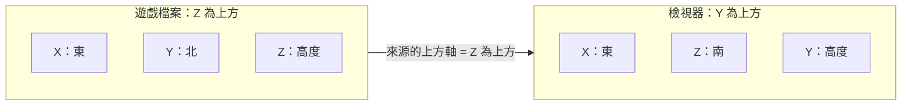

# 軸、單位與時間

遊戲與地圖對於哪一個方向是上方、一個單位有多長、時間如何書寫，往往意見不一。本頁說明三項設定，讓你的資料以正確的方向站立、以正確的比例呈現，並正常播放。

如果你的地圖是直立如牆，而不是平放如地板，請切換**來源的上方軸**。

若**來源的上方軸**設定錯誤，地圖會直立如牆；設定正確時，地圖會平放如地板。

## 檢視器繪製的世界 {#the-world-the-viewer-draws-in}

檢視器的世界是**Y 向上**：X 與 Z 為地面平面，Y 為高度。大多數遊戲引擎是 **Z 向上**：對它們而言，X 與 Y 是地面，Z 是高度。有些引擎還是鏡像的（左手座標系）。對應設定說明了如何把檔案的軸轉換為檢視器的軸。（嚴格來說，檢視器是右手座標系，即 three.js 的慣例。）

### 上方軸 {#up-axis}

[欄位對應](column-mapping.md)中的**來源的上方軸**：

| 設定 | 檔案 (x, y, z) 變成世界 (X, Y, Z) |
|---|---|
| *Z 為上方（大多數遊戲引擎）*，預設值 | (x, **z**, **y**)：檔案的 Z 成為高度，檔案的 Y 成為世界的 Z |
| *Y 為上方（圖形慣例）* | (x, y, z) 不變 |

對於 Z 向上的資料，三個陣列是重新標記而非複製（[`remapAxesInPlace`](https://github.com/Holdi601/3DHeat/blob/main/src/data/ingest.ts)），這在大型載入時可節省數百 MB。猜測是根據樣本做出的：Y 與 Z 欄位中，分散較小的那一個就是上方。

### 翻轉 {#flips}

**翻轉 X**、**翻轉 Y**、**翻轉 Z** 會在重新標記之前，對*檔案*中同名的軸取反，因此在 Z 向上時，*翻轉 Y* 會對最終成為世界 Z 的那個軸取反。翻轉會改變已載入的資料：[量尺](measure.md)、切片與鏡頭姿態所顯示的座標都是翻轉後的座標。

若要在**不**改變資料的情況下，把鏡像的世界正確地繪製出來，請改用**鏡頭與場景 → 反轉世界軸**（[鏡頭](camera.md#invert-world-axis)）。對於世界為左手座標系的遊戲，這是較好的選擇，因為工具顯示的每個座標都仍是遊戲本身的座標。

### 單位比例 {#unit-scale}

**單位比例**會乘上每一個位置。*1（m）*設為 1，*0.01（cm→m）*設為 0.01（Unreal Engine 的單位是公分，所以使用 0.01；Source 引擎的單位是英吋，所以使用 0.0254；兩者都不是公尺），此方塊接受任何數值。輸入的 0 或非數字的值會被替換為 1。

檢視器以公尺標示距離（Sprite 半徑、剔除距離、量尺、飛行速度），只有在換算後的世界單位是公尺時，這才是正確的。若不是，也不會出錯；標籤只會對任何單位都顯示「m」。

## 時間 {#time}

### 時間單位 {#time-units}

經驗法則：像 17000000000 這樣十位數以上的值是 Unix 時間戳；像 0、0.25、0.5 這樣的值是從開始算起的秒數。

| 時間單位（選單標籤） | 解讀為 | 是否顯示時鐘時間 |
|---|---|---|
| *秒（相對）* | 數值 × 1 s | 否 |
| *毫秒（相對）* | 數值 × 0.001 s | 否 |
| *微秒（相對）* | 數值 × 10^-6 s | 否 |
| *奈秒（相對）* | 數值 × 10^-9 s | 否 |
| *Unix 時間戳（秒）* | 自 1970-01-01 UTC 起的秒數 | 是 |
| *Unix 時間戳（毫秒）* | 自 1970-01-01 UTC 起的毫秒數 | 是 |
| *ISO-8601 日期字串* | 如 `2026-03-14T18:02:11.250Z` 的文字，以瀏覽器的 `Date.parse` 解析 | 是 |

使用絕對單位（最後三個）時，資料集會保留其最早資料列的時鐘時刻，而時間軸會在播放頭旁顯示目前的 UTC 時間（`HH:MM:SSZ`）。

**Parquet 的 `TIMESTAMP` 與 `DATE` 欄位**會解碼為真正的時刻，因此會忽略其單位設定，面板也會說明這一點。`DATE` 欄位代表整天：一天之內的每一列都共享同一個時刻，播放會以一天為單位跳動，面板會對此發出警告。

**ISO-8601 字串在 CSV 與 Parquet 中皆可使用。**以 ISO 單位設定的文字時間欄位，每個不同的字串只會解析一次；若沒有任何字串能成功解析，載入就會失敗，並顯示*對應的時間欄位中沒有可解析的 ISO-8601 時間戳。*——而且在取樣的數值都無法解析時，欄位對應本身就會拒絕開始。Parquet 的 `TIMESTAMP` 欄位不論設定什麼單位，都會被讀取為時間戳；而以 ISO 單位設定的數值型 Parquet 欄位，則會被讀取為 Unix 毫秒。以數值單位設定的文字時間欄位，在載入前就會被拒絕：每個數值都會被讀成 NaN。

### 時間如何儲存 {#how-time-is-stored}

合併檔案時，時間以 64 位元秒數保存，因此絕對的紀元時間能保留次秒級的細節。所有檔案都載入後，整個選取範圍內最早的時間會變成 0，每一列則以 32 位元秒數儲存相對於它的時間。32 位元浮點數有 24 位元的尾數：最長約一天半的時間跨度可以精確到優於 1/100 秒，半年的時間跨度則約精確到一秒。時間缺失或不是數字的資料列，會被放在 0，即起點。

資料列接著會依時間排序，這使時間軸的運作成本很低：時間視窗只需兩次二分搜尋即可找到（見[取樣與預算](sampling-and-budgets.md)）。

### 經過時間與時鐘時間 {#elapsed-time-versus-wall-clock}

像 `match_time` 或 `round_time` 這樣的時間欄位，會從每場對戰自己的開始時間計算。選擇它會把每場對戰放在同一條共享的軸上，適合比較每場對戰第 3 分鐘發生的事；面板也會指出這一點。時鐘時間欄位則會依對戰實際發生的順序顯示，若時間重疊則會重疊顯示。

## 觀看方向 {#look-direction}

觀看方向只由[盒子重播](box-replay.md)使用（來自每個盒子的射線）。它以兩個角度儲存，即偏航與俯仰，單位為弧度。

- **偏航／俯仰欄位**會按原樣讀取；選擇*度*時，會從度數轉換。它們不會依上方軸或翻轉進行調整。
- **方向向量欄位**會經過與位置相同的重新標記與翻轉，然後在世界軸中計算為 偏航 = atan2(x, -z)、俯仰 = atan2(y, √(x² + z²))，因此即使在鏡像來源的世界中，射線也會指向盒子所面對的方向。

如果在翻轉、使用方向向量，或調整過角度之後，偏航／俯仰欄位指向錯誤的方向，請檢查這些設定。
