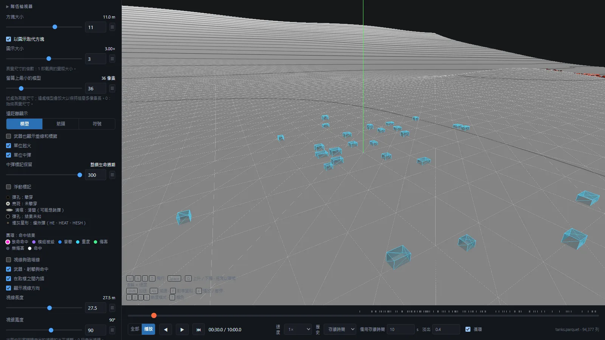

# 模型疊加（方塊重播）

一部小影片：每個人對應一個模型，隨著時間推移移動，身後帶有軌跡。

在模式列中，此模式稱為**模型疊加**。本頁先前名為「方塊重播」，因為在有模型之前，每個人都是一個方塊；「模型重播」與「方塊重播」意思相同。**模型疊加**沒有數字鍵：請在模式列中選取。它會為每個[人員](glossary.md)繪製一個模型（或方塊），沿著[時間軸](timeline.md)移動，並可選擇性地顯示視線射線與軌跡。它是播放而非密度：*誰在何時何地*。它需要一個人員欄位；沒有時間欄位時，每個取樣都會同時繪製。

## 使用方法 {#how-to-use-it}

1. 載入包含人員欄位與時間欄位的資料。
2. 在模式列中選取**模型疊加**。
3. 將時間軸切換為**播放**，然後按下播放（`K`）。
4. 打開**隊伍檢視器**，即可變更**軌跡長度**、模型大小或視線射線。

此模式不會繪製熱度，自適應 Sprite 預算也處於閒置狀態。

預設情況下，每個人都會以其所代表的模型繪製，而不是方塊——關於單位會取得哪一種模型，請見[模型](figures.md)；關於標籤、跟隨鏡頭、兩個單位之間的測量，以及事件清單，請見[對戰重播](match-replay.md)。

## 隊伍檢視器面板 {#the-team-viewer-panel}

在此模式中，它會取代熱度面板顯示。

| 控制項 | 預設值 | 範圍（撥動） | 意義 |
|---|---|---|---|
| **以圖示取代方塊** | 開啟 | | 每個人都以其所代表的模型呈現：步行的士兵、資料所指明的戰車或飛機。資料未說明的部分仍是方塊。 |
| **模型大小** | 1× | | 1× 為真實大小。 |
| **螢幕上最小的模型** | 36 px | 0 = 一律為真實大小 | 近距離時為真實大小；較遠的模型會放大，以保持此像素長度。 |
| **武器、射擊與命中** | 開啟 | | 飛行中的武器，附煙霧、曳光彈、撞擊、命中與擊殺。由命中推斷出的曳光彈會以虛線顯示。 |
| **方塊大小** | 實體大小，或載入時為範圍 / 500 | 0.05-200 m，對數刻度（5000） | 每個方塊的邊長。見[實體大小](sessions-persons-groups.md#entity-size)。 |
| **在取樣之間內插** | 開啟 | | 在同一場次中同一人的兩個取樣之間，依比例把方塊放在兩者之間。絕不跨越場次邊界。 |
| **顯示視線方向** | 開啟 | | 從每個方塊沿該人員視線方向射出的一條射線（需要[視線欄位](axes-units-and-time.md#look-direction)）。 |
| **視線射線長度** | 實體大小 × 4，或載入時為範圍 / 200 | 0.5-500 m，對數刻度（20,000） | 視線方向開啟時顯示。 |
| **軌跡長度** | 8 s | 0-300 s（86,400）；0 = 關閉 | 每個人身後繪製的歷史秒數。 |
| **繪製每個原始取樣** | 關閉 | | 視窗中每個已儲存的取樣各繪製一個方塊，而不是每人一個內插方塊。會經過降取樣，以維持互動性。 |

面板中的提示說明：內插與軌跡只會在同一場次內連接取樣；當載入的資料含有[共用名稱](sessions-persons-groups.md#names-worn-by-several-things-at-once)時，也會說明有多少名稱被繪製為單一取樣。

## 正在播放的場次 {#the-session-being-played}

若資料有場次欄位，側邊欄頂端的**場次**選擇器（[場次](sessions-persons-groups.md#the-session-picker)）會決定播放哪一場對戰。載入時會自動選取最忙碌的場次。只有該場次的資料列會成為方塊與軌跡，時間軸也只會涵蓋該場次的跨度，而不是整個資料集的跨度。*所有場次*會同時播放每個場次，且仍然絕不在場次之間連接取樣。

## 何時繪製什麼 {#what-is-drawn-when}

來自 [`TrackCursor`](https://github.com/Holdi601/3DHeat/blob/main/src/data/tracks.ts)：

**即時方塊**（播放模式，未繪製原始取樣）。對於每個可見的人員，取播放頭所在時刻或之前的最新取樣：

- 若該人員有下一個取樣，且它在同一場次中，名稱也未共用，則方塊會依時間比例放在兩個取樣之間，偏航沿較短的方向內插，俯仰則線性內插（開啟*內插*時）。
- 否則，方塊會停留在最後一個取樣處，持續時間為時間軸的**備用存續時間**（預設 10 秒），之後就會移除，因此已淘汰的玩家不會殘留在畫面上。

**全部模式**會忽略播放頭，並把範圍內的每個取樣都繪製為一個方塊。

**原始取樣**會在視窗中為每個已儲存的取樣繪製一個方塊：在*視窗*歷史下為*跨度*，否則為播放頭之前的所有取樣。最多 65,536 個方塊；取樣更多時，會每隔 *k* 個才繪製一個。

**軌跡**（當軌跡長度大於 0 且未繪製原始取樣時）：在播放頭之前的最近*軌跡長度*秒內，連接某人每對相鄰取樣的一條線，隨時間從 80% 不透明度逐漸淡出為透明。軌跡會在場次變更處停止，共用名稱則不繪製軌跡。最多 131,072 個頂點；超過時，資料列會被均勻地略過。

**誰可見：**當其所屬群組在[隊伍清單](teams-list.md)中被取消勾選（其群組由第一列決定）、群組篩選排除了該人員，或[實體](entities.md)面板的選取範圍不包含該人員時，該人員會被隱藏。欄位[篩選器](filters.md)不套用於方塊。

## 顏色 {#colours}

每個群組一組色相家族，每位成員一種色階，因此只要一瞥就能知道某人屬於哪一方（[`teamMemberColor`](https://github.com/Holdi601/3DHeat/blob/main/src/render/colors.ts)）。群組色相依固定的十種顏色輪流使用——藍、紅、綠、琥珀、紫羅蘭、青、洋紅、萊姆、橘、靛——同一群組的成員則分布在明度 42-76%、飽和度 90-65% 之間。

## 注意事項 {#notes}

- 模型疊加只在有變更時才會重建其模型；閒置的影格會重新繪製上一次的模型。
- [統計覆蓋](performance-and-stats.md)中的*方塊*一行會計算畫面上的方塊數。
- 模型疊加與關卡在同一個場景中繪製，因此[景深](camera.md#depth-of-field)會模糊方塊，但絕不會模糊熱度。
