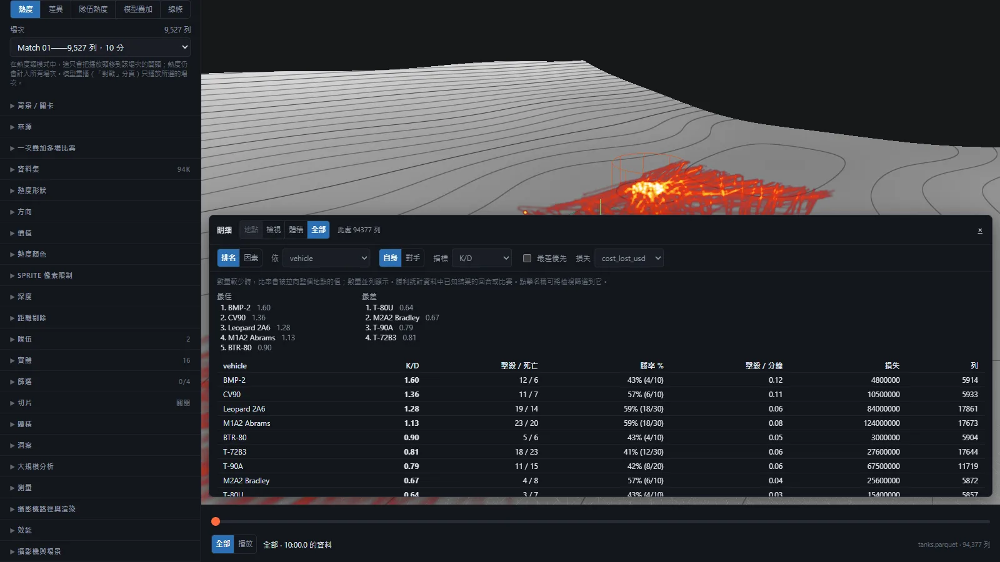
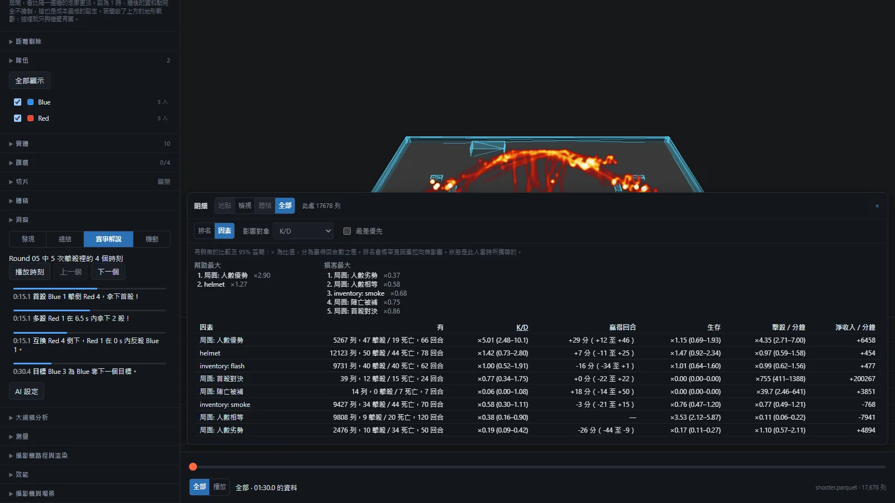

# 明細：誰與什麼在何處表現最好

**明細**回答一個問題：在這個地點，哪一種載具、玩家或武器表現最好？用它來找出在橋上最強的戰車，或看看戴頭盔是否真的有幫助。

它會依任何類別，為某個地點（一個選定的位置、目前畫面、一個體積，或所有顯示的內容）中發生的事件排名，並以有與沒有的方式衡量每一個狀態因素。

## 試試看 {#try-it}

1. 載入一場有擊殺與死亡的對戰，並打開**體積**。
2. 在你關心的地點周圍畫一個體積，並將它選取。
3. 在統計下按下**明細…**。
4. 在**依**之下，選擇*載具*，並選擇衡量指標 *K/D*（每次死亡的擊殺數）。
5. 閱讀清單，最好的排在前面。按下**最差優先**即可反轉順序。點擊某個名稱可將畫面篩選為該名稱；再點一次則取消。

## 開啟方式 {#open-it}

| 來源 | 起始的區域 |
| --- | --- |
| [體積](volumes.md)（統計）中的 **明細…** | 所選的體積 |
| 點擊某個點之後，在點選卡片上的 **此處明細** | 圍繞該點的球體（**半徑**，預設為資料大小的 3%） |
| **差異** 分割面板 | 畫面 |

標題列會切換區域：**地點**、**檢視**（上一次統計時攝影機所看到的內容；移動後請按**重新統計**）、**體積**（選取一個）或**全部**。統計會在背景進行；狀態列會顯示該區域中有多少資料列。

## 排名 {#ranking}

選擇要依什麼排名，以及衡量指標：

| 衡量指標 | 意義 |
| --- | --- |
| A、B | 差異地圖中每一側的資料列，依熱度的分割方式劃分 |
| A / B、A - B、A / (A + B) | 兩個圖層彼此相比 |
| K/D | 擊殺數對死亡數 |
| 獲勝率 | 獲勝的回合（或對戰），前提是資料說明了誰獲勝 |
| 每分鐘擊殺數 | 所在時間內每分鐘的擊殺數（依移動取樣之間的間隔計算） |
| 賺得、損失、淨金錢 | `earn_*` 與 `cost_*` 欄位的總和；由選擇器決定貨幣 |

擊殺、死亡、在場時間、獲勝與金錢，會計入該地點中畫面所顯示的每一筆資料列，不論其位於分割的哪一側，或都不在分割之中。

比率與速率在次數較少時，會被拉向整個地點的數值，因此只打了 1 條命卻有 2 次擊殺的人，不會排在最前面。次數會顯示在旁邊。

你可以依群組、玩家與對戰排名，也可以依任何類別欄位（載具、武器、陣營、購買類型、特務或套裝），依任何數值欄位的範圍（裝甲、裝備價值），依武器欄位的**類別**（步槍、狙擊槍、衝鋒槍、手槍……），以及依清單欄位（例如 `inventory`）所含的**道具**數量排名。

**自身**會依該資料列自己的數值排名。**對手**則依另一方的數值排名：擊殺時是受害者的武器，死亡時是擊殺者的武器（需要一個指名對方的 `other` / `victim` 欄位）。

## 當時的狀態 {#state-at-the-time}

資料列的數值就是它自己的數值，除非該列沒有記錄任何內容（沒有裝備的事件列），或它是一次死亡（其武器欄位可能指出擊殺者的武器）；此時採用同一人在對戰中較早時所攜帶的最後數值。

## 因素：有與沒有 {#factors-with-against-without}

從**排名**切換到**因素**，選擇**影響對象**，並閱讀*影響最大*與*傷害最大*：

每個因素對 K/D、獲勝回合數、存活率（每次死亡的分鐘數）、每分鐘擊殺數與每分鐘淨金錢的影響，並附有 95% 區間：比率以 x 表示，獲勝回合數則以分數的差值表示。排名會依各估計值自身的不確定性，將其拉向無效果的一端，因此罕見的因素必須有明確的效果，才能排名靠前；顯示的區間則是未經拉動的區間。

含有回合的資料會加入近距離交戰的**情境**（[近距離與回合](close-quarters.md)），在資料集載入後計算一次：*致盲*（該列的 `state_flashed`，或在過去 3 秒內 15 m 之內的敵方閃光）、*死亡換取*、*開局決鬥*，以及*人數佔優*、*人數相等*或*人數劣勢*（該列所屬一方與敵方仍存活的玩家數）。死亡會計入受害者在死亡前所處的情境。

單次計算最多測量 256 個因素。

## 給開發者 {#for-developers}

### 小樣本的收斂 {#pulling-small-samples}

排名數值為 `(n + m*r0) / (d + m)`：`n` 與 `d` 為次數，`r0` 為整個地點的比率，`m` 為該先驗值的權重。

### 給轉換器作者：為因素欄位命名 {#for-converter-authors-naming-factor-columns}

轉換器透過為欄位命名來新增因素：

| 欄位 | 因素 |
| --- | --- |
| `state_<name>` 數字 | 非零時開啟（`state_scoped`、`state_suppressor`） |
| `state_<name>` 類別 | 每個數值一個因素（`state_ammo` = AP、HE……） |
| `active_<name>` | 相同，適用於最近已開啟或使用的東西：能力、大招、裝置、增益（`active_ult`、`active_stim`） |
| 清單欄位（`inventory`、`loadout`、`perks`、`abilities`、`attachments`、`modules`、`buffs`、`debuffs`、`upgrades`，或名稱以 `s` 結尾的 `state_`／`active_` 名稱） | `a\|b\|c` 數值中每個項目一個因素 |
| 已常見的裝備旗標（`helmet`、`defuser`、`armor`、`scoped`、`airborne`、`duck`、`flashed`……） | 非零時開啟 |
| `ammoType`、`shellType`、`ammoName` | 最後發射的彈藥 |

結果：一個 0/1 的 `won` 欄位（該列所屬的一方贏得回合或對戰），以及一個 `round` 欄位。金錢：`earn_<currency>` 與 `cost_<kind>_<currency>`；僅以類型計算的收入（`earn_round_cs2`，即轉換器精確的回合獎勵）只會取代該類型的成本模型收入（`round` 也涵蓋安裝與拆除），其餘部分仍由模型計價。

此對應會連同檔案自己的清單，自行載入這些欄位：每個 `state_*`、`active_*`、`won`、`round` 與清單欄位，但若 Parquet 檔案的統計顯示某欄位在整個檔案中只有一個數值，則不載入（每個已載入的欄位每列佔 4 個位元組）。
