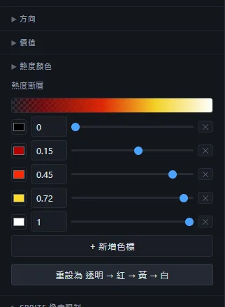

# 色彩與曝光

這些控制項決定每一段熱度量會得到哪一種顏色。**飽和點**是指多少熱度會被視為白熱。

## 快速修正 {#quick-fixes}

- 全部都是白色：提高**飽和點**，或按下**依畫面自動曝光**。
- 什麼都看不到：降低**飽和點**，或按下**依畫面自動曝光**。
- 只有幾個孤立的點出現：調高**最低熱度**。

本頁的每個控制項都在熱度變成顏色時生效，所以拖動任何一個都會立即重繪，**不會重新開始累積**。

## 飽和點 {#saturation-point}

**飽和點**（熱度形狀區段）：對應到色彩漸層頂端的累積熱度（搭配*線性*響應時；其他響應見下方）。滑桿為對數刻度 0.1-4000，拖曳把手可到 10,000,000，因為累積熱度會隨資料列數增加而變大。預設值為 24；每次載入時先給出**分析估計值**，然後依畫面**計量**取值。

設定錯誤就是熱度圖與空白（或全白）畫面的差別，而且這個值無法可靠地推導出來：遙測資料會高度聚集，例如出生點、門口、狹窄處，因此尖峰密度與平均密度的比值，在不同資料集與不同鏡頭角度之間可能相差一個數量級。

## 自動曝光 {#auto-exposure}

**依畫面自動曝光**會計量實際產生的畫面。它忽略空白像素，取有亮光像素的第 98 百分位數，並將其放在飽和點的 85% 位置，使色彩漸層的頂端保留給真正的尖峰。

面板隨後會顯示*已計量畫面的 X%；第 98 百分位數 R 已放在接近漸層頂端的位置*。使用*飽和*響應時，數值位於飽和點的 85% 處，會落在漸層的約 57% 位置，而不是 85%。

它也會**自動**執行：

- 資料集載入後的 8 個已算繪影格；
- [篩選器](filters.md)變更後的 8 個影格（把每個位置都過濾到只剩一百個事件，密度會改變好幾個數量級）；
- 在點熱度與[線熱度](line-heat.md)之間切換後，或變更線熱度繪製的路線後的 8 個影格，因為一條線每個樣本所產生的熱度，遠少於一個 Sprite。

當沒有任何亮光時，自動執行會保持飽和值不變；按鈕會退回分析估計值，並顯示*沒有可計量的亮光 - 已使用分析估計值*。

### 跟隨視角 {#follow-the-view}

**跟隨視角**（熱度形狀區段，預設開啟）會在每次鏡頭靜止時重新計量，因此你飛進的區域會使用整個色彩漸層，而不是針對整張地圖計量出的比例。小幅變化會被忽略，比例會平滑過渡而不是跳變。它在四種熱度模式中運作，但不在圖示覆蓋中運作。

取消勾選即可鎖定比例，以便在同一比例下比較不同地點。手動拖動**飽和點**也會鎖定比例。

## 密度響應 {#density-response}

**密度響應**：*k*（熱度 / 飽和點）如何對應到漸層上：

| 響應 | 公式 | 用途 |
|---|---|---|
| **飽和**（預設） | t = 1 - e^(-k) | 漸近地趨近漸層頂端，如同堆疊的半透明 Sprite。永遠不會裁切成平坦的白色，因此是不熟悉的資料時的安全預設值。 |
| **線性** | t = k | 唯一讓相同顏色代表相同數量的對應方式。用於比較兩個資料集或兩個時間區間。 |
| **對數** | t = log₂(1 + 7k) / 3 | 壓縮長尾，使單一極端熱點不再把其他所有區域壓到漸層底端。提亮稀疏區域。 |

## 最低熱度 {#minimum-heat}

**最低熱度**（預設關閉，0-100%）：任何帶有熱度的像素，都會被提升到至少這個漸層位置。調高它、同時調低 Sprite 半徑，就能看出*某處曾經發生過什麼*：單一資料點會變得清楚可見，而不是只稍微高於透明。判斷密度時請關閉它，因為它會刻意把漸層底端壓平。門檻值（k > 0.0001）可讓真正空白的像素保持空白。

## 色彩漸層編輯器 {#the-ramp-editor}

位於**熱度顏色**區段。其標籤說明了漸層的用途：在熱度與線條中為*熱度漸層*，在差異中為*正值（加法隊伍）*，在[隊伍熱度](team-heat.md)中為*不透明度漸層（顏色來自群組）*，此處只使用其 alpha。



頂端的色條會預覽漸層。下方每個色標各佔一列：

| 部分 | 意義 |
|---|---|
| 顏色方塊 | 色標的顏色（瀏覽器的顏色選擇器）。 |
| 數字 | 色標在漸層上的位置，0 到 1（0 = 沒有熱度）。 |
| 滑桿 | 色標的不透明度，0-100%。 |
| ✕ | 移除色標；只剩兩個時停用。 |

**+ 新增色標**會在最後兩個色標的中間新增一個色標，顏色與不透明度與最後一個色標相同。**重設為 透明 → 紅 → 黃 → 白**會還原預設值。

色標可以任意順序輸入；建立漸層時會排序。**alpha** 決定熱度如何與場景混合，這也是預設漸層零點完全透明的原因。

### 預設漸層 {#the-default-ramps}

| 位置 | 正值（熱度、線條、差異 +） | 負值（差異 −） |
|---|---|---|
| 0.00 | 黑色，alpha 0 | 黑色，alpha 0 |
| 0.15 | rgb(180, 0, 0)，alpha 0.55 | rgb(0, 170, 60)，alpha 0.55 |
| 0.45 | rgb(255, 40, 0)，alpha 0.85 | rgb(0, 190, 200)，alpha 0.85 |
| 0.72 | rgb(255, 220, 40)，alpha 0.95 | rgb(40, 80, 255)，alpha 0.95 |
| 1.00 | 白色，alpha 1 | rgb(170, 60, 255)，alpha 1 |

## 鏡頭移動時 {#while-the-camera-moves}

鏡頭移動時，累積會每個影格重新開始。開啟**每個影格都繪製所有資料列**（預設）時，每個移動中的影格仍然是精確的；關閉時，移動中的影格會顯示一個取樣估計值（較亮、依權重縮放的團塊），停止移動後會收斂到較平滑的真實畫面。這是預期的行為；請見[累積](accumulation.md)。

## 給開發者 {#for-developers}

### 合成階段 {#the-composite-pass}

熱度累積完成後，每個像素的值會在一次合成階段中轉換為顏色（[`COMPOSITE_FS`](https://github.com/Holdi601/3DHeat/blob/main/src/render/webgl2/shaders.ts)）。步驟如下：

```
k = |heat| / saturation point
t = response(k)                         clamped to 0..1
if minimum heat > 0 and k > 0.0001:  t = minimum + (1 - minimum) × t
colour, alpha = ramp(t)                  (the negative ramp when heat < 0, Difference only)
pixel = mix(scene, colour, alpha)
```

### 分析估計 {#the-analytic-estimate}

**分析估計**（[`estimateSaturation`](https://github.com/Holdi601/3DHeat/blob/main/src/data/calibrate.ts)）假設資料列散布在資料的 X-Z 佔地範圍內：平均熱度 = 資料列數 ×（π r² / 佔地面積）× 1/3 × 中心強度（1/3 是線性漸變在圓盤上的平均值），再乘以假設的尖峰與平均值比率 25，並限制在 0.1-1,000,000 之間。它只需要與正確值相差在一個數量級之內。

### 計量 {#metering}

[`exposure.ts`](https://github.com/Holdi601/3DHeat/blob/main/src/render/exposure.ts)：

1. 熱度目標會從 GPU 讀回，並取樣為最多 40,000 個值；
2. 空白像素（熱度 ≤ 0.0001）會被捨棄；大部分熱度畫面都是空白的，若把它們平均進去會使所有區域曝光不足，就像相機測光對著黑色背景一樣；
3. 有亮光像素的第 98 百分位數作為參照；
4. 飽和點變為 參照 / 0.85，因此參照值位於通往飽和點的 85% 位置，漸層頂端保留給真正的尖峰。

### 色彩表 {#the-colour-table}

漸層會被烘焙成一個 256 × 2 的 RGBA 表（正值漸層在第一列，負值在第二列）（[`buildColorLut`](https://github.com/Holdi601/3DHeat/blob/main/src/render/colors.ts)）。顏色在線性光中插值，並以 sRGB 儲存；不透明度則線性插值。
