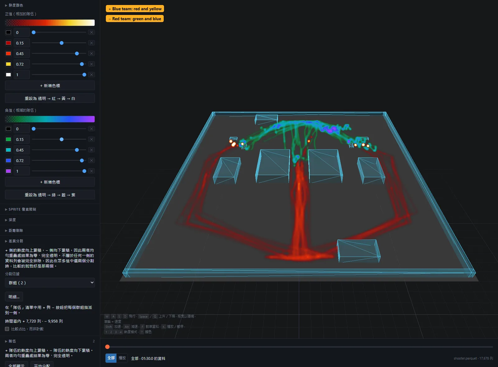

# 差異

隊伍 A 較多之處為紅色，隊伍 B 較多之處為綠藍色，兩者相等之處則不顯示。

**差異**（按鍵 2）是帶正負號的熱度。一個族群的列會增加熱度；另一個族群的列則會減去熱度。當兩者均勻重疊時，結果為零且完全透明；當其中一方占優時，會以該方的顏色顯示——預設情況下，**+** 一方為暖色（透明 → 紅 → 黃 → 白），**−** 一方為冷色（透明 → 綠 → 藍 → 紫）。

## 使用方式 {#how-to-use-it}

1. 按下 `2`（或在模式列中選取 **差異**）。
2. 開啟側欄中的 **差異分割**。
3. 選擇 **分割依據**：通常為*群組*。
4. 將一個群組（或數值）放在 **+**，另一個放在 **−**。
5. 閱讀顏色：暖色代表 + 一方，冷色代表 − 一方。若其中一方沒有任何列，面板會發出警告（見[你可能看到的訊息](#messages-you-may-see)）。

*哪兩個*族群，才是整個問題的關鍵，因此分割可以是任何保留下來的欄位，而不只限於群組。落在**兩邊都不屬於**的列會被**略去**，不會被計為零：正因如此，對許多數值中的兩個進行分割時，比較的恰好是這兩者；而且它可以和[篩選器](filters.md)組合使用——先篩選到一張地圖，再依版本分割它。

此模式需要兩個陣營：一個至少有兩個群組的群組欄位，或是對保留以供篩選之欄位的分割。若資料中的群組少於兩個，載入時會以欄位分割開始——多檔案載入時先用 *Source file* 欄位，否則用第一個有兩個值的類別欄位，再否則用第一個有範圍的數值欄位——因此*比較兩次載入*即使在沒有任何群組的資料上也能運作。只有兩者皆無的資料，會使此模式無法使用；欄位分割若某一方沒有任何東西，也同樣無法使用。

## 差異分割面板 {#the-difference-split-panel}

在差異模式中顯示，位於熱度面板之下。

**分割依據** 提供：

| 選項 | 顯示為 | 分割規則 |
|---|---|---|
| 群組 | *群組 (N)*（當有群組欄位時） | 每個群組放在 +、− 或兩者皆非，於[隊伍清單](teams-list.md)中設定 |
| 類別欄位 | *欄位 (N 個值)* | 各值放在 +、− 或兩者皆非 |
| 數值欄位 | *欄位（數值）* | 每一方各有一個數值範圍 |
| 來源檔案 | *Source file - 比較兩次載入*（載入多個檔案時） | 各檔案放在 +、− 或兩者皆非 |

只提供載入時在*保留以供篩選*下保留的欄位。

### 比較占比，而非計數 {#compare-shares-not-counts}

**比較占比，而非計數**（預設關閉）會以各方自己列數的倒數來加權，因此列數多五倍的一方不會僅憑數量獲勝。顏色因此會顯示每一方相對於另一方，在比例上較為常見之處。當兩方的資料量差異很大時使用它，例如長度不同的兩個場次。

### 你可能看到的訊息 {#messages-you-may-see}

當畫面並不是真正的差異時，面板會發出警告：

| 訊息 | 意義 |
|---|---|
| *N + / M −*（或 *N + / M − / K 未使用*） | 每一方（以及兩者皆非）各有多少值。 |
| 視窗中沒有任何列在 **+** 一方 | 只繪製 **−** 一方。請移動時間軸視窗或變更分割。 |
| 視窗中沒有任何列在 **−** 一方 | 只繪製 **+** 一方。 |
| 兩方都沒有任何值 | 差異不會繪製任何東西。請至少把一個值放在 **+** 或 **−**。 |
| *欄位*無法以此方式分割 | 所選的欄位不符合此分割。請重新選擇欄位。 |
| 分割欄位在 N 個區塊中的 M 個中無法放入 GPU 記憶體 | 這些列不會被繪製。請在「效能 → 資源預算」中提高 GPU 預算，或載入較少的列。 |

### 依群組 {#by-group}

面板只是指向[隊伍清單](teams-list.md)，那裡每個群組都有 **+** 與 **−** 按鈕。每次載入時，群組的前半（無條件進位）會放在 +，其餘放在 −；隊伍清單中的 **平均分配** 會再做一次同樣的事。放在兩邊都不屬於的群組，或以其核取方塊隱藏的群組，不會有任何貢獻。

### 依類別值 {#by-category-values}

| 部分 | 意義 |
|---|---|
| `a + / b − / c 未使用` | 每一方以及兩者皆非各有多少值。 |
| **清除** | 將每個值都放到兩者皆非。 |
| 值清單 | 每個值各有一個 **+** 與一個 **−** 按鈕（再次點擊已作用中的按鈕即可將其移出該方）。空值會以 *（缺漏）* 列出。 |
| 上限說明 | 只列出前 200 個值：*顯示 N 個值中的前 200 個。若欄位太寬，最好先以篩選器縮小範圍，或若其值有順序，則依範圍分割。* |

選擇欄位時，其第一個值會放在 +，第二個放在 −。當兩邊都沒有任何值時，分割會退回為群組，而不會顯示空白的畫面。*Source file* 的運作方式相同，每個檔案一個值——這就是比較兩份匯出、兩次測試執行或兩個版本的方法。

### 依範圍 {#by-range}

| 部分 | 意義 |
|---|---|
| 提示 | 欄位的最小值與最大值。 |
| **正範圍（+）**，**從** / **到** | 值落在此範圍內的列（兩端皆含）會被加入。 |
| **負範圍（−）**，**從** / **到** | 此範圍內的列會被減去。 |
| **在中點分割** | 將 + 設為 [最小值, 中點]，將 − 設為 [中點, 最大值]——選擇欄位時也會做同樣的設定。 |

同時落在兩個範圍內的值，計為 +。範圍不必涵蓋整個欄位；兩者皆不在的值會被略去。*前兩分鐘 對 最後兩分鐘* 就是對類似時間欄位的範圍分割。

## 顏色 {#colours}

在此模式下，**熱度顏色** 區段會顯示兩個色階編輯器：**正值（相加的隊伍）** 與 **負值（相減的隊伍）**，各自有其重設按鈕（*重設為 透明 → 紅 → 黃 → 白*、*重設為 透明 → 綠 → 藍 → 紫*）。合成結果會取淨熱度經過[飽和點與回應](colour-and-exposure.md)後的絕對值，並在淨值小於零之處選用負值色階。參閱[色彩與曝光](colour-and-exposure.md#the-ramp-editor)。

當差異的大小很重要時，使用*線性*密度回應：它是唯一一種相同顏色代表相同數量的回應。

## 給開發者 {#for-developers}

每一列在頂點著色器中都會得到一個 +1、-1 或 0 的符號（[`POINT_HEAT_VS`](https://github.com/Holdi601/3DHeat/blob/main/src/render/webgl2/shaders.ts)）；為 0 的列會在繪製任何片段之前被捨棄。

- 依群組時，符號來自一個 4,096 項的群組表，以該列的群組 ID 為索引（群組 ID 搭載在該列位置紋素的第四個通道中）。
- 依類別時，符號來自第二個 4,096 項的表，依每個類別值填入；該列的值則從欄位的篩選紋理讀取。超出表尾的值，在兩種後端上都會被捨棄。
- 依範圍時，會將該列的值與兩個範圍做比較。

變更分割會重新開始累積。

**隱藏的群組在任何分割下都保持隱藏。** 在依欄位分割時，群組表不再帶有符號；它對顯示的群組保存 1，對隱藏的群組保存 0（[`frameSignTables`](https://github.com/Holdi601/3DHeat/blob/main/src/render/filterTables.ts)），而兩張表會一同送到著色器——在 WebGL2 上為同一張符號紋理的兩列，在 WebGPU 上為同一個儲存緩衝區的兩半。只有當一列的群組為顯示中，*且*其欄位值位於某一方時，該列才會被繪製。因此，在[隊伍清單](teams-list.md)中取消勾選的群組，或被比賽分頁的陣營聚焦排除的群組，無論差異如何分割，都不會有任何貢獻。
