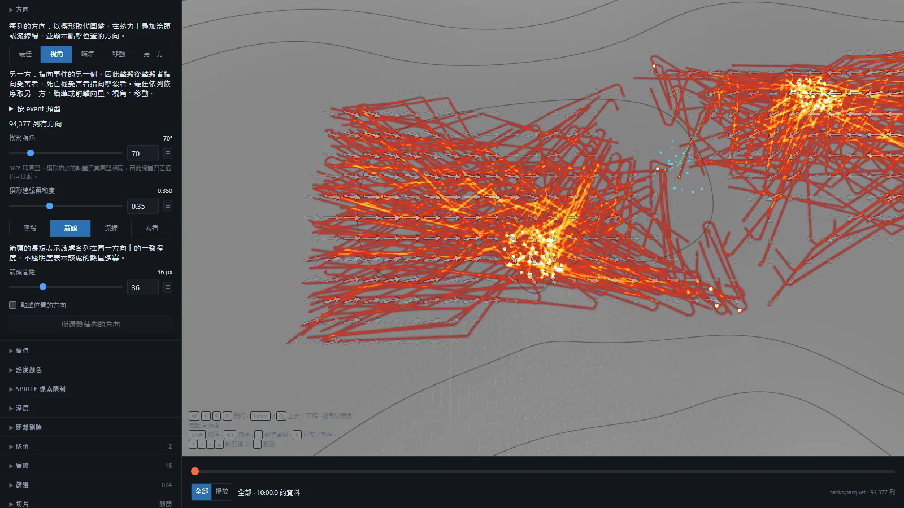

# 方向熱度

一般的熱度只說明事情**發生在哪裡**。方向熱度還能說明**朝哪個方向**：人們當時看向哪裡、瞄準哪裡、往哪裡移動，或戰鬥中另一方位於何處。

一般的 Sprite 是一個完整的圓盤（360 度）。若把**楔形張角**設為 70 度，同一個 Sprite 就會變成一個狹窄的楔形，指向該資料列所面對的方向，並加入相同的總熱度。

## 使用方法 {#how-to-use-it}

1. 載入含有方向資料的資料（見[什麼會讓資料列有方向](#what-gives-a-row-a-direction)）。
2. 在模式列中選擇**熱度**、**差異**或**隊伍熱度**。
3. 打開側邊欄中的**方向**區段。
4. 選擇**來源**（使用哪個方向），然後開啟繪製：
   - 把**楔形張角**調低到 360° 以下，即可把每個資料列繪製成指向其方向的楔形，而不是圓盤；
   - 選擇**場**，即可在熱度上方繪製箭頭或流線；
   - 勾選**點擊位置的方向**，然後點擊熱度，即可取得該位置的極座標圖。

狀態列會顯示有多少資料列能從所選來源取得方向。

## 設定 {#settings}

| 設定 | 預設值 | 作用 |
|---|---|---|
| 來源：**最佳**、**檢視**、**瞄準**、**移動**、**另一方** | 最佳 | 每個資料列取得哪個方向。*最佳*會依序取：每個資料列的另一方；若無則取瞄準；若無則取檢視；若無則取移動。 |
| **依事件類型** | 同上 | 為每種事件類型設定不同的來源，例如擊殺使用*另一方*，位置則使用*檢視*。當資料的事件欄位最多只有 40 個值時才會顯示。 |
| **楔形張角** | 360° | 360° 為一般的圓盤（即關閉）。數值越小，楔形越窄。楔形所加入的熱度與其圓盤相同，因此總量與差異仍可相互比較。 |
| **楔形邊緣柔和度** | 0.35 | 0 為邊緣銳利的楔形，1 為柔和的扇形。 |
| **場**：無場、箭頭、流線、兩者 | 無場 | 箭頭：箭頭的長度代表該處的資料列在同一方向上的一致程度，不透明度代表該處的熱度多寡。箭頭只會顯示在有熱度的地方。 |
| **箭頭間距** | 28 px | 螢幕上箭頭之間的距離。 |
| **流線動畫** | 開啟 | 開啟時，流線會流動。 |
| **點擊位置的方向** | 關閉 | 點擊熱度以查看該處的方向（如下）。 |
| **所選體積內的方向** | | 針對所選[體積](volumes.md)內的所有資料，顯示相同的圖表。 |

## 位置上的極座標圖 {#the-polar-chart-at-a-spot}

開啟**點擊位置的方向**後，點擊熱度。靠近該點的資料列（距離在 1.5 個 Sprite 半徑之內）會被彙整成一個由 24 個 15° 扇區組成的玫瑰圖：

- **橘色**花瓣：外向方向（資料列所指向的方向）；
- **藍色**花瓣：內向方向（資料列來自的方向）；
- 花瓣的**面積**隨其計數增加；箭頭顯示主要方向；
- 圖表下方的文字列會給出主要方位角、資料列的一致程度（R，0 到 1）、以度數表示的散佈範圍，以及資料列數量。

圖表上的 0° 朝上，即世界的 −Z（對於 Tacview 錄影而言為北方）。該位置也會在 3D 視圖中以箭頭與圓環標示。

## 什麼會讓資料列有方向 {#what-gives-a-row-a-direction}

| 來源 | 資料中需要的內容 |
|---|---|
| 檢視 | 一個偏航欄位（對應為觀看方向）：`yaw`、`heading`、`azimuth`、`view_yaw`、`rot_z` |
| 瞄準 | 成對的數字欄位，例如 `aim_x`/`aim_y`、`shot_x`/`shot_y`、`fire_x`/`fire_y`、`hit_dir_x`/`hit_dir_y`（可選擇加上 `…_z`） |
| 移動 | 無需額外資料：同一人前一個取樣（最多早 10 秒，同一場次）到此取樣的位移 |
| 另一方 | 一個指出事件另一方的欄位（`other`、`victim`、`target`、`killer`、`attacker`、`shooter`、`other_player` 等），其值為人員名稱；擊殺由擊殺者指向受害者，死亡則由受害者指向擊殺者 |

## 提示 {#tips}

- 楔形需要在螢幕上有一定大小；若小於幾個像素，就會再次改以圓盤繪製。
- 在擊殺資料列上使用*另一方*，可看見戰鬥是**從哪裡**贏得的；在位置資料列上使用*檢視*，可看見**人們在看哪裡**。
- 使用**差異**時，兩方的楔形會指向各自的方向，因此相互爭奪的火力線會更加醒目。
