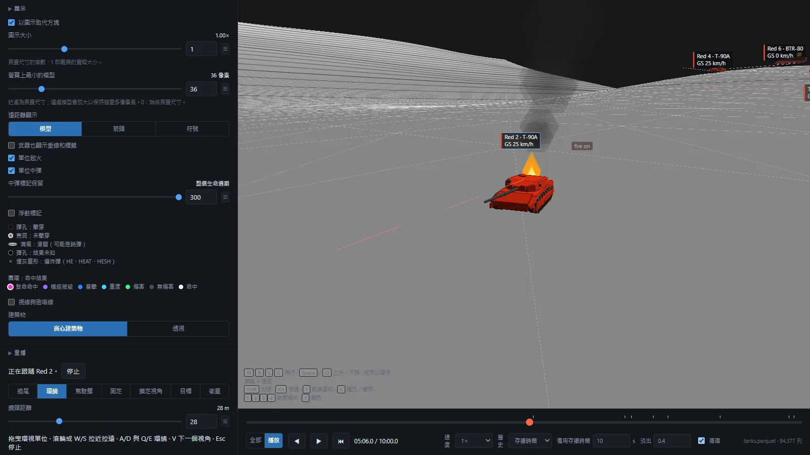

# 圖示

**圖示**是一個單位實際上是什麼的小型 3D 模型：坦克、噴射機、船、士兵。[重播](match-replay.md)會以真實大小把每個單位畫成它的圖示，而不是一個普通的方塊。

大約有 2,000 個命名的車輛、飛機、船隻、武器與士兵，全部由檢視器自己建置。

## 圖示目錄包含什麼 {#what-is-in-the-catalogue}

| 類別 | 範例 |
|---|---|
| 人員 | 站立、蹲下、趴下的士兵；狙擊手、反坦克、衛生兵、車組 |
| 地面 | 坦克、步兵戰鬥車、防空、火砲、卡車與汽車、火車與電車 |
| 空中 | 戰鬥機、攻擊機、轟炸機、運輸機、直升機，從雙翼機到現代噴射機 |
| 海上 | 依級別的軍艦、航空母艦、潛艇、小艇、商船 |
| 武器 | 飛彈、火箭、炸彈、魚雷、照明彈與干擾箔條 |
| 標記 | 煙霧、閃光與燃燒手榴彈、已放置的炸彈、旗幟、重生點、路點 |
| 近距離戰鬥 | 身穿防彈插板背心、手持突擊步槍、SMG、霰彈槍、DMR、LMG、手槍或盾牌的士兵；無人機、攝影機、鐵絲網、盾牌、牆面強化、路障、破牆炸藥、陷阱、窗戶、手榴彈、拆彈器 |

## 圖示如何製作 {#how-the-figures-are-made}

- **依已公開的尺寸建置。** 大部分圖示是由檢視器自己的圖示建置工具，依公開數字製作：長度、寬度、高度、路輪、砲塔與火砲、機翼與尾翼。接著，它們的形狀會參照公開的照片、圖面與已公開的尺寸進行調整。沒有使用任何遊戲的模型。
- **免費模型。** 少數圖示會使用免費的 3D 模型（CC0 或 CC BY），在它們比較真實的情況下，有時會與已建置的車體結合。CC BY 作品的作者會列在[模型出處](figure-credits.md)；CC0 作品不需要署名，因此不列在那裡。
- 每個圖示都有完整版、粗略版與遠距版（細節層級，LOD），所以可以同時繪製數千個。

## 單位會得到哪個圖示 {#which-figure-a-unit-gets}

檢視器會查看資料本身的欄位：

1. **名稱**——名為 *Name*、*Vehicle*、*Unit*、*Unit type*、*Model*、*Aircraft*、*Plane*、*Tank*、*Ship*、*Craft*、*Loadout*、*Kit* 或 *Figure* 的欄位——會與目錄比對：完全相符、透過約 4,000 個別名（數款遊戲的單位 id）比對、依最長的已知開頭比對（`F-16C_50` 即為 F-16C），或依以它為開頭的最短圖示名稱比對。
2. 若某個名稱的圖示與單位的**類型**不符，就不會使用（一輛名為 *Typhoon* 的卡車不是戰鬥機）。
3. **類型**——名為 *Type*、*Class*、*Kind*、*Category*、*Icon*、*Role* 或 *Domain* 的欄位——會給出類別圖示：Tacview 標籤（`Air+FixedWing`、`Ground+Heavy+Armor+Vehicle+Tank`、`Sea+Watercraft+Warship`、`Weapon+Missile`）、地圖圖示，或一般字詞（tank、helicopter、infantry）。
4. 兩者都沒有的資料屬於人員：每個人都是士兵。

因此，要取得正確圖示最簡單的方法，是使用一個帶有真實名稱的 `vehicle` 欄位，或一個帶有 Tacview 標籤的 `type` 欄位。

**我的單位顯示為方塊或士兵。** 新增一個帶有真實名稱的 `vehicle` 欄位，或一個帶有 Tacview 標籤的 `type` 欄位。將滑鼠移到單位上，可看到配對到的名稱。有這類欄位、但對某個單位沒有說明的資料，會讓該單位維持為方塊；兩者都沒有的資料，則會被畫成士兵。

## 近距離戰鬥圖示（Rainbow Six Siege） {#close-quarters-figures-rainbow-six-siege}

依 Rainbow Six Siege 重播讀取器的格式寫成的表格（欄位 `operator`、`pawn`、`primaryClass`、`side`）會得到專屬圖示：

- **玩家**會顯示為其幹員：78 名幹員每人都有專屬圖示，身高約 1.8 公尺，穿著自己的衣服——夾克、褲子與裝備依其常見的公開形象使用兩到三種顏色（黑色、橄欖色、棕褐色、城市灰、白色、海軍藍，搭配紅色、橘色或青綠色裝備）——並有自己的形狀；需要從上方看清的部分比真實大三分之一：頭戴物（頭盔、面罩或重型頭盔、帽子、毛線帽、貝雷帽、寬簷奔尼帽或毛皮帽、兜帽、圍巾、頭髮）、臉部（護目鏡、防毒面具、眼鏡、面具、鬍子、三鏡片護目鏡）、輕型、中型或重型體格（重型體格較寬，帶有大型護肩板與護頸）、長大衣或西裝、吉利服、背在背上的東西（鎚子、炸藥、無人機、罐子、燃料箱、發射筒、十字弓、面板、干擾器、盾牌）或手臂上的東西（發射器、金屬手臂）、自己的盾牌（高盾、鎮暴盾、附燈的盾），以及肩上的強調色。他們手持主武器的類別。檢視器不認識的幹員，會顯示為穿著防彈插板背心、使用隊伍顏色的普通士兵。
- **陣營**與衣服分開顯示：每名幹員腳下的地面上有一個圓環，**進攻方為琥珀色，防守方為淡青色**，圓環內是隊伍顏色，臂帶與頭帶也使用同一顏色。`stance` 欄位（stand、crouch、prone）決定其姿勢；沒有這個欄位時，他們會站著。
- **在重播距離下可以分辨：**從上方與四分之三視角以 48 像素高度繪製時，同一陣營的任兩名幹員都有明顯的顏色差異或不同的形狀（由檢視器的測試檢查）。
- **標籤**會顯示玩家名稱與其當時使用的幹員，並以符號表示幹員的角色：✸ 硬破牆手、⚒ 軟破牆手、➤ 突入、✦ 擊殺手、✚ 支援、⬟ 盾牌、◉ 情報、◇ 彈性、↺ 側翼警戒、⚓ 據守、✕ 陷阱手、⇄ 遊走、↯ 反道具、▣ 反破牆。
- **無人機**是可投擲的兩輪無人機，寬約 30 公分，每架都是獨立的軌跡，以其主人命名（「Ash · drone 2」）。
- **放置的道具**從放下時起到回合結束都留在原處，每個都顯示為代表其用途的圖示：攝影機、鐵絲網、可部署盾牌、破牆炸藥、硬破牆炸藥、小型黏性炸藥、地面陷阱、附絆線雷射的闊劍地雷、單向窗、裝甲板、手榴彈、毒氣罐、干擾器、感測器、雷射門、補給箱。用途相同的道具共用一個圖示。資料未說明種類的道具，會顯示為附燈的小裝置。
- **拆彈器**會在其安放處停留 45 秒。

載入檔案時，每架無人機與每個道具都會成為獨立的軌跡，因此玩家自己的圖示會留在其身體上。幹員是依其公開描述與圖像（所穿的衣服、作為其能力的裝置）製作的簡化形狀，道具則依其用途決定形狀。這些全都是檢視器自己的設計，採用物體的真實尺寸（闊劍地雷寬約 22 公分，門大小的面板為 1 公尺 × 2.1 公尺），不是遊戲中的模型。

## 設定 {#settings}

重播側邊欄的 **圖示** 區段可設定大小、螢幕上的最小尺寸、遠距單位會變成什麼（圖示、箭頭、符號），以及加在它們身上的效果。見[對戰重播](match-replay.md#figures)。煙霧、火焰與其他有時間限制的效果：[圖示疊加中的圖示](figure-replay.md)。

## 可選的本機圖示包 {#an-optional-local-figure-pack}

你可以在自己的電腦上保存一組自己的可選圖示包。其中的圖示會取代同名的目錄圖示。它絕不屬於儲存庫或任何已發佈的版本；沒有這個圖示包時，什麼都不會改變。
