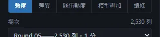

# 熱度模式

每一個點都會增加一點光暈，光暈彼此疊加，疊加後的結果再以色彩上色。模式是五種上色方式，每一種都回答一個問題。

熱圖頁籤側邊欄頂部的模式列決定[資料集](glossary.md)如何繪製。按鍵 1-4 分別選取熱度、差異、隊伍熱度與線條。模型疊加沒有快捷鍵。

| 模式 | 它回答的問題 |
|---|---|
| **熱度** | 在哪裡發生，發生了多少？ |
| **差異** | 哪一方做得比較多？ |
| **隊伍熱度** | 這是誰的？ |
| **線條** | 人們走了哪些方向？ |
| **模型疊加** | 誰在哪裡，又是什麼時候？ |

| 模式（模式列標籤） | 按鍵 | 繪製內容 | 需要 |
|---|---|---|---|
| **熱度** | 1 | 加法密度：每個可見列都會加入一個面向攝影機的放射狀 Sprite。[熱度](heat.md) | 一個資料集 |
| **差異** | 2 | 帶正負號的密度：一群人增加，另一群人減少。[差異](difference.md) | 兩方：至少兩個群組，或依保留欄位拆分 |
| **隊伍熱度** | 3 | 依群組上色的密度：每個群組一種色相，在群組重疊處混合。[隊伍熱度](team-heat.md) | 一個群組欄位 |
| **模型疊加** | - | 每個人一個模型（或方塊），隨時間軸移動：即重播。[模型疊加](box-replay.md)、[對戰重播](match-replay.md) | 一個人員欄位 |
| **線條** | 4 | 線條熱度：從每個人的每個取樣點到其下一個取樣點畫一條線，熱度向兩側衰減。[線條熱度](line-heat.md) | 一個人員欄位與一個時間欄位 |

資料無法支援的模式會變成灰色，其工具提示會說明原因，例如*不可用 - 差異模式需要兩個群組，或一個可供拆分的保留欄位；此資料只有一個群組。* 當新的資料集無法支援目前的模式時，檢視會退回**熱度**。

按鍵 1-4 也以同樣方式檢查資料：對應到灰色模式的按鍵沒有作用。

## 每個模式顯示哪些面板 {#which-panels-each-mode-shows}

| 面板 | 熱度 | 差異 | 隊伍熱度 | 模型疊加 | 線條 |
|---|---|---|---|---|---|
| 路線（[線條熱度](line-heat.md)） | | | | | 是 |
| 熱度形狀（含**跟隨視角**與**任何縮放下密度一致**）、熱度顏色、Sprite 像素限制、深度、距離剔除 | 是 | 是 | 是 | | 是 |
| 方向（[方向熱度](directional-heat.md)）、值（[數值加權](value-weighting.md)） | 是 | 是 | 是 | | 是 |
| 隊伍檢視器（[模型疊加](box-replay.md)） | | | | 是 | |
| 差異分割（[差異](difference.md)） | | 是 | | | |
| [隊伍](teams-list.md)、[實體](entities.md)、[篩選](filters.md)、背景 / 關卡、[切片](slice.md)、[指標](measure.md)、攝影機路徑與渲染、效能、攝影機與場景 | 是 | 是 | 是 | 是 | 是 |

## 所有熱度模式共用的部分 {#what-every-heat-mode-shares}

四種熱度模式（除模型疊加以外）都是同一套機制，只是輸入不同（[`engine.ts`](https://github.com/Holdi601/3DHeat/blob/main/src/render/engine.ts)）：

1. **哪些列。** [時間軸](timeline.md)視窗會選出一段按時間排序的連續列範圍；[篩選](filters.md)、群組可見性、差異分割、[距離剔除](depth-and-culling.md#distance-culling)與[切片](slice.md)會在頂點著色器中，逐列決定每一列是否參與，以及參與的強度。
2. **Splatting。** 每個參與的列都會以 Sprite（或在線條模式中為線段）繪製到浮點**熱度目標**中，並加上其漸層值。當列數超過單一影格能負擔的量時，會繪製分層抽樣後的列，並加權以補償。請參閱[取樣與預算](sampling-and-budgets.md)。
3. **累積。** 在沒有任何變化時，影格會持續合併，直到每一列都恰好貢獻一次。請參閱[累積](accumulation.md)。
4. **合成。** 每個像素的累積值會除以**飽和點**，經**密度響應**塑形，再以**最低熱度**提升，最後在**色彩漸層**中查表，其 alpha 會把結果混合到場景上。請參閱[色彩與曝光](colour-and-exposure.md)。

第 4 步的一切都在合成時套用，因此拖動這些控制項絕不會重新開始累積；第 1-2 步的任何變更則會。

## 本節中的頁面 {#pages-in-this-section}

- [熱度](heat.md) - 一般的熱度模式，以及其面板的總覽
  - [Sprite 形狀](sprite-shape.md) - 半徑、強度、衰減、曲線編輯器、像素限制、壓平
  - [色彩與曝光](colour-and-exposure.md) - 漸層編輯器、飽和點、自動曝光、最低熱度、密度響應
  - [深度與剔除](depth-and-culling.md) - 被關卡遮擋、隱藏在地形後方、距離剔除
- [差異](difference.md) - 差異分割
- [隊伍熱度](team-heat.md)
- [線條熱度](line-heat.md) - 路線
- [模型疊加](box-replay.md) - 重播模式（檔名仍為 box replay）
- [方向熱度](directional-heat.md)
- [數值加權](value-weighting.md)
