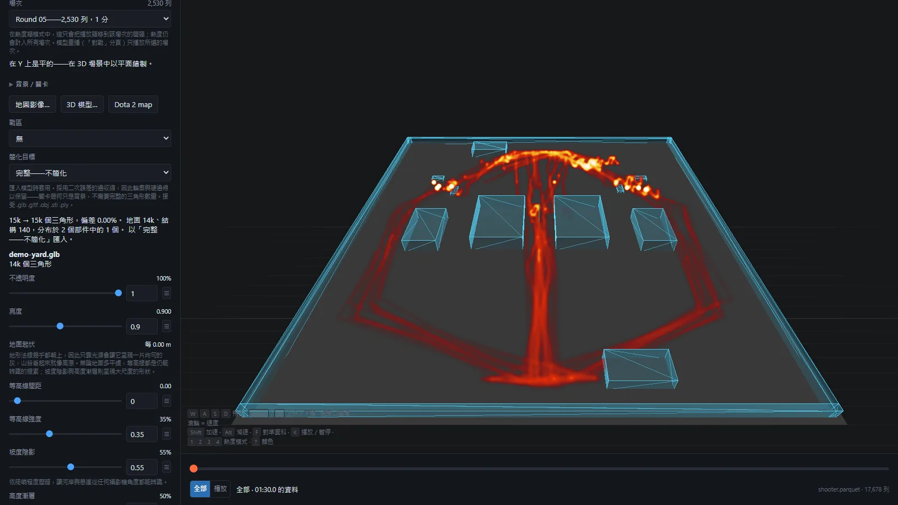

# 熱度

熱度會把許多事情大量發生的地方上色：稍微發生的地方為紅色，發生很多的地方則為白熱。它回答的是「這裡發生了什麼事，發生了多少」。

**熱度**（按鍵 1）是預設模式。每個可見的[列](glossary.md)都會加入一個面向攝影機的圓形[Sprite](glossary.md)；重疊的 Sprite 會在浮點緩衝區中相加；總和再經由色彩漸層映射（預設為透明 → 紅 → 黃 → 白），並疊加在場景上。

此圖顯示的是某一回合射擊遊戲在有建築物的關卡上的熱度：熱點位於房間內與樓梯上，而不只是在地面上。

## 使用方法 {#how-to-use-it}

1. 載入資料並按下 `1`（或在模式列中選取**熱度**）。
2. 如果一切都是白色或空白的，請按**熱度形狀**區段中的**依畫面自動曝光**。
3. 調整 **Sprite 半徑**，直到相鄰的點合併成帶狀：較小時顯示單一的點，較大時顯示區域。
4. 開啟**熱度顏色**來變更顏色，或開啟**深度**，讓山丘與牆壁把背後的熱度遮住。

同樣的面板也會塑造[差異](difference.md)、[隊伍熱度](team-heat.md)與[線條熱度](line-heat.md)；它們的差別在於新增的內容（帶正負號、有顏色，或沿著線條），而不在於運作方式。

## 面板與其預設值 {#the-panels-and-their-defaults}

下列每個控制項都對應到一個著色器參數，因此變更它們除了重新繪製之外不需要任何成本。滑桿旁有可輸入數值的方框，以及拖曳把手（右側的小握把：上下拖曳，拖得越遠越快，按住 Shift 可微調）；若滑桿的軌道在真正的上限之前就結束，把手可以推過軌道，直到此處列出的*微調上限*。標示為*載入時*的數值，會為每個新資料集重新計算。

### 熱度形狀（展開） {#heat-shape-open}

| 控制項 | 預設值 | 範圍（微調上限） | 詳細說明 |
|---|---|---|---|
| **Sprite 半徑** | 6 m；載入時為範圍 / 120 | 0.05-2000 m，對數刻度（50,000） | [Sprite 形狀](sprite-shape.md#sprite-radius) |
| **中心強度** | 1 | 0-10（1000） | [Sprite 形狀](sprite-shape.md#centre-and-edge-intensity) |
| **邊緣強度** | 0 | -2-10（1000） | [Sprite 形狀](sprite-shape.md#centre-and-edge-intensity) |
| **漸變形狀** | *衰減* | *衰減* / *曲線* | [Sprite 形狀](sprite-shape.md#ramp-shape-falloff-or-curve) |
| **衰減**（僅限衰減） | 1.6 | 0.1-8（64） | [Sprite 形狀](sprite-shape.md#falloff) |
| **平滑漸變**（僅限衰減） | 開 | | [Sprite 形狀](sprite-shape.md#falloff) |
| 曲線編輯器（僅限曲線） | *平滑*預設 | | [Sprite 形狀](sprite-shape.md#the-curve-editor) |
| **飽和點** | 24；載入時為估計值，之後依畫面測量 | 0.1-4000，對數刻度（10,000,000） | [色彩與曝光](colour-and-exposure.md#saturation-point) |
| **最低熱度** | 關（0） | 0-100% | [色彩與曝光](colour-and-exposure.md#minimum-heat) |
| **密度響應** | *飽和* | *飽和* / *線性* / *對數* | [色彩與曝光](colour-and-exposure.md#density-response) |
| **依畫面自動曝光** | | 按鈕 | [色彩與曝光](colour-and-exposure.md#auto-exposure) |
| **跟隨視角** | 開 | | 每當攝影機停止移動時，會重新測量曝光，因此你飛入的區域會使用整個色彩漸層。小幅變化會被忽略，比例尺會平滑過渡。取消勾選，或拖動**飽和點**，即可鎖定比例尺，在同一比例尺上比較不同地點。[色彩與曝光](colour-and-exposure.md#follow-the-view) |
| **任何縮放下密度一致** | 開 | | 無論你靠多近，一種顏色都代表每單位地面相同的列數。被像素限制放大（遠處）或縮小（近處）的 Sprite，會保留其真實大小應增加的熱度，因此從遠處曝光的畫面，不會因為你飛近而變淡。關閉時，被限制的 Sprite 會以其限制後的大小加上完整權重。[Sprite 形狀](sprite-shape.md#pixel-clamps) |
| **壓平到地面** | 關 | | [Sprite 形狀](sprite-shape.md#flatten-onto-ground-plane) |

### 熱度顏色（收合） {#heat-colours-closed}

| 控制項 | 預設值 | 詳細說明 |
|---|---|---|
| 群組色票與**色彩分離**（僅限隊伍熱度） | 1.4 | [隊伍熱度](team-heat.md) |
| **熱度漸層**編輯器（差異中為*正值（相加的隊伍）*，隊伍熱度中為*不透明度漸層*） | 透明 → 紅 → 黃 → 白 | [色彩與曝光](colour-and-exposure.md#the-ramp-editor) |
| **重設為 透明 → 紅 → 黃 → 白** | | |
| **負值（相減的隊伍）**漸層（僅限差異） | 透明 → 綠 → 藍 → 紫 | [差異](difference.md#colours) |

### Sprite 像素限制（收合） {#sprite-pixel-clamps-closed}

| 控制項 | 預設值 | 範圍（微調上限） | 詳細說明 |
|---|---|---|---|
| **最小像素半徑** | 1 px | 0-16（512） | [Sprite 形狀](sprite-shape.md#pixel-clamps) |
| **最大像素半徑** | 96 px | 2-1024，對數刻度（8192） | [Sprite 形狀](sprite-shape.md#pixel-clamps) |

### 深度（展開） {#depth-open}

| 控制項 | 預設值 | 詳細說明 |
|---|---|---|
| **隱藏在地形後方** | 開 | [深度與剔除](depth-and-culling.md#hide-behind-terrain) |
| **被幾何體遮擋** | 0.8（*暗 80%*） | [深度與剔除](depth-and-culling.md#hidden-behind-geometry) |

### 距離剔除（收合） {#distance-culling-closed}

| 控制項 | 預設值 | 範圍（微調上限） | 詳細說明 |
|---|---|---|---|
| **近** | 關（0） | 0.5-5000 m，對數刻度，軌道底端 = 關（200,000） | [深度與剔除](depth-and-culling.md#distance-culling) |
| **遠** | 關（0） | 1-200,000 m，對數刻度，底端 = 關（10,000,000） | [深度與剔除](depth-and-culling.md#distance-culling) |
| **以平面切割** | 開 | | [深度與剔除](depth-and-culling.md#distance-culling) |
| **同時切割關卡** | 開 | | [深度與剔除](depth-and-culling.md#distance-culling) |

按鍵：`[` 與 `]` 將遠邊界往內與往外推，`\` 切換開關（[深度與剔除](depth-and-culling.md#keyboard)）。

### 方向與值 {#direction-and-value}

熱度形狀下方還有兩個區段。**方向**會把每一列畫成一個楔形並加上箭頭：請參閱[方向熱度](directional-heat.md)。**值**會依每一列的成本或收益來加權熱度：請參閱[數值加權](value-weighting.md)。

## 會被儲存的內容 {#what-is-saved}

上述熱度設定不會在工作階段之間儲存：重新載入頁面會還原預設值。瀏覽器中保留兩項：最後一次的播放速度（`heat3d.speed`，請參閱[時間軸](timeline.md)），以及[模型疊加](box-replay.md)中遠處模型的設定（符號樣式、大小、命中標記等）。語言、[反轉的世界座標軸](camera.md#invert-world-axis)、賽車頁籤記住的車輛名稱，以及[關卡庫](level-library.md)也會保留。完整清單位於[儲存的設定](ref-settings-storage.md)。
