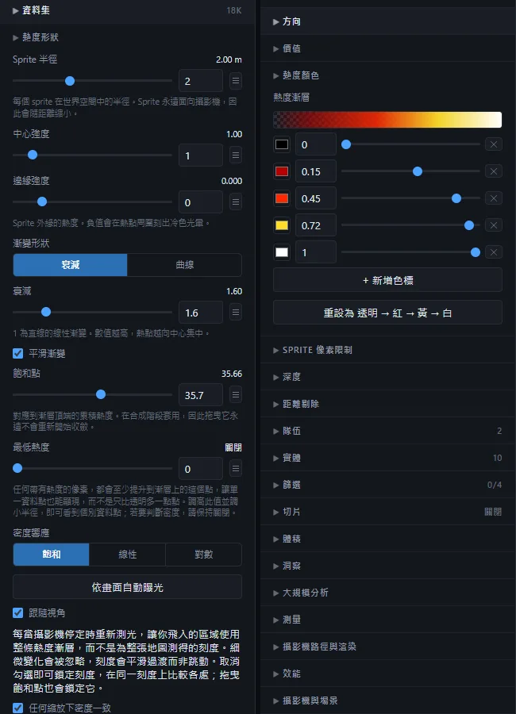

# 熱度

熱度會為許多事情發生過的地方上色：發生得稍微多一點的地方是紅色，發生得很多的地方則是白熱。它回答的問題是「這裡發生了什麼事，以及發生了多少」。

**熱度**（按鍵 1）是預設模式。每個可見的[資料列](glossary.md)都會貢獻一個面向攝影機的圓形[Sprite](glossary.md)；重疊的 Sprite 會在浮點緩衝區中相加；總和再經由色彩漸層對應——預設為透明 → 紅 → 黃 → 白——並繪製在場景之上。

此圖顯示的是一場射擊遊戲的一個回合，在有建築物的關卡上的熱度：熱點位於房間裡與樓梯上，而不只是在地面上。

## 使用方法 {#how-to-use-it}

1. 載入資料並按下 `1`（或在模式列中選擇**熱度**）。
2. 如果全部是白色或空白，請按下**熱度形狀**區段中的**依畫面自動曝光**。
3. 調整 **Sprite 半徑**，直到相鄰的點合併成帶狀：較小時顯示單一的點，較大時顯示區域。
4. 打開**熱度顏色**以變更顏色，或打開**深度**，讓山丘與牆壁把後方的熱度遮住。

同樣的面板也會塑造[差異](difference.md)、[隊伍熱度](team-heat.md)與[線條熱度](line-heat.md)；它們的差別在於加入的內容（帶正負號、有顏色，或沿著線條），而不在於運作方式。

## 各面板與其預設值 {#the-panels-and-their-defaults}

每個控制項都在其自己的頁面中說明；「詳細資訊」欄會連結到該頁。滑桿旁邊有一個可輸入數值的方塊，以及一個拖曳把手（右側的小握把：向上或向下拖曳，拖得越遠越快，按住 Shift 可微調）；若滑桿的軌道在真正的上限之前就結束，把手可以推過它，直到此處列出的*撥動上限*。標示為*載入時*的數值，會在每個新資料集上重新計算。

### 熱度形狀（已展開） {#heat-shape-open}

| 控制項 | 預設值 | 範圍（撥動上限） | 詳細資訊 |
|---|---|---|---|
| **Sprite 半徑** | 6 m；載入時為範圍 / 120 | 0.05-2000 m，對數刻度（50,000） | [Sprite 形狀](sprite-shape.md#sprite-radius) |
| **中心強度** | 1 | 0-10（1000） | [Sprite 形狀](sprite-shape.md#centre-and-edge-intensity) |
| **邊緣強度** | 0 | -2-10（1000） | [Sprite 形狀](sprite-shape.md#centre-and-edge-intensity) |
| **漸變形狀** | *衰減* | *衰減* / *曲線* | [Sprite 形狀](sprite-shape.md#ramp-shape-falloff-or-curve) |
| **衰減**（僅衰減時） | 1.6 | 0.1-8（64） | [Sprite 形狀](sprite-shape.md#falloff) |
| **平滑漸變**（僅衰減時） | 開啟 | | [Sprite 形狀](sprite-shape.md#falloff) |
| 曲線編輯器（僅曲線時） | *平滑*預設 | | [Sprite 形狀](sprite-shape.md#the-curve-editor) |
| **飽和點** | 24；載入時為估計值，之後依計量取值 | 0.1-4000，對數刻度（10,000,000） | [色彩與曝光](colour-and-exposure.md#saturation-point) |
| **最低熱度** | 關閉（0） | 0-100% | [色彩與曝光](colour-and-exposure.md#minimum-heat) |
| **密度響應** | *飽和* | *飽和* / *線性* / *對數* | [色彩與曝光](colour-and-exposure.md#density-response) |
| **依畫面自動曝光** | | 按鈕 | [色彩與曝光](colour-and-exposure.md#auto-exposure) |
| **跟隨視角** | 開啟 | | 每次鏡頭靜止時都會重新計量曝光，因此你飛進去的區域會使用整個色彩漸層。小幅變化會被忽略，比例會平滑過渡。取消勾選，或拖曳**飽和點**，即可鎖定比例，並在同一比例下比較各地點。[色彩與曝光](colour-and-exposure.md#follow-the-view) |
| **任何縮放下密度一致** | 開啟 | | 無論你靠得多近，一種顏色都代表相同的地面面積內的資料列數。被像素限制放大（遠處）或縮小（近處）的 Sprite，仍會保留其真實大小所應加入的熱度，因此從遠處曝光的畫面，不會在你飛近時變淡。關閉時，被限制的 Sprite 會以其被限制後的大小加入完整權重。[Sprite 形狀](sprite-shape.md#pixel-clamps) |
| **將地面壓平** | 關閉 | | [Sprite 形狀](sprite-shape.md#flatten-onto-ground-plane) |

### 熱度顏色（已收合） {#heat-colours-closed}

| 控制項 | 預設值 | 詳細資訊 |
|---|---|---|
| 群組色塊與**色彩分離**（僅隊伍熱度） | 1.4 | [隊伍熱度](team-heat.md) |
| **熱度漸層**編輯器（差異中為*正值（加法隊伍）*，隊伍熱度中為*不透明度漸層*） | 透明 → 紅 → 黃 → 白 | [色彩與曝光](colour-and-exposure.md#the-ramp-editor) |
| **重設為 透明 → 紅 → 黃 → 白** | | |
| **負值（相減的隊伍）**漸層（僅差異） | 透明 → 綠 → 藍 → 紫 | [差異](difference.md#colours) |

### Sprite 像素限制（已收合） {#sprite-pixel-clamps-closed}

| 控制項 | 預設值 | 範圍（撥動上限） | 詳細資訊 |
|---|---|---|---|
| **最小像素半徑** | 1 px | 0-16（512） | [Sprite 形狀](sprite-shape.md#pixel-clamps) |
| **最大像素半徑** | 96 px | 2-1024，對數刻度（8192） | [Sprite 形狀](sprite-shape.md#pixel-clamps) |

### 深度（已展開） {#depth-open}

| 控制項 | 預設值 | 詳細資訊 |
|---|---|---|
| **隱藏地形後方** | 開啟 | [深度與剔除](depth-and-culling.md#hide-behind-terrain) |
| **被幾何體遮擋** | 0.8（*變暗 80%*） | [深度與剔除](depth-and-culling.md#hidden-behind-geometry) |

### 距離剔除（已收合） {#distance-culling-closed}

| 控制項 | 預設值 | 範圍（撥動上限） | 詳細資訊 |
|---|---|---|---|
| **近** | 關閉（0） | 0.5-5000 m，對數刻度，軌道底部為關閉（200,000） | [深度與剔除](depth-and-culling.md#distance-culling) |
| **遠** | 關閉（0） | 1-200,000 m，對數刻度，底部為關閉（10,000,000） | [深度與剔除](depth-and-culling.md#distance-culling) |
| **以平面切割** | 開啟 | | [深度與剔除](depth-and-culling.md#distance-culling) |
| **同時切割關卡** | 開啟 | | [深度與剔除](depth-and-culling.md#distance-culling) |

按鍵：`[` 與 `]` 會把遠界向內與向外推移，`\` 則切換它（[深度與剔除](depth-and-culling.md#keyboard)）。

### 方向與值 {#direction-and-value}

熱度形狀下方還有另外兩個區段。**方向**會把每個資料列繪製為楔形並加上箭頭：見[方向熱度](directional-heat.md)。**值**會依每個資料列的花費或收入為熱度加權：見[值加權](value-weighting.md)。

## 會被儲存的內容 {#what-is-saved}

上述的熱度設定不會在工作階段之間保存：重新載入頁面會還原預設值。瀏覽器中會保留兩項內容：最後使用的播放速度（`heat3d.speed`，見[時間軸](timeline.md)），以及[模型疊加](box-replay.md)中較遠處模型的設定（符號樣式、大小、命中標記等）。語言、[反轉的世界軸](camera.md#invert-world-axis)、競賽頁籤記住的車輛名稱，以及[關卡庫](level-library.md)也會保留。完整清單見[已儲存的設定](ref-settings-storage.md)。
