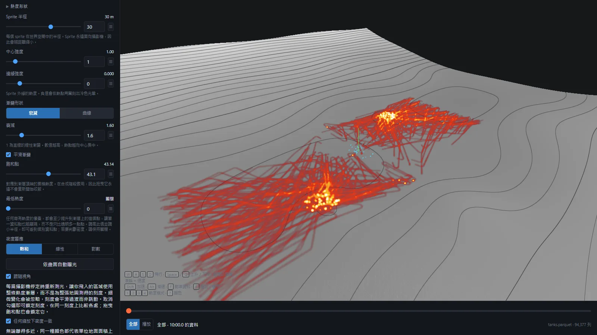
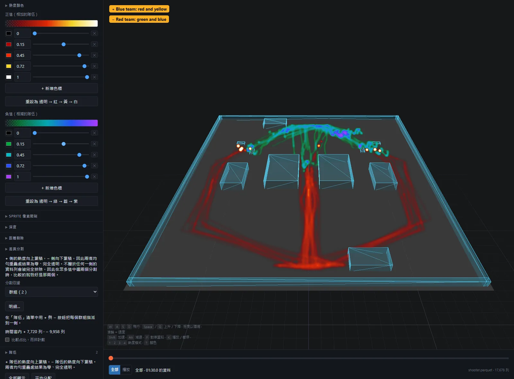
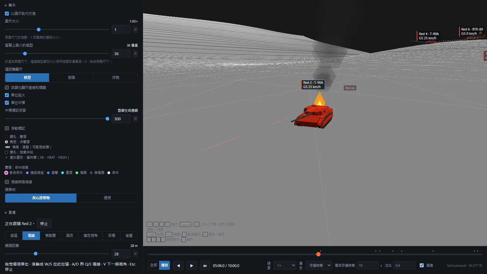
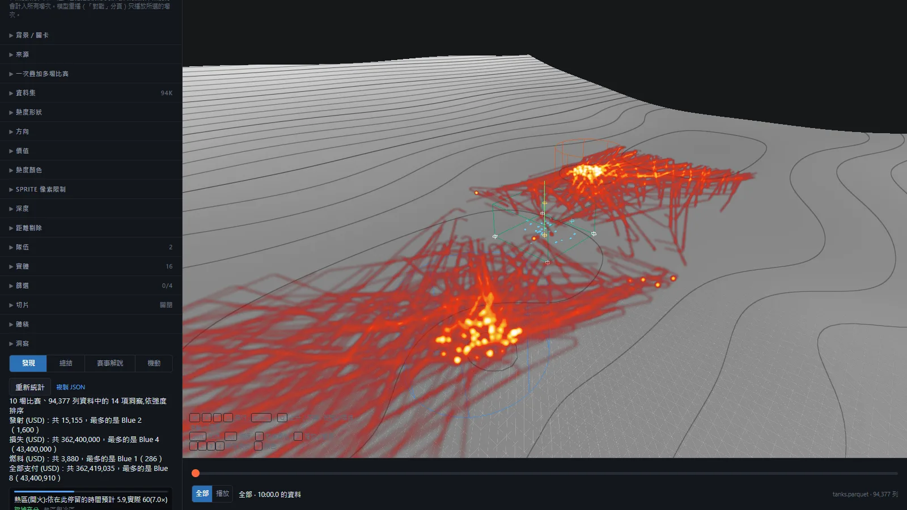
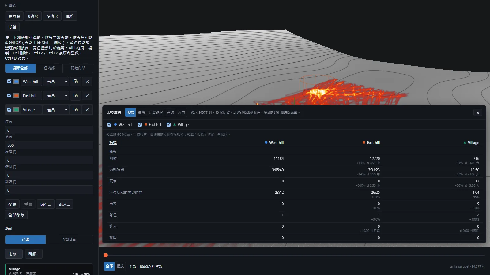
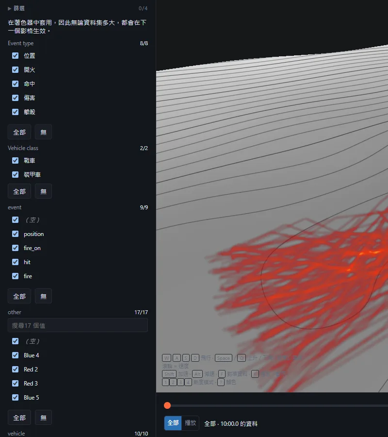
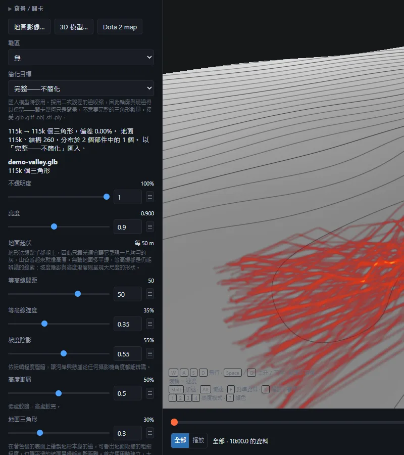

{: width="720" }

# 3DHeat

3DHeat 會顯示遊戲中事情發生的位置，包括玩家去過哪裡、在哪裡交戰、又在哪裡倒下。它可以呈現為你能飛行穿越的發光熱度色彩，也可以呈現為重播比賽過程的小型 3D 模型。

載入位置資料（CSV、Parquet、Tacview 錄影、轉換後的重播、單一檔案、資料夾，或數千場比賽），然後把它們看成 **可以飛行穿越的熱圖**、**重播比賽的模型**、沿著玩家路線的線條，或是兩群人的對照。它會自己找出特別突出的地方，而且完全在你的瀏覽器中執行：不會上傳到任何地方。3DHeat 與它的所有工具都是免費且開放原始碼的，採用 [MIT 授權](https://github.com/Holdi601/3DHeat/blob/main/LICENSE)。



**第一次來？** 先產生 [示範資料](demo-data.md)，並依照它的七個步驟操作。本網站的每張圖片都是用它拍攝的。

## 功能總覽 {#what-it-does}

| | |
|---|---|
|  | **[熱度模式](heat-modes.md)** - 熱度、[差異](difference.md)（某一方較多的地方為紅色，另一方較多的地方為綠藍色）、[隊伍熱度](team-heat.md)、[線條熱度](line-heat.md)；[方向熱度](directional-heat.md)，包含扇形、箭頭場與極座標圖；依[數值加權](value-weighting.md)的熱度：武器、載具與燃料各自的成本。 |
|  | **[對戰重播](match-replay.md)** - 每個單位都以它本身的[模型](figures.md)呈現，遠距離時使用 NATO 或俄式符號，另有飛彈與曳光彈、命中標記、殘骸、火焰、砲塔、目標、類似 Tacview 的攝影機，以及戰術顯示；[一次疊加多場比賽](many-matches.md)。 |
|  | **[洞察](insights.md)** - 強勢位置、致命地形、出生點陷阱、咽喉點與特別突出的玩家，都附上證據並加以排序；可撰寫文字總結，也可選用你指定的 AI 來產生；單場比賽的解說模式；以及[知識視角](knowledge.md)。 |
|  | **[體積](volumes.md)** - 繪製方塊、角柱、圓柱與球體，依它們篩選、統計其中發生的事件、匯出，並將各地點並排比較；[明細](breakdown.md)可看出在某個地點誰、以及什麼表現最好。 |
|  | **[篩選](filters.md)** - 依事件類型、玩家或 AI、載具類別、數值、任何欄位篩選，無論資料多大，都在顯示卡中完成。 |
|  | **[關卡](levels.md)** - 地圖影像、使用[資料工具](#related-repositories)製作的 3D 關卡、簡化、[世界背景](world-backdrop.md)（飛行資料使用真實地形）。 |

另外還有：賽車遊戲單圈分析用的[賽車分析](race-analysis.md)頁籤、Counter-Strike 2 比賽摘要用的[對戰](match-analysis.md)頁籤、在關卡上規劃用的[戰術板](tactics-board.md)、依載具呈現的[命中分析](hit-analysis.md)、數千場比賽的[大量分析](mass-analysis.md)、[攝影機路徑與影片](camera-path-and-video.md)、[40 種語言](languages.md)，以及[公制或英制單位](settings.md)。

## 頁籤 {#the-tabs}

頁籤位於側邊欄頂部，在名稱、單位與語言選單的下方。

| 頁籤 | 用途 |
|---|---|
| **熱圖** | 任何位置資料表：熱度模式、模型疊加、篩選、體積、洞察、關卡、測量與影片。 |
| **賽車分析** | 同一條賽道的兩圈或更多圈：時間損失在哪裡、為什麼，以及該改什麼。 |
| **對戰** | 比賽的模型重播，以及 Counter-Strike 2 的比賽摘要。 |
| **戰術** | 在關卡上的規劃：模型、路線、投擲的道具、區域，以及可逐步播放的註記。 |
| **載具** | 每個單位在哪裡被擊中、被誰擊中、以什麼擊中。 |

## 安裝與執行 {#install-and-run}

3DHeat 可以自由使用、修改與分享（MIT 授權），[相關儲存庫](#related-repositories)中列出的每個工具也一樣。

### Windows，簡易方式 {#windows-the-easy-way}

專案根目錄中有三個批次檔。

| 檔案 | 功能 |
|---|---|
| `start.bat` | 啟動檢視器。即使 Node.js 不在 `PATH` 中，也能找到它（會搜尋 `%ProgramFiles%\nodejs`、`%ProgramFiles(x86)%\nodejs` 與 `%LOCALAPPDATA%\Programs\nodejs`）。若找不到 Node.js，會提議使用 `winget install -e --id OpenJS.NodeJS.LTS` 安裝 LTS 版本。第一次執行時，會先詢問是否下載相依套件（約 300 MB，安裝在資料夾內的 `node_modules\`，不會安裝到系統層級）。若連接埠 5273 已有程式在監聽，它會拒絕啟動，並改為指向 `restart.bat`。若此資料夾是沒有本機變更的 git 簽出，且有較新的版本，它會詢問是否更新（Y/N；60 秒內沒有回應則保留目前版本；請參閱[更新](updates.md)）。接著它會在 `http://127.0.0.1:5273/` 執行開發伺服器並開啟瀏覽器。**這個視窗就是伺服器**：保持開啟，關閉它或按 Ctrl+C 即可停止。 |
| `restart.bat` | 執行 `stop.bat quiet`，然後執行 `start.bat`。只有在修改 `vite.config.ts`、新增相依套件，或伺服器卡住時才需要。來源程式的修改會自動熱重載。 |
| `stop.bat` | 停止正在監聽連接埠 5273 的程式。它透過 `netstat` 找出處理程序編號來停止，絕不依映像檔名稱，因此電腦上其他 Node.js 程序不會受影響。會等待約兩秒讓通訊端釋放。加上參數 `quiet` 時，結束時不會暫停。 |

### 手動安裝（任何作業系統） {#by-hand-any-os}


```bash
git clone --recursive https://github.com/Holdi601/3DHeat.git
cd 3DHeat
npm install
npm run dev      # http://127.0.0.1:5273
```

`exporters/` 資料夾包含各自獨立的資料工具，它們是 git 子模組，每個都是獨立的儲存庫；若是一般複製後，請執行 `git submodule update --init`。檢視器本身執行時不需要它們。`exporters/ext/` 包含選用的轉換器（War Thunder、World of Tanks、World of Warships、Squad 重播；DCS 與 IL-2 地圖），每一個都是獨立的專案。

這些都不附帶任何遊戲資料：關卡、地圖與錄影都是在你自己的電腦上，用工具從你擁有的遊戲製作的。

### npm 指令稿 {#npm-scripts}

| 指令稿 | 執行內容 |
|---|---|
| `npm run dev` | 在連接埠 5273 執行 Vite 開發伺服器，綁定 `127.0.0.1`。 |
| `npm run build` | 型別檢查（`tsc --noEmit`）並把正式版打包到 `dist/`。 |
| `npm run preview` | 提供正式版打包內容。 |
| `npm run typecheck` | 只執行型別檢查。 |
| `npm test` / `npm run test:watch` | 單元與整合測試（vitest）。 |
| `npm run smoke` | 在無介面的 Chromium 中操作真正的應用程式，並檢查畫布上是否有具資料色彩的像素；螢幕截圖存到 `tools/.smoke/`。需要開發伺服器已在執行。 |
| `npm run smoke:f16` | 同一組測試，但加上 `?heat=f16`，強制使用半精度浮點累積路徑（請參閱[半精度浮點累積](half-float-accumulation.md)）。 |
| `npm run bench` | 匯入效能測試，結果寫入 `tools/.smoke/ingest-bench.json`。 |
| `npm run test:heavy` | 需要大型真實資料檔案的測試；若檔案不存在，會自動略過。 |
| `npm run inspect -- <file.parquet>` | 列印 Parquet 檔案的結構與部分資料列（`tools/inspect-parquet.mjs`）。 |

### 開發伺服器增加的功能 {#what-the-dev-server-adds}

檢視器是靜態網頁，但開發伺服器（請參閱 `vite.config.ts`）會增加兩個本機路由，靜態部署的 `dist/` 沒有這兩個路由：

- `/__host/memory` 回報電腦已安裝與可用的 RAM，並在可讀取時回報顯示卡的記憶體（來自 `nvidia-smi`，或在 Windows 上來自顯示卡的登錄項目）。這讓[記憶體預算](memory-and-budgets.md)可以使用實際數值，而不是瀏覽器有上限的估計值。
- `/__heat3d/update` 檢查簽出版本是否落後，並可以快轉更新（[更新](updates.md)）。

伺服器只綁定 `127.0.0.1`，因此兩個路由都無法從網路存取。請以 `http://127.0.0.1:5273` 開啟：`localhost` 可能解析為 IPv6 迴路位址 `::1`，而那裡沒有程式在監聽。它不送出跨來源隔離標頭（COOP/COEP）：檢視器沒有使用 `SharedArrayBuffer`，工作執行緒是以轉移的方式交換資料，不需要它。

## 瀏覽器與 GPU 需求 {#browser-and-gpu-requirements}

- **支援 WebGPU 或 WebGL2 的瀏覽器。** 會先嘗試 WebGPU（Chrome 與 Edge 支援）；若沒有，則使用 WebGL2 後端。WebGL2 必須提供 `EXT_color_buffer_float`（渲染到浮點紋理），否則檢視器會顯示「無法初始化渲染器。」請參閱[兩種後端](backends.md)。檢視器是在 Chromium 上開發與測試的；其他瀏覽器尚未驗證。
- **已開啟硬體加速。** 當瀏覽器以 CPU 繪圖（SwiftShader、llvmpipe、Microsoft Basic Render Driver 等）時，側邊欄頂部會出現紅色橫幅，說明情況與修正方式。請參閱[軟體渲染偵測](software-rendering.md)。
- **獨立顯示卡有幫助，但不是必要。** 兩種後端都會要求高效能配接器。可以保存在 GPU 上的資料量是一種預算，你可以看到並加以變更（[記憶體與預算](memory-and-budgets.md)）。
- **選用功能**會使用其他瀏覽器 API：影片渲染需要支援 VP9 或 VP8 的 WebCodecs `VideoEncoder`（[攝影機路徑與影片](camera-path-and-video.md)）；關卡的網格簡化需要 WebAssembly；拖放資料夾使用 File and Directory Entries API；關卡庫使用 IndexedDB；遊戲手把使用 Gamepad API。

## 文件地圖 {#documentation-map}

**開始**：[示範資料](demo-data.md) · [匯入資料](getting-data-in.md)（[載入檔案](loading-files.md)、[欄位對應](column-mapping.md)、[座標軸、單位與時間](axes-units-and-time.md)、[場次、人員與群組](sessions-persons-groups.md)、[Tacview](tacview-acmi.md)、[轉換器](converters.md)、[.3dheat](container.md)、[記憶體與預算](memory-and-budgets.md)）

**檢視**：[熱度模式](heat-modes.md)（[熱度](heat.md)、[Sprite 形狀](sprite-shape.md)、[色彩與曝光](colour-and-exposure.md)、[深度與剔除](depth-and-culling.md)、[差異](difference.md)、[隊伍熱度](team-heat.md)、[線條熱度](line-heat.md)、[方塊重播](box-replay.md)、[方向熱度](directional-heat.md)、[數值加權](value-weighting.md)）· [時間軸](timeline.md) · [關卡](levels.md)（[地圖影像](map-images.md)、[3D 關卡](model-levels.md)、[外觀](level-appearance.md)、[關卡庫](level-library.md)、[世界背景](world-backdrop.md)、[其來源](world-backdrop-sources.md)）· [攝影機](camera.md)（[遊戲手把](gamepad.md)、[按鍵](keyboard-reference.md)）· [攝影機路徑與影片](camera-path-and-video.md)

**分析**：[篩選與工具](filters-and-tools.md)（[篩選](filters.md)、[隊伍](teams-list.md)、[實體](entities.md)、[切片](slice.md)、[指標](measure.md)、[體積](volumes.md)、[明細](breakdown.md)）· [洞察](insights.md)（[知識視角](knowledge.md)）· [大量分析](mass-analysis.md)

**重播**：[對戰重播](match-replay.md) · [一次疊加多場比賽](many-matches.md) · [模型](figures.md)（[模型疊加中的重播](figure-replay.md)、[出處](figure-credits.md)）· [Tacview 對等功能](tacview-parity.md) · [命中分析](hit-analysis.md)

**其他頁籤**：[賽車分析](race-analysis.md)（[方法](race-analytics.md)、[其他遊戲](other-games.md)）· [對戰分析](match-analysis.md) · [戰術板](tactics-board.md)（[速度](tactics-speeds.md)）

**檢視器**：[詞彙表](glossary.md) · [設定、單位與按鍵](settings.md) · [語言](languages.md) · [更新](updates.md) · [渲染內部機制](rendering-internals.md)（[後端](backends.md)、[累積](accumulation.md)、[取樣與預算](sampling-and-budgets.md)、[半精度浮點](half-float-accumulation.md)、[GPU 記憶體](gpu-memory.md)、[軟體渲染](software-rendering.md)、[效能面板與統計](performance-and-stats.md)）· [資料格式](data-formats.md) · [參考](reference.md) · [維護文件](maintaining.md)

## 相關儲存庫 {#related-repositories}

檢視器負責讀取資料；這些工具負責製作資料。每一個都是獨立的公開儲存庫（MIT），並有自己的文件。它們都不附帶遊戲資料：關卡、地圖與錄影都是在你自己的電腦上，從你擁有的遊戲製作的。每個遊戲讀取工具都是獨立的小專案，有自己的授權檔、版本發布與問題追蹤，因此可以單獨安裝、更新、維護，或應權利人要求撤下，而不影響檢視器或其他工具。

| 儲存庫 | 功能 | 用途 | 文件 |
|---|---|---|---|
| [3DHeat-GameFiles](https://github.com/Holdi601/3DHeat-GameFiles) | 從遊戲附帶的壓縮檔中讀取賽道與關卡（Forza Horizon、BeamNG、Assetto Corsa Rally；Unreal、Unity、Frostbite 與 Source 2 讀取器），輸出為 glTF | 熱度或重播底下的 3D 關卡 | [網站](https://holdi601.github.io/3DHeat-GameFiles/) |
| [3DHeat-GameCapture](https://github.com/Holdi601/3DHeat-GameCapture) | 從賽車遊戲公開的介面記錄單圈遙測資料，並從遊戲影片重建關卡 | 賽車分析用的單圈資料；無法讀取檔案時的關卡來源 | [網站](https://holdi601.github.io/3DHeat-GameCapture/) |
| [3DHeat-UnrealExporter](https://github.com/Holdi601/3DHeat-UnrealExporter) | Unreal Editor 外掛，把關卡匯出為一個 glTF 檔案 | 你自己 Unreal 專案的關卡 | [網站](https://holdi601.github.io/3DHeat-UnrealExporter/) |
| [3DHeat-CS2](https://github.com/Holdi601/3DHeat-CS2) | 把 Counter-Strike 2 示範檔轉為熱度表格與比賽摘要，並把 CS2 地圖轉為幾何 | CS2 熱度、重播與對戰頁籤 | [網站](https://holdi601.github.io/3DHeat-CS2/) |
| [3DHeat-Watcher](https://github.com/Holdi601/3DHeat-Watcher) | 在背景中，依遊戲公開的內容記錄你的遊戲過程：遙測、遊戲狀態整合、記錄檔與重播 | 不需手動操作，即可取得你自己的統計資料 | [網站](https://holdi601.github.io/3DHeat-Watcher/) |
| [3DHeat-Ext-WarThunder](https://github.com/Holdi601/3DHeat-Ext-WarThunder) | 把 War Thunder 重播（`.wrpl`）轉為表格：空中與地面軌跡、射擊、命中、擊殺、砲塔、目標 | War Thunder 重播、命中標記與洞察 | [網站](https://holdi601.github.io/3DHeat-Ext-WarThunder/) |
| [3DHeat-Ext-WoT](https://github.com/Holdi601/3DHeat-Ext-WoT) | 把 World of Tanks 重播轉為表格：每台載具的位置、死亡與擊殺 | World of Tanks 熱度與重播 | [網站](https://holdi601.github.io/3DHeat-Ext-WoT/) |
| [3DHeat-Ext-WoWs](https://github.com/Holdi601/3DHeat-Ext-WoWs) | 把 World of Warships 重播轉為表格：每艘艦艇的位置與擊沉 | World of Warships 熱度與重播 | [網站](https://holdi601.github.io/3DHeat-Ext-WoWs/) |
| [3DHeat-Ext-Squad](https://github.com/Holdi601/3DHeat-Ext-Squad) | 把 Squad 伺服器示範檔轉為表格：每位玩家的位置、隊伍與小隊 | Squad 熱度與重播 | [網站](https://holdi601.github.io/3DHeat-Ext-Squad/) |
| [3DHeat-Ext-DCS](https://github.com/Holdi601/3DHeat-Ext-DCS) | 把你自己安裝的 DCS World 地形轉為關卡：地面、道路、城鎮、機場、田野、水域 | DCS 與 Tacview 錄影在其真實地形上呈現 | [網站](https://holdi601.github.io/3DHeat-Ext-DCS/) |
| [3DHeat-Ext-IL2](https://github.com/Holdi601/3DHeat-Ext-IL2) | 把 IL-2 Great Battles 地圖轉為關卡 | IL-2 錄影在其地圖上呈現 | [網站](https://holdi601.github.io/3DHeat-Ext-IL2/) |

## 原始碼結構簡述 {#source-layout-briefly}

| 資料夾 | 內容 |
|---|---|
| [`src/data/`](https://github.com/Holdi601/3DHeat/tree/main/src/data) | 檔案選取、CSV 與 Parquet 匯入、自動對應、驗證、記憶體模型、資料集建構、模型解析、分類、簡化、關卡庫 |
| [`src/render/`](https://github.com/Holdi601/3DHeat/tree/main/src/render) | 影格迴圈（`engine.ts`）、取樣、兩種後端、攝影機、遊戲手把、測量、攝影機路徑、影片錄製 |
| [`src/state/`](https://github.com/Holdi601/3DHeat/tree/main/src/state) | 應用程式狀態（`store.ts`）與所有預設值、領域型別（`types.ts`）、Sprite 曲線 |
| [`src/ui/`](https://github.com/Holdi601/3DHeat/tree/main/src/ui) | 側邊欄面板、時間軸、覆蓋層 |
| [`src/race/`](https://github.com/Holdi601/3DHeat/tree/main/src/race)、[`src/match/`](https://github.com/Holdi601/3DHeat/tree/main/src/match) | 賽車分析與對戰頁籤 |
| [`src/i18n/`](https://github.com/Holdi601/3DHeat/tree/main/src/i18n) | 翻譯 |
| [`src/insights/`](https://github.com/Holdi601/3DHeat/tree/main/src/insights) | 洞察：偵測器、總結、解說、AI 供應商、知識視角 |
| [`src/mass/`](https://github.com/Holdi601/3DHeat/tree/main/src/mass) | 多場比賽的大量分析 |
| [`src/volumes/`](https://github.com/Holdi601/3DHeat/tree/main/src/volumes) | 體積、其統計、匯出與比較 |
| [`src/breakdown/`](https://github.com/Holdi601/3DHeat/tree/main/src/breakdown) | 明細與因素 |
| [`src/overlay/`](https://github.com/Holdi601/3DHeat/tree/main/src/overlay) | 多場比賽的疊加 |
| [`src/figures/`](https://github.com/Holdi601/3DHeat/tree/main/src/figures) | 模型目錄與其建構工具 |
| [`src/vehicle/`](https://github.com/Holdi601/3DHeat/tree/main/src/vehicle) | 命中分析（載具頁籤） |
| [`src/tactics/`](https://github.com/Holdi601/3DHeat/tree/main/src/tactics) | 戰術板 |
| [`src/world/`](https://github.com/Holdi601/3DHeat/tree/main/src/world) | 世界背景 |
| [`src/units/`](https://github.com/Holdi601/3DHeat/tree/main/src/units) | 度量單位 |
