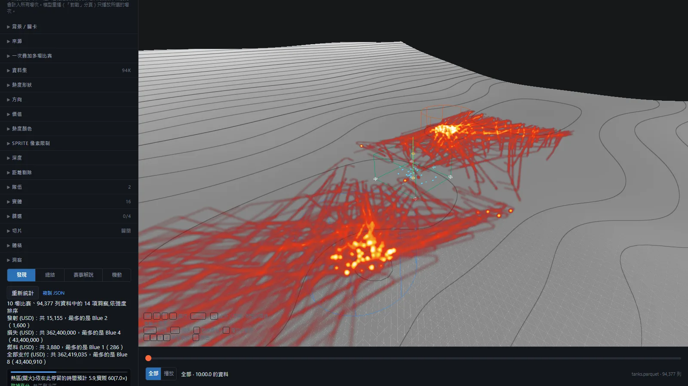
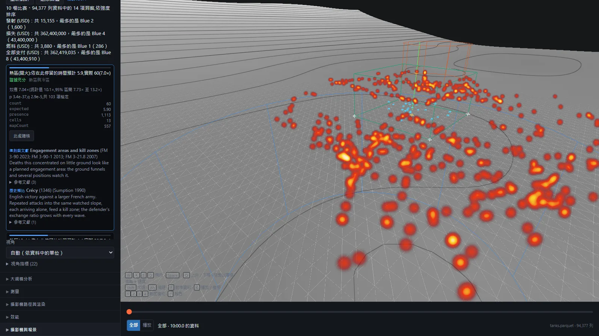
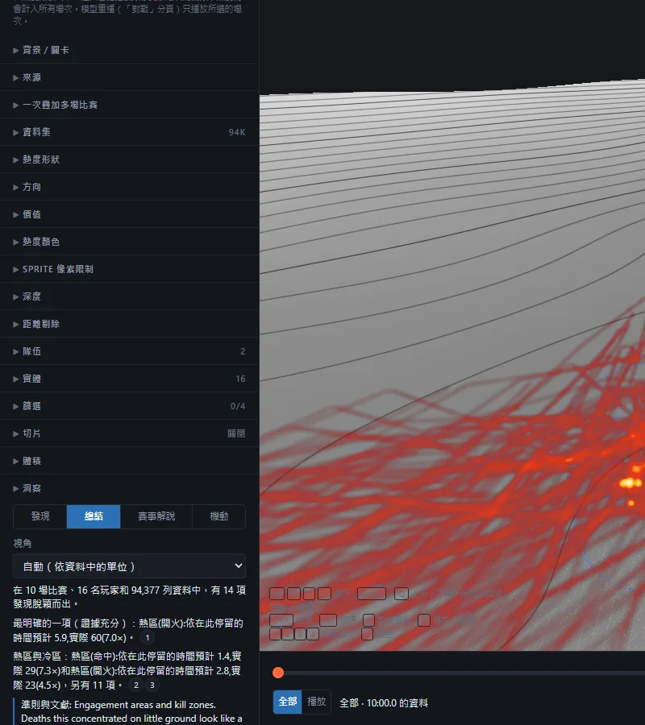
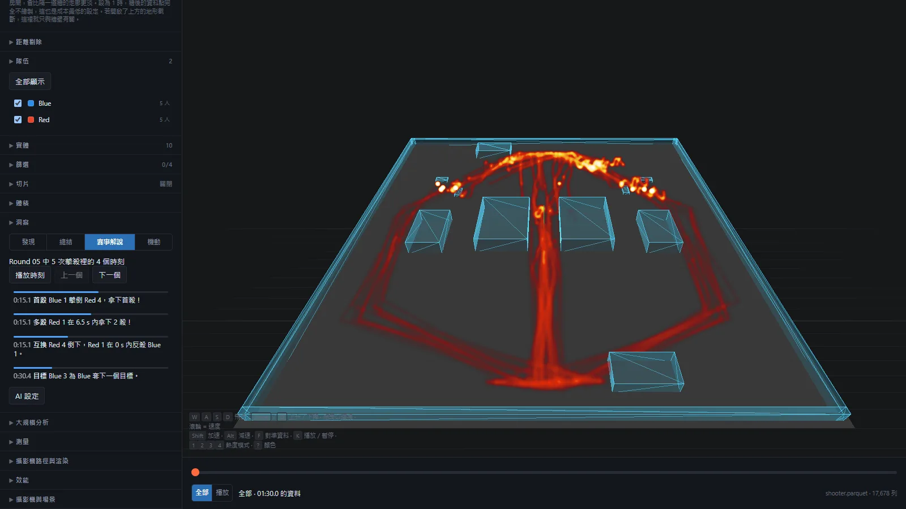

# 洞察

**洞察**會在已載入的資料中尋找特別突出的地方，例如強勢位置、致命地形、出生點陷阱、咽喉點，以及遠超同儕的玩家，並依強度由高到低，附上證據告訴你。它能讓你在一分鐘內了解一場比賽是如何贏或輸的。之後它可以撰寫總結；在單場重播中，它還能擔任解說，跳到重大時刻。

所有計數都在你的瀏覽器中完成。除非你開啟外部 AI（見[外部 AI](#external-ai)），否則不會有任何東西離開你的電腦。

**洞察**區段位於熱圖與對戰頁籤的側邊欄中。它有三個分頁：**發現**、**總結**與**賽事解說**。

## 發現 {#findings}

1. 載入資料並開啟**洞察**。按**尋找洞察**（「統計中… n%」會顯示進度）。
2. 閱讀清單。每項發現都有強度條、一句說明、證據的可靠程度（*強證據*、*良好證據*或*有些證據*）、發現它的偵測器，以及在相關時的載具類別。
3. **點擊某項發現**：檢視會套用其篩選、把攝影機飛到該地點、跳到對應時間，並開啟詳細資料：含 95% 區間的效果、p 與 q 值、計入的證據，以及**此處體積**，它會在該地點周圍繪製一個[體積](volumes.md)。
4. **還原篩選**會把你的篩選放回去。**複製 JSON** 會複製整份報告。

計數會在整個時間範圍內，使用目前的篩選、隱藏的群組與所選的比賽。之後變更篩選時，會有說明提示；按**重新統計**即可。

清單頂端的幾行（例如金錢總額）會在列出發現之前，先總結整體資料。

### 偵測器 {#the-detectors}

| 偵測器 | 找出什麼 | 資料需求 |
|---|---|---|
| **強勢位置** | 擊殺與死亡比率遠優於地圖其他地方的地點，以及花費時間中很少人死亡的*安全地面* | 擊殺與死亡事件 |
| **熱區與冷區** | 某種事件種類（射擊、命中、佔領等）出現的頻率，遠高於或遠低於在該處花費時間所預測的地點 | 事件欄位 |
| **開闊地與掩體** | 在開闊地的死亡，對比附近的關卡幾何；以及相對於快速移動的緩慢移動 | 死亡；幾何部分需要 3D 關卡 |
| **出生點** | 強勢出生點、出生點陷阱、安全出生點、首次接觸的時間 | 時間與人員 |
| **依地點看職業** | 某種載具類別，或玩家對比 AI，在某區域的表現明顯更好或更差 | 擊殺，加上載具類別或玩家／AI 欄位 |
| **玩家** | 在同一類別中，擊殺或死亡遠多於或遠少於他人的玩家 | 人員與擊殺 |
| **咽喉與側翼** | 咽喉點（通過次數遠多於周圍地面）與側翼路線（很少使用，但會導向擊殺） | 人員 |
| **值** | *高成本地面*與*高收益地面* | [數值欄位](value-weighting.md) |
| **是什麼決定了回合** | 區分贏下與輸掉回合的因素，以及增加或損失獲勝機率最多的玩家（見[誰贏了](#who-won-what-decided-the-rounds)） | 回合、擊殺與死亡，以及[結果欄位](data-formats.md#outcome-columns)（`won`） |

無法在資料上執行的偵測器會列在底部，並附上原因。

### 發現如何排序 {#how-findings-are-ranked}

每個地點或群組都會與地圖其他部分比較（精確二項式或比率檢定）。偽發現率控制在 5%（Benjamini-Hochberg）。偶然性可能看起來像某種模式；此設計可以降低誤報：在顯示的發現中，預計約有二十分之一可能只是偶然。事件數量少的效果，在排序前會被拉向「沒有效果」。最多列出 60 項發現，且每個偵測器都會在前段保留幾個地點。

### 誰贏了：是什麼決定了回合 {#who-won-what-decided-the-rounds}

如果資料寫明了每個回合由誰贏下（`won` [結果欄位](data-formats.md#outcome-columns)：CS2、Rainbow Six Siege、War Thunder ……），結果就是洞察的核心。對每一方，它依回合中發生的事把回合分開，並比較勝率：

| 因素 | 該方有此情況的回合 | ……以及沒有的回合 |
|---|---|---|
| 首次對槍 | 拿下第一個擊殺 | 先陣亡 |
| 購買 | 購買比另一方好 | 較差 |
| 首死被換 | 首個陣亡在 5 秒內被換回 | 沒有被換 |
| 安放 | 安放了炸彈 | 沒有安放 |
| 道具 | 投擲物比平常的回合多 | 較少 |
| 早接觸 | 第一次對槍早於本場對戰的中位時間 | 較晚 |
| 守住某地 | 有玩家在該地點站了 5 秒或更久 | 沒有人 |
| 早到某地 | 有玩家在前 25 秒內到達那裡（路線） | 沒有人 |

每次比較都是兩個勝率之差，附上 95% 區間（Newcombe）、Fisher 精確 p 值，以及涵蓋所有嘗試過之因素的 q 值（Benjamini-Hochberg）。回合少於 8 個的一側會標為*回合少*。低於 5% 錯誤發現率者成為發現；最強的排在其他偵測器的發現之上（結果類發現的權重，是效果與證據相同的其他發現的 1.35 倍）。

一個虛構的例子，共 40 回合：

> **T** 守住 **Mid** 的 19 個回合中贏下 79%，沒有守住的 21 個回合中贏下 24%（55 個百分點，95%：26 至 74）——q 0.004。

它也會追蹤回合的**獲勝機率**——每一方在每個時刻的勝算，依據存活人數、安放情況與時鐘：回合有 30 個以上時據此擬合，否則使用固定的先驗模型（文字會說明是哪一種）。由此得出**轉折點**（最能改變勝算的擊殺與安放）以及每位玩家**增加的獲勝機率**：他們的擊殺與安放計為正，他們的陣亡計為負，以整場對戰中相當於多少回合來表示，附上每回合平均值及其區間，並與零比較檢定。地點也有同樣的收支：哪一方在那裡發生的對槍中得益最多。

資料需要雙方的回合、擊殺與死亡，以及 `won` 欄位；守住地點需要有名稱的地點（`place`），購買需要 `buy` 欄位。

## 總結 {#debrief}

**總結**分頁會把發現寫成一段簡短的文字：開頭導言、最清楚的一項發現、一段戰術建議、一段平衡性建議，接著——若資料寫明了誰贏——是什麼決定了回合，其餘依偵測器分組，並說明有多少項仍屬證據較弱。

是什麼決定了回合分為四段：比分以及獲勝機率的來源；最強的因素及其數字、區間與 q（若沒有任何一項通過錯誤發現率，文字會寫*目前都還不確定*，但仍會指出最強的那一項）；最大的三個轉折點；以及增加與損失獲勝機率最多的玩家，加上得益最多的地點。一個虛構的例子：

> 在結果已知的 40 回合中，T 贏下 23，CT 贏下 17（T：58%，95%：42% 至 72%）。獲勝機率來自擬合了這些回合的模型。
>
> 區分贏下與輸掉回合的因素：T 守住 Mid 的 19 個回合中贏下 79%，沒有守住的 21 個回合中贏下 24%（55 個百分點，95%：26 至 74）（q 0.004），……
>
> 轉折點：第 17 回合 48 秒，CT 在 B 點的一次擊殺使其勝算從 31% 變為 58%，並贏下了該回合，…… 每個段落都有編號按鈕，可顯示其發現。**複製文字**會複製它。

內建的敘述者可離線運作，並使用你的語言。其上方的**視角**選擇器（見[知識視角](knowledge.md)）決定段落引用哪些文獻。

### 外部 AI {#external-ai}

**AI 設定**可讓你選擇的 AI 模型改為撰寫總結：

| 設定 | 意義 |
|---|---|
| **供應商** | Anthropic (Claude)、OpenAI (ChatGPT)、OpenRouter、Ollama（本機）、LM Studio（本機）、llama.cpp 伺服器（本機），或任何相容 OpenAI 的端點 |
| **基礎 URL**、**模型** | 由供應商填入；**列出模型**會向伺服器查詢 |
| **API 金鑰** | 只會傳送到基礎 URL。不會被記錄，也不會儲存在檢視、匯出或 `.3dheat` 檔案中。大多數本機伺服器不需要它。 |
| **在此瀏覽器中記住金鑰** | 預設關閉：頁面關閉時金鑰會被遺忘 |
| **使用外部 AI** | 預設關閉 |
| **傳送玩家名稱** | 預設關閉：玩家會以 P1、P2……傳送 |

然後輸入選填的問題，並按**用 AI 撰寫**。只會傳送發現與其數字，絕不會傳送你資料的列。回答會以串流方式逐步出現；被引用的發現會變成按鈕。若資料寫明了誰贏，會要求模型先寫是什麼決定了回合，為每個數字附上區間與 q，並在某個因素只依據很少的回合、或獲勝機率來自先驗模型時說明這一點。

## 賽事解說 {#caster}

針對**單一場比賽**（若載入了多場，請先選擇一場），**賽事解說**會找出值得觀看的時刻：第一滴血、多殺、交換擊殺、殘局致勝、目標易手、逆轉、特別突出的玩家、遠距離射擊，以及**轉折點**——最能改變某一方贏下該回合機會的擊殺（依每一方剩下的存活玩家，在沒有重生的回合中）。

若資料寫明了每個回合由誰贏下，每個時刻都會說出來：*「Anna 擊倒 Ben：T 贏下該回合的機會從 38% 變為 62%——而且他們贏下了這個回合。」* 賽事解說挑選要保留哪些時刻時，最終獲勝一方的時刻分量較重；逆轉以贏下的回合計算。

- 點擊某個時刻：檢視會切換到重播，跳到該時刻前一下，飛到該處並跟隨玩家。
- **播放時刻**會把每個時刻播放到結束，然後前進；**上一個** / **下一個**可逐一切換。
- 開啟外部 AI 後，**AI 解說**會根據時刻清單（種類、時間、名稱或代號、隊伍、類別、距離）撰寫解說。

它需要人員與擊殺／死亡（或佔領）事件；若有 `other`／`victim` 欄位，則能計算交換擊殺與遠距離射擊。

## 知識視角 {#knowledge-lens}

發現可以透過**視角**來解讀，即已確立的知識：軍事學說、空戰與海戰、城市作戰、遊戲設計與電競（或*自動*，由資料中的單位決定）。開啟某項發現後，會顯示最接近的**學說與文獻**條目，以及**歷史類比**，並附上參考文獻。**視角指標**會根據該文獻，在資料上計算指標（Lanchester 擬合、交換比、兵力比、射界、關鍵地形、交換擊殺、主動權）。總結與 AI 提示都會包含它們。關於此功能的完整說明：[知識視角](knowledge.md)。

視角指標也會把玩家當作群體與團隊來衡量其行為：排列與徘徊、路線驅趕、通道與足跡、擁擠、領導者與跟隨者、落後者、損失下的崩潰點、失去生命後的風險、連殺、購買一致性，以及對來襲火力的反應，每一項都與其自身的虛無模型比較：[群體行為](collective-behaviour.md)。

## 讓洞察發揮作用的資料 {#data-that-makes-insights-work}

- 具有**時間**、**人員**與**隊伍**欄位的位置；
- 含擊殺與死亡（`kill`、`death`）以及其他（`hit`、`fire`、`capture` 等）的**事件**欄位；
- 用於交換擊殺與方向的**其他方**欄位（`other`、`victim`）；
- 用於類別的**載具**或**類型**欄位；用於玩家對比 AI 的 `ai` 欄位；
- 有多場比賽時的**場次**／**比賽**／**回合**欄位。

[示範資料](demo-data.md)包含所有這些欄位。
