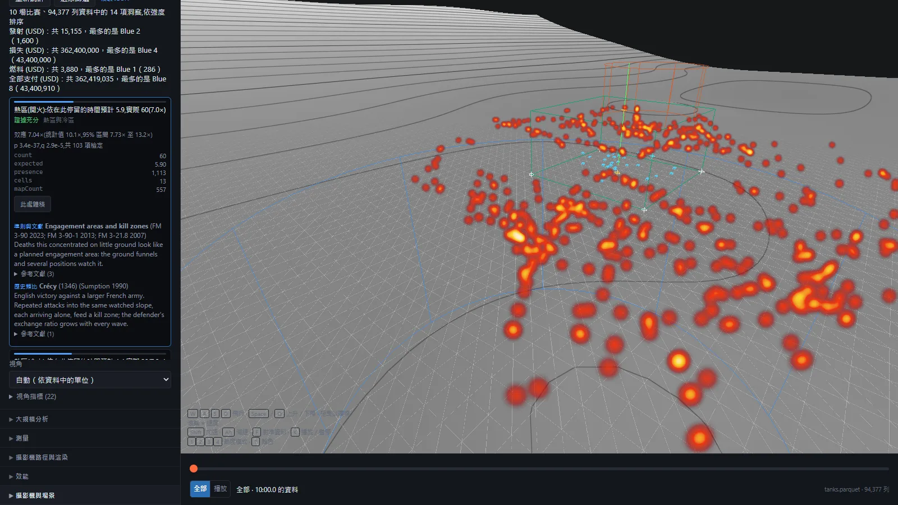

# 知識視角

當[洞察](insights.md)找出某項發現時，這一部分會用軍事史、遊戲設計與運動分析的觀念來解釋它，並指出其出處的書籍或論文。用它來了解一個模式*為何*重要，而不只是知道它存在。

## 試試看 {#try-it}

1. 載入資料並開啟 **洞察**，然後按下 **尋找洞察**。
2. 點擊一項發現以開啟它。
3. 閱讀 **準則與文獻** 與 **歷史類比**；完整的參考文獻摺疊在其下方。
4. 變更 **視角**（例如改為*軍事準則*），以另一套文獻來閱讀同一項發現。

## 運作方式 {#how-it-works}

洞察面板以專業分析師的方式判讀其發現：透過軍事準則與作戰研究、歷史上的交戰，以及遊戲設計、關卡設計與分析的文獻。它是離線運作的，依據檢視器中一套經過策劃的知識庫；當由外部模型撰寫總結時，也會把同樣的材料交給它。

## 面板顯示的內容 {#what-the-panel-shows}

- **視角** 選擇用來解讀發現的文獻：*自動*（依資料中單位的種類選定：飛機、艦船、地面載具、步兵）、*軍事準則*、*空戰*、*海軍*、*城鎮戰*、*遊戲設計與平衡*、*電子競技*。所選視角之外的條目會被略過。
- 每項已開啟的發現，都會顯示與其最接近的 **準則與文獻** 條目，以及最接近的 **歷史類比**，完整參考文獻摺疊在其下方。
- **視角指標** 列出在同一批資料列上計算出的作戰分析量數（如下），每項都附上其意義與相關文獻。
- **總結** 會為最重要的發現與視角指標加上說明行：「準則與文獻：……」與「歷史類比：……」，每行都附上作者與年份的引註，以及摺疊在其下的參考文獻。
- **用 AI 撰寫** 會把最相關的條目（摘要、教訓、它們所涉及的發現、完整參考文獻）連同報告一併送出，並要求模型以其編號引用——`{concept.lanchester-square}`——且不使用其他來源。

標籤已翻譯；知識內容本身為英文。

## 視角指標 {#lens-metrics}

在洞察工作執行緒中計算，與偵測器在同一次資料列走訪中完成（`src/insights/lensMetrics.ts`）。若資料無法支撐某項指標，該指標就會被略過。

| 指標 | 量測內容 | 需要 |
|---|---|---|
| 蘭徹斯特擬合 | 將每一方每 20 秒的損失，對雙方存活的兵力做迴歸（卜瓦松分布，準概似誤差）；敵方與己方兵力的指數，與平方律（瞄準射擊）及線性律（區域射擊）做檢定 | 時間、隊伍、擊殺與死亡 |
| 交換比 | 依陣營與地點的每次死亡擊殺數；在佔用 5% 時間的最致命地面上死亡所占的比例，與僅以該死亡數機率所得比例的對照；死亡對時間的基尼係數；死亡率的 Moran's I | 擊殺與死亡 |
| 局部兵力比 | 每次擊殺時，交戰範圍內存活的己方與敵方單位（範圍由資料設定：至最近敵人距離中位數的兩倍）；由局部占優的一方所獲得的擊殺比例，及其超出僅由數量所預測之部分 | 時間、隊伍、人物 |
| 射界 | 將最忙碌的擊殺地點在 2.5D 遮蔽表面（關卡幾何至牆高，或所走過的地面）上的可視範圍，與平均地點比較，以及視野與擊殺占比的等級相關性 | 位置；載入的關卡會使其更精確；不適用於空中 |
| 能量狀態 | 空戰擊殺者與被擊殺者的比能（高度加上速度所能換得的高度），以 Mann-Whitney 統計量比較 | 飛機等級、時間、高度 |
| 關鍵地形 | 每個地點在一場比賽中，名列三個最忙碌擊殺地點的頻率 | 數場比賽 |
| 相互支援（交換） | 在交戰範圍內與 5 秒內，由隊友的擊殺回應的死亡 | 時間、隊伍 |
| 先發制人 | 交戰——依比賽分組、以 20 秒的寂靜分隔、以三個交戰範圍的距離分隔的擊殺——由先得分的一方獲勝 | 時間、隊伍 |
| 齊射模型 | 將 Hughes 齊射方程式套用於接觸中艦艇的 20 秒時段：每艘攻擊艦艇使多少艘艦艇失去戰鬥力，以及每艘防禦艦艇挽救多少艘；僅以艦艇做的蘭徹斯特擬合 | 艦艇等級、時間、隊伍 |
| 戰鬥效能 | 每一方每單位作戰小時的擊殺數，以及兩個最大一方的比值（Dupuy 意義上的戰鬥效能值），附 95% 區間，以及各方在局部兵力相等時的擊殺占比 | 時間、隊伍 |
| 交戰範圍 | 擊殺、發射與每次生命中的第一發射擊時，距最近敵人的距離（從偵測到交戰），依單位種類分列 | 時間、隊伍；資料中有的發射紀錄 |
| 殺傷鏈 | 從殺手最後一次發射到擊殺的秒數，以及從其在戰鬥中的第一發射擊到擊殺的秒數 | 時間；發射或開火事件 |
| 集中或分散 | 在每個 20 秒時段中，兩個最大陣營的散布，以及較緊密的一方所取得的擊殺占比 | 時間、隊伍 |
| 出動 | 每一方：出動（起飛，或飛機生成）、降落、損失的飛機，以及飛機造成的擊殺；損失率與每次出動的擊殺數 | 飛機等級；起飛或生成 |

含有回合的資料，會加入近距離戰與電子競技的量數——回合獲勝機率、行動的價值、開局對決、交換、探頭者對守點者、瞄準、交叉火力、輔助道具、人數優勢、殘局、佈置、下包後、致命漏斗，以及玩家影響力：參閱[近距離戰與回合](close-quarters.md)。

有隊伍與軌跡的資料，會加入群體科學、集體運動、行為經濟學與軍事心理學的群體行為量數——對齊與打轉、路線驅趕、通道與尾跡、擁擠、領導者與跟隨者、落隊者、崩潰點、損失後的風險、連勝、購買協議與壓制，每一項都與其自身的空白模型比較：參閱[群體行為](collective-behaviour.md)。

武器、誘餌與建築不計為單位。若武器資料列以其發射單位命名（如 Tacview 來源的資料中，有 `Shooter` 或 `Launcher` 欄位），則該發射會歸於該單位，並以其名稱或物件 ID 相符。

## 發現如何對應到文獻 {#how-findings-meet-the-literature}

條目與發現是透過一個**模式分類**（`src/insights/knowledge/patterns.ts`）相遇的：集中、局部優勢、瞄準與區域射擊、咽喉點、殺傷區、射界、反斜坡、側翼、相互支援、能量優勢、生成壓力、平衡等。每種偵測器與每項視角指標都會說明其數字呈現了哪些模式（`src/insights/lens.ts`）；每個知識條目則說明它談及哪些模式，並附上權重。條目與發現的相關性，是加權後的重疊程度，並依該條目的領域（陸地、空中、海上、城鎮）與資料的吻合程度，以及發現本身的強度調整。所顯示的理由，是發現的數字以一句話表達，後接條目的教訓。

## 目錄 {#catalogue}

每個模式、概念、方法、歷史案例、設計原則與研究，以及參考書目：參閱[知識目錄](knowledge-catalogue.md)。

## 給開發者 {#for-developers}

### 新增條目 {#adding-entries}

1. 依類型選擇檔案：`src/insights/knowledge/` 中的 `concepts.ts` 與 `concepts-more.ts`、`methods.ts`、`cases.ts`、`cases-land.ts`、`cases-air-sea.ts`、`cases-esports.ts`、`design.ts`（設計原則）或 `studies.ts`。
2. 給它一個新的 ID `<type>.<slug>`（絕不重用），並指定其視角、領域，以及它所談及的模式與 0 至 1 之間的權重。只有在某項發現能呈現某模式時，才將其加入 `patterns.ts`，並在 `lens.ts` 中將它從某項發現或指標對應過來。
3. 摘要與教訓請**以你自己的話撰寫**。只引用公有領域著作的內容（參考文獻中的 `pd: true`），且須簡短。
4. 引註：將任何新的著作加入 `refs.ts`，附上作者、年份、標題與出版者（期刊需含卷號與頁碼）；若有公開紀錄，則附上 URL 或 DOI。
5. 執行 `npx vitest run src/insights/lens.test.ts`（檢查 ID 唯一、模式已知、參考可解析、公有領域引文、案例含日期與結果），並執行 `node tools/knowledge-doc.mjs` 以更新[目錄](knowledge-catalogue.md)。
