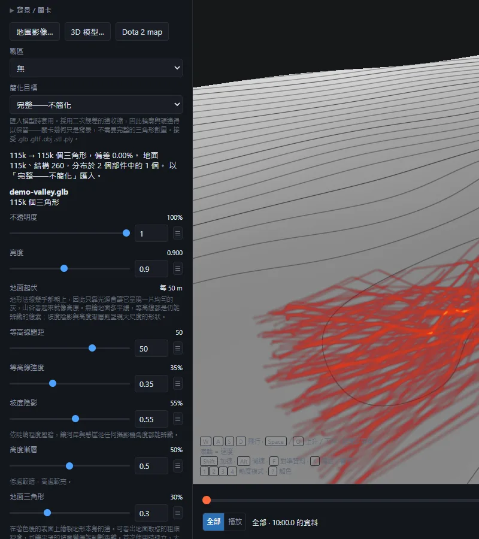

# 關卡與背景幾何

關卡是遊戲發生的 3D 地點：一張地圖、一座城鎮或一條賽道。把它放在你的資料後方，你就能看見熱度*位於何處*。**背景／關卡**面板（「關卡」的說明見[詞彙表](glossary.md)）提供三種背景資訊：

- **地圖影像**，由兩個錨點進行地理參照：見[地圖影像](map-images.md)；
- **3D 關卡**，即 `.glb`、`.gltf`、`.obj`、`.stl` 或 `.ply`，匯入時會分割為地面、結構與水體，並加以簡化：見[3D 關卡](model-levels.md)與[關卡外觀](level-appearance.md)；
- **真實世界背景**，適用於記錄了其在地球上位置的錄影（Tacview ACMI 檔案），會從開放資料下載真實的地形、道路、水體、機場與建築物：見[真實世界背景](world-backdrop.md)。

在沒有載入任何內容時，場景會是暗的，並顯示格線與彩色座標軸（[鏡頭與場景](camera.md)中的**格線**與**座標軸**），面板會顯示*未載入任何內容 - 場景顯示格線與座標軸。加入地圖影像或關卡網格，為熱度提供背景。*

三個分頁都共用同一個關卡：在競賽分析頁籤中載入的賽道，就是熱度圖所顯示的同一個關卡。

## 把關卡放在資料後方 {#put-a-level-behind-your-data}

1. 先載入你的資料（[匯入資料](getting-data-in.md)），使關卡能符合它。
2. 打開側邊欄中的**背景／關卡**。
3. 按下**地圖影像…**選擇圖片，或按下**3D 模型…**選擇 3D 關卡，然後選擇檔案。若是真實世界的錄影，請改用**真實世界背景**或**戰區**。
4. 等待進度列完成。大型模型會先被簡化（見下方的**簡化目標**）。
5. 在視圖中按下 **F**，即可框選所有內容。調整**不透明度**與**亮度**，直到熱度能從關卡中突顯出來。
6. 若你之後還會再用這個關卡，請按下**儲存至關卡庫**（[關卡庫](level-library.md)）。

## 關卡對熱度的作用 {#what-a-level-does-for-the-heat}

- 它會**遮擋**：位於其後方的資料點會逐面變暗，位於地形後方的資料點則會被隱藏（[深度與剔除](depth-and-culling.md)）。沒有關卡時，就不會有遮擋。
- 它會被[切片](slice.md)切開，若*同時切割關卡*開啟，也會與熱度一起被[距離剔除](depth-and-culling.md#distance-culling)切開。
- 除了格線與方塊之外，它是唯一會被[景深](camera.md#depth-of-field)模糊的東西。
- 當 3D 關卡比資料大時，它會**拓寬攝影機的遠裁切面**：近與遠裁切面是根據資料集校準的，而一張匯出的、橫跨數公里的地圖若沒有調整，就會完全位於遠裁切面之後，使視圖空無一物。當關卡的水平範圍較大時，遠裁切面會變為其 3 倍，近裁切面則隨之移動（至少為遠 / 100,000），以維持遮擋所依賴的深度精度；飛行速度則會提高到至少為範圍 / 12。它只會被拓寬，絕不會被縮窄。

## 面板，由上到下 {#the-panel-top-to-bottom}

| 部分 | 詳細資訊 |
|---|---|
| **地圖影像…**、**3D 模型…** | 載入其中一個；它會取代目前的關卡。 |
| **真實世界背景**、**清除地圖圖磚** | 僅適用於具有地理參考的資料集：以真實地點建立關卡，或刪除已下載的地圖圖磚。[真實世界背景](world-backdrop.md) |
| **簡化目標** | 下一次模型匯入的三角形預算：*完整 - 不簡化*（預設）、*高 - 8M*、*中 - 3M*、*低 - 800k*、*輪廓 - 100k*。[3D 關卡](model-levels.md#simplification) |
| 進度與**取消** | 在解碼或匯入時顯示。 |
| 匯入說明 | 簡化前後的三角形數、地面／結構／水體的分割，以及所使用的細節層級。 |
| 名稱與大小 | 圖片為 `寬×高 px · x × z m/px`，模型為 `N 個三角形（原為 M 個）`。 |
| **不透明度**、**亮度** | 兩種類型皆有。 |
| 圖片控制項 | **降低飽和度**、**南北翻轉**、**定位**（兩個錨點）、**符合資料範圍**、**高度**。[地圖影像](map-images.md) |
| 模型控制項 | 地面起伏、水體、地面三角形、線框、材質、擷取的顏色、結構、部件分類。[關卡外觀](level-appearance.md) |
| **儲存至關卡庫**、**移除** | [關卡庫](level-library.md)；移除會卸載目前的關卡。 |
| **關卡庫** | 儲存於此瀏覽器中的關卡。[關卡庫](level-library.md) |

## 本節的頁面 {#pages-in-this-section}

- [地圖影像](map-images.md)
- [3D 關卡](model-levels.md)：格式、部件、分類、簡化、材質
- [關卡外觀](level-appearance.md)：3D 關卡的每個控制項
- [關卡庫](level-library.md)
- [真實世界背景](world-backdrop.md)：錄影之下的真實世界，來自開放資料

如何從遊戲與引擎取得關卡，屬於獨立的匯出工具範疇（見儲存庫的 [README](https://github.com/Holdi601/3DHeat/blob/main/README.md)）；它們所寫入的格式約定，已摘要於 [3D 關卡](model-levels.md#the-exporter-contract)。
