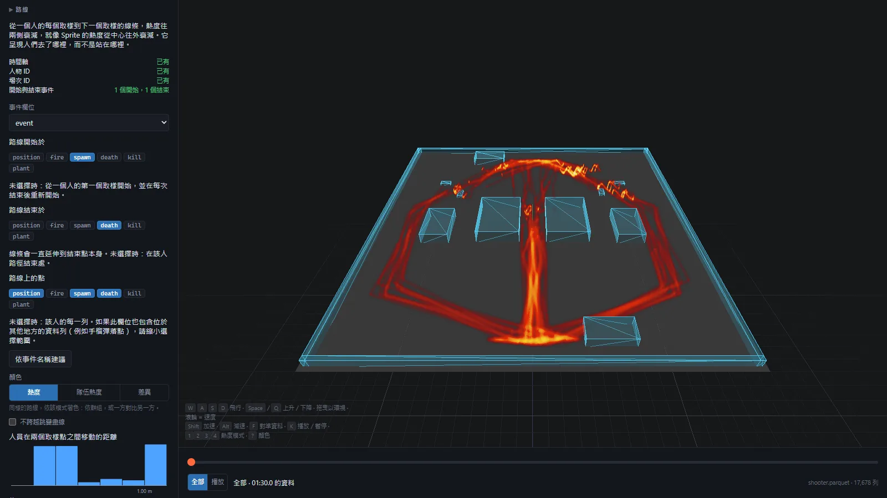

# 線條熱度

熱度顯示人們站在哪裡。線條則顯示他們走過的路徑。

**線條**（按鍵 4）是線條熱度：從每個[人物](glossary.md)的一個樣本到其下一個樣本之間畫一條線，並以 [Sprite](glossary.md) 相同的衰減方式潑灑出去——沿線條的方向而非繞著一個點。它顯示人們*去過*哪裡，而不是他們*站過*哪裡：只走過一次的通道與長時間駐守的房間同樣清楚，而快速玩家稀疏的樣本會連成一條連續的路線，而不是一條點狀的軌跡。它需要人物欄位與時間欄位。

## 使用方式 {#how-to-use-it}

1. 按下 `4`（或在模式列中選取 **線條**）。
2. 開啟 **路線**，檢查綠色的核對清單：時間軸與人物 ID 必須存在。
3. 按下 **依事件名稱建議**，以填入路線的起點與終點。
4. 閱讀統計行：「N 條路線，其中 M 條到達終點」。
5. 若線條跨越地圖上的各處，請調整 **最長步長**（參閱[跳躍上限](#the-jump-limit)）。

線條只有在起點與終點之間才有意義，因此 **路線** 面板會說明什麼界定了一條路線。從[路線規則](#the-rules-of-a-route)開始的所有內容都是細節，可以略過。

## 路線面板 {#the-routes-panel}

在線條模式中，顯示於熱度面板的上方。

### 資料中有什麼 {#what-the-data-has}

一份核對清單：存在時為綠色，不存在時為琥珀色：

| 線條 | 狀態 |
|---|---|
| **時間軸** | *存在* / *缺少 - 必需* |
| **人物 ID** | *存在* / *缺少 - 必需* |
| **場次 ID** | *存在* / *無 - 所有列屬於同一場次* |
| **起點與終點事件** | *N 個起點，M 個終點* / *未選擇 - 整條軌跡* （只有在有事件欄位且至少有一個起點與一個終點時才為綠色） |

### 控制項 {#controls}

| 控制項 | 意義 |
|---|---|
| **事件欄位** | 其值為事件（出生、死亡、位置等）的類別欄位。*無 - 整條軌跡*：每位人物在每個場次中的軌跡即為一條路線，並在軌跡有缺口處中斷。只提供載入時保留供篩選的欄位。 |
| **路線始於** | 開始一條路線的事件值（出生、重生、部署）。未選擇時：路線始於人物的第一個樣本，並在每個終點之後再次開始。 |
| **路線止於** | 結束一條路線的事件值（死亡、撤離、瞬移）。線條會一直延伸到終點那一列本身。未選擇時：路線止於人物軌跡的結束處。 |
| **路線上的點** | 其列沿路線排列的事件值。未選擇時：該人物的每一列。當此欄位也含有放在別處的列時（例如手榴彈落點），請縮小範圍。 |
| **依事件名稱建議** | 依數值的名稱（如下）填入三個清單。 |
| **顏色** | *熱度*、*隊伍熱度* 或 *差異*。相同的路線，以該模式的著色方式呈現：每個群組各為一種色相，或一方對另一方，群組清單、分割與色階的運作方式與那些模式相同。預設為*熱度*。隊伍熱度與差異需要群組欄位。 |
| **不跨越跳躍** / **最長步長** | 人物的下一個樣本距離超過此值時，視為重生、瞬移或墜落，而不是他們去過的地方，因此不會在兩者之間連線。當資料顯示明顯的缺口時（見下文），會在載入時自動填入；沒有缺口時則關閉。有無事件欄位皆可運作。 |
| 統計行 | `N 條路線，其中 M 條到達終點，K 段`，每秒更新數次。 |

每份清單是一列切換晶片，每個值一個，最常見的排在前面；將游標移到晶片上會顯示其列數。最多提供 120 個值（*另有 N 個值未顯示*）。

選擇另一個事件欄位時，若建議所選的正是同一欄位，則套用該建議；否則從空白清單開始。

### 建議 {#the-suggestion}

每次載入時，以及按下 **依事件名稱建議** 時（[`suggestLineSettings`](https://github.com/Holdi601/3DHeat/blob/main/src/data/lines.ts)）：

- **事件欄位：** 第一個保留下來、名為 `event`、`eventname` 或 `eventtype` 的類別欄位；否則為 `kind`、`type` 或 `action`；否則為任何包含 *event*、*kind*、*action* 或 *type* 的欄位。
- **起點：** 包含 *spawn、deploy、join、enter、start、begin、respawn、revive、land/landed/landing、drop* 的值——除非它們同時符合某個終點字詞。
- **終點：** 包含 *death、died、dead、kill/killed、eliminat…、extract、evac、teleport、leave、left、disconnect、quit、exit、end、finish、downed* 的值——但值 `kill` 與 `kills` 除外（擊殺是殺手所做的事，並非其路線的終點）。
- **點：** 恰好為 *position、location、player location、move、movement、tick、sample* 或 *pos* 的值；若找到任何一個，起點與終點也會加入點中。若都找不到，點保持為空（即每一列）。

### 跳躍上限 {#the-jump-limit}

當人們跳躍時，步長的長度會分成兩組，兩組之間幾乎沒有任何值：一個人在兩個樣本之間走過的距離，以及地圖的寬度。載入時（[`suggestMaxJump`](https://github.com/Holdi601/3DHeat/blob/main/src/data/lines.ts)），步長會依其平方長度每倍增一次計數，最多計 1,600 萬個，而上限則設在第一個高於中位數、至少寬一倍長度、每個區間低於 0.02% 步長、且其後仍有步長的範圍之中間。若沒有這樣的範圍，就不會切除任何東西，因為那樣就無法區分跳躍與快速的車輛；此時手動開啟上限，則從資料對角線的十分之一開始。

上限之上的圖表顯示步長實際的長度，並在上限處有一條線：位於其右側的長條不予繪製。兩個軸都是對數的，因為跳躍的長度可能只有步長的百分之一，或是一千倍長。將游標移到長條上可看到其範圍與占比；點擊圖表可把上限設在該處。其下方顯示超過上限的步長所占的比例。

## 路線規則 {#the-rules-of-a-route}

列會依時間順序、逐一人物走訪（[`buildLines`](https://github.com/Holdi601/3DHeat/blob/main/src/data/lines.ts)）：

1. [共用名稱](sessions-persons-groups.md#names-worn-by-several-things-at-once)的列會被完全略過。
2. 選擇了點時，既不是起點、終點也不是點的列會被略過。
3. 列會依人物、每個場次分別走訪，因此時間順序上場次交錯的人物，在每個場次中各有一條路線。當前一列沒有後繼者（其[存續時間](sessions-persons-groups.md#person)為「無」）時，路線即告結束——路線永遠不會跨越場次邊界，也不會跨越載入時判定沒有下一個樣本的缺口。一列屬於哪條路線只計算一次並保留，每列 4 位元組，因此改變最長步長時不必重複這部分的計算。
4. **起點**列會關閉任何開啟中的路線，並在該處開啟一條新路線。
5. 選擇了起點時，路線之外的列會被忽略；未選擇起點時，路線之外的任何非終點列都會開啟一條路線。
6. 路線內的任何其他列，會增加一個從該路線前一列到此列的**線段**。
7. 延伸路線的**終點**列，會在其線段之後關閉該路線；該路線計為*到達終點*。
8. 超過**最長步長**的步長會在原處關閉路線，新路線則從遠端開始，除非該列是終點。不會在其間畫線，統計行也會計入此次跳躍。

每個線段都儲存在其*終點*列上，因此線段仍維持時間順序，[時間軸](timeline.md)視窗、取樣器、[篩選](filters.md)、群組可見性與差異符號，都會像處理點一樣處理它們。因此，篩選會套用到線段結束的那一列上。

## 播放 {#playback}

在**全部**模式中，每條路線都會完整繪製。在**播放**模式中，每位人物都是一個在其樣本之間移動的點，並在其身後畫出路線：

- 在播放頭之後開始的線段不繪製；
- 人物正在其中的線段，會繪製到其內插位置為止，並在頭部加上端點；
- 熱度會沿**尾巴**淡出：使用*累積*歷史時，尾巴沒有限制，直到目前為止的整條路線都會保留；使用*視窗*時，它會在*跨度*（預設 30 秒）內淡出為零。使用*存續時間*時，尾巴同樣為*跨度*，而在線條模式中，時間軸會為該歷史顯示*跨度*方框（取代線條熱度不使用的*備用存續時間*與*淡出*）。

播放期間，每個影格都是完整繪製，而不是累積，因為頭部每個影格都在移動，若使用移動平均，每個頭部都會被拖成一道條紋。

## 給開發者 {#for-developers}

### 記憶體 {#memory}

進入線條模式（或路線設定變更）時，路線會在主執行緒上建立，離開該模式時則釋放：每列在記憶體中 5 位元組，在 GPU 上 8 位元組（每個線段的起點位置，在資料的邊界框內每軸量化為 16 位元，以及其旗標）。

### 線條如何繪製 {#how-a-line-is-drawn}

兩種後端都會以 **18 個頂點**，從其終點列繪製每個線段（[`lineHeatVs`](https://github.com/Holdi601/3DHeat/blob/main/src/render/webgl2/shaders.ts) 及其 WGSL 對應版本）：

- 每一端的半寬，是該端距離處的 [Sprite 半徑](sprite-shape.md#sprite-radius)，並套用像素限制。寬度小於 2.5 像素的線，會以 2.5 像素寬繪製，其熱度會相應縮小，因此細線既不會消失，也不會變亮。
- 熱度**沿線條的方向**以與 Sprite 相同的斜率衰減——衰減或曲線、中心與邊緣強度。
- 圓形端點**只**在路線開始或結束之處繪製，因此相鄰線段之間的接頭不會串成一串珠子。
- 幾何在螢幕空間中建立，並在該處做線性內插，因此無論線條如何延伸進入深度，衰減都保持以線條為中心。穿過近裁剪面的線段會在該處切斷，而不是被捨棄。

點熱度與線條熱度每列所放出的熱度量差異很大，因此在兩者之間切換時，會重新測量飽和度（[色彩與曝光](colour-and-exposure.md#auto-exposure)）。
