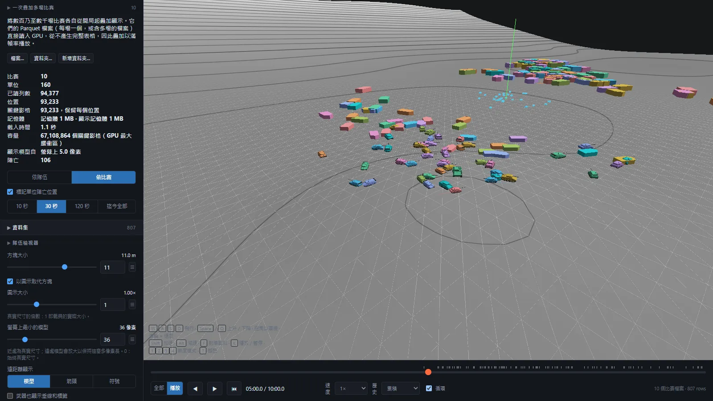

# 一次疊加多場比賽

**一次疊加多場比賽**會把許多場比賽重疊播放，讓你看到每場比賽中的玩家通常會去哪裡。用它可以在同一張圖中比較數百或數千場比賽。

每場比賽都從自己的開頭開始，其單位以模型的形式移動。檔案會直接送進顯示卡，不會建立完整的表格，因此即使一般載入會耗盡記憶體，它仍能流暢播放。

## 使用方法 {#how-to-use-it}

1. 在熱圖側邊欄中開啟**一次疊加多場比賽**。
2. 按**多個檔案…**（選取多個檔案）、**資料夾…**（一個資料夾及其子資料夾），或**新增資料夾…**（加入已載入的內容）。
3. 檢視會切換到模型疊加，並從開頭開始。按**播放**。

每個檔案是一場比賽（或包含數場）。Parquet 檔案與 [`.3dheat`](container.md) 容器皆可使用。檔案需要位置、時間與單位欄位；名稱、類型與陣營欄位會被保留。其他檔案，以及轉換器的附屬檔案（飛行、訊息、事件、聊天、目標），都會被略過。一般表格請參閱[匯入資料](getting-data-in.md)。

## 設定 {#settings}

| 設定 | 功能 |
|---|---|
| **依隊伍** / **依比賽** | 依陣營上色，或每場比賽一種顏色。 |
| **標記單位陣亡位置** | 在每個單位死亡的位置標示 10 秒、30 秒、120 秒，或直到目前為止的全部時間。 |

面板會顯示讀取了多少場比賽、單位、列與位置，使用的記憶體，以及載入時間。*可容納*是顯示卡還能再容納多少位置。*模型來自*是螢幕上的尺寸門檻，低於此尺寸的單位會以小型箭鏢代替模型繪製。

模型的外觀與[對戰重播](match-replay.md#figures)使用相同的控制項：**圖示大小**、**螢幕上最小的模型**與**遠距離顯示**。

## 小技巧 {#tips}

- 當全部資料都無法放進記憶體時，位置會被稀疏化（只保留每隔數公尺的一個位置），面板也會說明此情況。
- 熱度模式同樣適用於疊加的資料。
- 若要對數千場比賽進行統計而不實際繪製，請參閱[大量分析](mass-analysis.md)。
