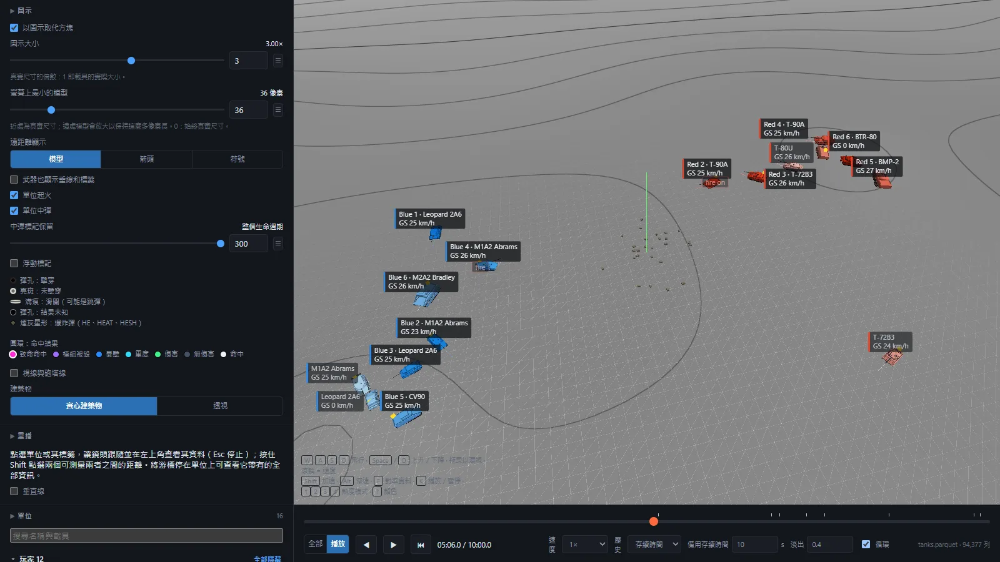
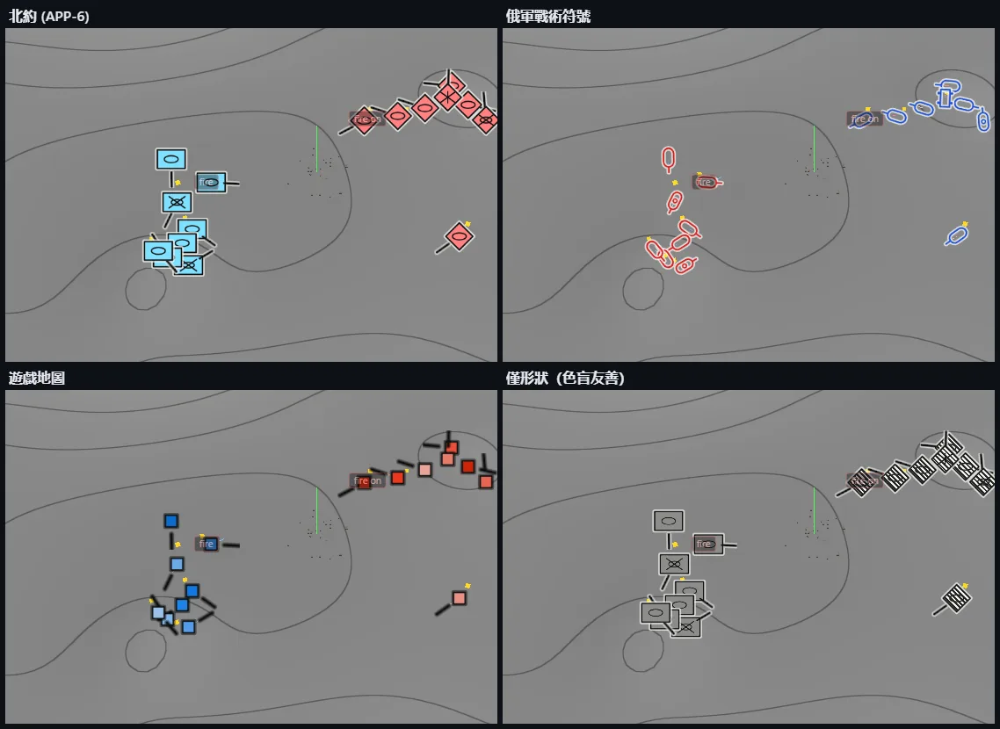
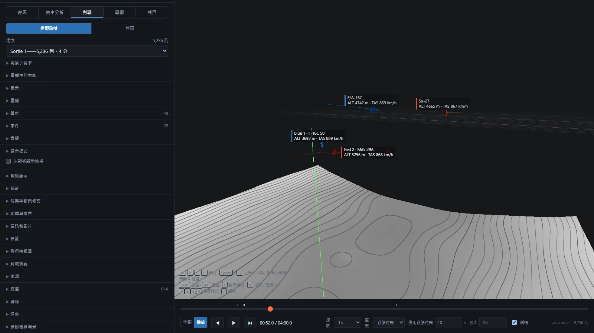

# 對戰重播

重播就像一部比賽的影片，每位玩家都以他所駕駛的東西來呈現。用它來重看一場戰鬥、追蹤某個單位，並看出誰擊中了誰。

射擊、命中、火焰與殘骸會畫在關卡上的單位與目標上。攝影機、標籤與戰術顯示可以幫助你讀懂戰鬥。你熟悉 Tacview 嗎？[Tacview 對等功能](tacview-parity.md)說明了它的每項工具在這裡的對應位置。

## 開始重播 {#start-a-replay}

1. 使用**來源 → 多個檔案…**載入錄影，或把它拖放到來源面板（任何具有**人員**與**時間**欄位的表格、Tacview 檔案、轉換後的重播、[`.3dheat`](container.md) 比賽檔）。請參閱[匯入資料](getting-data-in.md)。
2. 開啟**對戰**頁籤並選取**模型重播**，或在熱圖頁籤的模式列中選取**模型疊加**。
3. 在**重播中的對戰**下，選擇一場比賽、全部一起，或數場。
4. 在時間軸上按**播放**（或按 `K`）。拖曳時間軸即可跳轉。

對於名稱或類型為已知的每個單位，模型會取代方塊（請參閱[模型](figures.md)）。沒有名稱或類型欄位的資料，會以士兵繪製。

## 模型 {#figures}

| 設定（**圖示**區段） | 預設值 | 功能 |
|---|---|---|
| **以圖示取代方塊** | 開 | 關閉時繪製普通方塊。 |
| **圖示大小**（相對真實大小的倍數） | 1 | 1 為真實大小；0.25 到 20 倍（對數刻度）。較大的值在遠處更容易看見。 |
| **螢幕上最小的模型** | 36 px | 遠處的模型會放大，至少維持這個大小，範圍 0 到 200 px；0 則保持真實大小。 |
| **遠距離顯示**：模型、箭頭、符號 | 模型 | 遠處單位會變成什麼。 |
| **符號體系** | NATO (APP-6) | NATO (APP-6)、俄式戰術標誌、**遊戲地圖**圖示，或**僅形狀（色盲友善）**。 |
| **符號大小**、**我方**、**敵方 / 中立**、**航向標記** | 28 px（12 到 64）、自動、敵方、開 | 符號的外觀，以及哪一方為友軍。 |
| **垂直線** | 開 | 從每個單位畫一條直線到地面，使 3D 中的高度一目瞭然。 |
| **武器也顯示垂線和標籤** | 關 | 飛彈與炸彈的垂線到地面，以及其標籤。 |
| **單位起火** | 開 | 從單位著火到被撲滅為止的火焰。 |
| **單位中彈** | 開 | 標示射擊命中的位置（見下文）。**中彈標記保留**：1 到 300 秒，或**整個生命週期**。**浮動標記**：繪製在表面之上的標記。 |
| **視線與砲塔線** | 關 | 虛線：玩家看的方向；實線：砲口指向的方向。 |
| **建築物** | 實心 | 當關卡有繪製建築物時，可選實心或透明。 |

### 遠處的符號 {#symbols-at-a-distance}

當某個單位會比**螢幕上最小的模型**還小時，它可以變成一個保持清晰可讀的符號。形狀代表種類（例如裝甲車為帶有履帶標記的圓角方塊）；顏色代表陣營。開啟**符號體系**選單即可變更樣式。

### 命中標記、殘骸與火焰 {#hit-marks-wrecks-and-fires}

- **命中標記**位於射擊接觸的表面上，依模型的比例呈現。它們的外觀說明發生了什麼：一個洞（穿透）、明亮的濺射（未穿透）、一道刮痕（跳彈）、一個煙灰星形（爆炸彈）。彩色圓環表示其效果：致命一擊、模組被摧毀、致命、嚴重、傷害、無傷害、命中。將滑鼠移到標記上可看到該次射擊的名稱。
- 被摧毀的單位會從死亡到重生或被移除之前，以**焦黑**的殘骸呈現；其符號會被劃掉。
- **火焰**會從單位著火的那一刻起燃燒，直到被撲滅為止。
- **砲塔**會轉向資料所示的砲口方向（若沒有該資料，則轉向玩家看的方向）。

### 武器、誘餌與曳光彈 {#weapons-decoys-and-tracers}

開啟**武器、射擊與命中**（隊伍檢視器區段）後：飛彈、火箭、炸彈與魚雷會以各自的模型飛行，並帶有煙霧尾跡；子彈與砲彈為曳光彈；撞擊與爆炸會閃光。以**虛線**繪製的曳光彈，是根據命中推算出來的，因為資料中沒有該次射擊。照明彈與金屬箔條會以誘餌的形式繪製；除非勾選了*誘餌與砲彈*，否則它們會從單位清單中隱藏。

## 攝影機 {#cameras}

點擊某個單位或其標籤即可**跟隨**它；**重播**區段提供**追尾**、**環繞**、**駕駛艙**（帶有抬頭顯示，按 `H`）、**固定**、**鎖定視角**、**目標**與**衛星**。`V` 會依序切換它們，**鏡頭距離**設定距離遠近。按 Esc 停止。

- **雙單位視角**：選取**目標**（或按住 Ctrl/Alt 點擊某個單位），即可從被跟隨的單位去看它；**互換**會交換兩者。
- **測量**：按住 Shift 點擊兩個單位，即可取得它們之間的方位、距離與高度差。
- **2D 地圖**（`M`）：角落或全畫面檢視，附有軌跡與名稱。
- **書籤**（`B`）：儲存當下的時刻與攝影機；錄影本身的擊殺、死亡與標記也會列出。
- **事件**：依時間順序列出每個事件；點擊即可跳到該處。`Page Up` / `Page Down` 可在事件之間跳轉；**遇事件暫停**則會在每個事件處停止。

## 戰術顯示 {#tactical-display}

**戰術顯示**區段會為單位繪製：不選單位、選取的單位、全部，或某一種類（飛機、地面、艦船、武器）：速度向量與前方路徑、機頭與升力線、雷達錐、鎖定、資料鏈、交戰區與交戰線、視線、玩家看的方向（視野錐）、砲塔瞄準，以及錄影中的攝影機。

### 顯示風格 {#display-style}

`T`（或**以戰術顯示檢視**開關）會把外觀切換為雷達螢幕風格：發光、輪廓、等高線、測量格線、掃描線、距離環、高度階梯、顯示擊殺與事件的面板，以及會自行把攝影機移到事件處的**導演**。

## 目標 {#objectives}

當比賽附帶其目標時，**目標**區段會把它們畫在關卡上：佔領區（含擁有者與佔領進度）、出生點、機場、區域與轟炸目標，每一層都可以切換，並附有標籤。它們可以穿透地面看見。若載入了多種遊戲模式，**模式**會依模式篩選比賽。目標來自錄影旁的轉換器比賽檔，或 [`.3dheat`](container.md) 容器內的資料。

## 標籤與統計 {#labels-and-statistics}

- **標籤**：每種類別（**選取**、**飛機**、**地面**、**艦船**、**武器**、**AI**）各有規則：顯示與否、顯示哪些值，以及當標籤重疊時，由誰先取得空間的**優先順序**。**標籤互不重疊**會在標籤會遮住其他單位時，把它移到單位旁邊，若沒有空間則省略。**標籤大小**為 60 到 250%。**恢復為名稱、載具、高度與速度**會重設這些規則。
  - 地面單位預設顯示名稱、載具與速度。
  - 飛機預設顯示名稱、載具、高度與速度。
  - 艦船預設顯示名稱、載具、速度與航向。
  - 將滑鼠移到單位上，即可看到它的所有值。
- **統計**：依隊伍與單位列出擊殺、死亡、射擊、命中、命中率、起飛、降落、滯空時間、最高速度、高度與 G 力、距離。可匯出 CSV。
- **圖表**：單位的數值隨時間變化、兩個單位的比較，或一個數值對另一個數值。

## 一次疊加多場比賽 {#many-matches-at-once}

若要把數百或數千場比賽疊在一起，請參閱[一次疊加多場比賽](many-matches.md)。模型的細節（煙霧、火焰及其他定時效果）：[模型疊加中的模型](figure-replay.md)。Tacview 功能清單：[Tacview 對等功能](tacview-parity.md)，它是本頁的子頁面。
