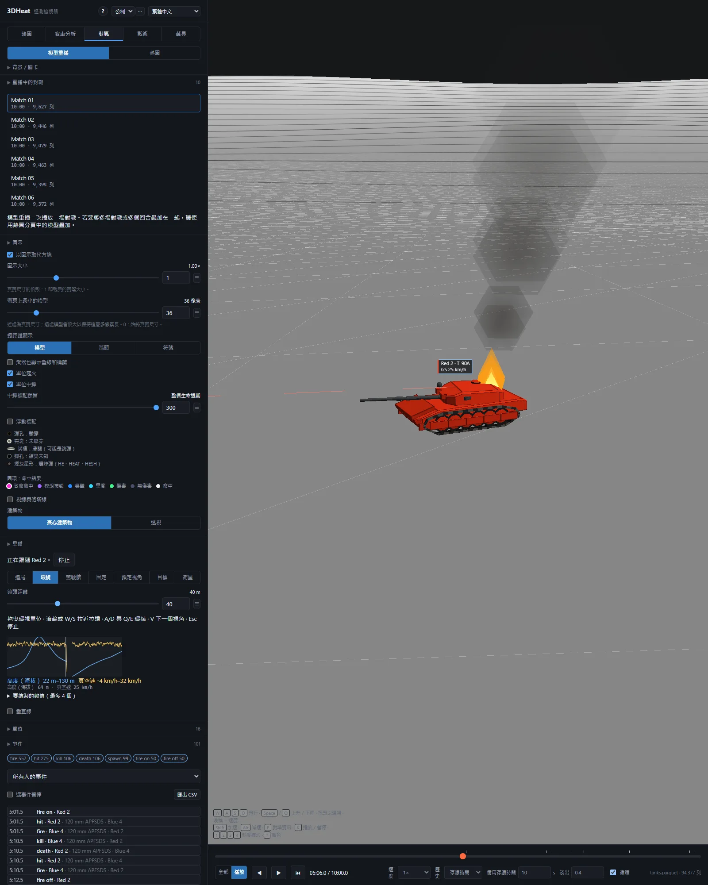
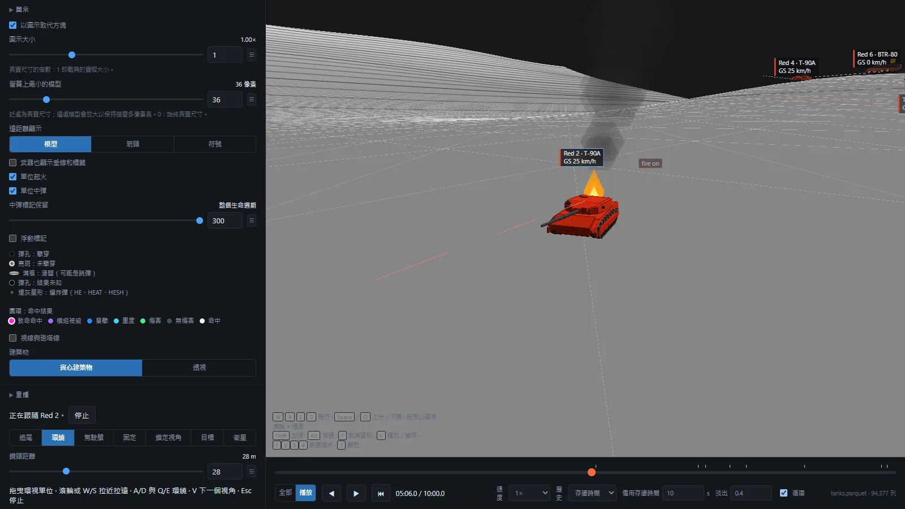
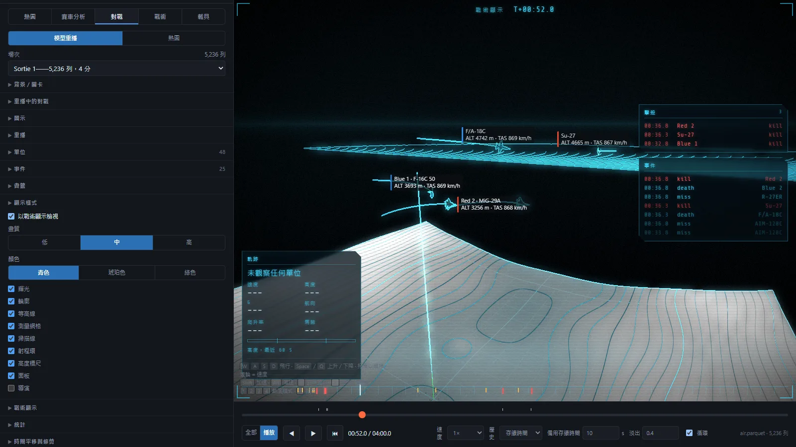

# 對戰重播

重播就像一部對戰的影片，每位玩家都以他所駕駛的載具來呈現。用它來重新觀看一場戰鬥、跟隨某一個單位，並看出誰擊中了誰。

射擊、命中、開火與損毀，會畫在關卡上的單位與目標上。鏡頭、標籤與戰術顯示能幫助你讀懂戰鬥。你熟悉 Tacview 嗎？[Tacview 對等功能](tacview-parity.md)說明了它的每個工具在這裡的對應位置。

## 開始重播 {#start-a-replay}

1. 使用**來源 → 檔案…**載入錄影，或把它拖放到來源面板上（任何具有**人員**與**時間**欄位的表格、Tacview 檔案、已轉換的重播，或 [`.3dheat`](container.md) 對戰檔案）。參見[匯入資料](getting-data-in.md)。
2. 打開**對戰**頁籤並選擇**模型重播**，或在熱度頁籤的模式列中選擇**模型疊加**。
3. 在**重播中的對戰**下，選擇一場對戰、全部同時，或多場。
4. 在時間軸上按下**播放**（或 `K`）。拖曳時間軸即可跳轉。

只要某單位的名稱或類型已知，模型就會取代方塊（見[模型](figures.md)）。沒有名稱或類型欄位的資料，會以士兵的模型繪製。

## 圖示 {#figures}

| 設定（**圖示**區段） | 預設值 | 作用 |
|---|---|---|
| **以圖示取代方塊** | 開啟 | 關閉時會繪製普通方塊。 |
| **圖示大小**（為真實大小的倍數） | 1 | 1 為真實大小；0.25 至 20 倍（對數刻度）。較大時在遠處也容易看清。 |
| **螢幕上最小的模型** | 36 px | 遠處的模型會放大，以維持此長度，0 至 200 px；0 則保持真實大小。 |
| **遠距離顯示**：圖示、箭頭、符號 | 圖示 | 遠處單位會變成什麼。 |
| **符號體系** | NATO（APP-6） | NATO（APP-6）、俄羅斯戰術標誌、**遊戲地圖**圖示，或**僅形狀（色盲友善）**。 |
| **符號大小**、**我方**、**敵對／中立**、**航向標記** | 28 px（12 至 64）、自動、敵對、開啟 | 符號的外觀，以及哪一方是友軍。 |
| **垂直線** | 開啟 | 從每個單位畫一條直線垂直落到地面，使高度在 3D 中可以讀取。 |
| **武器也顯示垂線和標籤** | 關閉 | 飛彈與炸彈的垂線及標籤。 |
| **單位起火** | 開啟 | 從單位起火到被撲滅為止的火焰。 |
| **單位中彈** | 開啟 | 標示射擊命中的位置（如下）。**中彈標記保留**：1 至 300 秒，或**整個生命週期**。**浮動標記**：繪製在表面之上的標記。 |
| **視線與砲塔線** | 關閉 | 虛線：玩家看向的方向；實線：砲管指向的方向。 |
| **建築物** | 實心 | 當關卡為建築物上色時，建築物可為實心或透視。 |

### 遠距離的符號 {#symbols-at-a-distance}

當某個單位會比**螢幕上最小的模型**還小時，它可以變成一個保持清晰可讀的符號。形狀代表種類（例如帶有履帶標記的圓角方塊代表裝甲車）；顏色代表所屬的一方。打開**符號體系**選單即可變更樣式。

### 命中標記、殘骸與火焰 {#hit-marks-wrecks-and-fires}

- **命中標記**位於射擊所接觸的表面上，依模型的比例縮放。它們的外觀顯示發生了什麼：一個洞（已穿透）、一團明亮的濺射（未穿透）、一道刮痕（跳彈）、一顆煙灰星（爆炸性彈藥）。彩色圓環顯示其效果：致命一擊、模組損毀、致命傷、嚴重、傷害、無傷害、命中。把滑鼠移到標記上即可看見該發射的名稱。
- 被摧毀的單位會以**焦黑**的殘骸呈現，從它死亡起直到重生或被移除為止；它的符號會被劃掉。
- **火焰**會從單位起火的那一刻起燃燒在它身上，直到被撲滅為止。
- **砲塔**會轉向資料所指示的砲管方向（若沒有該資料，則轉向玩家視線的方向）。

### 武器、誘餌與曳光彈 {#weapons-decoys-and-tracers}

開啟**武器、射擊與命中**（隊伍檢視器區段）時：飛彈、火箭、炸彈與魚雷會以各自的模型飛行，並帶有煙霧尾跡；子彈與砲彈則為曳光彈；撞擊與爆炸會閃光。以**虛線**繪製的曳光彈，是根據命中推算出來的，因為資料中沒有射擊紀錄。照明彈與干擾箔條會被繪製為誘餌；除非勾選了*誘餌與砲彈*，否則它們會從單位清單中隱藏。

## 鏡頭 {#cameras}

點擊單位或其標籤即可**跟隨**它；**重播**區段提供**追尾**、**環繞**、**駕駛艙**（帶有抬頭顯示器，`H`）、**固定**、**鎖定視角**、**目標**與**衛星**。`V` 會循環切換它們，**鏡頭距離**設定距離的遠近。按 Esc 即可停止。

- **雙單位視角**：選擇一個**目標**（或 Ctrl／Alt 點擊一個單位），即可從被跟隨的單位看向它；**互換**則會交換兩者。
- **測量**：Shift 點擊兩個單位，即可取得它們之間的方位、距離與高度差。
- **2D 地圖**（`M`）：角落或整個視圖，並帶有軌跡與名稱。
- **書籤**（`B`）：儲存時刻與鏡頭；錄影本身的擊殺、死亡與標記也會被列出。
- **事件**：依時間順序列出每個事件；點擊即可跳到該處。`Page Up` / `Page Down` 可在事件之間跳轉；**遇事件暫停**則會在每個事件處停下。

## 戰術顯示 {#tactical-display}

**戰術顯示**區段會為所選單位、全部單位，或某一類（飛機、地面、船艦、武器）繪製以下內容（若不選任何單位）：速度向量與前方路徑、機頭與升力線、雷達錐、鎖定、資料鏈、交戰區與交戰線、視線、玩家的注視方向（視錐）、砲塔瞄準，以及錄製的鏡頭。

### 顯示樣式 {#display-style}

`T`（或**以戰術顯示檢視**開關）會把外觀切換為雷達螢幕風格：發光、輪廓、等高線、測量格線、掃描線、距離環、高度階梯、帶有擊殺與事件的面板，以及會自行把鏡頭移到事件位置的**導演**。

## 目標 {#objectives}

當對戰附帶其目標時，**目標**區段會把它們繪製在關卡上：佔領區（含擁有者與佔領進度）、出生點、機場、區域與轟炸目標，每一層都可以開關，並附有標籤。它們會透過地面顯示出來。若載入了多種遊戲模式，**模式**會依模式篩選對戰。目標來自錄影旁邊的轉換器對戰檔案，或來自 [`.3dheat`](container.md) 容器之內。

Rainbow Six Siege 對戰會帶上它們的炸彈點：每個炸彈點的兩個房間以帶名稱的輪廓畫在各自的地板上，這些輪廓是根據遊戲顯示房間名稱時玩家所站的位置推算出來的；對戰中沒有打到的地圖炸彈點，則取自轉換器的炸彈點表，畫成一個圓。在重播中，播放頭所在回合的炸彈點以琥珀色亮起，其他保持灰色。它們屬於佔領區圖層。

## 標籤與統計 {#labels-and-statistics}

- **標籤**：依類型設定的規則（**選取**、**飛機**、**地面**、**艦船**、**武器**、**AI**）：是否顯示、顯示哪些數值，以及當標籤重疊時，誰能優先佔用空間的**優先順序**。**標籤互不重疊**會在標籤會覆蓋另一個標籤時，把它移到其單位旁邊，若沒有空間則將其省略。**標籤大小**為 60 至 250%。**恢復為名稱、載具、高度與速度**會重設這些規則。
  - 地面單位預設顯示名稱、載具與速度。
  - 飛機預設顯示名稱、載具、高度與速度。
  - 船艦預設顯示名稱、載具、速度與航向。
  - 把滑鼠移到單位上即可看到它的所有數值。
- **統計**：依隊伍與單位列出：擊殺、死亡、射擊、命中、命中率、起飛、降落、在空中的時間、最高速度、高度與 G 值、距離。可匯出 CSV。
- **圖表**：單位的數值隨時間變化、兩個單位相互比較，或一個數值對照另一個數值。

## 同時多場對戰 {#many-matches-at-once}

若要把數百或數千場對戰疊在一起，請見[同時多場對戰](many-matches.md)。模型的細節（煙霧、火焰及其他計時效果）：[模型疊加中的模型](figure-replay.md)。Tacview 功能清單：[Tacview 對等功能](tacview-parity.md)，它是本頁的子頁面。
