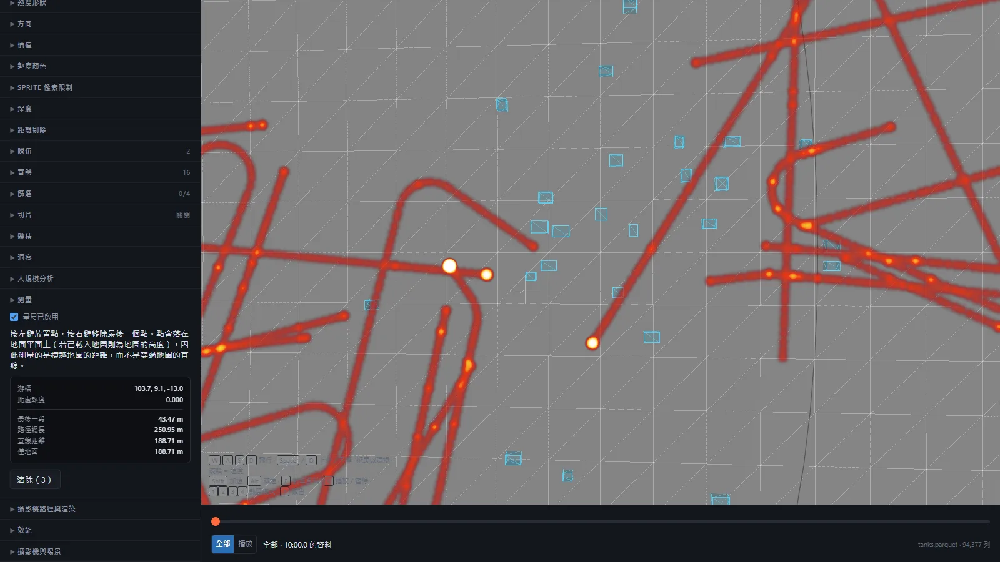

# 指標

**指標**能把滑鼠變成一把尺，並告訴你游標下方的地點有多繁忙。用它來找出兩個地點相距多遠，或某一地點有多少流量。

## 試試看 {#try-it}

1. 在側邊欄打開 **指標**，並勾選 **量尺已啟用**。
2. 在地圖上左鍵點擊三個地點。每次點擊都會放下一個點。
3. 閱讀 **路徑總長**（整條路徑的長度）與 **最後一段**（最後一段路）。
4. 右鍵點擊可移除最後一個點，或按下 **清除（3）** 移除全部。

| 動作 | 效果 |
|---|---|
| 左鍵點擊 | 在游標與地面平面相交處放下一個點。按下與放開之間移動超過 4 像素的點擊，會被視為攝影機拖曳，而不是放點。 |
| 右鍵點擊 | 移除最後一個點。 |
| 移動 | 游標位置與其下方的熱度會即時更新。 |

量尺開啟時，攝影機仍然可以操作：拖曳仍可環顧，按鍵仍可飛行。量尺開啟期間，它會接管所有點擊，因此[點擊選取](camera.md#click-to-pick)要等到它關閉後才能使用。

**地面平面**在載入[地圖圖像](map-images.md)時，是該圖像的高度；否則是資料集的最低 Y（沒有地圖圖像時為 0）。點會落在這個平面上，所以量尺是沿著地圖量，而不是沿著穿過地圖的一條線量。使用 3D 關卡時，平面仍然是資料集的最低 Y，而不是關卡的表面——若要取得真實表面上的一點，請關閉量尺並點擊它（[點擊選取](camera.md#click-to-pick)），這會直接從關卡自己的三角形讀取座標。

## 讀數 {#readouts}

| 行 | 意義 |
|---|---|
| **游標** | 平面上游標所指點的世界 X、Y、Z。 |
| **此處熱度** | 游標像素處有多少熱度。數字越大，表示該地點的流量越多。它是顏色漸層在飽和點做除法之前所接收的值，所以你可以拿它與[飽和點](colour-and-exposure.md#saturation-point)比較。 |
| **最後一段** | 從最後一個點到游標（或最後兩點之間）的距離。 |
| **路徑總長** | 穿過每個點與游標的折線長度。 |
| **直線距離** | 從第一個點到游標（或最後一個點）的 3D 距離。 |
| **僅地面** | 相同，但只計算 X 與 Z。 |
| **清除（N）** | 移除所有點。 |

距離的顯示方式：小於 1 單位時以公分、小於 1,000 時以公尺、大於時以公里為單位——假設一個世界單位是一公尺（[座標軸、單位與時間](axes-units-and-time.md#unit-scale)）。座標為世界座標，即使某個座標軸為了顯示而[反轉](camera.md#invert-world-axis)也是如此。

這些點以及它們之間的線，會以疊加的方式畫在檢視中，大小依格線間距而定。量尺的點不會被保存在視圖中；載入其他資料時它們會保留。

## 給開發者 {#for-developers}

**此處熱度** 從 GPU 讀取的頻率最多每 120 毫秒一次，因為單一像素的讀回會讓管線停頓。它使用與 `engine.readHeatProbe()` 相同的路徑：會除以該影格寫入時所用的增益，所以在半浮點累積路徑（`?heat=f16`）上，它與 32 位元目標使用相同的單位（[半精度浮點累積](half-float-accumulation.md)）。
