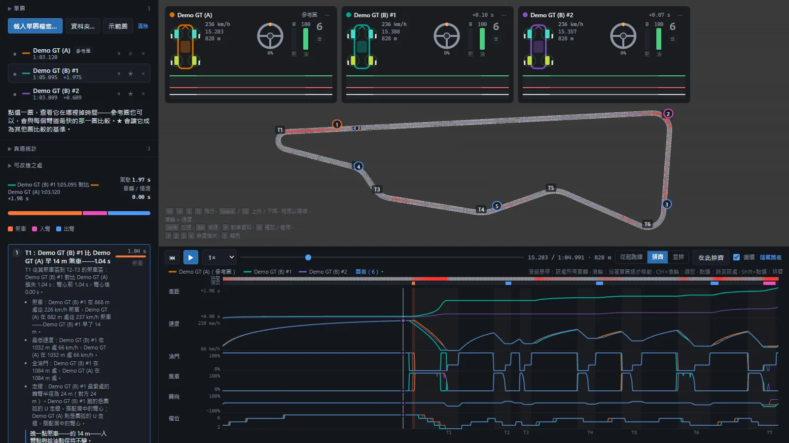

# 賽車分析

你把同一條賽道開了兩次。**賽車分析** 分頁會同時以 3D 播放兩次行駛，顯示一圈在哪裡較慢，並告訴你原因。還沒有圈嗎？按下 **示範圈**。

此分頁會比較同一條賽道的兩圈或更多圈。它與熱圖共用畫布、攝影機與已載入的賽道模型（**背景／關卡**）；其餘部分則各自獨立：自己的側欄，以及視圖下方自己的列。*圈*、*參考圈*與*頂點*等詞彙，請參閱[詞彙表](glossary.md)。

本頁是此分頁的地圖。每個部分都有自己的頁面：

| 頁面 | 涵蓋內容 |
|---|---|
| [載入圈](race-loading-laps.md) | 每一種檔案格式、資料夾與賽道、車輛名稱、示範圈、圈列表、參考圈與聚焦 |
| [重播與 3D 場景](race-replay-and-scene.md) | 播放列、三種重播模式、對齊車輛、追逐攝影機、線條、地圖、車輛、標籤、鏡像世界 |
| [圖表與 HUD](race-charts-and-hud.md) | 距離圖表、圖表選擇器、指標與縮放、車輛卡片、通道表 |
| [車輛控制事件](race-control-events.md) | 鎖死、輪胎空轉、過度轉向、打轉、轉向不足、命中、撞車、ABS／TC、手煞車、空中——每一項如何偵測，以及所有門檻 |
| [逐彎分析](race-corner-analysis.md) | 依距離對齊、彎道與分段、彎道的時間帳、每個原因與其嘗試順序、走線形狀與建議 |
| [車輛檔案與比較](race-car-profiles.md) | 每輛車能做什麼，依其圈測得；*車輛比較*；車輛在每個彎道中決定了什麼 |
| [賽道統計](race-course-statistics.md) | 同一條賽道的許多圈：每個彎道與每種類型的失誤、失誤地圖、熱度圖匯出、效能限制 |
| [賽車分析：方法](race-analytics.md) | 規則背後的研究，附來源 |
| [其他賽車遊戲](other-games.md) | 檢視器對每款遊戲的圈所做的處理：遊戲未送出時推算出的打滑與漂移、鏡像世界、額外通道 |

## 畫面 {#the-screen}

**側欄**，由上至下（各區段可收合）：

1. **單圈**——載入、列表、顯示或隱藏、參考圈、聚焦、追逐。參閱[載入圈](race-loading-laps.md)。
2. **賽道統計**——僅在載入三圈以上時出現。參閱[賽道統計](race-course-statistics.md)。
3. **可改進之處**——聚焦圈的發現，逐彎列出。參閱[逐彎分析](race-corner-analysis.md)。
4. **逐彎分析**（若有多個等級則為 *逐彎分析 - 等級 X*）——每個彎道中最快的圈及其走線。有兩圈以上時顯示。
5. **車輛控制**——聚焦圈的鎖死、滑動、推擠與命中。參閱[車輛控制事件](race-control-events.md)。
6. **車輛比較**（只有一輛車時則為 **車輛**）——參閱[車輛檔案與比較](race-car-profiles.md)。
7. **檢視**——哪一張地圖繪於賽道上，以及繪製哪些內容。參閱[重播與 3D 場景](race-replay-and-scene.md)。
8. 共用的 **關卡** 與 **攝影機與場景** 面板（賽道模型、軸反轉、攝影機）——與熱圖及[攝影機](camera.md)一同說明。

**視圖** 顯示賽道、已行駛的線條、地圖、車輛、釘在賽道上的標籤，以及左上角最多六張車輛卡片（參閱[圖表與 HUD](race-charts-and-hud.md)）。若沒有載入任何圈，會顯示：「未載入圈——請把兩個或以上的圈檔案拖放到這裡，或從側欄載入示範圈。」

**視圖下方的列** 包含重播播放列，以及（除非已隱藏）距離圖表。

## 快速開始 {#quick-start}

1. 開啟 **賽車分析** 分頁（位於側欄頂端 **熱圖** 的旁邊）。
2. 把圈載入進來。按下 **示範圈**，看看此分頁如何處理三個虛構的圈。若是你自己的圈，請先錄製它們（[檔案格式與錄製工具](race-loading-laps.md#file-formats)），然後按下 **載入單圈檔案…** 或 **資料夾…**，或把檔案或資料夾拖放到視圖上。
3. 最快的完整圈會成為參考圈；其餘圈中最慢的會被聚焦。點擊列表中的任一圈即可聚焦它；★ 會把該圈設為參考圈。
4. 閱讀 **可改進之處**。點擊某項發現：車輛會在其前 40 公尺對齊，攝影機會框住它，重播會播放經過該處的過程，並開啟量測資料。
5. 將游標移到圖表上，可把每輛車移到該公尺；Shift+點擊則在該處將它們對齊。

## 鍵盤 {#keyboard}

當賽車分頁開啟時：

| 按鍵 | 作用 |
|---|---|
| **K** | 播放／暫停重播 |
| **Home** | 回到重播的起點 |
| 數字鍵 | 無作用（在熱圖中則是切換模式） |

在文字欄位或下拉式選單中輸入的按鍵會被忽略。攝影機按鍵的運作方式與熱圖相同（**W A S D**、**空格** 上升、**Q** 下降、**Shift** 加速、**Alt** 減速，滑鼠用來環顧；全部見[攝影機](camera.md)）；**F** 會框住已載入的圈（與載入圈時相同）。

## 許多圈 {#many-laps}

- 所有已載入的圈都會被分析並計數；數十圈需要一兩秒。
- 超過 **8** 圈（`SHOW_ALL_UP_TO`）時，新加入的圈只有在它是參考圈、聚焦的圈，或聚焦圈所屬等級中的最佳圈時才會被繪製。**全部顯示** 與 **只顯示正在查看的** 可切換此設定。
- 可見車輛超過 **10** 輛（`PLAIN_PAST`）時，未被查看的圈（非聚焦、非被追趕的車，也非參考圈）會以每 6 公尺一個點的稀疏線條繪製，取代每 1.5 公尺一個點，車輛也以普通方式繪製。
- 圖表最多繪製 **8** 圈；HUD 最多顯示 **6** 張卡片。
- 賽道統計從 **3** 圈起出現。

詳情：[賽道統計](race-course-statistics.md#performance-with-many-laps)。

## 預設的檢視設定 {#default-view-settings}

| 設定 | 預設 |
|---|---|
| 地圖 | 時間地圖 |
| 已行駛的線條、車輛、輪胎與懸吊、標籤、由各圈推算的賽道 | 開 |
| 卡片上的所有數值 | 關 |
| 車輛大小 | 1× |
| 圖表 | 顯示 |
| 重播模式 | 從線條開始 |
| 重播速度 | 1× |
| 循環 | 開 |

以上設定都不會被儲存；重新載入後會從預設值開始。瀏覽器會記住的內容：語言，以及從圈檔案中學到的車輛名稱（參閱[載入圈](race-loading-laps.md#car-names)）。

## 給開發者 {#for-developers}

### 載入圈時會發生什麼 {#what-happens-when-laps-are-loaded}

每當圈的集合、參考圈或語言改變時，整個分析都會重做（[`src/race/analysis.ts`](https://github.com/Holdi601/3DHeat/blob/main/src/race/analysis.ts) 中的 `analyse`）：

1. 對於遊戲未送出的部分，會為每一圈加入推算出的通道：漂移角、由車輪速度推算的車輪滑移、是否在空中、鬆散地面、橫擺率（[`derive.ts`](https://github.com/Holdi601/3DHeat/blob/main/src/race/derive.ts)）。
2. 選出參考圈，並把每一圈投影到其路徑上，每 2 公尺重新取樣（[`align.ts`](https://github.com/Holdi601/3DHeat/blob/main/src/race/align.ts)）。
3. 從各圈推斷遊戲的世界是否為鏡像（[`handedness.ts`](https://github.com/Holdi601/3DHeat/blob/main/src/race/handedness.ts)）。
4. 在參考圈上找出彎道，並將其組合成從一個煞車區到下一個煞車區的分段（[`segments.ts`](https://github.com/Holdi601/3DHeat/blob/main/src/race/segments.ts)）。
5. 每輛車：其包絡線（每個速度下的抓地力、煞車、拉力）、其性能檔案、其輪胎曲線（[`envelope.ts`](https://github.com/Holdi601/3DHeat/blob/main/src/race/envelope.ts)、[`profile.ts`](https://github.com/Holdi601/3DHeat/blob/main/src/race/profile.ts)、[`control.ts`](https://github.com/Holdi601/3DHeat/blob/main/src/race/control.ts)）。
6. 每圈與每個分段：它做了什麼（煞車點、最慢點、全油門等），以及它所行駛的走線（[`line.ts`](https://github.com/Holdi601/3DHeat/blob/main/src/race/line.ts)）。
7. 每圈：其車輛控制事件，各自與該處所比較的圈對照。
8. 每圈與每個分段：相對於其比較圈的時間帳，以及以文字呈現的發現。
9. 每圈的時間地圖與原因地圖。

這些文字以目前的語言產生；切換語言會重新執行分析（並重新命名示範圈）。分析的失敗會以錯誤的形式顯示在 **單圈** 按鈕下方，而已載入的圈仍會保留。

### 原始檔案 {#source-files}

| 檔案 | 角色 |
|---|---|
| `src/race/adapters.ts`、`ibt.ts` | 讀取圈檔案 |
| `src/race/lap.ts`、`carNames.ts`、`synthetic.ts` | 圈的型別、命名、示範圈 |
| `src/race/derive.ts`、`handedness.ts` | 推算的通道、鏡像世界 |
| `src/race/align.ts`、`segments.ts`、`line.ts` | 距離軸、彎道、線條 |
| `src/race/analysis.ts` | 比較的彎道、原因、發現 |
| `src/race/envelope.ts`、`profile.ts` | 車輛能做什麼 |
| `src/race/control.ts`、`impacts.ts` | 車輛控制、命中與撞車 |
| `src/race/stats.ts` | 許多圈 |
| `src/race/replay.ts`、`scene.ts`、`glyph.ts`、`geometry.ts` | 重播與繪製 |
| `src/race/schema.ts`、`graphs.ts` | 通道表、圖表的列 |
| `src/ui/race/*` | 側欄、圖表、HUD、標籤 |
| `src/state/raceStore.ts` | 分頁的狀態與重播時鐘 |
