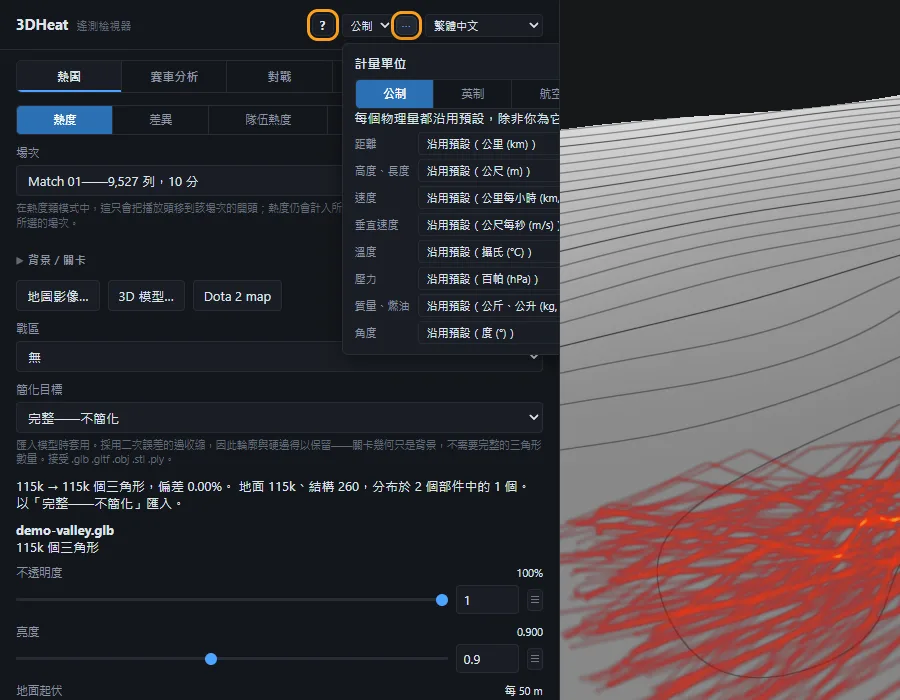
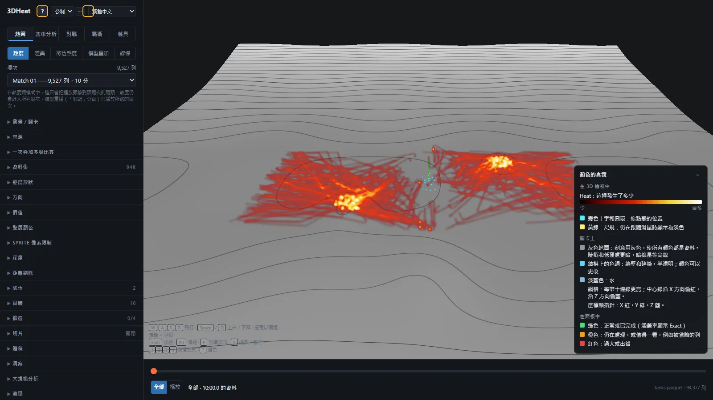
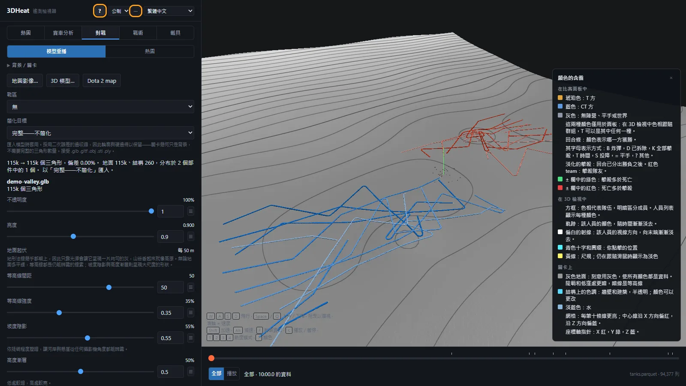

# 設定、單位與按鍵

側邊欄頂端的小型控制項會改變檢視器與你溝通的方式：語言、單位（公尺或英尺、公里每小時或節），以及說明模式（解說顏色的意義）。你的選擇會保存在瀏覽器中。

## 標題列 {#the-header}

位於側邊欄頂端：

| 控制項 | 功能 |
|---|---|
| **?** | 說明模式：說明每種顏色的意義（也可按 `?` 或 `F1`） |
| **單位**選單 | 公制、英制、航空或海里制 |
| **單位**旁的 **...** 按鈕 | 開啟「為每個數量選擇單位」：每個數量各有一個下拉式選單 |
| **語言**選單 | 檢視器的語言：[40 種語言](languages.md)，或瀏覽器的語言 |

你在方框中輸入的數字可以使用小數點或逗號（`0.35` 或 `0,35`）。檢視器兩種都能讀取，並會依檢視器語言的寫法顯示數字。

## 單位 {#units}

1. 在**單位**選單中選擇一個預設組合。所有數量會一起切換。
2. 若只想更改其中一個數量，請點擊其旁邊的 **...** 按鈕，並為該數量選擇單位。之後選單會在預設組合後面顯示 `*`。
3. 你沒有設定的數量會跟隨預設組合。選擇「依預設組合」即可恢復。

| 數量 | 公制（預設） | 英制 | 航空 | 海里制 |
|---|---|---|---|---|
| 距離 | km | mi | NM | NM |
| 高度、長度 | m | ft | ft | m |
| 速度 | km/h | mph | kt | kt |
| 垂直速度 | m/s | ft/min | ft/min | m/s |
| 溫度 | °C | °F | °C | °C |
| 氣壓 | hPa | inHg | hPa | hPa |
| 質量、燃油 | kg、l | lb、gal | lb、gal | t、m³ |
| 角度 | 度 | 度 | 度 | 度 |

你可以為單一數量選擇的其他單位：距離 km、mi、NM；速度 km/h、m/s、kt、mph；垂直速度 m/s、ft/min、m/min；溫度 °C、°F、K；氣壓 hPa、inHg、mmHg、psi；質量 kg、lb、t；角度為度或 NATO 密位（一圈為 6400）。這些單位在檢視器中處處一致：標籤、卡片、圖表與統計。

## 說明模式 {#help-mode}

按 `?` 或 `F1`，或點擊 **?** 按鈕。它會顯示*顏色的意義*：3D 檢視、熱度漸層、隊伍顏色、關卡顏色、面板狀態顏色、對戰面板與賽車檢視的圖例。直到你關閉為止都會保持開啟。在對戰頁籤中，它也會說明對戰面板的顏色。

## 瀏覽器會記住的內容 {#what-the-browser-remembers}

以下設定會在造訪之間保存在你的瀏覽器中（不會傳送到任何地方）：

- 語言、單位與說明模式；
- 重播的模型、符號、標籤、攝影機與戰術顯示設定；
- 播放速度與鏡像設定；
- 每個錄影的書籤、每個資料集的體積、目標圖層；
- 外部 AI 設定（只有在你勾選*記住*時才會保存金鑰）。

熱度設定、篩選與模式在每次載入時都會重新開始。完整的自動產生清單：[儲存的設定](ref-settings-storage.md)。

## 檢視器保留的瀏覽器按鍵 {#keys-the-viewer-keeps-from-the-browser}

載入大型資料的工作階段需要時間，因此檢視器會阻止瀏覽器意外將其丟棄：

- 在文字方塊之外，會列印、儲存、開啟、重新載入、關閉或開啟新視窗的 `Ctrl`／`Cmd` 加字母組合不會有任何作用；`F1`、`F3`、`F5`、`F6` 與 `F7` 也不會有作用。
- 在已載入資料或關卡的情況下關閉或重新載入分頁，會先詢問。
- 在全螢幕時，檢視器會鎖定它所使用的按鍵（W、T、N、S、R、P、Q、Esc），使瀏覽器無法攔截它們。

完整清單：[瀏覽器按鍵](ref-browser-keys.md)。檢視器自己所有的按鍵：[鍵盤與滑鼠參考](keyboard-reference.md)。
