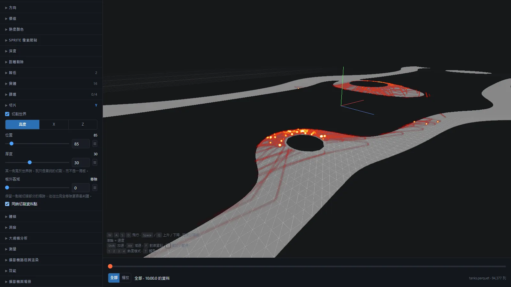

# 切片

**切片**會像切蛋糕一樣切開世界，讓你看到建築物內部。當牆壁遮住了有趣的熱度時使用它，例如只看建築物的某一層樓。

## 試試看 {#try-it}

1. 載入一個關卡與一些資料，然後打開 **切片**。
2. 勾選 **切割世界**。座標軸為 **高度**。
3. 上下拖曳 **位置**：切片板會在關卡中移動。
4. 把 **厚度** 調薄以看平面圖，或調厚以看「這個高度以下的所有東西」。
5. 把 **板外區域** 保持在 0 以移除其餘部分，或提高它以保留淡淡的痕跡。



切片板會**同時切割關卡幾何與資料點**——只切割關卡的話，熱度會飄在原本建築物所在的位置。它與[深度遮擋](depth-and-culling.md)是一組互補的功能：關卡一旦能正確地遮住它後面的東西，建築物內部也會被遮住。當有東西可以切片（資料集或 3D 關卡）時，這個面板就會顯示；開啟時其標題會顯示座標軸，關閉時則顯示 *off*。

```
側視圖            位置 = 切片板所在的位置
 ----------      厚度 = 切片板的高度
 | 第 3 層 |
 |=========|  <--- 切片板（保留）
 | 第 2 層 |  <--- 板外：移除（或淡化）
 | 第 1 層 |
 ----------
```

## 控制項 {#controls}

| 控制項 | 預設 | 意義 |
|---|---|---|
| **切割世界** | 關 | 開啟切片板。當位置仍在初始值 0、厚度仍在初始值 500 時，開啟會把它們移到座標軸的中點，並使厚度為座標軸範圍的 15%。 |
| 座標軸 | **高度** | *高度*（Y）、*X* 或 *Z*。切換座標軸會把切片板移到新座標軸的中點。 |
| **位置** | 中點 | 切片板的中心，以世界單位計，沿座標軸範圍（500 階）。 |
| **厚度** | 範圍的 15% | 從範圍的 1/500 到兩倍範圍，以對數階數變化。當它與範圍一樣寬時，會顯示 *超出世界*：此時一側會超出世界，變成單純的切割而不是切片板。 |
| **板外區域** | 0，*移除* | 板外的內容保留多少可見，0–100%。被切掉的東西留下淡淡的痕跡，通常比直接移除更容易閱讀。 |
| **同時切割資料點** | 開 | 關閉時熱度會保持完整，因此會穿過切口顯示——適合用來查看切片板上方與下方有什麼。 |

座標軸的範圍，在載入 3D 關卡時是該關卡的範圍，否則是資料集的範圍。

切片與[距離剔除](depth-and-culling.md#distance-culling)彼此獨立：後者是沿著檢視方向切割，而不是沿著世界座標軸；兩者可以組合使用。任何切片設定的變更都會重新開始熱度累積。

## 給開發者 {#for-developers}

切片板會在頂點著色器中，對每個資料列的世界位置進行測試：位於板外的資料列，其貢獻會乘上*板外區域*的值，所以當值為 0 時，它會在任何片段被繪製之前就被拒絕。關卡著色器會對地面、結構與水面的每個片段套用相同的測試。
